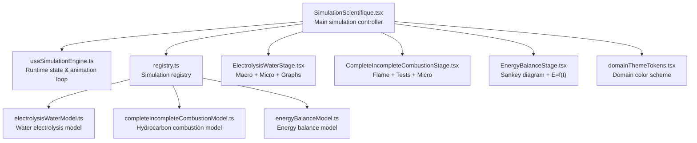
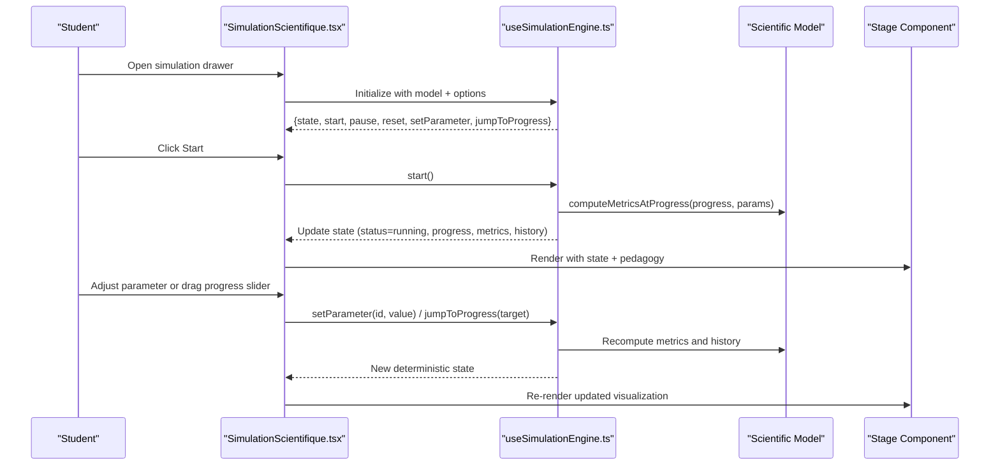
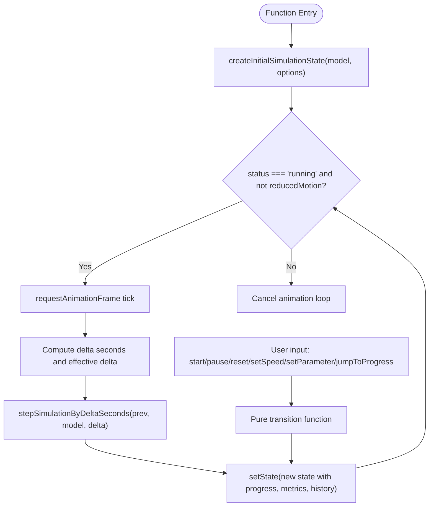
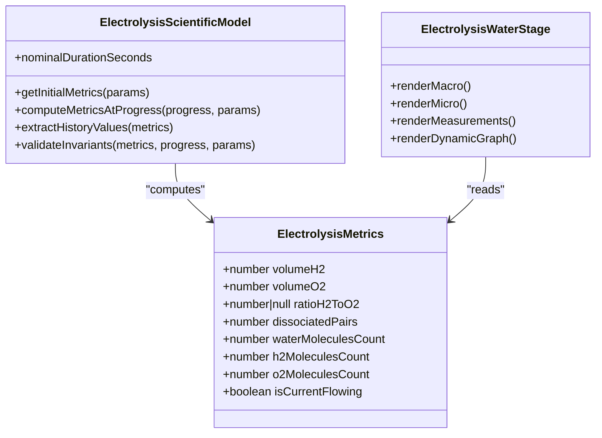
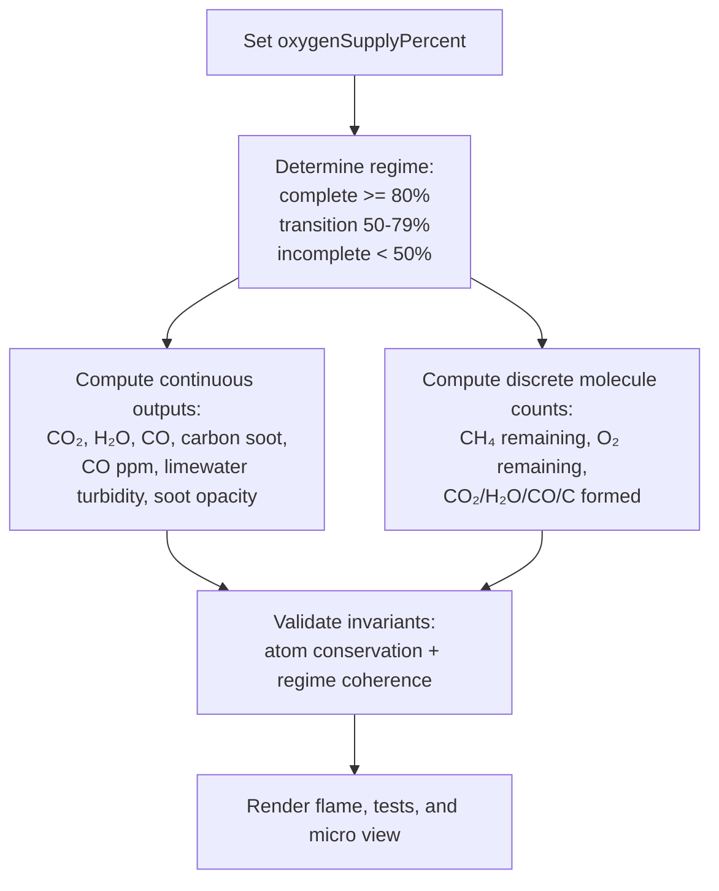
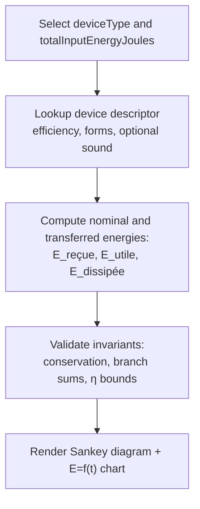
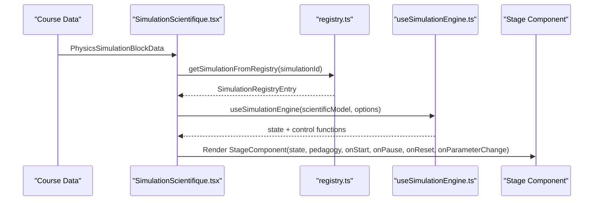
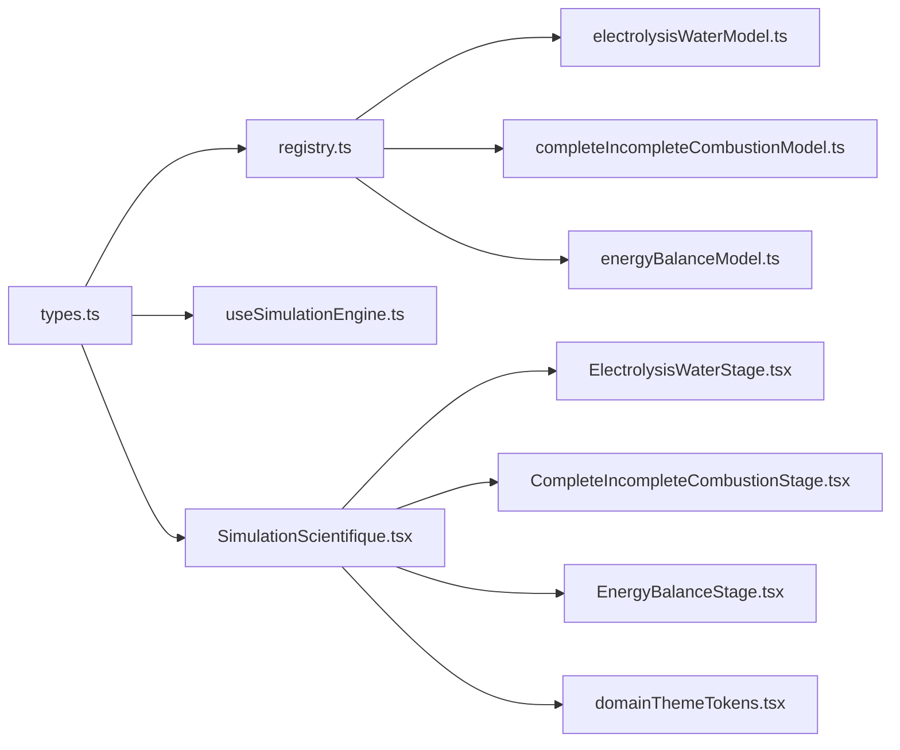

# Physics-Chemistry Module

<cite>
**Referenced Files in This Document**
- [SimulationScientifique.tsx](file://src/components/physics/simulations/SimulationScientifique.tsx)
- [useSimulationEngine.ts](file://src/components/physics/simulations/useSimulationEngine.ts)
- [types.ts](file://src/components/physics/simulations/types.ts)
- [registry.ts](file://src/components/physics/simulations/registry.ts)
- [domainThemeTokens.tsx](file://src/components/physics/domainThemeTokens.tsx)
- [electrolysisWaterModel.ts](file://src/components/physics/simulations/pilots/electrolysisWaterModel.ts)
- [ElectrolysisWaterStage.tsx](file://src/components/physics/simulations/pilots/ElectrolysisWaterStage.tsx)
- [completeIncompleteCombustionModel.ts](file://src/components/physics/simulations/pilots/completeIncompleteCombustionModel.ts)
- [CompleteIncompleteCombustionStage.tsx](file://src/components/physics/simulations/pilots/CompleteIncompleteCombustionStage.tsx)
- [energyBalanceModel.ts](file://src/components/physics/simulations/pilots/energyBalanceModel.ts)
- [EnergyBalanceStage.tsx](file://src/components/physics/simulations/pilots/EnergyBalanceStage.tsx)
</cite>

## Table of Contents
1. [Introduction](#introduction)
2. [Project Structure](#project-structure)
3. [Core Components](#core-components)
4. [Architecture Overview](#architecture-overview)
5. [Detailed Component Analysis](#detailed-component-analysis)
6. [Dependency Analysis](#dependency-analysis)
7. [Performance Considerations](#performance-considerations)
8. [Troubleshooting Guide](#troubleshooting-guide)
9. [Conclusion](#conclusion)

## Introduction
This document explains the Physics-Chemistry module as a scientific simulation framework for 3AM (third-year middle school). It covers:
- The simulation engine architecture and runtime state management.
- How domain-specific theming, interactive laboratory environments, and theoretical concepts are translated into practical simulations.
- Three concrete examples: water electrolysis, complete/incomplete combustion, and energy balance calculations.
- The relationship between simulation pilots (models + stage components), stage components, and the main simulation controller.

The system separates pedagogical content, deterministic scientific models, runtime state, and rendering so that each physical phenomenon can be modeled, visualized, and guided through a structured scientific method.

## Project Structure
The Physics-Chemistry simulation layer is organized around a generic framework plus pilot implementations:
- Framework types define the contract between pedagogy, scientific models, runtime state, and stage rendering.
- A registry maps simulation identifiers to their pedagogy, model, and stage component.
- A React hook manages animation, parameters, progress, and accessibility.
- A top-level controller composes UI controls, parameter panels, representation modes, and the stage component.
- Pilot modules implement specific phenomena with pure models and SVG-based stages.

**Diagram sources**
- [SimulationScientifique.tsx:138-170](file://src/components/physics/simulations/SimulationScientifique.tsx#L138-L170)
- [useSimulationEngine.ts:309-479](file://src/components/physics/simulations/useSimulationEngine.ts#L309-L479)
- [registry.ts:42-80](file://src/components/physics/simulations/registry.ts#L42-L80)
- [electrolysisWaterModel.ts:35-116](file://src/components/physics/simulations/pilots/electrolysisWaterModel.ts#L35-L116)
- [completeIncompleteCombustionModel.ts:127-347](file://src/components/physics/simulations/pilots/completeIncompleteCombustionModel.ts#L127-L347)
- [energyBalanceModel.ts:192-315](file://src/components/physics/simulations/pilots/energyBalanceModel.ts#L192-L315)
- [ElectrolysisWaterStage.tsx:67-131](file://src/components/physics/simulations/pilots/ElectrolysisWaterStage.tsx#L67-L131)
- [CompleteIncompleteCombustionStage.tsx:109-170](file://src/components/physics/simulations/pilots/CompleteIncompleteCombustionStage.tsx#L109-L170)
- [EnergyBalanceStage.tsx:15-81](file://src/components/physics/simulations/pilots/EnergyBalanceStage.tsx#L15-L81)
- [domainThemeTokens.tsx:17-57](file://src/components/physics/domainThemeTokens.tsx#L17-L57)

**Section sources**
- [types.ts:3-15](file://src/components/physics/simulations/types.ts#L3-L15)
- [registry.ts:32-41](file://src/components/physics/simulations/registry.ts#L32-L41)

## Core Components
The framework defines a strict separation of responsibilities:
- Pedagogical content declares titles, objectives, observations, guided questions, conclusions, fallback data, and supported representations.
- Scientific models are pure, deterministic functions computing metrics at normalized progress values and validating invariants.
- Runtime state tracks status, progress, speed, representation mode, interaction mode, reduced motion, parameters, metrics, and history.
- Stage components render macroscopic experiments, microscopic particle views, real-time measurements, and dynamic graphs.
- The registry centralizes simulation entries and provides lookup helpers.
- The theme tokens provide domain-specific colors, gradients, icons, and labels.

Key type contracts include:
- `SimulationPedagogicalContent` for declarative teaching structure.
- `SimulationScientificModel<TMetrics, TParams>` for pure computation.
- `SimulationRuntimeState<TMetrics, TParams>` for live state.
- `SimulationStageProps<TMetrics, TParams>` for rendering props.
- `SimulationRegistryEntry` for registration.

**Section sources**
- [types.ts:118-146](file://src/components/physics/simulations/types.ts#L118-L146)
- [types.ts:203-235](file://src/components/physics/simulations/types.ts#L203-L235)
- [types.ts:237-260](file://src/components/physics/simulations/types.ts#L237-L260)
- [types.ts:262-275](file://src/components/physics/simulations/types.ts#L262-L275)
- [types.ts:277-289](file://src/components/physics/simulations/types.ts#L277-L289)

## Architecture Overview
The simulation lifecycle flows from the controller to the engine hook, then to the model and stage:

**Diagram sources**
- [SimulationScientifique.tsx:138-170](file://src/components/physics/simulations/SimulationScientifique.tsx#L138-L170)
- [useSimulationEngine.ts:309-479](file://src/components/physics/simulations/useSimulationEngine.ts#L309-L479)
- [types.ts:237-260](file://src/components/physics/simulations/types.ts#L237-L260)

## Detailed Component Analysis

### Simulation Engine and Runtime State Management
The engine hook encapsulates:
- Deterministic initial state creation.
- Pure state transitions for start, pause, reset, speed change, parameter update, and progress jumping.
- An animation loop using `requestAnimationFrame`, clamped by nominal duration and speed.
- Reduced motion support via system preference and manual toggle.
- Visibility detection to pause when off-screen.
- History building for dynamic charts.

**Diagram sources**
- [useSimulationEngine.ts:100-128](file://src/components/physics/simulations/useSimulationEngine.ts#L100-L128)
- [useSimulationEngine.ts:133-165](file://src/components/physics/simulations/useSimulationEngine.ts#L133-L165)
- [useSimulationEngine.ts:254-302](file://src/components/physics/simulations/useSimulationEngine.ts#L254-L302)
- [useSimulationEngine.ts:375-405](file://src/components/physics/simulations/useSimulationEngine.ts#L375-L405)

**Section sources**
- [useSimulationEngine.ts:22-55](file://src/components/physics/simulations/useSimulationEngine.ts#L22-L55)
- [useSimulationEngine.ts:309-479](file://src/components/physics/simulations/useSimulationEngine.ts#L309-L479)

### Water Electrolysis Simulation
The water electrolysis pilot demonstrates:
- Macroscopic view: apparatus with two inverted tubes collecting H₂ and O₂, animated bubbles, and a DC generator.
- Microscopic view: simplified molecular rearrangement showing conservation of atoms.
- Real-time measurements: volumes of H₂ and O₂ and the fixed volume ratio V(H₂) : V(O₂) = 2 : 1.
- Dynamic graph: Volume vs Time showing proportional growth with slope H₂ = 2 × slope O₂.

The model enforces:
- Deterministic volume calculation ensuring V(H₂) = 2 × V(O₂).
- Simplified microscale counting of dissociated pairs and remaining/reacted molecules.
- Invariant validation for atom conservation and exact volume ratio.

**Diagram sources**
- [electrolysisWaterModel.ts:7-24](file://src/components/physics/simulations/pilots/electrolysisWaterModel.ts#L7-L24)
- [electrolysisWaterModel.ts:35-116](file://src/components/physics/simulations/pilots/electrolysisWaterModel.ts#L35-L116)
- [ElectrolysisWaterStage.tsx:67-131](file://src/components/physics/simulations/pilots/ElectrolysisWaterStage.tsx#L67-L131)

Concrete implementation highlights:
- Volume relation enforced deterministically to avoid rounding drift.
- Microscale model uses discrete steps to illustrate atomic rearrangement while preserving total H and O counts.
- Stage renders patterns and markers for accessibility beyond color alone.

**Section sources**
- [electrolysisWaterModel.ts:51-81](file://src/components/physics/simulations/pilots/electrolysisWaterModel.ts#L51-L81)
- [electrolysisWaterModel.ts:90-116](file://src/components/physics/simulations/pilots/electrolysisWaterModel.ts#L90-L116)
- [ElectrolysisWaterStage.tsx:131-494](file://src/components/physics/simulations/pilots/ElectrolysisWaterStage.tsx#L131-L494)
- [ElectrolysisWaterStage.tsx:497-599](file://src/components/physics/simulations/pilots/ElectrolysisWaterStage.tsx#L497-L599)
- [ElectrolysisWaterStage.tsx:602-800](file://src/components/physics/simulations/pilots/ElectrolysisWaterStage.tsx#L602-L800)

### Complete and Incomplete Hydrocarbon Combustion
The combustion pilot models how oxygen availability determines reaction products:
- Macroscopic view: Bunsen burner, flame color changes, test results for H₂O (anhydrous CuSO₄ turns blue), CO₂ (limewater turbidity), CO detector ppm, and soot deposition.
- Microscopic view: discrete molecule rearrangements conserving C, H, and O across regimes.
- Parameters: oxygen supply percentage with presets for complete, transition, and incomplete combustion.

The model computes:
- Continuous macroscopic quantities proportional to progress.
- Discrete microscale molecule counts per regime and stage thresholds.
- Safety-relevant outputs such as CO ppm and soot deposit opacity.

**Diagram sources**
- [completeIncompleteCombustionModel.ts:50-78](file://src/components/physics/simulations/pilots/completeIncompleteCombustionModel.ts#L50-L78)
- [completeIncompleteCombustionModel.ts:83-89](file://src/components/physics/simulations/pilots/completeIncompleteCombustionModel.ts#L83-L89)
- [completeIncompleteCombustionModel.ts:166-291](file://src/components/physics/simulations/pilots/completeIncompleteCombustionModel.ts#L166-L291)
- [completeIncompleteCombustionModel.ts:300-347](file://src/components/physics/simulations/pilots/completeIncompleteCombustionModel.ts#L300-L347)

**Section sources**
- [completeIncompleteCombustionModel.ts:127-164](file://src/components/physics/simulations/pilots/completeIncompleteCombustionModel.ts#L127-L164)
- [completeIncompleteCombustionModel.ts:166-291](file://src/components/physics/simulations/pilots/completeIncompleteCombustionModel.ts#L166-L291)
- [CompleteIncompleteCombustionStage.tsx:109-170](file://src/components/physics/simulations/pilots/CompleteIncompleteCombustionStage.tsx#L109-L170)
- [CompleteIncompleteCombustionStage.tsx:170-673](file://src/components/physics/simulations/pilots/CompleteIncompleteCombustionStage.tsx#L170-L673)
- [CompleteIncompleteCombustionStage.tsx:676-800](file://src/components/physics/simulations/pilots/CompleteIncompleteCombustionStage.tsx#L676-L800)

### Energy Balance Calculations
The energy balance pilot illustrates quantitative energy accounting:
- Sankey-style diagram showing E_reçue splitting into E_utile and E_dissipée.
- Device descriptors for lamp, motor, heater, and fan with efficiency percentages and optional sound branch.
- Cumulative energy chart E = f(t) verifying conservation at every instant.

The model ensures:
- Nominal and transferred energy satisfy E_reçue = E_utile + E_dissipated.
- Dissipated branches sum correctly (thermal + sound = total dissipated).
- Efficiency η is consistent with useful/input ratios and bounded between 0% and 100%.

**Diagram sources**
- [energyBalanceModel.ts:30-81](file://src/components/physics/simulations/pilots/energyBalanceModel.ts#L30-L81)
- [energyBalanceModel.ts:112-177](file://src/components/physics/simulations/pilots/energyBalanceModel.ts#L112-L177)
- [energyBalanceModel.ts:210-266](file://src/components/physics/simulations/pilots/energyBalanceModel.ts#L210-L266)
- [energyBalanceModel.ts:268-315](file://src/components/physics/simulations/pilots/energyBalanceModel.ts#L268-L315)

**Section sources**
- [energyBalanceModel.ts:192-266](file://src/components/physics/simulations/pilots/energyBalanceModel.ts#L192-L266)
- [EnergyBalanceStage.tsx:15-81](file://src/components/physics/simulations/pilots/EnergyBalanceStage.tsx#L15-L81)
- [EnergyBalanceStage.tsx:82-484](file://src/components/physics/simulations/pilots/EnergyBalanceStage.tsx#L82-L484)
- [EnergyBalanceStage.tsx:486-783](file://src/components/physics/simulations/pilots/EnergyBalanceStage.tsx#L486-L783)

### Main Simulation Controller and Interaction Modes
The main controller:
- Resolves the registry entry by simulation ID.
- Initializes the engine with default representation and interaction mode.
- Provides a collapsible drawer UI for opening/closing the simulation.
- Renders parameter panels, scientific step banner, controls (play/pause/reset, speed, reduced motion), and a progress slider.
- Switches between exploration mode and guided observation mode.
- Displays dynamic observations based on current progress.
- Wraps the stage component with state, pedagogy, and control callbacks.

**Diagram sources**
- [SimulationScientifique.tsx:138-170](file://src/components/physics/simulations/SimulationScientifique.tsx#L138-L170)
- [registry.ts:95-102](file://src/components/physics/simulations/registry.ts#L95-L102)

**Section sources**
- [SimulationScientifique.tsx:138-170](file://src/components/physics/simulations/SimulationScientifique.tsx#L138-L170)
- [SimulationScientifique.tsx:247-311](file://src/components/physics/simulations/SimulationScientifique.tsx#L247-L311)
- [SimulationScientifique.tsx:316-426](file://src/components/physics/simulations/SimulationScientifique.tsx#L316-L426)
- [SimulationScientifique.tsx:431-579](file://src/components/physics/simulations/SimulationScientifique.tsx#L431-L579)
- [SimulationScientifique.tsx:581-717](file://src/components/physics/simulations/SimulationScientifique.tsx#L581-L717)
- [SimulationScientifique.tsx:719-800](file://src/components/physics/simulations/SimulationScientifique.tsx#L719-L800)

### Domain-Specific Theming System
The theming system provides:
- Domain tokens including primary, secondary, highlight, soft background/border, dark text, gradients, icons, labels, presentation bullets, and key units/symbols.
- Context provider and hook for consuming theme values.
- SVG domain patterns for visual identity.

Physics-Chemistry simulations use the theme to:
- Color active buttons, sliders, badges, and borders consistently.
- Reflect domain identity (matter, energy, electricity, optics) in headers and cards.
- Ensure accessible contrast and consistent visual language across labs.

**Section sources**
- [domainThemeTokens.tsx:17-57](file://src/components/physics/domainThemeTokens.tsx#L17-L57)
- [domainThemeTokens.tsx:59-295](file://src/components/physics/domainThemeTokens.tsx#L59-L295)
- [domainThemeTokens.tsx:410-423](file://src/components/physics/domainThemeTokens.tsx#L410-L423)

## Dependency Analysis
The following diagram shows core dependencies among framework files and pilot modules:

**Diagram sources**
- [types.ts:3-15](file://src/components/physics/simulations/types.ts#L3-L15)
- [registry.ts:1-30](file://src/components/physics/simulations/registry.ts#L1-L30)
- [SimulationScientifique.tsx:1-14](file://src/components/physics/simulations/SimulationScientifique.tsx#L1-L14)

**Section sources**
- [registry.ts:42-80](file://src/components/physics/simulations/registry.ts#L42-L80)

## Performance Considerations
- Deterministic models ensure reproducible metrics without side effects, enabling fast recomputation on parameter changes.
- The animation loop uses `requestAnimationFrame` and cancels when paused, off-screen, or reduced motion is enabled.
- History points are sampled up to a maximum number of steps to keep charts responsive.
- SVG rendering avoids heavy libraries; animations are lightweight transforms and opacity changes.
- IntersectionObserver pauses running simulations when not visible, reducing unnecessary computation.

[No sources needed since this section provides general guidance]

## Troubleshooting Guide
Common issues and resolutions:
- Simulation fallback view appears if the requested simulation identifier is not implemented or initialization fails. Check the registry mapping and ensure the simulation ID matches a registered entry.
- If the animation does not start, verify that reduced motion is not forced by system preferences and that the container is visible.
- Parameter changes should immediately recompute metrics and history; if not, confirm that the parameter ID exists in the model’s parameter definitions and that the value is within min/max bounds.
- For energy balance, invariant checks enforce conservation; if they fail, review device descriptor selection and input energy range.

**Section sources**
- [SimulationScientifique.tsx:45-108](file://src/components/physics/simulations/SimulationScientifique.tsx#L45-L108)
- [useSimulationEngine.ts:333-351](file://src/components/physics/simulations/useSimulationEngine.ts#L333-L351)
- [useSimulationEngine.ts:353-373](file://src/components/physics/simulations/useSimulationEngine.ts#L353-L373)
- [energyBalanceModel.ts:268-306](file://src/components/physics/simulations/pilots/energyBalanceModel.ts#L268-L306)

## Conclusion
The Physics-Chemistry module implements a robust, extensible simulation framework tailored for 3AM curricula. By separating pedagogy, deterministic science, runtime state, and rendering, it supports rich interactive laboratories for water electrolysis, hydrocarbon combustion, and energy balance. The registry-driven architecture allows new simulations to be added cleanly, while the engine guarantees reproducibility, performance, and accessibility. Domain theming ties the visual experience to the underlying scientific context, helping students connect theory with practice.