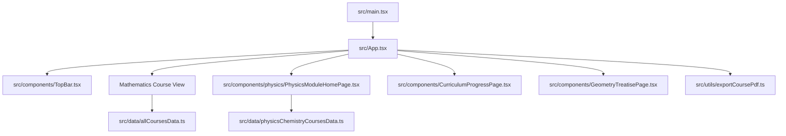
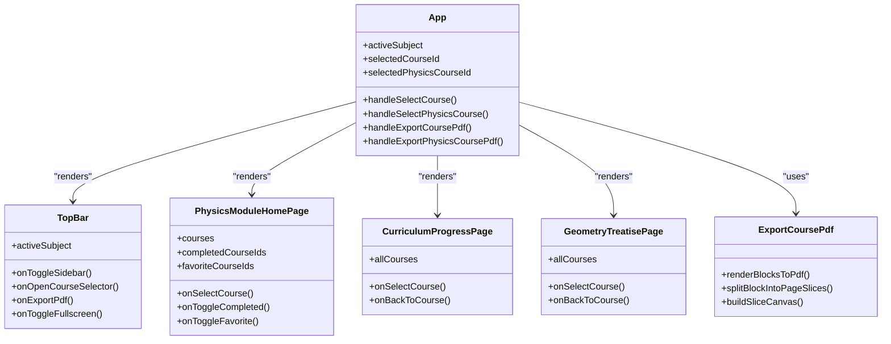
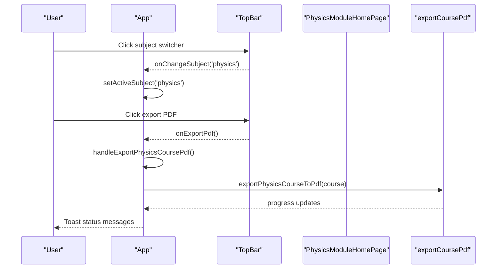
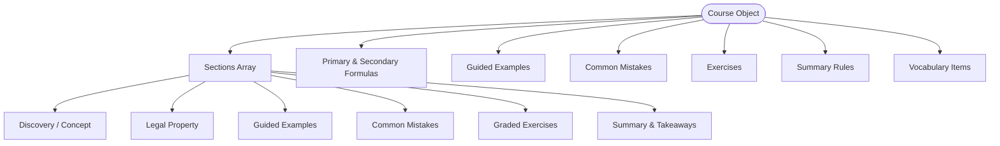
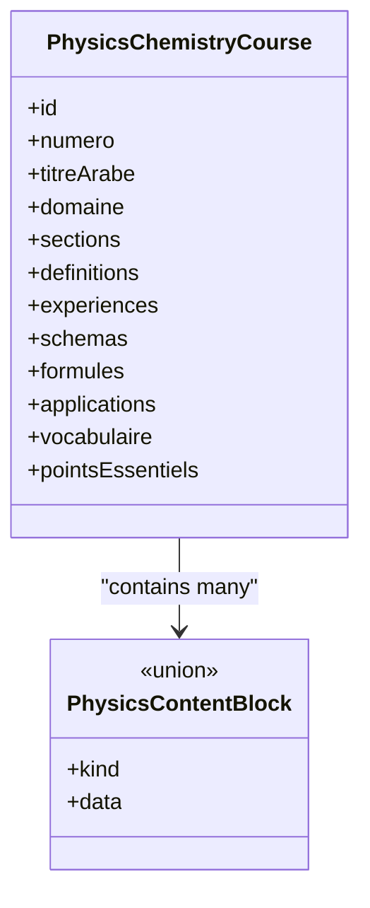
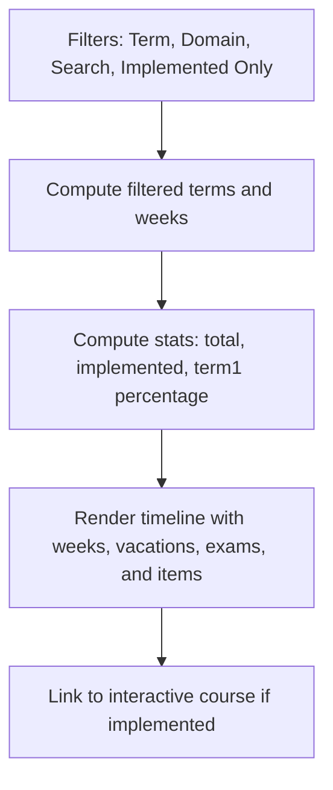
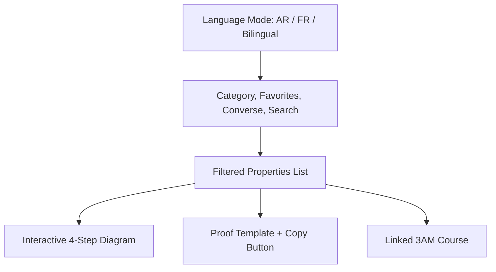
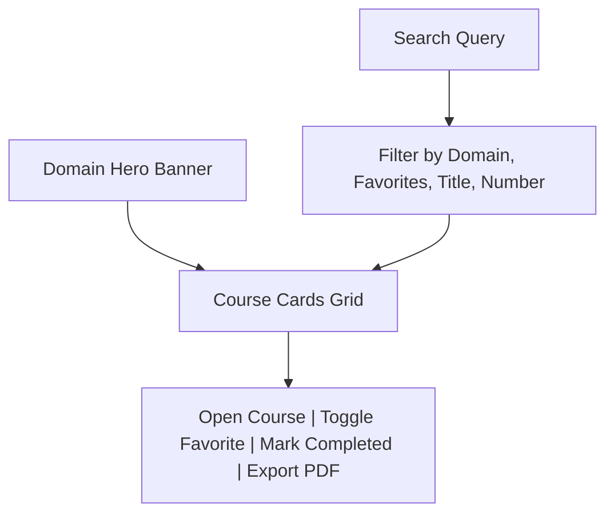
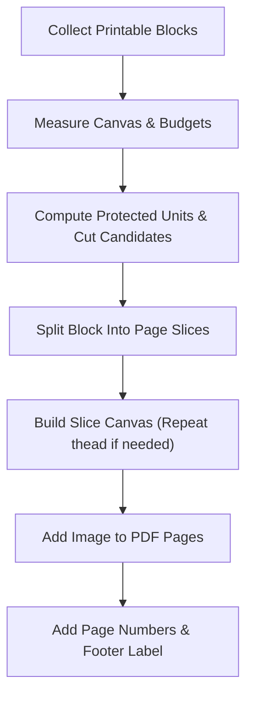
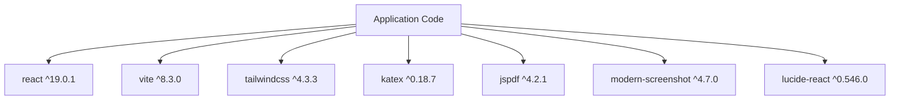

# Project Overview

<cite>
**Referenced Files in This Document**
- [package.json](file://package.json)
- [vite.config.ts](file://vite.config.ts)
- [src/main.tsx](file://src/main.tsx)
- [src/App.tsx](file://src/App.tsx)
- [src/types.ts](file://src/types.ts)
- [src/typesPhysicsChemistry.ts](file://src/typesPhysicsChemistry.ts)
- [src/data/allCoursesData.ts](file://src/data/allCoursesData.ts)
- [src/data/physicsChemistryCoursesData.ts](file://src/data/physicsChemistryCoursesData.ts)
- [src/components/TopBar.tsx](file://src/components/TopBar.tsx)
- [src/components/CurriculumProgressPage.tsx](file://src/components/CurriculumProgressPage.tsx)
- [src/components/GeometryTreatisePage.tsx](file://src/components/GeometryTreatisePage.tsx)
- [src/components/physics/PhysicsModuleHomePage.tsx](file://src/components/physics/PhysicsModuleHomePage.tsx)
- [src/utils/exportCoursePdf.ts](file://src/utils/exportCoursePdf.ts)
</cite>

## Table of Contents
1. [Introduction](#introduction)
2. [Project Structure](#project-structure)
3. [Core Components](#core-components)
4. [Architecture Overview](#architecture-overview)
5. [Detailed Component Analysis](#detailed-component-analysis)
6. [Dependency Analysis](#dependency-analysis)
7. [Performance Considerations](#performance-considerations)
8. [Troubleshooting Guide](#troubleshooting-guide)
9. [Conclusion](#conclusion)
10. [Appendices](#appendices)

## Introduction
Cours 3AM is an interactive educational platform for Algerian middle school students at the 3ème année moyenne level. It covers two official subjects: Mathematics and Physics-Chemistry. The platform transforms traditional textbook content into engaging, interactive learning experiences by combining structured lessons, discovery activities, guided examples, common-mistake alerts, exercises, summaries, vocabulary, and visual models. For Physics-Chemistry, it adds domain-based organization, trilingual terminology, scientific schemas, experiments, simulations, and curriculum-aligned progress tracking.

Key characteristics:
- Target audience: Algerian middle school students (3AM).
- Subjects: Mathematics and Physics-Chemistry.
- Pedagogy: Discovery-driven sections, step-by-step guided examples, common mistakes, graded exercises, summaries, vocabulary, and mindmaps.
- Multilingual support: Arabic, French, and English where available; strong RTL layout for Arabic.
- Curriculum alignment: Official Algerian curriculum structure for both subjects, with a dedicated annual progression view for Mathematics and domain-based organization for Physics-Chemistry.
- Interactive features: Visual math models, geometry treatise diagrams, physics simulation registry, and PDF export.

## Project Structure
The project is a modern React application built with TypeScript, Vite, Tailwind CSS, KaTeX for mathematical rendering, and jsPDF for PDF export. The main entry point renders the root App component, which routes between Mathematics and Physics-Chemistry modules.

**Diagram sources**
- [src/main.tsx:1-12](file://src/main.tsx#L1-L12)
- [src/App.tsx:1-436](file://src/App.tsx#L1-L436)
- [src/components/TopBar.tsx:1-386](file://src/components/TopBar.tsx#L1-L386)
- [src/components/physics/PhysicsModuleHomePage.tsx:1-764](file://src/components/physics/PhysicsModuleHomePage.tsx#L1-L764)
- [src/components/CurriculumProgressPage.tsx:1-503](file://src/components/CurriculumProgressPage.tsx#L1-L503)
- [src/components/GeometryTreatisePage.tsx:1-771](file://src/components/GeometryTreatisePage.tsx#L1-L771)
- [src/utils/exportCoursePdf.ts:1-800](file://src/utils/exportCoursePdf.ts#L1-L800)
- [src/data/allCoursesData.ts:1-800](file://src/data/allCoursesData.ts#L1-L800)
- [src/data/physicsChemistryCoursesData.ts:1-800](file://src/data/physicsChemistryCoursesData.ts#L1-L800)

**Section sources**
- [src/main.tsx:1-12](file://src/main.tsx#L1-L12)
- [src/App.tsx:1-436](file://src/App.tsx#L1-L436)
- [package.json:1-42](file://package.json#L1-L42)
- [vite.config.ts:1-23](file://vite.config.ts#L1-L23)

## Core Components
This section explains the primary building blocks that power the platform’s user experience and data flow.

- Application shell and routing:
  - The root component manages subject switching between Mathematics and Physics-Chemistry, course selection, view modes (course, curriculum, geometry treatise), fullscreen mode, and PDF export state.
  - It also tracks Physics-Chemistry completion and favorites using localStorage.

- Top navigation and module switcher:
  - The top bar provides subject switching, current course identification, quick lesson navigation, PDF export buttons, fullscreen toggle, and module-specific actions.

- Mathematics data model:
  - Courses are defined as structured objects containing objectives, sections, formulas, guided examples, common mistakes, exercises, summaries, key takeaways, mindmaps, and vocabulary.

- Physics-Chemistry data model:
  - Courses are organized by domains (matter, energy, electricity, optics) and include definitions, observations, experiments, explanations, schemas, tables, formulas, examples, activities, applications, vocabulary, essential points, and optional simulations.

- Curriculum and geometry tools:
  - A curriculum progression page maps official yearly planning to implemented courses.
  - A geometry treatise page organizes 69 properties with bilingual statements, interactive diagrams, proof templates, and copy-to-clipboard functionality.

- PDF export utility:
  - A robust pagination engine captures DOM blocks, slices them along protected boundaries, repeats table headers across pages, and generates A4 PDFs with consistent margins and footer labels.

**Section sources**
- [src/App.tsx:23-436](file://src/App.tsx#L23-L436)
- [src/components/TopBar.tsx:20-386](file://src/components/TopBar.tsx#L20-L386)
- [src/types.ts:1-147](file://src/types.ts#L1-L147)
- [src/typesPhysicsChemistry.ts:1-397](file://src/typesPhysicsChemistry.ts#L1-L397)
- [src/components/CurriculumProgressPage.tsx:23-503](file://src/components/CurriculumProgressPage.tsx#L23-L503)
- [src/components/GeometryTreatisePage.tsx:28-771](file://src/components/GeometryTreatisePage.tsx#L28-L771)
- [src/utils/exportCoursePdf.ts:1-800](file://src/utils/exportCoursePdf.ts#L1-L800)

## Architecture Overview
The platform follows a component-driven architecture with clear separation between UI components, data models, and utilities.

**Diagram sources**
- [src/App.tsx:1-436](file://src/App.tsx#L1-L436)
- [src/components/TopBar.tsx:1-386](file://src/components/TopBar.tsx#L1-L386)
- [src/components/physics/PhysicsModuleHomePage.tsx:1-764](file://src/components/physics/PhysicsModuleHomePage.tsx#L1-L764)
- [src/components/CurriculumProgressPage.tsx:1-503](file://src/components/CurriculumProgressPage.tsx#L1-L503)
- [src/components/GeometryTreatisePage.tsx:1-771](file://src/components/GeometryTreatisePage.tsx#L1-L771)
- [src/utils/exportCoursePdf.ts:1-800](file://src/utils/exportCoursePdf.ts#L1-L800)

## Detailed Component Analysis

### Application Shell and Subject Routing
The application shell coordinates:
- Active subject selection (Mathematics vs Physics-Chemistry).
- Course selection and section navigation for Mathematics.
- Physics-Chemistry home and course views.
- Curriculum and geometry treatise views.
- Fullscreen mode and PDF export workflows.

**Diagram sources**
- [src/App.tsx:116-195](file://src/App.tsx#L116-L195)
- [src/components/TopBar.tsx:192-294](file://src/components/TopBar.tsx#L192-L294)
- [src/utils/exportCoursePdf.ts:511-800](file://src/utils/exportCoursePdf.ts#L511-L800)

**Section sources**
- [src/App.tsx:23-436](file://src/App.tsx#L23-L436)
- [src/components/TopBar.tsx:47-386](file://src/components/TopBar.tsx#L47-L386)

### Mathematics Data Model and Lesson Structure
Each Mathematics course includes:
- Identification fields (id, number, titles).
- Pedagogical sections (concept, property, guided examples, common mistakes, exercises, summary).
- Primary and secondary formulas with conditions and notes.
- Guided examples with step-by-step math.
- Common mistakes with explanations and corrections.
- Exercises with difficulty levels, hints, solution steps, and final answers.
- Summary rules, key takeaways, mindmaps, and vocabulary.

**Diagram sources**
- [src/types.ts:70-147](file://src/types.ts#L70-L147)
- [src/data/allCoursesData.ts:1-800](file://src/data/allCoursesData.ts#L1-L800)

**Section sources**
- [src/types.ts:1-147](file://src/types.ts#L1-L147)
- [src/data/allCoursesData.ts:1-800](file://src/data/allCoursesData.ts#L1-L800)

### Physics-Chemistry Domain Organization and Content Blocks
Physics-Chemistry courses are organized by domains:
- Matter and its transformations.
- Energy.
- Electrical phenomena.
- Optical phenomena.

Each course supports rich content blocks:
- Paragraphs, bullet lists, quotes.
- Discovery activities with observation tables and guided questions.
- Definitions, observations, experiments, explanations.
- Schemas and figures with annotations.
- Tables, formulas, examples, activities, applications.
- Common mistakes and callouts.
- Optional simulations via a registry.

**Diagram sources**
- [src/typesPhysicsChemistry.ts:306-397](file://src/typesPhysicsChemistry.ts#L306-L397)
- [src/data/physicsChemistryCoursesData.ts:1-800](file://src/data/physicsChemistryCoursesData.ts#L1-L800)

**Section sources**
- [src/typesPhysicsChemistry.ts:1-397](file://src/typesPhysicsChemistry.ts#L1-L397)
- [src/data/physicsChemistryCoursesData.ts:1-800](file://src/data/physicsChemistryCoursesData.ts#L1-L800)

### Curriculum Progress Page
The curriculum page maps the official yearly plan to implemented courses:
- Filters by term, domain, search query, and implementation status.
- Displays statistics such as total items, implemented items, and first-term coverage percentage.
- Provides direct links to interactive lessons when available.

**Diagram sources**
- [src/components/CurriculumProgressPage.tsx:39-101](file://src/components/CurriculumProgressPage.tsx#L39-L101)
- [src/components/CurriculumProgressPage.tsx:120-503](file://src/components/CurriculumProgressPage.tsx#L120-L503)

**Section sources**
- [src/components/CurriculumProgressPage.tsx:23-503](file://src/components/CurriculumProgressPage.tsx#L23-L503)

### Geometry Treatise Page
The geometry treatise page provides:
- Bilingual language mode (Arabic, French, bilingual).
- Category filters for 10 proof objectives.
- Search across codes, titles, statements, and proof templates.
- Favorites persisted in localStorage.
- Interactive 4-step diagrams per property.
- Copy-to-clipboard proof templates.
- Direct links to linked 3AM courses.

**Diagram sources**
- [src/components/GeometryTreatisePage.tsx:41-115](file://src/components/GeometryTreatisePage.tsx#L41-L115)
- [src/components/GeometryTreatisePage.tsx:133-771](file://src/components/GeometryTreatisePage.tsx#L133-L771)

**Section sources**
- [src/components/GeometryTreatisePage.tsx:28-771](file://src/components/GeometryTreatisePage.tsx#L28-L771)

### Physics Module Home Page
The Physics-Chemistry home page offers:
- Domain-based hero banners and presentation cards.
- Search across numbers, titles, Arabic/French titles, and domain names.
- Favorites and completed course tracking.
- Specimen preview of chemical formulas, trilingual terms, and molecular models.
- Per-domain course grids with progress indicators and PDF export.

**Diagram sources**
- [src/components/physics/PhysicsModuleHomePage.tsx:57-93](file://src/components/physics/PhysicsModuleHomePage.tsx#L57-L93)
- [src/components/physics/PhysicsModuleHomePage.tsx:96-279](file://src/components/physics/PhysicsModuleHomePage.tsx#L96-L279)
- [src/components/physics/PhysicsModuleHomePage.tsx:496-764](file://src/components/physics/PhysicsModuleHomePage.tsx#L496-L764)

**Section sources**
- [src/components/physics/PhysicsModuleHomePage.tsx:1-764](file://src/components/physics/PhysicsModuleHomePage.tsx#L1-L764)

### PDF Export Utility
The PDF export utility implements strict pagination rules:
- No cutting inside rows, cards, paragraphs, or SVGs.
- Repeated table headers on continuation pages.
- Whole-block movement when space is insufficient.
- Avoidance of nearly empty pages.

**Diagram sources**
- [src/utils/exportCoursePdf.ts:77-197](file://src/utils/exportCoursePdf.ts#L77-L197)
- [src/utils/exportCoursePdf.ts:270-450](file://src/utils/exportCoursePdf.ts#L270-L450)
- [src/utils/exportCoursePdf.ts:511-800](file://src/utils/exportCoursePdf.ts#L511-L800)

**Section sources**
- [src/utils/exportCoursePdf.ts:1-800](file://src/utils/exportCoursePdf.ts#L1-L800)

## Dependency Analysis
The application depends on:
- React 19 and ReactDOM for UI rendering.
- Vite for development and build tooling.
- Tailwind CSS for styling.
- KaTeX for mathematical formula rendering.
- jsPDF for PDF generation.
- modern-screenshot for DOM-to-canvas conversion during PDF export.
- lucide-react for icons.
- Express and dotenv for optional server-side configuration.
- Puppeteer and tsx for advanced scripting and type-safe execution.

**Diagram sources**
- [package.json:13-40](file://package.json#L13-L40)

**Section sources**
- [package.json:1-42](file://package.json#L1-L42)

## Performance Considerations
- Rendering performance:
  - Use React StrictMode for development-time checks.
  - Keep large datasets like course lists memoized where possible.
- PDF export performance:
  - The export utility uses canvas slicing and JPEG compression to balance quality and file size.
  - Protected unit detection avoids cutting sensitive elements like tables and SVGs.
- Development workflow:
  - HMR can be disabled via environment variables to reduce CPU usage during automated edits.
- Styling:
  - Tailwind CSS enables efficient utility-first styling without heavy custom CSS bundles.

[No sources needed since this section provides general guidance]

## Troubleshooting Guide
Common issues and resolutions:
- PDF export fails or produces incomplete pages:
  - Ensure the target course is visible and rendered before exporting.
  - Check console errors related to jsPDF or modern-screenshot.
  - Verify that DOM elements have valid dimensions and are not hidden.
- Physics-Chemistry course not found:
  - Confirm the selected course ID exists in the physics course dataset.
  - Reset local storage if completion/favorite states become inconsistent.
- Math course section navigation not updating:
  - Verify scroll event listeners are attached and section IDs match the rendered content.
- Geometry treatise favorites not persisting:
  - Check browser private mode restrictions on localStorage.
  - Clear stored bookmarks and re-add favorites.

**Section sources**
- [src/App.tsx:116-195](file://src/App.tsx#L116-L195)
- [src/utils/exportCoursePdf.ts:511-800](file://src/utils/exportCoursePdf.ts#L511-L800)
- [src/components/GeometryTreatisePage.tsx:46-73](file://src/components/GeometryTreatisePage.tsx#L46-L73)

## Conclusion
Cours 3AM delivers a comprehensive, curriculum-aligned interactive learning environment for Algerian middle school students. By structuring Mathematics and Physics-Chemistry content into discoverable, visual, and multilingual formats, it bridges traditional textbooks with modern digital pedagogy. The architecture separates concerns cleanly, supports robust PDF export, and provides tools for progress tracking, favorites, and exploration across domains and properties.

[No sources needed since this section summarizes without analyzing specific files]

## Appendices

### Installation and Development Setup
- Prerequisites:
  - Node.js and a package manager (pnpm recommended).
- Install dependencies:
  - Run the package manager install command in the project root.
- Start development server:
  - Use the dev script to launch Vite on port 3000 with host binding.
- Build for production:
  - Use the build script to generate optimized assets.
- Preview production build:
  - Use the preview script to serve the built output locally.
- Type checking:
  - Use the lint script to run TypeScript type checks without emitting files.

**Section sources**
- [package.json:6-11](file://package.json#L6-L11)
- [vite.config.ts:6-21](file://vite.config.ts#L6-L21)

### Basic Usage Examples
- Switch subjects:
  - Use the top bar to toggle between Mathematics and Physics-Chemistry.
- Navigate Mathematics lessons:
  - Open the course selector from the top bar or sidebar.
  - Scroll through sections; active section highlights based on scroll position.
- Explore Physics-Chemistry:
  - From the Physics-Chemistry home page, filter by domain, search by title or number, mark courses as completed or favorite, and open individual courses.
- Export to PDF:
  - Click the export button in the top bar for the current course.
  - Observe toast notifications indicating export progress and success or error messages.

**Section sources**
- [src/components/TopBar.tsx:95-127](file://src/components/TopBar.tsx#L95-L127)
- [src/components/TopBar.tsx:192-294](file://src/components/TopBar.tsx#L192-L294)
- [src/components/physics/PhysicsModuleHomePage.tsx:57-93](file://src/components/physics/PhysicsModuleHomePage.tsx#L57-L93)
- [src/App.tsx:116-195](file://src/App.tsx#L116-L195)