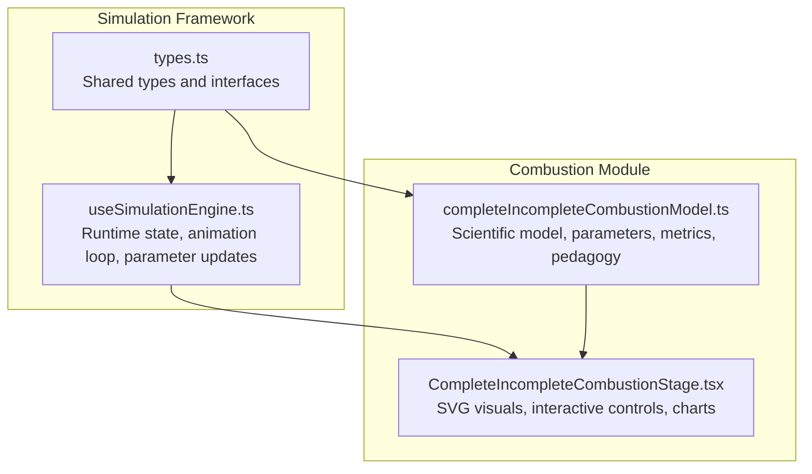
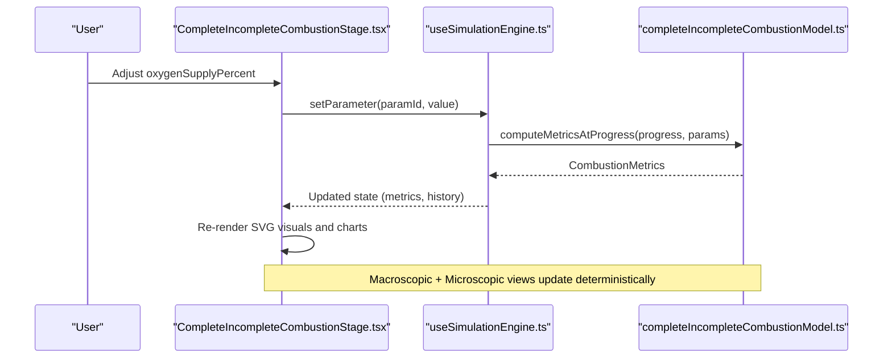
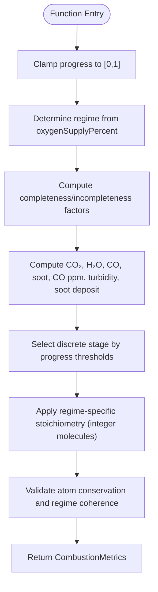
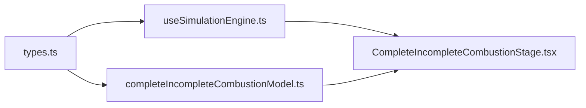

# Complete/Incomplete Combustion Simulation

<cite>
**Referenced Files in This Document**   
- [CompleteIncompleteCombustionStage.tsx](file://src/components/physics/simulations/pilots/CompleteIncompleteCombustionStage.tsx)
- [completeIncompleteCombustionModel.ts](file://src/components/physics/simulations/pilots/completeIncompleteCombustionModel.ts)
- [types.ts](file://src/components/physics/simulations/types.ts)
- [useSimulationEngine.ts](file://src/components/physics/simulations/useSimulationEngine.ts)
</cite>

## Table of Contents
1. [Introduction](#introduction)
2. [Project Structure](#project-structure)
3. [Core Components](#core-components)
4. [Architecture Overview](#architecture-overview)
5. [Detailed Component Analysis](#detailed-component-analysis)
6. [Dependency Analysis](#dependency-analysis)
7. [Performance Considerations](#performance-considerations)
8. [Troubleshooting Guide](#troubleshooting-guide)
9. [Conclusion](#conclusion)
10. [Appendices](#appendices)

## Introduction
This document explains the complete and incomplete combustion simulation for a hydrocarbon (methane CH₄). It demonstrates how oxygen availability determines whether combustion is complete or incomplete, and it visualizes both macroscopic laboratory observations and a simplified microscopic atomic model. The simulation helps learners understand:
- Complete combustion produces carbon dioxide (CO₂) and water (H₂O) with a clean blue flame when oxygen is sufficient.
- Incomplete combustion produces toxic carbon monoxide (CO), solid carbon soot (C), plus CO₂ and H₂O when oxygen is insufficient, accompanied by a yellow/orange luminous flame.
- Interactive controls allow adjusting the oxygen supply to observe changes in flame color, product formation, safety indicators, and real-time graphs.

Educational objectives include understanding combustion efficiency, identifying products through classic chemical tests, recognizing safety risks from CO, and appreciating conservation of atoms across reactions.

## Project Structure
The simulation follows a modular architecture separating pedagogical content, scientific model, runtime engine, and rendering stage.

**Diagram sources**
- [types.ts:1-290](file://src/components/physics/simulations/types.ts#L1-L290)
- [useSimulationEngine.ts:1-480](file://src/components/physics/simulations/useSimulationEngine.ts#L1-L480)
- [completeIncompleteCombustionModel.ts:1-524](file://src/components/physics/simulations/pilots/completeIncompleteCombustionModel.ts#L1-L524)
- [CompleteIncompleteCombustionStage.tsx:1-1289](file://src/components/physics/simulations/pilots/CompleteIncompleteCombustionStage.tsx#L1-L1289)

**Section sources**
- [types.ts:1-290](file://src/components/physics/simulations/types.ts#L1-L290)
- [useSimulationEngine.ts:1-480](file://src/components/physics/simulations/useSimulationEngine.ts#L1-L480)
- [completeIncompleteCombustionModel.ts:1-524](file://src/components/physics/simulations/pilots/completeIncompleteCombustionModel.ts#L1-L524)
- [CompleteIncompleteCombustionStage.tsx:1-1289](file://src/components/physics/simulations/pilots/CompleteIncompleteCombustionStage.tsx#L1-L1289)

## Core Components
- Scientific model: Defines parameters (oxygen supply percentage), computes deterministic metrics over time, enforces atom conservation, and provides pedagogical content.
- Runtime engine: Manages simulation state, animation loop, parameter changes, progress stepping, and history building.
- Stage component: Renders macroscopic lab view (Bunsen burner, flame, tests), microscopic molecular view (CH₄, O₂, CO₂, CO, H₂O, C), real-time measurements, and dynamic graphs.

Key responsibilities:
- Model: Pure calculations for CO₂, H₂O, CO, soot, ppm CO, limewater turbidity, soot deposit, and discrete micro counts.
- Engine: Deterministic history generation, reduced motion support, intersection observer for visibility, and safe state transitions.
- Stage: Visual feedback for flame characteristics, product detection, safety diagnostics, and educational prompts.

**Section sources**
- [completeIncompleteCombustionModel.ts:8-48](file://src/components/physics/simulations/pilots/completeIncompleteCombustionModel.ts#L8-L48)
- [completeIncompleteCombustionModel.ts:50-78](file://src/components/physics/simulations/pilots/completeIncompleteCombustionModel.ts#L50-L78)
- [completeIncompleteCombustionModel.ts:127-347](file://src/components/physics/simulations/pilots/completeIncompleteCombustionModel.ts#L127-L347)
- [useSimulationEngine.ts:100-128](file://src/components/physics/simulations/useSimulationEngine.ts#L100-L128)
- [useSimulationEngine.ts:221-252](file://src/components/physics/simulations/useSimulationEngine.ts#L221-L252)
- [useSimulationEngine.ts:309-479](file://src/components/physics/simulations/useSimulationEngine.ts#L309-L479)
- [CompleteIncompleteCombustionStage.tsx:109-128](file://src/components/physics/simulations/pilots/CompleteIncompleteCombustionStage.tsx#L109-L128)

## Architecture Overview
The simulation integrates declarative pedagogy, pure scientific computation, and reactive UI rendering.

**Diagram sources**
- [CompleteIncompleteCombustionStage.tsx:294-325](file://src/components/physics/simulations/pilots/CompleteIncompleteCombustionStage.tsx#L294-L325)
- [useSimulationEngine.ts:221-252](file://src/components/physics/simulations/useSimulationEngine.ts#L221-L252)
- [completeIncompleteCombustionModel.ts:166-291](file://src/components/physics/simulations/pilots/completeIncompleteCombustionModel.ts#L166-L291)

## Detailed Component Analysis

### Chemical Principles and Educational Objectives
- Complete combustion (sufficient O₂): Hydrocarbon reacts fully to form CO₂ and H₂O; flame is blue and hot; no CO or soot; limewater turns cloudy due to CO₂; anhydrous CuSO₄ turns blue due to H₂O.
- Incomplete combustion (insufficient O₂): Produces CO (toxic, odorless), solid carbon soot (black layer), plus CO₂ and H₂O; flame becomes yellow/orange and luminous; CO detector warns; limewater still shows CO₂; soot deposits on vessel bottom.
- Conservation of atoms: The microscopic model strictly conserves total C, H, and O across reactants and products at each discrete stage.

Educational goals:
- Observe how oxygen availability controls reaction pathway and products.
- Identify products using classic chemical tests (CuSO₄ for H₂O, limewater for CO₂, CO sensor for toxicity).
- Understand safety implications of incomplete combustion (CO poisoning risk).
- Relate macroscopic phenomena to microscopic atomic rearrangements.

**Section sources**
- [completeIncompleteCombustionModel.ts:91-126](file://src/components/physics/simulations/pilots/completeIncompleteCombustionModel.ts#L91-L126)
- [completeIncompleteCombustionModel.ts:349-519](file://src/components/physics/simulations/pilots/completeIncompleteCombustionModel.ts#L349-L519)
- [CompleteIncompleteCombustionStage.tsx:175-673](file://src/components/physics/simulations/pilots/CompleteIncompleteCombustionStage.tsx#L175-L673)

### Interactive Controls and Observations
Controls:
- Oxygen supply slider (20%–100%) with presets for quick comparison (e.g., 100% complete, 60% transition, 30% incomplete).
- Quick toggle button inside the macroscopic view to switch between high and low oxygen settings.
- Start/Pause/Reset controls managed by the engine; speed control affects animation only, not scientific laws.

Observations:
- Flame color shifts from blue (complete) to yellow/orange (incomplete).
- Water vapor condensation and CuSO₄ turning blue indicate H₂O formation.
- Limewater turbidity indicates CO₂ presence.
- Black soot deposition indicates solid carbon formation under incomplete conditions.
- CO ppm indicator warns of toxic gas emission during incomplete combustion.

Real-time metrics and graph:
- Quantitative readouts for CO₂, H₂O, CO, and soot.
- Dynamic chart plotting CO₂ versus combined incomplete products (CO + C) over simulated time.

**Section sources**
- [completeIncompleteCombustionModel.ts:50-78](file://src/components/physics/simulations/pilots/completeIncompleteCombustionModel.ts#L50-L78)
- [CompleteIncompleteCombustionStage.tsx:294-325](file://src/components/physics/simulations/pilots/CompleteIncompleteCombustionStage.tsx#L294-L325)
- [CompleteIncompleteCombustionStage.tsx:964-1284](file://src/components/physics/simulations/pilots/CompleteIncompleteCombustionStage.tsx#L964-L1284)

### Combustion Model Calculations
Regime determination:
- Complete regime: oxygenSupplyPercent ≥ 80%.
- Transition regime: 50% ≤ oxygenSupplyPercent < 80%.
- Incomplete regime: oxygenSupplyPercent < 50%.

Continuous macroscopic quantities:
- Completeness factor derived from oxygen percentage.
- H₂O produced scales linearly with progress.
- CO₂ produced depends on completeness factor.
- CO and soot produced depend on incompleteness factor.
- CO ppm proportional to incomplete fraction.
- Limewater turbidity and soot deposit percentages derived from product amounts.

Discrete microscopic stages:
- Fixed sample of 4 CH₄ molecules.
- Initial O₂ count varies by regime (8 for complete, 7 for transition, 6 for incomplete).
- Two discrete stages based on progress thresholds (≥0.35 and ≥0.8) ensure integer molecule counts while conserving atoms.
- Atom conservation invariant checks total C = 4, total H = 16, total O = 2 × initial O₂ molecules.

**Diagram sources**
- [completeIncompleteCombustionModel.ts:166-291](file://src/components/physics/simulations/pilots/completeIncompleteCombustionModel.ts#L166-L291)
- [completeIncompleteCombustionModel.ts:300-347](file://src/components/physics/simulations/pilots/completeIncompleteCombustionModel.ts#L300-L347)

**Section sources**
- [completeIncompleteCombustionModel.ts:83-89](file://src/components/physics/simulations/pilots/completeIncompleteCombustionModel.ts#L83-L89)
- [completeIncompleteCombustionModel.ts:166-291](file://src/components/physics/simulations/pilots/completeIncompleteCombustionModel.ts#L166-L291)
- [completeIncompleteCombustionModel.ts:300-347](file://src/components/physics/simulations/pilots/completeIncompleteCombustionModel.ts#L300-L347)

### Visual Representations
Macroscopic view:
- Bunsen burner with adjustable air intake (virole) visually representing oxygen supply.
- Animated flame that flickers during running state; color changes based on regime.
- Cold dish above flame showing water condensation and CuSO₄ color change.
- Soot deposit visualization under incomplete combustion.
- CO sensor display with ppm values and safety warnings.
- Limewater test tube showing turbidity indicating CO₂.

Microscopic view:
- Reactant box showing 4 CH₄ molecules and available O₂ molecules.
- Product box showing formed CO₂, H₂O, CO (if any), and C soot (if any).
- Arrow indicating conservation of atoms with counts displayed.

Dynamic chart:
- Plots CO₂ quantity versus combined incomplete products (CO + C) over simulated time.
- Current point markers and labels for clarity.

**Section sources**
- [CompleteIncompleteCombustionStage.tsx:175-673](file://src/components/physics/simulations/pilots/CompleteIncompleteCombustionStage.tsx#L175-L673)
- [CompleteIncompleteCombustionStage.tsx:679-959](file://src/components/physics/simulations/pilots/CompleteIncompleteCombustionStage.tsx#L679-L959)
- [CompleteIncompleteCombustionStage.tsx:1121-1284](file://src/components/physics/simulations/pilots/CompleteIncompleteCombustionStage.tsx#L1121-L1284)

### Implementation Details and Integration Examples
Integration points:
- The stage component receives state, pedagogy, and callbacks from the simulation engine.
- Parameter changes are handled via setParameter, which recalculates metrics and history deterministically.
- Reduced motion mode disables animations and adjusts step behavior for accessibility.

Example usage pattern:
- Initialize simulation with model and options (default representation, interaction mode, reduced motion flag).
- Render Stage component with provided props.
- Use start/pause/reset controls exposed by the engine.
- Adjust oxygenSupplyPercent via slider or preset buttons; observe immediate updates in visuals and metrics.

Accessibility and UX:
- aria-labels and roles for SVG elements.
- Live regions for metric updates.
- Safety diagnostic banner highlighting complete vs incomplete combustion status.

**Section sources**
- [useSimulationEngine.ts:309-479](file://src/components/physics/simulations/useSimulationEngine.ts#L309-L479)
- [CompleteIncompleteCombustionStage.tsx:109-128](file://src/components/physics/simulations/pilots/CompleteIncompleteCombustionStage.tsx#L109-L128)
- [CompleteIncompleteCombustionStage.tsx:964-1119](file://src/components/physics/simulations/pilots/CompleteIncompleteCombustionStage.tsx#L964-L1119)

## Dependency Analysis
The simulation components have clear separation of concerns and minimal coupling:
- types.ts defines shared interfaces used by both the engine and model.
- useSimulationEngine.ts orchestrates state transitions and animation without knowing domain specifics.
- completeIncompleteCombustionModel.ts encapsulates all chemistry logic and pedagogy.
- CompleteIncompleteCombustionStage.tsx renders visuals and handles user interactions, delegating computation to the model via the engine.

**Diagram sources**
- [types.ts:1-290](file://src/components/physics/simulations/types.ts#L1-L290)
- [useSimulationEngine.ts:1-480](file://src/components/physics/simulations/useSimulationEngine.ts#L1-L480)
- [completeIncompleteCombustionModel.ts:1-524](file://src/components/physics/simulations/pilots/completeIncompleteCombustionModel.ts#L1-L524)
- [CompleteIncompleteCombustionStage.tsx:1-1289](file://src/components/physics/simulations/pilots/CompleteIncompleteCombustionStage.tsx#L1-L1289)

**Section sources**
- [types.ts:1-290](file://src/components/physics/simulations/types.ts#L1-L290)
- [useSimulationEngine.ts:1-480](file://src/components/physics/simulations/useSimulationEngine.ts#L1-L480)
- [completeIncompleteCombustionModel.ts:1-524](file://src/components/physics/simulations/pilots/completeIncompleteCombustionModel.ts#L1-L524)
- [CompleteIncompleteCombustionStage.tsx:1-1289](file://src/components/physics/simulations/pilots/CompleteIncompleteCombustionStage.tsx#L1-L1289)

## Performance Considerations
- Deterministic history building ensures consistent graph rendering without heavy recomputation.
- Animation loop uses requestAnimationFrame and pauses when out of viewport to save resources.
- Reduced motion mode minimizes CPU usage by avoiding continuous animations.
- SVG-based visuals are lightweight and scale well across devices.

[No sources needed since this section provides general guidance]

## Troubleshooting Guide
Common issues and resolutions:
- No flame or static visuals: Ensure simulation is started; check reduced motion mode which may alter step behavior.
- Incorrect product amounts: Verify oxygenSupplyPercent setting; confirm regime classification aligns with expected thresholds.
- Graph not updating: Confirm history is being built; check that progress is advancing and metrics are computed.
- Accessibility concerns: Enable reduced motion if animations cause discomfort; verify aria-labels and live regions are present.

Validation and invariants:
- Atom conservation checks ensure total C, H, O remain constant across discrete stages.
- Regime coherence checks prevent impossible combinations (e.g., CO or soot in complete regime).

**Section sources**
- [completeIncompleteCombustionModel.ts:300-347](file://src/components/physics/simulations/pilots/completeIncompleteCombustionModel.ts#L300-L347)
- [useSimulationEngine.ts:333-351](file://src/components/physics/simulations/useSimulationEngine.ts#L333-L351)
- [useSimulationEngine.ts:354-373](file://src/components/physics/simulations/useSimulationEngine.ts#L354-L373)

## Conclusion
This simulation provides a comprehensive, interactive exploration of complete and incomplete combustion. By adjusting oxygen levels, learners can observe how reaction pathways shift, visualize product formation at both macroscopic and microscopic levels, and understand the safety implications of incomplete combustion. The deterministic model ensures scientific accuracy, while the rich visuals and guided pedagogy make complex concepts accessible.

[No sources needed since this section summarizes without analyzing specific files]

## Appendices

### API and Data Models Summary
- Parameters: oxygenSupplyPercent (20–100%).
- Metrics: oxygenSupplyPercent, regime, co2Produced, h2oProduced, coProduced, carbonSootProduced, coPpm, limewaterTurbidityPercent, sootDepositPercent, ch4Remaining, o2Remaining, o2InitialMicro, co2MicroCount, h2oMicroCount, coMicroCount, cMicroCount, isBurning.
- Pedagogy: Titles, objectives, warnings, scientific steps, dynamic observations, guided questions, conclusions, fallback data.

**Section sources**
- [completeIncompleteCombustionModel.ts:8-48](file://src/components/physics/simulations/pilots/completeIncompleteCombustionModel.ts#L8-L48)
- [completeIncompleteCombustionModel.ts:349-519](file://src/components/physics/simulations/pilots/completeIncompleteCombustionModel.ts#L349-L519)