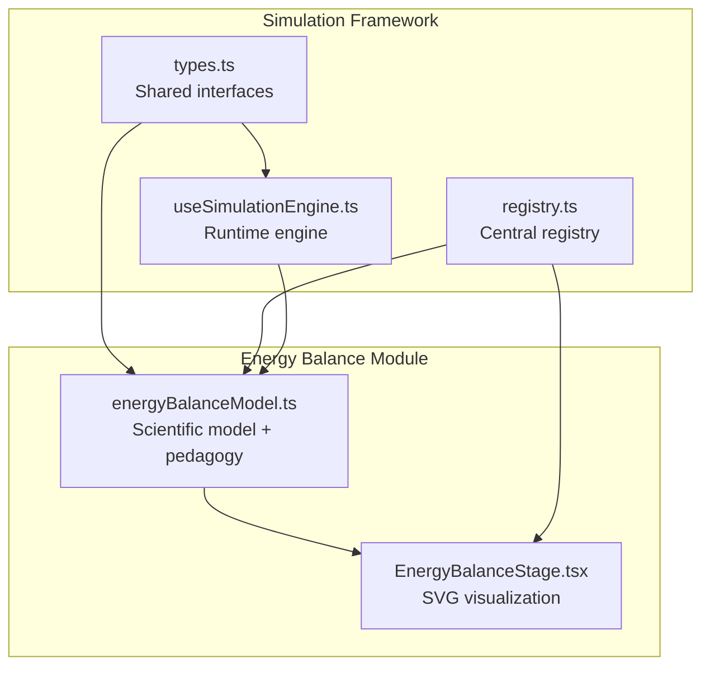
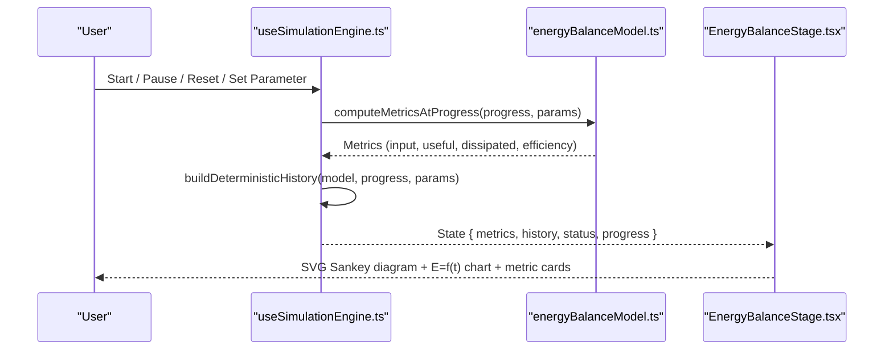
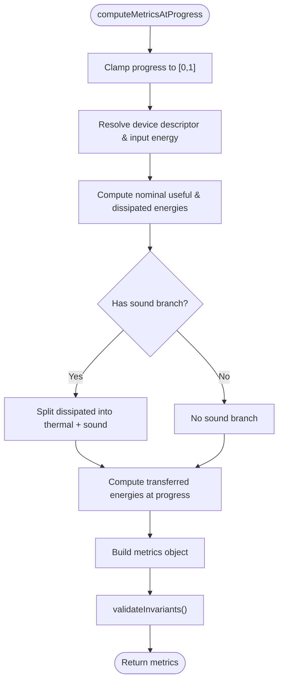
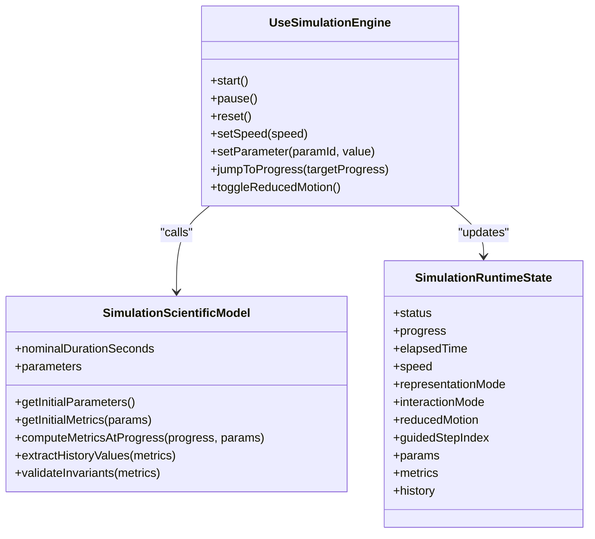
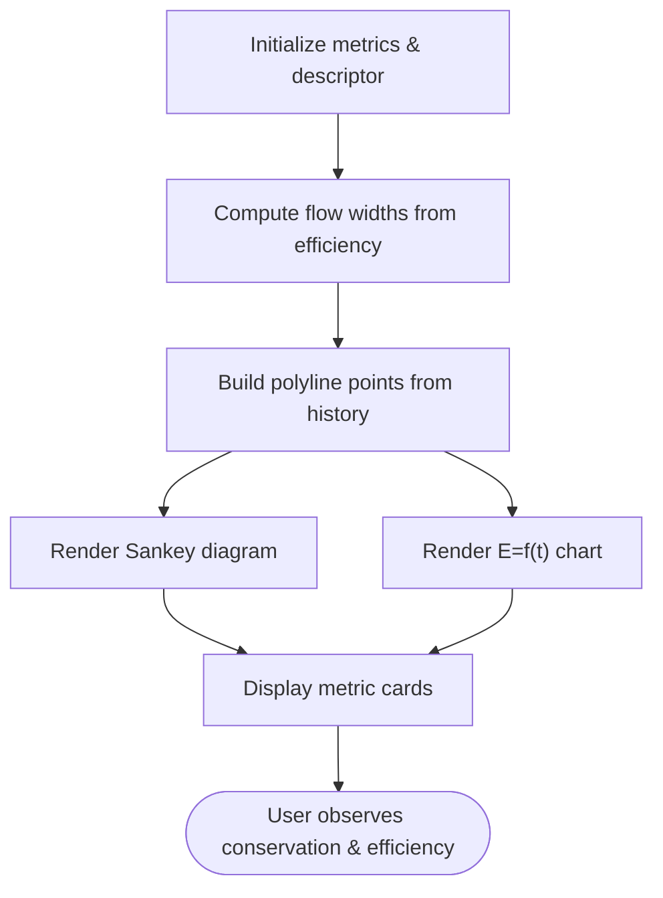
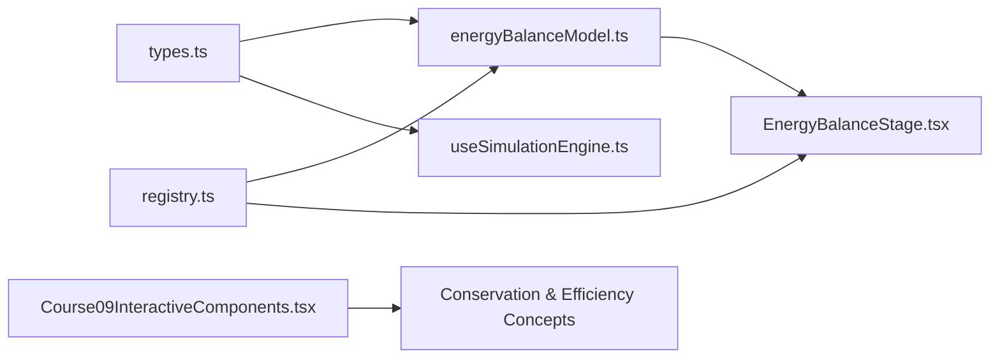
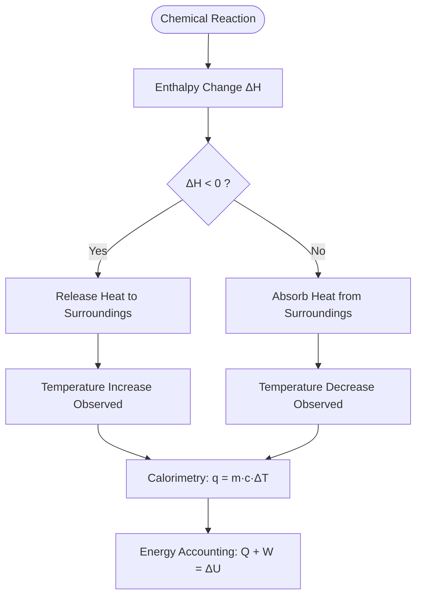

# Energy Balance Simulation

<cite>
**Referenced Files in This Document**
- [EnergyBalanceStage.tsx](file://src/components/physics/simulations/pilots/EnergyBalanceStage.tsx)
- [energyBalanceModel.ts](file://src/components/physics/simulations/pilots/energyBalanceModel.ts)
- [types.ts](file://src/components/physics/simulations/types.ts)
- [useSimulationEngine.ts](file://src/components/physics/simulations/useSimulationEngine.ts)
- [registry.ts](file://src/components/physics/simulations/registry.ts)
- [Course09InteractiveComponents.tsx](file://src/components/physics/Course09InteractiveComponents.tsx)
</cite>

## Table of Contents
1. [Introduction](#introduction)
2. [Project Structure](#project-structure)
3. [Core Components](#core-components)
4. [Architecture Overview](#architecture-overview)
5. [Detailed Component Analysis](#detailed-component-analysis)
6. [Dependency Analysis](#dependency-analysis)
7. [Performance Considerations](#performance-considerations)
8. [Troubleshooting Guide](#troubleshooting-guide)
9. [Conclusion](#conclusion)
10. [Appendices](#appendices)

## Introduction
This document explains the energy balance simulation that demonstrates thermodynamic principles and conservation of energy in energy conversion systems. The simulation focuses on:
- Quantitative energy accounting: input energy splits into useful and dissipated forms.
- Conservation of energy at every instant: received energy equals the sum of useful and dissipated energies.
- Efficiency calculation: the ratio of useful energy to received energy, expressed as a percentage.
- Interactive exploration: users select devices and input energy values, then observe Sankey-style flow diagrams and cumulative energy graphs over time.

The implementation is part of a broader physics-chemistry simulation framework for middle-school education. It uses a clean separation between scientific model, runtime engine, UI stage, and pedagogical content.

Important note about scope: this repository implements macroscopic energy balances for electrical devices (lamp, motor, heater, fan). It does not implement chemical reaction enthalpy, calorimetry with heat capacities, or explicit exothermic/endothermic reaction modeling. Those topics are conceptually related but not present in the codebase analyzed here.

## Project Structure
The energy balance simulation lives under the physics simulations module and follows a consistent architecture:
- Scientific model defines parameters, metrics, device descriptors, and deterministic computations.
- Runtime engine manages animation, state transitions, parameter updates, and history sampling.
- Stage component renders SVG-based visualizations and metric cards.
- Registry wires the model, pedagogy, and stage together.
- Types define shared interfaces across all simulations.

**Diagram sources**
- [types.ts:1-290](file://src/components/physics/simulations/types.ts#L1-L290)
- [useSimulationEngine.ts:1-480](file://src/components/physics/simulations/useSimulationEngine.ts#L1-L480)
- [registry.ts:1-103](file://src/components/physics/simulations/registry.ts#L1-L103)
- [energyBalanceModel.ts:1-485](file://src/components/physics/simulations/pilots/energyBalanceModel.ts#L1-L485)
- [EnergyBalanceStage.tsx:1-783](file://src/components/physics/simulations/pilots/EnergyBalanceStage.tsx#L1-L783)

**Section sources**
- [types.ts:1-290](file://src/components/physics/simulations/types.ts#L1-L290)
- [registry.ts:1-103](file://src/components/physics/simulations/registry.ts#L1-L103)

## Core Components
- Scientific model: Defines device descriptors (lamp, motor, heater, fan), efficiency percentages, input/output energy forms, and deterministic calculations for nominal and instantaneous energy values. It also includes pedagogical content such as objectives, guided questions, and conclusions.
- Runtime engine: Provides React hooks and pure state transition functions for starting, pausing, resetting, stepping, setting speed, changing parameters, and building deterministic history for charts.
- Stage component: Renders a quantitative Sankey-like diagram showing energy flows, a real-time cumulative graph E = f(t), and metric cards for input, useful, dissipated energy, and efficiency.
- Registry: Registers the energy balance simulation by associating its model, pedagogy, and stage component.

Key responsibilities:
- Model: Pure math and data; no JSX.
- Engine: Animation loop, state management, accessibility features (reduced motion), and history generation.
- Stage: Visualization and user interaction display.
- Registry: Centralized wiring for course integration.

**Section sources**
- [energyBalanceModel.ts:1-485](file://src/components/physics/simulations/pilots/energyBalanceModel.ts#L1-L485)
- [useSimulationEngine.ts:1-480](file://src/components/physics/simulations/useSimulationEngine.ts#L1-L480)
- [EnergyBalanceStage.tsx:1-783](file://src/components/physics/simulations/pilots/EnergyBalanceStage.tsx#L1-L783)
- [registry.ts:1-103](file://src/components/physics/simulations/registry.ts#L1-L103)

## Architecture Overview
The simulation follows a layered architecture:
- Data layer: types.ts defines shared structures like SimulationRuntimeState, SimulationScientificModel, and SimulationPedagogicalContent.
- Model layer: energyBalanceModel.ts provides deterministic computation of metrics based on normalized progress and parameters.
- Engine layer: useSimulationEngine.ts drives the animation loop, handles reduced motion, intersection observer visibility, and exposes control methods.
- Presentation layer: EnergyBalanceStage.tsx renders SVG diagrams and metric cards using current metrics and history.
- Integration layer: registry.ts registers the simulation entry for course navigation.

**Diagram sources**
- [useSimulationEngine.ts:309-479](file://src/components/physics/simulations/useSimulationEngine.ts#L309-L479)
- [energyBalanceModel.ts:192-315](file://src/components/physics/simulations/pilots/energyBalanceModel.ts#L192-L315)
- [EnergyBalanceStage.tsx:1-783](file://src/components/physics/simulations/pilots/EnergyBalanceStage.tsx#L1-L783)

## Detailed Component Analysis

### Scientific Model: Energy Balance
The model encapsulates:
- Device descriptors: lamp (30% efficient), motor (70%), heater (90%), fan (65%, with sound branch).
- Parameters: device type and total input energy in joules.
- Metrics: nominal and transferred energies, efficiency percent and decimal, dissipated percent, optional sound and thermal branches.
- Invariants: conservation checks for nominal and transferred energies, branch sums, efficiency bounds, and consistency of η calculation.
- Pedagogy: objectives, warnings, dynamic observations, guided questions, and conclusions.

**Diagram sources**
- [energyBalanceModel.ts:210-306](file://src/components/physics/simulations/pilots/energyBalanceModel.ts#L210-L306)

Key behaviors:
- Conservation law enforced: E_received = E_useful + E_dissipated at both nominal and instantaneous levels.
- Efficiency formula: η (%) = (E_useful / E_received) × 100.
- Optional sound branch for fan: dissipates thermal and acoustic energy.

**Section sources**
- [energyBalanceModel.ts:15-110](file://src/components/physics/simulations/pilots/energyBalanceModel.ts#L15-L110)
- [energyBalanceModel.ts:179-315](file://src/components/physics/simulations/pilots/energyBalanceModel.ts#L179-L315)

### Runtime Engine: Simulation Control
The engine provides:
- Deterministic history builder: samples metrics at fixed steps up to current progress.
- State transitions: start, pause, reset, set speed, set parameter, jump to progress.
- Animation loop: uses requestAnimationFrame, respects reduced motion, pauses when out of view.
- Accessibility: detects prefers-reduced-motion and toggles reducedMotion state.

**Diagram sources**
- [useSimulationEngine.ts:100-302](file://src/components/physics/simulations/useSimulationEngine.ts#L100-L302)
- [useSimulationEngine.ts:309-479](file://src/components/physics/simulations/useSimulationEngine.ts#L309-L479)
- [types.ts:121-260](file://src/components/physics/simulations/types.ts#L121-L260)

**Section sources**
- [useSimulationEngine.ts:1-480](file://src/components/physics/simulations/useSimulationEngine.ts#L1-L480)
- [types.ts:121-260](file://src/components/physics/simulations/types.ts#L121-L260)

### Stage Component: Visualization and Interaction
The stage renders:
- A Sankey-like diagram showing input energy splitting into useful and dissipated branches, with proportional arrow thicknesses.
- A central system box displaying device name and efficiency badge.
- Metric cards for input, useful, dissipated energy, and efficiency with a gauge bar.
- A cumulative energy chart E = f(t) plotting input, useful, and dissipated energies over time.
- Pedagogical text and warnings in Arabic and French.

**Diagram sources**
- [EnergyBalanceStage.tsx:21-80](file://src/components/physics/simulations/pilots/EnergyBalanceStage.tsx#L21-L80)
- [EnergyBalanceStage.tsx:104-477](file://src/components/physics/simulations/pilots/EnergyBalanceStage.tsx#L104-L477)
- [EnergyBalanceStage.tsx:489-777](file://src/components/physics/simulations/pilots/EnergyBalanceStage.tsx#L489-L777)

**Section sources**
- [EnergyBalanceStage.tsx:1-783](file://src/components/physics/simulations/pilots/EnergyBalanceStage.tsx#L1-L783)

### Pedagogical Content and Guided Learning
The model’s pedagogy section provides:
- Title, category, level badge, objective, macroscopic warning.
- Supported representations and scientific steps.
- Dynamic observations triggered by progress thresholds.
- Guided questions with target parameters and answers.
- Conclusions and formulas summarizing key relations.

This structure supports inquiry-based learning: manipulate parameters, observe flows, measure quantities, compare results, and conclude.

**Section sources**
- [energyBalanceModel.ts:320-485](file://src/components/physics/simulations/pilots/energyBalanceModel.ts#L320-L485)

## Dependency Analysis
The energy balance simulation depends on:
- Shared types for runtime state, parameters, metrics, and pedagogy.
- The engine for animation and state transitions.
- The registry for course integration.
- Additional static schemas and components in Course09InteractiveComponents.tsx reinforce concepts like conservation and efficiency.

**Diagram sources**
- [types.ts:1-290](file://src/components/physics/simulations/types.ts#L1-L290)
- [energyBalanceModel.ts:1-485](file://src/components/physics/simulations/pilots/energyBalanceModel.ts#L1-L485)
- [useSimulationEngine.ts:1-480](file://src/components/physics/simulations/useSimulationEngine.ts#L1-L480)
- [EnergyBalanceStage.tsx:1-783](file://src/components/physics/simulations/pilots/EnergyBalanceStage.tsx#L1-L783)
- [registry.ts:1-103](file://src/components/physics/simulations/registry.ts#L1-L103)
- [Course09InteractiveComponents.tsx:800-902](file://src/components/physics/Course09InteractiveComponents.tsx#L800-L902)

**Section sources**
- [registry.ts:1-103](file://src/components/physics/simulations/registry.ts#L1-L103)
- [Course09InteractiveComponents.tsx:800-902](file://src/components/physics/Course09InteractiveComponents.tsx#L800-L902)

## Performance Considerations
- Deterministic history builder limits sampled points to avoid heavy rendering while preserving smooth charts.
- Reduced motion mode disables animations and advances progress in discrete steps for accessibility.
- IntersectionObserver pauses the simulation when the component is off-screen to save resources.
- SVG rendering is lightweight and responsive; polyline points are computed from history arrays.

[No sources needed since this section provides general guidance]

## Troubleshooting Guide
Common issues and resolutions:
- Conservation invariant fails: check that nominal and transferred energy sums match within tolerance; verify efficiency and dissipated percent add to 100%.
- Efficiency out of bounds: ensure device descriptor efficiency is strictly between 0% and 100%.
- History mismatch: confirm extractHistoryValues returns correct keys and values aligned with chart series.
- Animation not running: verify status is 'running', reducedMotion is false, and component is visible.

**Section sources**
- [energyBalanceModel.ts:268-306](file://src/components/physics/simulations/pilots/energyBalanceModel.ts#L268-L306)
- [useSimulationEngine.ts:333-373](file://src/components/physics/simulations/useSimulationEngine.ts#L333-L373)

## Conclusion
The energy balance simulation provides a robust, interactive demonstration of macroscopic energy conservation and efficiency in electrical devices. It emphasizes:
- Quantitative energy accounting with Joules.
- Conservation of energy at every instant.
- Efficiency calculation and comparison across devices.
- Clear visualizations via Sankey-like diagrams and cumulative energy charts.
- Pedagogical scaffolding through guided questions and dynamic observations.

While it does not cover chemical reaction enthalpy or calorimetry with heat capacities, it establishes foundational concepts of energy transformation and conservation that transfer to broader thermodynamics contexts.

[No sources needed since this section summarizes without analyzing specific files]

## Appendices

### Conceptual Overview: Exothermic vs Endothermic Processes
Exothermic reactions release energy to the surroundings, typically observed as temperature increase. Endothermic reactions absorb energy from the surroundings, often causing temperature decrease. These concepts relate to enthalpy changes (ΔH < 0 for exothermic, ΔH > 0 for endothermic) and energy transfer mechanisms such as heat conduction, convection, and radiation.

Calorimetry calculates heat exchanged using q = m·c·ΔT, where m is mass, c is specific heat capacity, and ΔT is temperature change. Energy accounting in chemical systems requires balancing enthalpy changes with work and heat transfers, respecting the first law of thermodynamics.

These topics are conceptual extensions beyond the current repository’s scope, which focuses on macroscopic energy balances for electrical devices rather than chemical reaction energetics.

[No sources needed since this diagram shows conceptual workflow, not actual code structure]