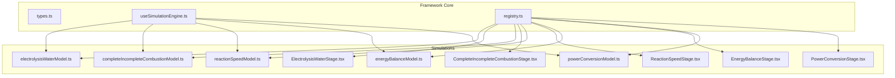
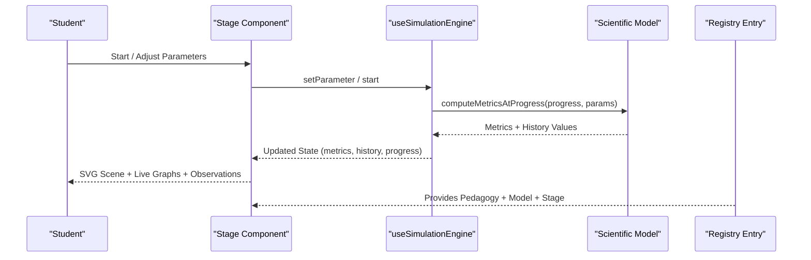
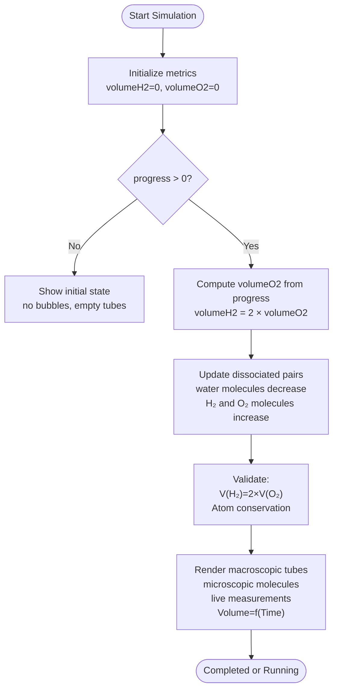
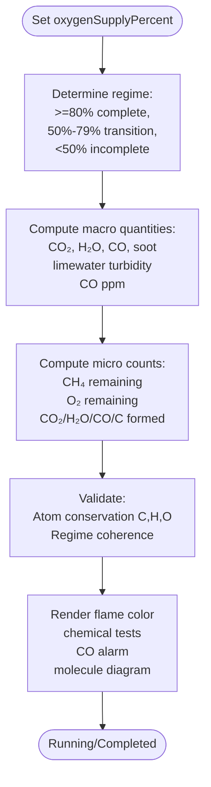
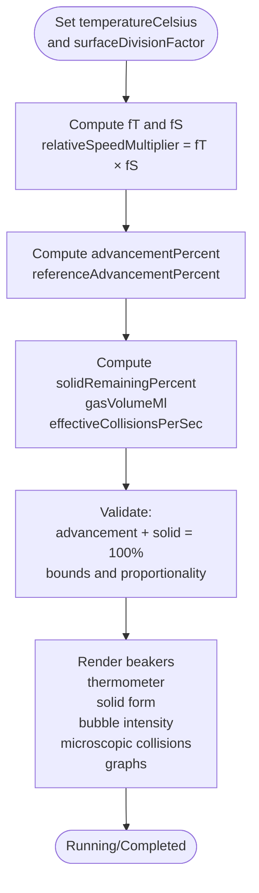
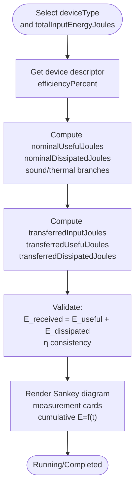
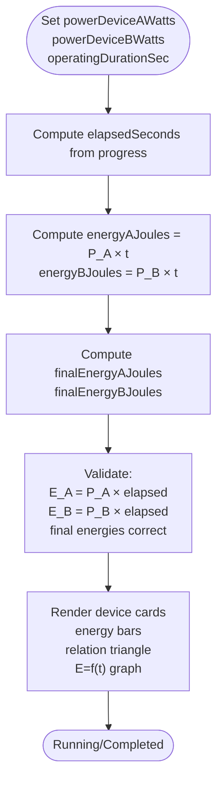
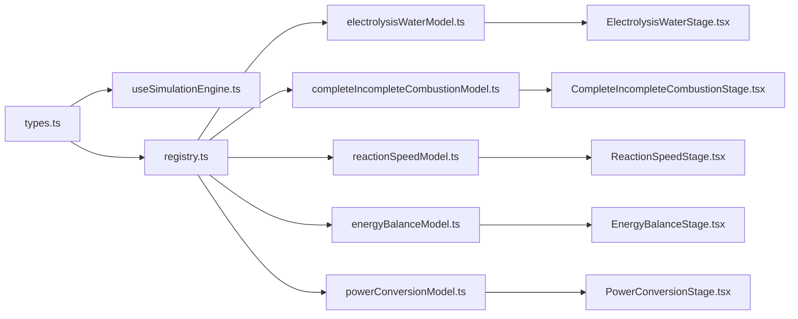

# Implemented Simulations

<cite>
**Referenced Files in This Document**
- [README_SIMULATIONS.md](file://src/components/physics/simulations/README_SIMULATIONS.md)
- [types.ts](file://src/components/physics/simulations/types.ts)
- [useSimulationEngine.ts](file://src/components/physics/simulations/useSimulationEngine.ts)
- [registry.ts](file://src/components/physics/simulations/registry.ts)
- [electrolysisWaterModel.ts](file://src/components/physics/simulations/pilots/electrolysisWaterModel.ts)
- [ElectrolysisWaterStage.tsx](file://src/components/physics/simulations/pilots/ElectrolysisWaterStage.tsx)
- [completeIncompleteCombustionModel.ts](file://src/components/physics/simulations/pilots/completeIncompleteCombustionModel.ts)
- [CompleteIncompleteCombustionStage.tsx](file://src/components/physics/simulations/pilots/CompleteIncompleteCombustionStage.tsx)
- [reactionSpeedModel.ts](file://src/components/physics/simulations/pilots/reactionSpeedModel.ts)
- [ReactionSpeedStage.tsx](file://src/components/physics/simulations/pilots/ReactionSpeedStage.tsx)
- [energyBalanceModel.ts](file://src/components/physics/simulations/pilots/energyBalanceModel.ts)
- [EnergyBalanceStage.tsx](file://src/components/physics/simulations/pilots/EnergyBalanceStage.tsx)
- [powerConversionModel.ts](file://src/components/physics/simulations/pilots/powerConversionModel.ts)
- [PowerConversionStage.tsx](file://src/components/physics/simulations/pilots/PowerConversionStage.tsx)
</cite>

## Table of Contents
1. [Introduction](#introduction)
2. [Project Structure](#project-structure)
3. [Core Components](#core-components)
4. [Architecture Overview](#architecture-overview)
5. [Detailed Component Analysis](#detailed-component-analysis)
6. [Dependency Analysis](#dependency-analysis)
7. [Performance Considerations](#performance-considerations)
8. [Troubleshooting Guide](#troubleshooting-guide)
9. [Conclusion](#conclusion)

## Introduction
This document explains all implemented scientific simulations in the 3AM Physics-Chemistry simulation framework. It covers water electrolysis, complete and incomplete combustion modeling, reaction speed factors, energy balance calculations, and power-energy conversion. For each simulation, it describes the underlying physics or chemistry principles, interactive features, visual representations, educational objectives, and how the simulation is structured and integrated into the framework through models, stages, and registry entries.

The framework separates responsibilities strictly:
- Declarative pedagogical content
- Pure deterministic scientific model
- Runtime state and parameters
- SVG-based stage rendering
- Controls, parameters, and accessibility
- Guided observation workflow
- Centralized registration

**Section sources**
- [README_SIMULATIONS.md:7-28](file://src/components/physics/simulations/README_SIMULATIONS.md#L7-L28)

## Project Structure
The simulation system lives under `src/components/physics/simulations/`. Each simulation has:
- A pilot model file defining pure scientific logic and pedagogical content
- A Stage React component for macroscopic/microscopic visualization and dynamic graphs
- A registry entry connecting id, course number, pedagogy, model, and stage

**Diagram sources**
- [types.ts:17-50](file://src/components/physics/simulations/types.ts#L17-L50)
- [registry.ts:42-80](file://src/components/physics/simulations/registry.ts#L42-L80)

**Section sources**
- [README_SIMULATIONS.md:7-28](file://src/components/physics/simulations/README_SIMULATIONS.md#L7-L28)
- [registry.ts:42-80](file://src/components/physics/simulations/registry.ts#L42-L80)

## Core Components
The framework defines generic contracts and runtime behavior used by every simulation:
- Generic types for metrics, parameters, runtime state, history points, and pedagogical content
- A pure engine hook managing animation loop, reduced motion, parameter updates, progress stepping, and history building
- A registry mapping simulation ids to their pedagogy, scientific model, and stage component

Key responsibilities:
- `types.ts`: declares `RegisteredSimulationId`, `PhysicsSimulationParameter`, `SimulationScientificModel`, `SimulationRuntimeState`, `SimulationPedagogicalContent`, and `SimulationRegistryEntry`
- `useSimulationEngine.ts`: provides `createInitialSimulationState`, `stepSimulationByDeltaSeconds`, `buildDeterministicHistory`, and React hook with `requestAnimationFrame`, intersection observer, and reduced-motion support
- `registry.ts`: centralizes active simulations and lookup helpers

**Section sources**
- [types.ts:17-50](file://src/components/physics/simulations/types.ts#L17-L50)
- [types.ts:118-146](file://src/components/physics/simulations/types.ts#L118-L146)
- [types.ts:237-289](file://src/components/physics/simulations/types.ts#L237-L289)
- [useSimulationEngine.ts:57-95](file://src/components/physics/simulations/useSimulationEngine.ts#L57-L95)
- [useSimulationEngine.ts:100-128](file://src/components/physics/simulations/useSimulationEngine.ts#L100-L128)
- [useSimulationEngine.ts:254-302](file://src/components/physics/simulations/useSimulationEngine.ts#L254-L302)
- [useSimulationEngine.ts:309-479](file://src/components/physics/simulations/useSimulationEngine.ts#L309-L479)
- [registry.ts:42-80](file://src/components/physics/simulations/registry.ts#L42-L80)

## Architecture Overview
Each simulation follows a consistent architecture:
- Scientific model computes deterministic metrics from normalized progress and parameters
- Stage renders macroscopic and microscopic views, live measurements, and dynamic graphs
- Pedagogical content drives guided questions, observations, and conclusions
- Registry wires everything together for course integration

**Diagram sources**
- [useSimulationEngine.ts:221-251](file://src/components/physics/simulations/useSimulationEngine.ts#L221-L251)
- [useSimulationEngine.ts:254-302](file://src/components/physics/simulations/useSimulationEngine.ts#L254-L302)
- [registry.ts:42-80](file://src/components/physics/simulations/registry.ts#L42-L80)

**Section sources**
- [README_SIMULATIONS.md:43-60](file://src/components/physics/simulations/README_SIMULATIONS.md#L43-L60)
- [registry.ts:42-80](file://src/components/physics/simulations/registry.ts#L42-L80)

## Detailed Component Analysis

### Water Electrolysis Simulation
Scientific principles:
- Decomposition of water: 2 H₂O → 2 H₂ + O₂
- Volumetric relation V(H₂) = 2 × V(O₂)
- Microscopic conservation of atoms: total H and O remain constant during dissociation

Interactive features:
- Toggle current flow and observe bubble generation at electrodes
- Macroscopic view with graduated tubes collecting H₂ and O₂ volumes
- Microscopic view showing H₂O molecules splitting into H₂ and O₂ molecules
- Live measurements and dynamic graph Volume vs Time
- Guided questions leading to discovery of the 2:1 volume ratio

Educational objectives:
- Observe gas evolution at electrodes
- Measure real-time volumes and confirm the stoichiometric ratio
- Connect macroscopic observations to molecular rearrangement

Code structure:
- Model: `electrolysisWaterModel.ts` defines metrics, deterministic computation, invariants, and pedagogical content
- Stage: `ElectrolysisWaterStage.tsx` renders apparatus, bubbles, molecule diagrams, measurements, and chart

**Diagram sources**
- [electrolysisWaterModel.ts:35-81](file://src/components/physics/simulations/pilots/electrolysisWaterModel.ts#L35-L81)
- [electrolysisWaterModel.ts:90-115](file://src/components/physics/simulations/pilots/electrolysisWaterModel.ts#L90-L115)

**Section sources**
- [electrolysisWaterModel.ts:35-115](file://src/components/physics/simulations/pilots/electrolysisWaterModel.ts#L35-L115)
- [ElectrolysisWaterStage.tsx:67-131](file://src/components/physics/simulations/pilots/ElectrolysisWaterStage.tsx#L67-L131)
- [ElectrolysisWaterStage.tsx:131-494](file://src/components/physics/simulations/pilots/ElectrolysisWaterStage.tsx#L131-L494)
- [ElectrolysisWaterStage.tsx:497-599](file://src/components/physics/simulations/pilots/ElectrolysisWaterStage.tsx#L497-L599)
- [ElectrolysisWaterStage.tsx:602-800](file://src/components/physics/simulations/pilots/ElectrolysisWaterStage.tsx#L602-L800)

### Complete and Incomplete Combustion Modeling
Scientific principles:
- Hydrocarbon combustion depends on oxygen availability
- Complete combustion: CH₄ + 2 O₂ → CO₂ + 2 H₂O (blue flame, no soot)
- Incomplete combustion: insufficient O₂ produces CO (toxic), solid carbon soot C, plus CO₂ and H₂O (yellow/orange flame)
- Strict atom conservation across regimes

Interactive features:
- Adjustable oxygen supply percentage (20%–100%)
- Visual flame color change based on regime
- Chemical tests: limewater turbidity for CO₂, anhydrous CuSO₄ turning blue for H₂O, CO ppm sensor alert
- Microscopic view tracking CH₄ and O₂ consumption and product formation while conserving atoms

Educational objectives:
- Understand role of O₂ availability in determining combustion products
- Identify chemical tests for products
- Recognize safety risks of CO and soot in incomplete combustion

Code structure:
- Model: `completeIncompleteCombustionModel.ts` defines parameters, regime classification, continuous and discrete micro-level metrics, invariants, and pedagogical content
- Stage: `CompleteIncompleteCombustionStage.tsx` renders burner, flame, test indicators, CO detector, limewater, and molecule diagrams

**Diagram sources**
- [completeIncompleteCombustionModel.ts:83-89](file://src/components/physics/simulations/pilots/completeIncompleteCombustionModel.ts#L83-L89)
- [completeIncompleteCombustionModel.ts:166-290](file://src/components/physics/simulations/pilots/completeIncompleteCombustionModel.ts#L166-L290)
- [completeIncompleteCombustionModel.ts:300-346](file://src/components/physics/simulations/pilots/completeIncompleteCombustionModel.ts#L300-L346)

**Section sources**
- [completeIncompleteCombustionModel.ts:83-89](file://src/components/physics/simulations/pilots/completeIncompleteCombustionModel.ts#L83-L89)
- [completeIncompleteCombustionModel.ts:166-290](file://src/components/physics/simulations/pilots/completeIncompleteCombustionModel.ts#L166-L290)
- [completeIncompleteCombustionModel.ts:300-346](file://src/components/physics/simulations/pilots/completeIncompleteCombustionModel.ts#L300-L346)
- [CompleteIncompleteCombustionStage.tsx:109-170](file://src/components/physics/simulations/pilots/CompleteIncompleteCombustionStage.tsx#L109-L170)
- [CompleteIncompleteCombustionStage.tsx:170-673](file://src/components/physics/simulations/pilots/CompleteIncompleteCombustionStage.tsx#L170-L673)
- [CompleteIncompleteCombustionStage.tsx:676-800](file://src/components/physics/simulations/pilots/CompleteIncompleteCombustionStage.tsx#L676-L800)

### Reaction Speed Factors
Scientific principles:
- Reaction rate increases with temperature due to higher thermal agitation
- Reaction rate increases with surface area when solids are divided into fragments or powder
- Effective collisions per second drive faster reactions; final product amount remains unchanged for same mass

Interactive features:
- Temperature slider (10°C–60°C) with presets
- Surface division factor buttons (whole tablet, fragmented, fine powder)
- Side-by-side beakers comparing reference (25°C, whole tablet) with experimental conditions
- Microscopic window showing particle agitation and effective collision frequency
- Dynamic graph of advancement percent vs time comparing both experiments

Educational objectives:
- Observe how T and S affect reaction speed
- Relate macroscopic bubbling and completion time to microscopic collision frequency
- Conclude that T↑ and S↑ increase effective collisions and reduce duration

Code structure:
- Model: `reactionSpeedModel.ts` defines temperature and surface factors, kinetic advancement curve, reference comparison, and invariants
- Stage: `ReactionSpeedStage.tsx` renders two beakers, thermometer, solid representation, bubble animations, microscopic collision window, and advancement curves

**Diagram sources**
- [reactionSpeedModel.ts:103-116](file://src/components/physics/simulations/pilots/reactionSpeedModel.ts#L103-L116)
- [reactionSpeedModel.ts:122-133](file://src/components/physics/simulations/pilots/reactionSpeedModel.ts#L122-L133)
- [reactionSpeedModel.ts:181-241](file://src/components/physics/simulations/pilots/reactionSpeedModel.ts#L181-L241)
- [reactionSpeedModel.ts:244-277](file://src/components/physics/simulations/pilots/reactionSpeedModel.ts#L244-L277)

**Section sources**
- [reactionSpeedModel.ts:103-116](file://src/components/physics/simulations/pilots/reactionSpeedModel.ts#L103-L116)
- [reactionSpeedModel.ts:122-133](file://src/components/physics/simulations/pilots/reactionSpeedModel.ts#L122-L133)
- [reactionSpeedModel.ts:181-241](file://src/components/physics/simulations/pilots/reactionSpeedModel.ts#L181-L241)
- [reactionSpeedModel.ts:244-277](file://src/components/physics/simulations/pilots/reactionSpeedModel.ts#L244-L277)
- [ReactionSpeedStage.tsx:14-85](file://src/components/physics/simulations/pilots/ReactionSpeedStage.tsx#L14-L85)
- [ReactionSpeedStage.tsx:85-556](file://src/components/physics/simulations/pilots/ReactionSpeedStage.tsx#L85-L556)
- [ReactionSpeedStage.tsx:558-800](file://src/components/physics/simulations/pilots/ReactionSpeedStage.tsx#L558-L800)

### Energy Balance Calculations
Scientific principles:
- Energy balance: E_received = E_useful + E_dissipated
- Efficiency η (%) = (E_useful / E_received) × 100
- Dissipated energy is not lost; it spreads into surroundings (heat, sound)

Interactive features:
- Device selector (lamp, motor, water heater, fan) with different efficiencies
- Adjustable input energy (100 J–2000 J)
- Sankey-style quantitative energy flow diagram with proportional bands
- Real-time cumulative graphs of received, useful, and dissipated energies over time
- Educational warnings emphasizing dissipation ≠ disappearance

Educational objectives:
- Track energy transformation through a device
- Verify conservation of energy at every instant
- Calculate efficiency and compare devices

Code structure:
- Model: `energyBalanceModel.ts` defines device descriptors, nominal and transferred energies, efficiency, and invariants
- Stage: `EnergyBalanceStage.tsx` renders Sankey diagram, measurement cards, and E(t) graph

**Diagram sources**
- [energyBalanceModel.ts:179-182](file://src/components/physics/simulations/pilots/energyBalanceModel.ts#L179-L182)
- [energyBalanceModel.ts:210-265](file://src/components/physics/simulations/pilots/energyBalanceModel.ts#L210-L265)
- [energyBalanceModel.ts:268-305](file://src/components/physics/simulations/pilots/energyBalanceModel.ts#L268-L305)

**Section sources**
- [energyBalanceModel.ts:179-182](file://src/components/physics/simulations/pilots/energyBalanceModel.ts#L179-L182)
- [energyBalanceModel.ts:210-265](file://src/components/physics/simulations/pilots/energyBalanceModel.ts#L210-L265)
- [energyBalanceModel.ts:268-305](file://src/components/physics/simulations/pilots/energyBalanceModel.ts#L268-L305)
- [EnergyBalanceStage.tsx:15-81](file://src/components/physics/simulations/pilots/EnergyBalanceStage.tsx#L15-L81)
- [EnergyBalanceStage.tsx:81-484](file://src/components/physics/simulations/pilots/EnergyBalanceStage.tsx#L81-L484)
- [EnergyBalanceStage.tsx:486-783](file://src/components/physics/simulations/pilots/EnergyBalanceStage.tsx#L486-L783)

### Power-Energy Conversion
Scientific principles:
- Power P = E / t, equivalently E = P × t, t = E / P
- Unit relationships: 1 W = 1 J/s, 1 kW = 1000 W
- Comparing two devices over the same duration shows proportional energy accumulation

Interactive features:
- Adjustable powers P_A and P_B with realistic presets
- Adjustable operating duration t
- Visual comparison of energy accumulation bars and rates
- Dynamic triangle of relations and E = f(t) graph showing slopes equal to power
- Emphasis that power is a rate, not just an amount of energy

Educational objectives:
- Distinguish between energy and power
- Use the relationship triangle to calculate unknowns
- Interpret slope of E(t) as power and compare devices

Code structure:
- Model: `powerConversionModel.ts` defines parameters, elapsed time, energy accumulation, final energies, and invariants
- Stage: `PowerConversionStage.tsx` renders device cards, energy bars, relation triangle, and E(t) graph

**Diagram sources**
- [powerConversionModel.ts:172-221](file://src/components/physics/simulations/pilots/powerConversionModel.ts#L172-L221)
- [powerConversionModel.ts:224-253](file://src/components/physics/simulations/pilots/powerConversionModel.ts#L224-L253)

**Section sources**
- [powerConversionModel.ts:172-221](file://src/components/physics/simulations/pilots/powerConversionModel.ts#L172-L221)
- [powerConversionModel.ts:224-253](file://src/components/physics/simulations/pilots/powerConversionModel.ts#L224-L253)
- [PowerConversionStage.tsx:9-23](file://src/components/physics/simulations/pilots/PowerConversionStage.tsx#L9-L23)
- [PowerConversionStage.tsx:23-475](file://src/components/physics/simulations/pilots/PowerConversionStage.tsx#L23-L475)
- [PowerConversionStage.tsx:477-750](file://src/components/physics/simulations/pilots/PowerConversionStage.tsx#L477-L750)

## Dependency Analysis
The registry centralizes dependencies between pedagogy, scientific models, and stage components. The engine depends only on the model interface, ensuring decoupling between UI and science logic.

**Diagram sources**
- [registry.ts:42-80](file://src/components/physics/simulations/registry.ts#L42-L80)
- [types.ts:237-289](file://src/components/physics/simulations/types.ts#L237-L289)

**Section sources**
- [registry.ts:42-80](file://src/components/physics/simulations/registry.ts#L42-L80)
- [types.ts:237-289](file://src/components/physics/simulations/types.ts#L237-L289)

## Performance Considerations
- Deterministic history building limits sampling to a fixed number of steps for stable graph rendering
- Animation loop uses `requestAnimationFrame` and pauses when the simulation is out of view via IntersectionObserver
- Reduced motion mode disables continuous animation and advances simulation in pedagogical steps
- Parameter changes immediately recompute metrics and history without restarting the simulation

[No sources needed since this section provides general guidance]

## Troubleshooting Guide
Common issues and checks:
- If graphs do not update, verify that `extractHistoryValues` returns numeric values for tracked series
- If invariants fail, check boundary conditions and rounding in `validateInvariants`
- If animations feel janky, ensure `reducedMotion` is respected and avoid heavy DOM updates inside the render path
- If a simulation does not appear, confirm its id is registered in `simulationRegistry` and typed in `RegisteredSimulationId`

**Section sources**
- [useSimulationEngine.ts:57-95](file://src/components/physics/simulations/useSimulationEngine.ts#L57-L95)
- [useSimulationEngine.ts:333-373](file://src/components/physics/simulations/useSimulationEngine.ts#L333-L373)
- [registry.ts:86-102](file://src/components/physics/simulations/registry.ts#L86-L102)

## Conclusion
The framework implements five core scientific simulations with clear separation of concerns: pure models, declarative pedagogy, robust runtime engine, and rich SVG-based stages. Each simulation emphasizes observable phenomena, quantitative verification, and conceptual understanding aligned with curriculum goals. The registry-driven design makes adding new simulations straightforward while preserving scientific integrity and user experience.

[No sources needed since this section summarizes without analyzing specific files]