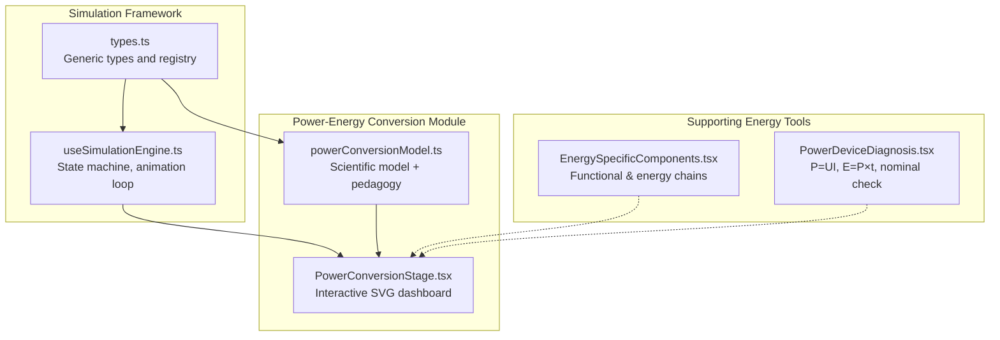
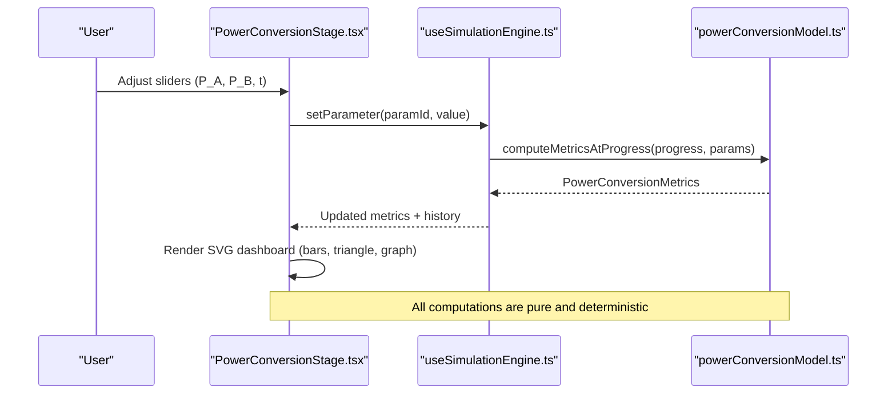
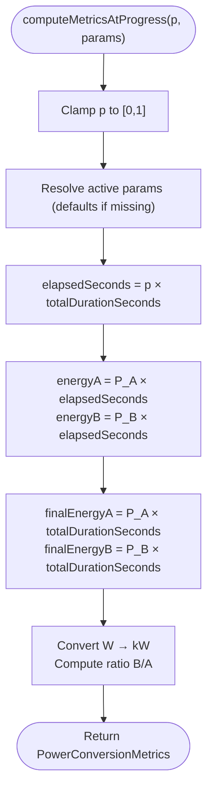
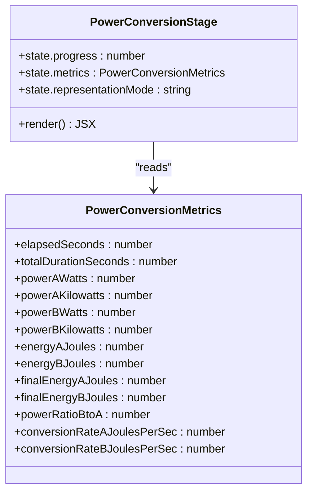
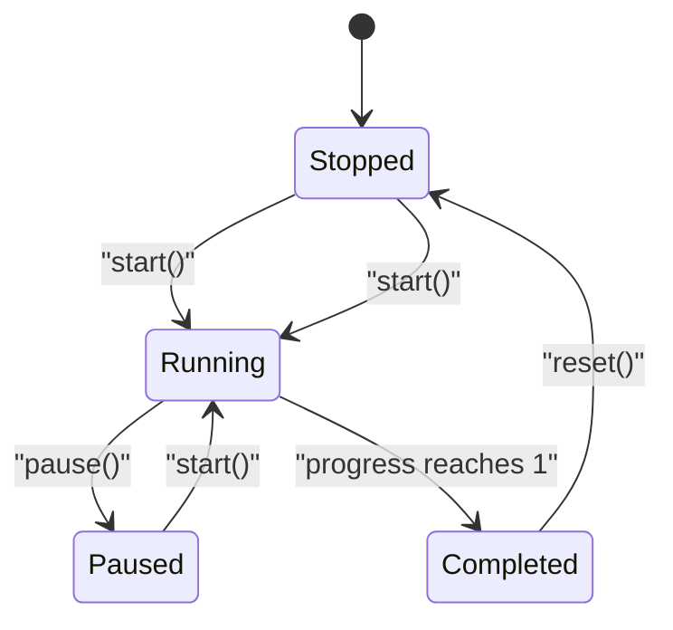
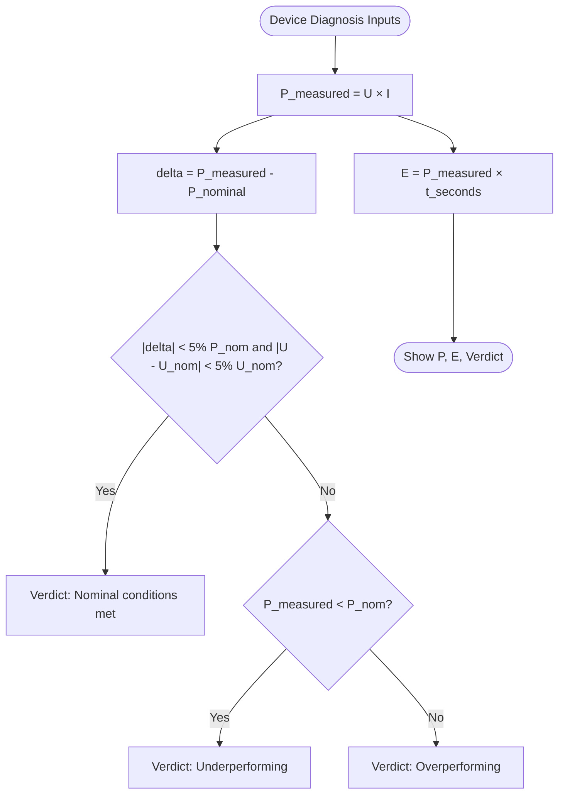
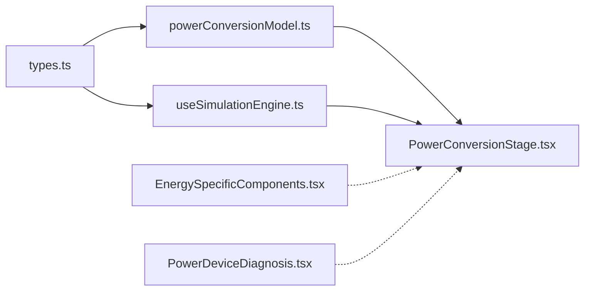

# Power-Energy Conversion Simulation

<cite>
**Referenced Files in This Document**
- [PowerConversionStage.tsx](file://src/components/physics/simulations/pilots/PowerConversionStage.tsx)
- [powerConversionModel.ts](file://src/components/physics/simulations/pilots/powerConversionModel.ts)
- [types.ts](file://src/components/physics/simulations/types.ts)
- [useSimulationEngine.ts](file://src/components/physics/simulations/useSimulationEngine.ts)
- [EnergySpecificComponents.tsx](file://src/components/physics/EnergySpecificComponents.tsx)
- [PowerDeviceDiagnosis.tsx](file://src/components/physics/PowerDeviceDiagnosis.tsx)
</cite>

## Table of Contents
1. [Introduction](#introduction)
2. [Project Structure](#project-structure)
3. [Core Components](#core-components)
4. [Architecture Overview](#architecture-overview)
5. [Detailed Component Analysis](#detailed-component-analysis)
6. [Dependency Analysis](#dependency-analysis)
7. [Performance Considerations](#performance-considerations)
8. [Troubleshooting Guide](#troubleshooting-guide)
9. [Conclusion](#conclusion)
10. [Appendices](#appendices)

## Introduction
This document explains the power-energy conversion simulation that teaches and visualizes the relationship between electrical power, energy consumption, and time:
- P = E / t
- E = P × t
- t = E / P

The simulation supports interactive exploration of two devices with different power ratings, shows how energy accumulates over time, and provides pedagogical guidance for wattage calculations, kilowatt-hour measurements, and practical applications in household and industrial contexts. It also includes complementary tools for device diagnosis and energy chain visualization to reinforce concepts such as useful versus dissipated energy and unit conversions.

## Project Structure
The power-energy conversion simulation is implemented as part of a broader physics-simulation framework. The relevant pieces are:
- A scientific model that computes deterministic metrics from user parameters.
- A React stage component that renders an interactive SVG dashboard.
- A generic simulation engine hook that manages state, animation, parameter updates, and history building.
- Supporting components for energy chains, circuit diagrams, and device diagnosis.

**Diagram sources**
- [types.ts:1-290](file://src/components/physics/simulations/types.ts#L1-L290)
- [useSimulationEngine.ts:1-480](file://src/components/physics/simulations/useSimulationEngine.ts#L1-L480)
- [powerConversionModel.ts:1-446](file://src/components/physics/simulations/pilots/powerConversionModel.ts#L1-L446)
- [PowerConversionStage.tsx:1-750](file://src/components/physics/simulations/pilots/PowerConversionStage.tsx#L1-L750)
- [EnergySpecificComponents.tsx:1-820](file://src/components/physics/EnergySpecificComponents.tsx#L1-L820)
- [PowerDeviceDiagnosis.tsx:1-179](file://src/components/physics/PowerDeviceDiagnosis.tsx#L1-L179)

**Section sources**
- [types.ts:1-290](file://src/components/physics/simulations/types.ts#L1-L290)
- [useSimulationEngine.ts:1-480](file://src/components/physics/simulations/useSimulationEngine.ts#L1-L480)
- [powerConversionModel.ts:1-446](file://src/components/physics/simulations/pilots/powerConversionModel.ts#L1-L446)
- [PowerConversionStage.tsx:1-750](file://src/components/physics/simulations/pilots/PowerConversionStage.tsx#L1-L750)
- [EnergySpecificComponents.tsx:1-820](file://src/components/physics/EnergySpecificComponents.tsx#L1-L820)
- [PowerDeviceDiagnosis.tsx:1-179](file://src/components/physics/PowerDeviceDiagnosis.tsx#L1-L179)

## Core Components
- Scientific model (powerConversionModel.ts): Defines parameters, metrics, computation logic, validation, and pedagogical content.
- Interactive stage (PowerConversionStage.tsx): Renders device cards, energy bars, a dynamic E=f(t) graph, and a live E-P-t triangle.
- Simulation engine (useSimulationEngine.ts): Manages runtime state, animation, parameter changes, and deterministic history generation.
- Supporting tools:
  - Energy-specific components (EnergySpecificComponents.tsx): Functional and energy chains, circuit diagram, key formulas, units.
  - Device diagnosis (PowerDeviceDiagnosis.tsx): Nominal vs measured power, energy calculation, conformance verdict.

Key relationships:
- Parameters: P_A (W), P_B (W), operating duration t (s).
- Metrics: elapsedSeconds, totalDurationSeconds, powerAWatts/BWatts, energyAJoules/BJoules, final energies, ratios, conversion rates.
- Algorithms: E = P × t; P = E / t; t = E / P; unit conversions W ↔ kW; J ↔ Wh/kWh via supporting blocks.

**Section sources**
- [powerConversionModel.ts:8-44](file://src/components/physics/simulations/pilots/powerConversionModel.ts#L8-L44)
- [powerConversionModel.ts:153-264](file://src/components/physics/simulations/pilots/powerConversionModel.ts#L153-L264)
- [PowerConversionStage.tsx:1-750](file://src/components/physics/simulations/pilots/PowerConversionStage.tsx#L1-L750)
- [useSimulationEngine.ts:100-302](file://src/components/physics/simulations/useSimulationEngine.ts#L100-L302)
- [EnergySpecificComponents.tsx:716-800](file://src/components/physics/EnergySpecificComponents.tsx#L716-L800)
- [PowerDeviceDiagnosis.tsx:43-179](file://src/components/physics/PowerDeviceDiagnosis.tsx#L43-L179)

## Architecture Overview
The simulation follows a clean separation of concerns:
- Data-driven parameters and metrics defined in the model.
- Pure computation functions for deterministic results.
- A React stage component focused on visualization.
- A reusable engine hook handling lifecycle, animation, and state transitions.

**Diagram sources**
- [PowerConversionStage.tsx:1-750](file://src/components/physics/simulations/pilots/PowerConversionStage.tsx#L1-L750)
- [useSimulationEngine.ts:221-252](file://src/components/physics/simulations/useSimulationEngine.ts#L221-L252)
- [powerConversionModel.ts:172-222](file://src/components/physics/simulations/pilots/powerConversionModel.ts#L172-L222)

## Detailed Component Analysis

### Scientific Model: Power Conversion
Responsibilities:
- Define manipulable parameters: P_A (W), P_B (W), operating duration t (s).
- Compute metrics at any normalized progress p ∈ [0,1]:
  - elapsedSeconds = p × totalDurationSeconds
  - energyA = P_A × elapsedSeconds
  - energyB = P_B × elapsedSeconds
  - finalEnergyA = P_A × totalDurationSeconds
  - finalEnergyB = P_B × totalDurationSeconds
  - powerAKilowatts = P_A / 1000
  - powerBKilowatts = P_B / 1000
  - powerRatioBtoA = P_B / P_A
  - conversionRateA = P_A (J/s)
  - conversionRateB = P_B (J/s)
- Validate invariants: positive powers/duration, consistency of final energies, and rounding tolerance for instantaneous energies.
- Provide pedagogical content: objectives, observations, guided questions, conclusions, and fallback summary.

Complexity:
- Time complexity per step: O(1).
- Space complexity: O(1) for metrics; history grows linearly with sampled points.

Optimization opportunities:
- Precompute constants if parameters rarely change during a run.
- Memoize derived values like ratios and conversions when parameters are stable.

Error handling:
- clampProgress ensures p ∈ [0,1].
- validateInvariants guards against inconsistent metrics.

**Diagram sources**
- [powerConversionModel.ts:172-222](file://src/components/physics/simulations/pilots/powerConversionModel.ts#L172-L222)

**Section sources**
- [powerConversionModel.ts:8-44](file://src/components/physics/simulations/pilots/powerConversionModel.ts#L8-L44)
- [powerConversionModel.ts:153-264](file://src/components/physics/simulations/pilots/powerConversionModel.ts#L153-L264)
- [powerConversionModel.ts:266-446](file://src/components/physics/simulations/pilots/powerConversionModel.ts#L266-L446)

### Interactive Stage: Power Conversion Dashboard
Features:
- Two device cards showing:
  - P_A and P_B in W and kW
  - Conversion rate in J/s
  - Live energy bar E = P × t
  - Final energy at t_total
- Dynamic E-P-t triangle illustrating P = E/t, E = P×t, t = E/P and unit relations.
- Optional dual-mode graph E = f(t) showing linear growth with slope equal to power.
- Four metric cards: E_A, E_B, elapsed time, and power ratio.

Data flow:
- Reads metrics from state.
- Computes fill ratios for bars based on max(final energies).
- Renders SVG elements for bars, triangle, and graph lines.

Accessibility:
- aria-labels describe the SVG scenes.
- Directional attributes ensure correct text layout.

**Diagram sources**
- [PowerConversionStage.tsx:1-750](file://src/components/physics/simulations/pilots/PowerConversionStage.tsx#L1-L750)
- [powerConversionModel.ts:17-44](file://src/components/physics/simulations/pilots/powerConversionModel.ts#L17-L44)

**Section sources**
- [PowerConversionStage.tsx:1-750](file://src/components/physics/simulations/pilots/PowerConversionStage.tsx#L1-L750)

### Simulation Engine: State Machine and Animation
Responsibilities:
- Initialize state with default parameters and metrics.
- Manage start, pause, reset, speed control, parameter updates, and progress jumps.
- Build deterministic history for graphs by sampling metrics at fixed intervals.
- Respect reduced-motion preferences and pause when off-screen.

Key operations:
- clampProgress(value): Ensures progress stays within [0,1].
- buildDeterministicHistory(model, progress, params): Generates sample points for charts.
- setSimulationParameterState(...): Updates parameters and recalculates metrics/history.
- stepSimulationByDeltaSeconds(...): Advances simulation based on real-time delta and speed.

**Diagram sources**
- [useSimulationEngine.ts:133-178](file://src/components/physics/simulations/useSimulationEngine.ts#L133-L178)
- [useSimulationEngine.ts:254-302](file://src/components/physics/simulations/useSimulationEngine.ts#L254-L302)

**Section sources**
- [useSimulationEngine.ts:1-480](file://src/components/physics/simulations/useSimulationEngine.ts#L1-L480)

### Supporting Tools: Energy Chains and Device Diagnosis
Energy chains:
- Visualizes functional and energy chains for three systems (lamp, fan, hydro).
- Shows useful output vs dissipated heat Q, reinforcing E_reçue = E_utile + Q.
- Provides circuit diagrams and key formulas including E = P × t and unit conversions.

Device diagnosis:
- Accepts nominal voltage/power and measured U, I, and operating time.
- Computes measured power P = U × I and energy E = P × t.
- Compares measured vs nominal power to provide a conformance verdict.

**Diagram sources**
- [PowerDeviceDiagnosis.tsx:43-179](file://src/components/physics/PowerDeviceDiagnosis.tsx#L43-L179)

**Section sources**
- [EnergySpecificComponents.tsx:1-820](file://src/components/physics/EnergySpecificComponents.tsx#L1-L820)
- [PowerDeviceDiagnosis.tsx:1-179](file://src/components/physics/PowerDeviceDiagnosis.tsx#L1-L179)

## Dependency Analysis
- PowerConversionStage depends on:
  - types.ts for shared interfaces.
  - powerConversionModel.ts for metrics and parameters.
- useSimulationEngine.ts depends on:
  - types.ts for runtime state and model contracts.
  - powerConversionModel.ts through generic type parameters.
- EnergySpecificComponents.tsx and PowerDeviceDiagnosis.tsx are independent but conceptually aligned with the same physics principles.

**Diagram sources**
- [types.ts:1-290](file://src/components/physics/simulations/types.ts#L1-L290)
- [useSimulationEngine.ts:1-480](file://src/components/physics/simulations/useSimulationEngine.ts#L1-L480)
- [powerConversionModel.ts:1-446](file://src/components/physics/simulations/pilots/powerConversionModel.ts#L1-L446)
- [PowerConversionStage.tsx:1-750](file://src/components/physics/simulations/pilots/PowerConversionStage.tsx#L1-L750)
- [EnergySpecificComponents.tsx:1-820](file://src/components/physics/EnergySpecificComponents.tsx#L1-L820)
- [PowerDeviceDiagnosis.tsx:1-179](file://src/components/physics/PowerDeviceDiagnosis.tsx#L1-L179)

**Section sources**
- [types.ts:1-290](file://src/components/physics/simulations/types.ts#L1-L290)
- [useSimulationEngine.ts:1-480](file://src/components/physics/simulations/useSimulationEngine.ts#L1-L480)
- [powerConversionModel.ts:1-446](file://src/components/physics/simulations/pilots/powerConversionModel.ts#L1-L446)
- [PowerConversionStage.tsx:1-750](file://src/components/physics/simulations/pilots/PowerConversionStage.tsx#L1-L750)
- [EnergySpecificComponents.tsx:1-820](file://src/components/physics/EnergySpecificComponents.tsx#L1-L820)
- [PowerDeviceDiagnosis.tsx:1-179](file://src/components/physics/PowerDeviceDiagnosis.tsx#L1-L179)

## Performance Considerations
- Deterministic computation: All core calculations are O(1) per frame, ensuring smooth animations even with frequent re-renders.
- History sampling: Fixed number of samples (e.g., up to 20 steps) keeps chart data lightweight.
- Reduced motion: Respects system preferences to avoid unnecessary animations.
- Off-screen pausing: Uses IntersectionObserver to pause when not visible, saving CPU cycles.

[No sources needed since this section provides general guidance]

## Troubleshooting Guide
Common issues and resolutions:
- Progress stuck at 0 or 1:
  - Ensure start() is called and status is 'running'.
  - Check clampProgress behavior and that elapsed time advances correctly.
- Metrics inconsistency:
  - validateInvariants will fail if final energies do not match P × t_total or if instantaneous energies deviate beyond tolerance.
- Parameter out-of-range:
  - setSimulationParameterState clamps values to min/max defined in model.parameters.
- Graph not updating:
  - Verify extractHistoryValues returns expected keys and that buildDeterministicHistory is invoked after parameter changes.

**Section sources**
- [powerConversionModel.ts:224-253](file://src/components/physics/simulations/pilots/powerConversionModel.ts#L224-L253)
- [useSimulationEngine.ts:221-252](file://src/components/physics/simulations/useSimulationEngine.ts#L221-L252)
- [useSimulationEngine.ts:254-302](file://src/components/physics/simulations/useSimulationEngine.ts#L254-L302)

## Conclusion
The power-energy conversion simulation offers a rigorous, interactive learning environment for understanding P = E/t, E = P×t, and t = E/P. Through clear visuals, deterministic computations, and guided pedagogy, it helps learners connect abstract formulas to real-world scenarios involving watts, joules, kilowatt-hours, and cost implications. Complementary tools for energy chains and device diagnosis extend the educational scope to practical household and industrial applications.

[No sources needed since this section summarizes without analyzing specific files]

## Appendices

### Calculation Algorithms Summary
- Instantaneous energy: E(t) = P × t
- Final energy: E_final = P × t_total
- Unit conversions:
  - 1 kW = 1000 W
  - 1 Wh = 3600 J
  - 1 kWh = 1000 Wh
- Ratios:
  - P_B / P_A = E_B / E_A for equal durations

**Section sources**
- [powerConversionModel.ts:172-222](file://src/components/physics/simulations/pilots/powerConversionModel.ts#L172-L222)
- [EnergySpecificComponents.tsx:716-800](file://src/components/physics/EnergySpecificComponents.tsx#L716-L800)

### Practical Scenarios and Calculations
- LED lamp (10 W) for 10 s:
  - E = 10 × 10 = 100 J
- Device B (500 W) for 10 s:
  - E = 500 × 10 = 5000 J
- Water heater (2000 W = 2 kW) for 10 s:
  - E = 2000 × 10 = 20000 J
- Two lamps (20 W and 100 W) for 1 minute:
  - Convert minutes to seconds: 1 min = 60 s
  - E_20W = 20 × 60 = 1200 J
  - E_100W = 100 × 60 = 6000 J
- Device with P = 500 W converts E = 10000 J:
  - t = E / P = 10000 / 500 = 20 s

**Section sources**
- [powerConversionModel.ts:266-446](file://src/components/physics/simulations/pilots/powerConversionModel.ts#L266-L446)

### Cost Analysis Guidance
To estimate electricity cost:
- Determine energy consumed in kWh: E_kWh = E_J / 3600000
- Multiply by tariff (currency per kWh) to get cost.
- Use the energy chains and formula blocks to understand useful vs dissipated energy and efficiency considerations.

**Section sources**
- [EnergySpecificComponents.tsx:716-800](file://src/components/physics/EnergySpecificComponents.tsx#L716-L800)