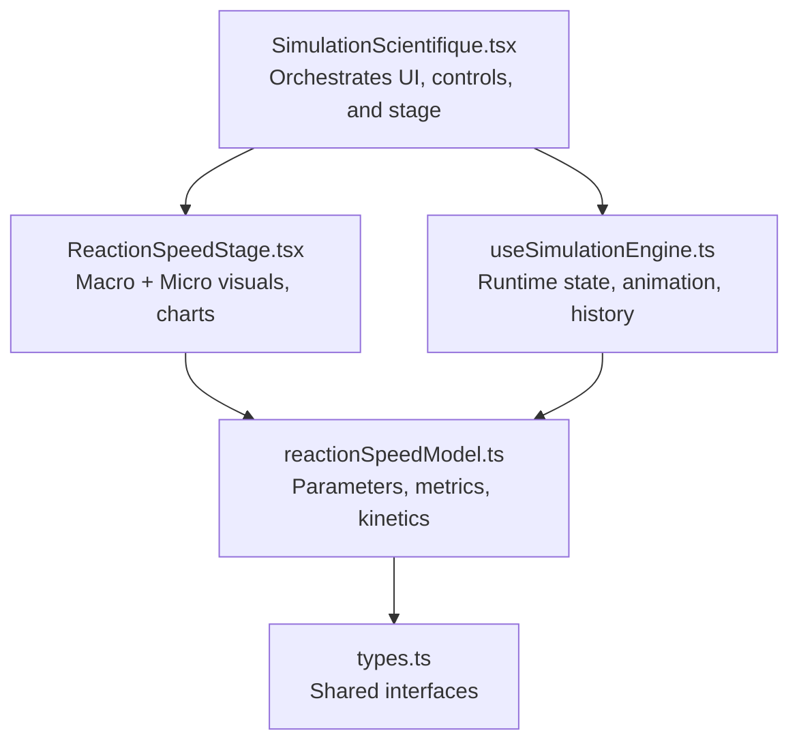
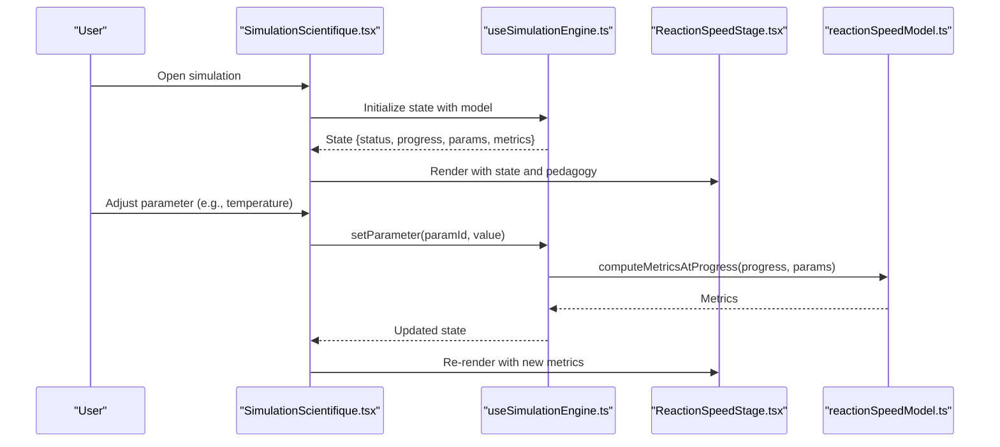
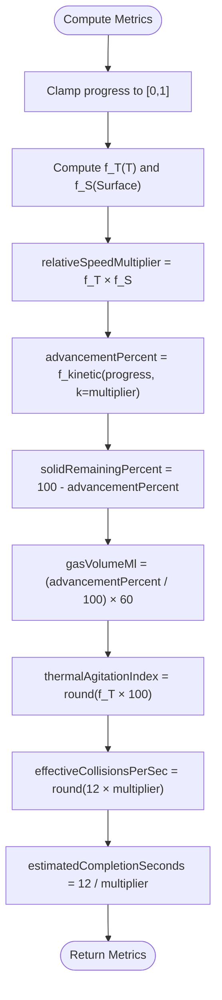
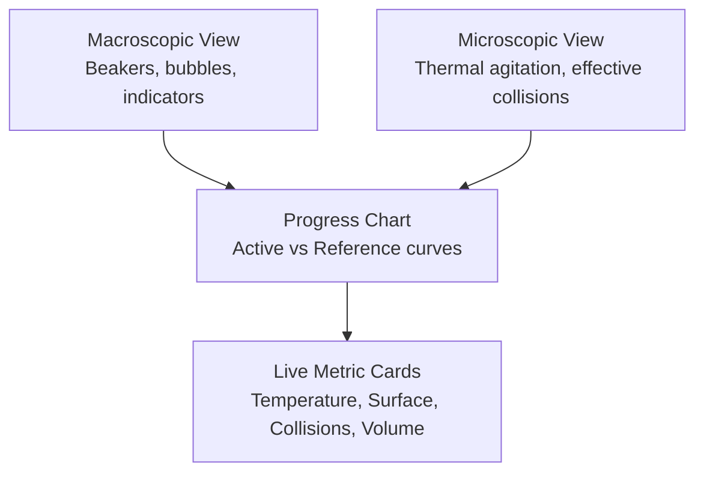
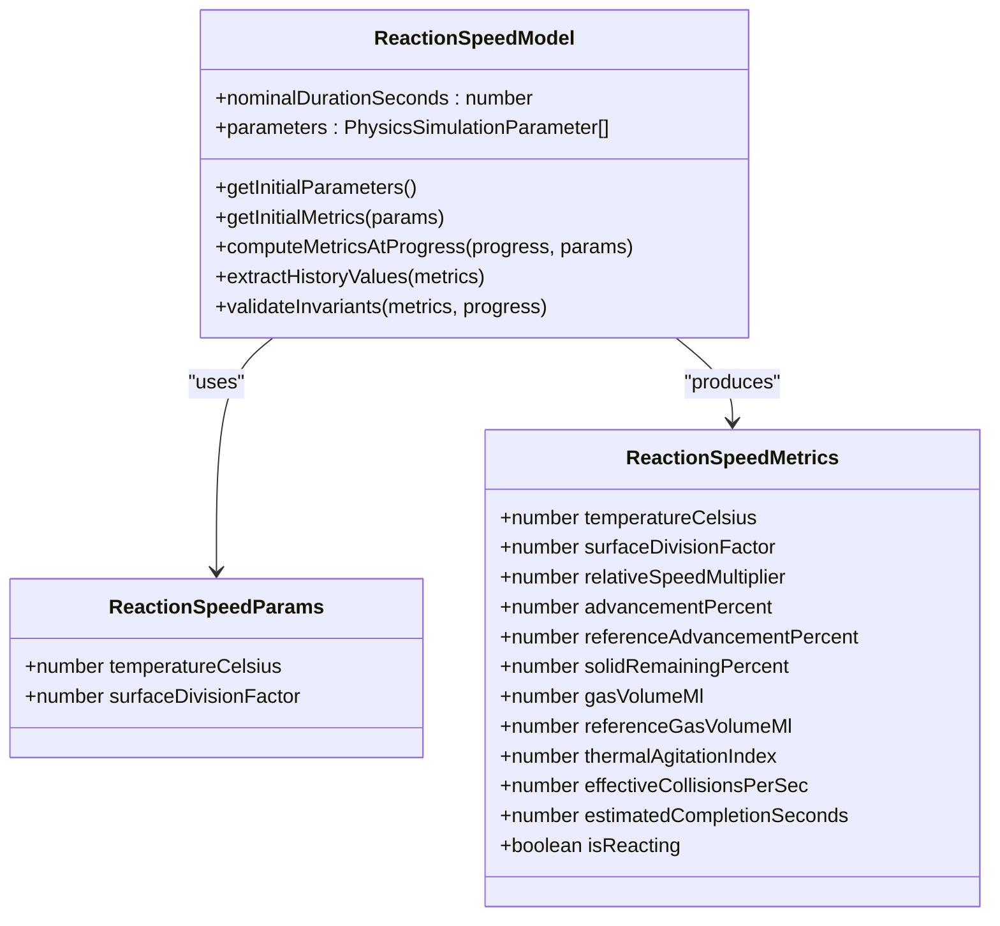
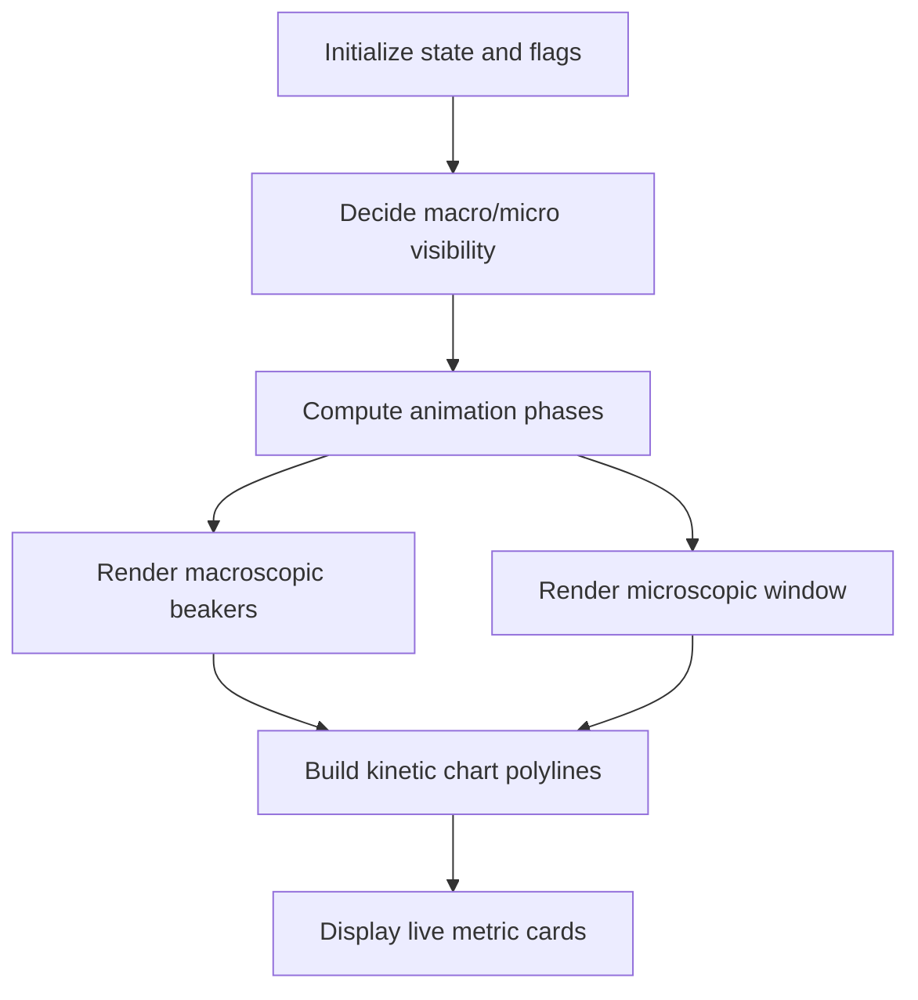
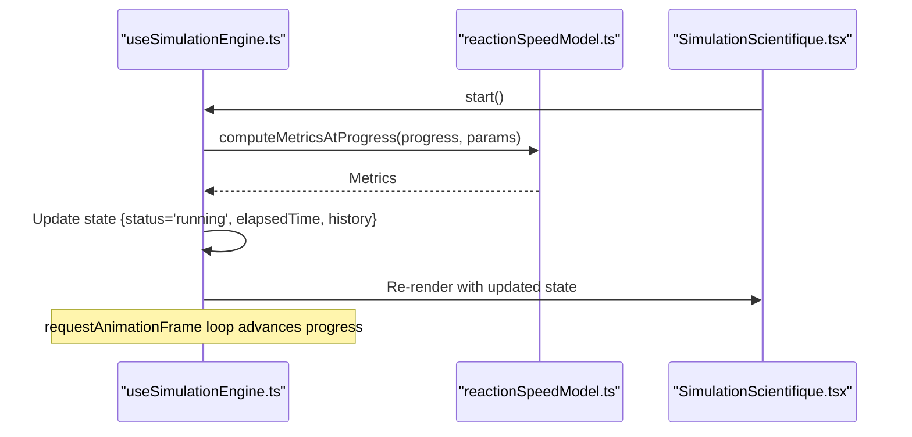
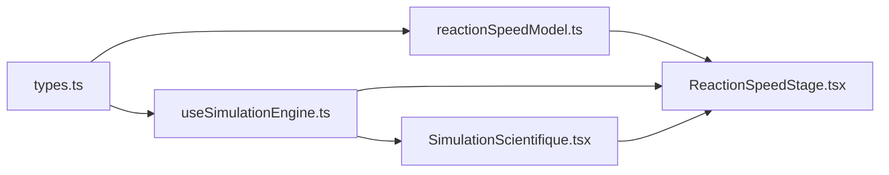

# Reaction Speed Factors Simulation

<cite>
**Referenced Files in This Document**
- [ReactionSpeedStage.tsx](file://src/components/physics/simulations/pilots/ReactionSpeedStage.tsx)
- [reactionSpeedModel.ts](file://src/components/physics/simulations/pilots/reactionSpeedModel.ts)
- [SimulationScientifique.tsx](file://src/components/physics/simulations/SimulationScientifique.tsx)
- [useSimulationEngine.ts](file://src/components/physics/simulations/useSimulationEngine.ts)
- [types.ts](file://src/components/physics/simulations/types.ts)
</cite>

## Table of Contents
1. [Introduction](#introduction)
2. [Project Structure](#project-structure)
3. [Core Components](#core-components)
4. [Architecture Overview](#architecture-overview)
5. [Detailed Component Analysis](#detailed-component-analysis)
6. [Dependency Analysis](#dependency-analysis)
7. [Performance Considerations](#performance-considerations)
8. [Troubleshooting Guide](#troubleshooting-guide)
9. [Conclusion](#conclusion)

## Introduction
This document explains the reaction speed factors simulation that helps learners explore how temperature and surface area affect chemical reaction rates. It focuses on collision theory, activation energy concepts, and rate law relationships as they are modeled in this simulation. The simulation provides:
- Interactive parameters for temperature and solid surface division
- Macroscopic visualization comparing a reference beaker with an experimental beaker
- Microscopic visualization of thermal agitation and effective collisions
- Real-time kinetic curves showing advancement versus time
- Pedagogical guidance through observation prompts and guided questions

The simulation is part of a broader scientific simulation framework used across physics and chemistry modules.

## Project Structure
The reaction speed simulation is implemented as a stage component integrated into a generic simulation engine. Key files:
- Stage component: renders macroscopic and microscopic views and real-time metrics
- Scientific model: defines parameters, metrics, and deterministic calculations
- Simulation engine hook: manages state, animation loop, parameter changes, and history
- Types: define shared interfaces for models, stages, runtime state, and registry entries
- Simulation orchestrator: composes UI controls, parameter panels, and stage rendering

**Diagram sources**
- [SimulationScientifique.tsx:138-170](file://src/components/physics/simulations/SimulationScientifique.tsx#L138-L170)
- [useSimulationEngine.ts:309-479](file://src/components/physics/simulations/useSimulationEngine.ts#L309-L479)
- [ReactionSpeedStage.tsx:14-25](file://src/components/physics/simulations/pilots/ReactionSpeedStage.tsx#L14-L25)
- [reactionSpeedModel.ts:139-179](file://src/components/physics/simulations/pilots/reactionSpeedModel.ts#L139-L179)
- [types.ts:242-289](file://src/components/physics/simulations/types.ts#L242-L289)

**Section sources**
- [SimulationScientifique.tsx:138-170](file://src/components/physics/simulations/SimulationScientifique.tsx#L138-L170)
- [useSimulationEngine.ts:309-479](file://src/components/physics/simulations/useSimulationEngine.ts#L309-L479)
- [ReactionSpeedStage.tsx:14-25](file://src/components/physics/simulations/pilots/ReactionSpeedStage.tsx#L14-L25)
- [reactionSpeedModel.ts:139-179](file://src/components/physics/simulations/pilots/reactionSpeedModel.ts#L139-L179)
- [types.ts:242-289](file://src/components/physics/simulations/types.ts#L242-L289)

## Core Components
- ReactionSpeedStage: React component that renders the interactive scene, including macroscopic beakers, microscopic particle windows, kinetic charts, and live metric cards. It reads state from the simulation engine and uses pedagogical content to guide observations.
- reactionSpeedModel: Pure scientific model defining parameters (temperature and surface division), initial metrics, kinetic advancement calculation, gas volume mapping, and invariant validation. It also includes pedagogical content such as objectives, warnings, dynamic observations, and guided questions.
- useSimulationEngine: Generic React hook managing simulation lifecycle, animation loop via requestAnimationFrame, parameter updates, reduced motion support, intersection observer-based pause when off-screen, and deterministic history building.
- types: Shared TypeScript interfaces for simulation models, runtime state, parameters, stage props, registry entries, and pedagogical content.

Key responsibilities:
- Model: deterministic computation of metrics based on normalized progress and parameters
- Engine: state transitions, timing, and history generation
- Stage: visual feedback and user interaction
- Orchestrator: composition of controls, parameter panel, and stage

**Section sources**
- [ReactionSpeedStage.tsx:14-25](file://src/components/physics/simulations/pilots/ReactionSpeedStage.tsx#L14-L25)
- [reactionSpeedModel.ts:8-40](file://src/components/physics/simulations/pilots/reactionSpeedModel.ts#L8-L40)
- [useSimulationEngine.ts:309-479](file://src/components/physics/simulations/useSimulationEngine.ts#L309-L479)
- [types.ts:121-146](file://src/components/physics/simulations/types.ts#L121-L146)

## Architecture Overview
The simulation follows a layered architecture:
- Presentation layer: SimulationScientifique.tsx composes UI controls, parameter panel, and delegates rendering to the stage component.
- Interaction layer: useSimulationEngine.ts manages runtime state, animation, and parameter changes.
- Domain layer: reactionSpeedModel.ts encapsulates scientific laws and pedagogical content.
- Contract layer: types.ts defines shared interfaces ensuring consistency across layers.

**Diagram sources**
- [SimulationScientifique.tsx:138-170](file://src/components/physics/simulations/SimulationScientifique.tsx#L138-L170)
- [useSimulationEngine.ts:221-251](file://src/components/physics/simulations/useSimulationEngine.ts#L221-L251)
- [reactionSpeedModel.ts:181-242](file://src/components/physics/simulations/pilots/reactionSpeedModel.ts#L181-L242)
- [ReactionSpeedStage.tsx:14-25](file://src/components/physics/simulations/pilots/ReactionSpeedStage.tsx#L14-L25)

## Detailed Component Analysis

### Collision Theory and Activation Energy Concepts
- Temperature effect: Higher temperature increases thermal agitation, increasing the frequency of effective collisions between reactant particles. In the model, temperature influences a thermal factor that scales relative speed and agitation index.
- Surface area effect: Dividing the solid reactant into fragments or powder exposes more particles to collisions, increasing effective collision frequency. The model maps surface division factors to a surface factor multiplier.
- Effective collisions: The simulation displays effective collisions per second and thermal agitation index to visualize the micro-level explanation behind macroscopic rate changes.
- Activation energy concept: While not explicitly modeled as an Arrhenius equation, the simulation conveys the idea that higher temperature and greater surface area increase the number of effective collisions needed to overcome activation barriers.

Pedagogical content emphasizes:
- Raising temperature or increasing surface area increases effective collisions per second, which increases reaction rate.
- Final product quantity remains the same; only the duration changes.

**Section sources**
- [reactionSpeedModel.ts:103-116](file://src/components/physics/simulations/pilots/reactionSpeedModel.ts#L103-L116)
- [reactionSpeedModel.ts:292-358](file://src/components/physics/simulations/pilots/reactionSpeedModel.ts#L292-L358)
- [ReactionSpeedStage.tsx:558-883](file://src/components/physics/simulations/pilots/ReactionSpeedStage.tsx#L558-L883)

### Rate Law Relationships in the Simulation
- Relative speed multiplier: Computed as the product of thermal factor and surface factor. This multiplier scales the kinetic advancement curve.
- Kinetic advancement percent: Uses a deterministic monotonic function that reaches 100% at normalized progress = 1 for the reference case. The function models faster initial reaction and deceleration near completion.
- Gas volume: Proportional to advancement percent, capped at a maximum volume (60 mL).
- Estimated completion time: Derived from nominal duration divided by relative speed multiplier.

**Diagram sources**
- [reactionSpeedModel.ts:181-242](file://src/components/physics/simulations/pilots/reactionSpeedModel.ts#L181-L242)

**Section sources**
- [reactionSpeedModel.ts:103-133](file://src/components/physics/simulations/pilots/reactionSpeedModel.ts#L103-L133)
- [reactionSpeedModel.ts:181-242](file://src/components/physics/simulations/pilots/reactionSpeedModel.ts#L181-L242)

### Interactive Parameters Users Can Adjust
- Temperature (°C): Range 10–60°C with presets for cold (10°C), reference (25°C), and hot (50°C). Increasing temperature raises thermal agitation and effective collisions.
- Surface Division Factor: Discrete options representing whole tablet (×1), fragmented (×2), and fine powder (×4). Increasing surface exposure increases effective collisions.

These parameters are exposed via a parameter panel with sliders or preset buttons depending on configuration. Changes immediately recalculate metrics and update visuals.

**Section sources**
- [reactionSpeedModel.ts:42-98](file://src/components/physics/simulations/pilots/reactionSpeedModel.ts#L42-L98)
- [SimulationScientifique.tsx:431-579](file://src/components/physics/simulations/SimulationScientifique.tsx#L431-L579)

### Visual Feedback Mechanisms
- Macroscopic view: Two beakers side-by-side. Reference beaker shows baseline behavior (25°C, ×1). Experimental beaker reflects current temperature and surface division. Bubble animations indicate effervescence intensity proportional to reaction speed. Numerical indicators show advancement percentage and gas volume.
- Microscopic view: Particle window illustrating thermal agitation vectors and solid reactant representation according to surface division. Effective collision counter and agitation index are displayed.
- Kinetic chart: Dynamic plot of advancement percent versus time, comparing active experiment curve with reference curve. Current positions are marked on both curves.

**Diagram sources**
- [ReactionSpeedStage.tsx:86-556](file://src/components/physics/simulations/pilots/ReactionSpeedStage.tsx#L86-L556)
- [ReactionSpeedStage.tsx:558-883](file://src/components/physics/simulations/pilots/ReactionSpeedStage.tsx#L558-L883)
- [ReactionSpeedStage.tsx:885-1137](file://src/components/physics/simulations/pilots/ReactionSpeedStage.tsx#L885-L1137)

**Section sources**
- [ReactionSpeedStage.tsx:86-556](file://src/components/physics/simulations/pilots/ReactionSpeedStage.tsx#L86-L556)
- [ReactionSpeedStage.tsx:558-883](file://src/components/physics/simulations/pilots/ReactionSpeedStage.tsx#L558-L883)
- [ReactionSpeedStage.tsx:885-1137](file://src/components/physics/simulations/pilots/ReactionSpeedStage.tsx#L885-L1137)

### Technical Implementation Details

#### Reaction Speed Model Calculations
- Thermal factor: Monotonic scaling with temperature, normalized to 1.00 at 25°C.
- Surface factor: Discrete multipliers for surface division states.
- Kinetic advancement: Deterministic function using a power-law shape to simulate rapid initial reaction and slowing near completion.
- Gas volume: Linearly proportional to advancement percent.
- Effective collisions: Scaled by relative speed multiplier.
- Estimated completion time: Inversely proportional to relative speed multiplier.

**Diagram sources**
- [reactionSpeedModel.ts:8-40](file://src/components/physics/simulations/pilots/reactionSpeedModel.ts#L8-L40)
- [reactionSpeedModel.ts:139-287](file://src/components/physics/simulations/pilots/reactionSpeedModel.ts#L139-L287)

**Section sources**
- [reactionSpeedModel.ts:103-133](file://src/components/physics/simulations/pilots/reactionSpeedModel.ts#L103-L133)
- [reactionSpeedModel.ts:181-242](file://src/components/physics/simulations/pilots/reactionSpeedModel.ts#L181-L242)
- [reactionSpeedModel.ts:244-287](file://src/components/physics/simulations/pilots/reactionSpeedModel.ts#L244-L287)

#### Stage Component Architecture
- Props: Receives runtime state, pedagogy content, and control callbacks.
- Rendering logic: Determines visibility of macroscopic/microscopic views based on representation mode. Computes animation phases for bubbles and particles. Builds polyline points for kinetic charts.
- Visual elements: SVG-based beakers, thermometer, solid representations, particle vectors, effective collision counters, and dynamic charts.
- Accessibility: Includes aria labels and roles for screen readers.

**Diagram sources**
- [ReactionSpeedStage.tsx:14-25](file://src/components/physics/simulations/pilots/ReactionSpeedStage.tsx#L14-L25)
- [ReactionSpeedStage.tsx:27-76](file://src/components/physics/simulations/pilots/ReactionSpeedStage.tsx#L27-L76)
- [ReactionSpeedStage.tsx:86-556](file://src/components/physics/simulations/pilots/ReactionSpeedStage.tsx#L86-L556)
- [ReactionSpeedStage.tsx:558-883](file://src/components/physics/simulations/pilots/ReactionSpeedStage.tsx#L558-L883)
- [ReactionSpeedStage.tsx:885-1137](file://src/components/physics/simulations/pilots/ReactionSpeedStage.tsx#L885-L1137)

**Section sources**
- [ReactionSpeedStage.tsx:14-25](file://src/components/physics/simulations/pilots/ReactionSpeedStage.tsx#L14-L25)
- [ReactionSpeedStage.tsx:27-76](file://src/components/physics/simulations/pilots/ReactionSpeedStage.tsx#L27-L76)
- [ReactionSpeedStage.tsx:86-556](file://src/components/physics/simulations/pilots/ReactionSpeedStage.tsx#L86-L556)
- [ReactionSpeedStage.tsx:558-883](file://src/components/physics/simulations/pilots/ReactionSpeedStage.tsx#L558-L883)
- [ReactionSpeedStage.tsx:885-1137](file://src/components/physics/simulations/pilots/ReactionSpeedStage.tsx#L885-L1137)

#### Simulation Engine Hook
- State management: Creates initial state, handles start/pause/reset, speed changes, parameter updates, and progress jumps.
- Animation loop: Uses requestAnimationFrame to advance simulation time proportionally to nominal duration and speed setting.
- Reduced motion: Respects system preferences and allows toggling; in reduced motion mode, starting advances to key pedagogical milestones.
- Intersection observer: Pauses simulation when the container is off-screen to save resources.
- History building: Generates deterministic history points for charting based on model metrics.

**Diagram sources**
- [useSimulationEngine.ts:133-165](file://src/components/physics/simulations/useSimulationEngine.ts#L133-L165)
- [useSimulationEngine.ts:375-405](file://src/components/physics/simulations/useSimulationEngine.ts#L375-L405)
- [useSimulationEngine.ts:407-479](file://src/components/physics/simulations/useSimulationEngine.ts#L407-L479)

**Section sources**
- [useSimulationEngine.ts:100-128](file://src/components/physics/simulations/useSimulationEngine.ts#L100-L128)
- [useSimulationEngine.ts:133-165](file://src/components/physics/simulations/useSimulationEngine.ts#L133-L165)
- [useSimulationEngine.ts:221-251](file://src/components/physics/simulations/useSimulationEngine.ts#L221-L251)
- [useSimulationEngine.ts:309-479](file://src/components/physics/simulations/useSimulationEngine.ts#L309-L479)

## Dependency Analysis
- ReactionSpeedStage depends on:
  - SimulationRuntimeState and SimulationPedagogicalContent from types
  - ReactionSpeedMetrics and ReactionSpeedParams from reactionSpeedModel
- reactionSpeedModel depends on:
  - SimulationScientificModel interface from types
  - clampProgress utility from useSimulationEngine
- SimulationScientifique orchestrates:
  - useSimulationEngine for state and controls
  - StageComponent prop for rendering
- useSimulationEngine depends on:
  - types for interfaces
  - model for metrics computation and history extraction

**Diagram sources**
- [types.ts:242-289](file://src/components/physics/simulations/types.ts#L242-L289)
- [reactionSpeedModel.ts:1-7](file://src/components/physics/simulations/pilots/reactionSpeedModel.ts#L1-L7)
- [useSimulationEngine.ts:1-8](file://src/components/physics/simulations/useSimulationEngine.ts#L1-L8)
- [ReactionSpeedStage.tsx:1-7](file://src/components/physics/simulations/pilots/ReactionSpeedStage.tsx#L1-L7)
- [SimulationScientifique.tsx:1-14](file://src/components/physics/simulations/SimulationScientifique.tsx#L1-L14)

**Section sources**
- [types.ts:242-289](file://src/components/physics/simulations/types.ts#L242-L289)
- [reactionSpeedModel.ts:1-7](file://src/components/physics/simulations/pilots/reactionSpeedModel.ts#L1-L7)
- [useSimulationEngine.ts:1-8](file://src/components/physics/simulations/useSimulationEngine.ts#L1-L8)
- [ReactionSpeedStage.tsx:1-7](file://src/components/physics/simulations/pilots/ReactionSpeedStage.tsx#L1-L7)
- [SimulationScientifique.tsx:1-14](file://src/components/physics/simulations/SimulationScientifique.tsx#L1-L14)

## Performance Considerations
- Deterministic computations: All model functions are pure, enabling reproducible results and efficient re-renders.
- Animation efficiency: requestAnimationFrame loop caps delta time and cancels when off-screen to reduce unnecessary work.
- Reduced motion: System preference detection and manual toggle minimize animations for accessibility and performance.
- History sampling: Fixed step count (up to 20 points) ensures chart data remains lightweight while preserving curve fidelity.

[No sources needed since this section provides general guidance]

## Troubleshooting Guide
Common issues and resolutions:
- Simulation does not start: Ensure the container is visible; the engine pauses when off-screen due to intersection observer.
- No animations: Check reduced motion settings; toggle reduced motion or adjust system preferences.
- Parameters not updating metrics: Verify parameter IDs match those defined in the model and that values are within min/max ranges.
- Chart not updating: Confirm history is being rebuilt after parameter changes and progress jumps.

Validation invariants:
- Conservation of reactant: advancement percent plus solid remaining percent equals 100%.
- Bounds: Advancement and gas volume within expected ranges; relative speed multiplier positive.
- Initial state: At progress zero, advancement is zero and solid remaining is 100%.
- Gas volume proportionality: Gas volume strictly proportional to advancement percent.

**Section sources**
- [useSimulationEngine.ts:353-373](file://src/components/physics/simulations/useSimulationEngine.ts#L353-L373)
- [reactionSpeedModel.ts:244-278](file://src/components/physics/simulations/pilots/reactionSpeedModel.ts#L244-L278)

## Conclusion
The reaction speed factors simulation effectively demonstrates how temperature and surface area influence chemical reaction rates through increased effective collisions. Learners can interactively adjust parameters and observe macroscopic and microscopic effects, supported by real-time metrics and kinetic curves. The architecture cleanly separates concerns between presentation, interaction, domain logic, and contracts, ensuring maintainability and extensibility. Pedagogical content guides students through observation, measurement, comparison, and conclusion, reinforcing core scientific principles.

[No sources needed since this section summarizes without analyzing specific files]