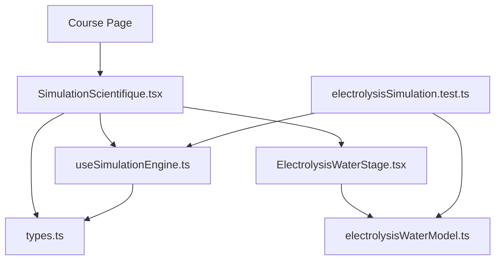
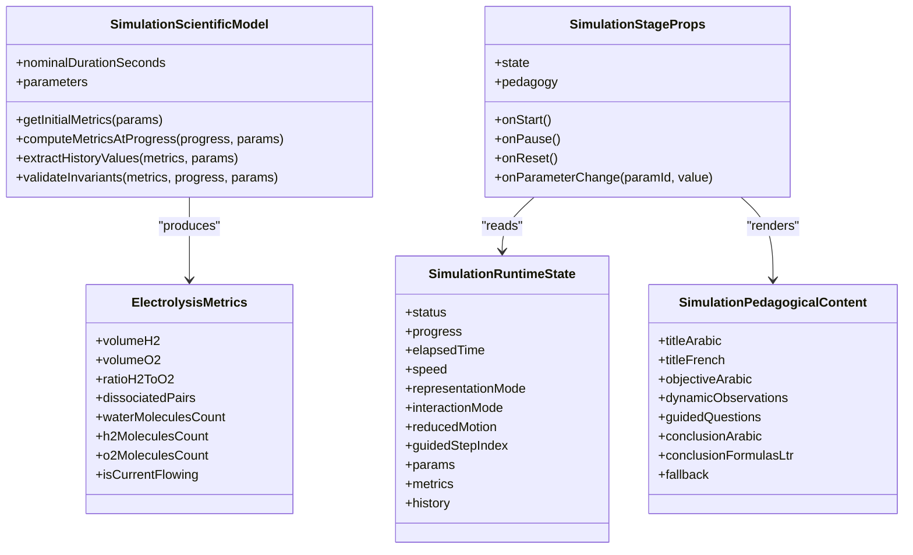
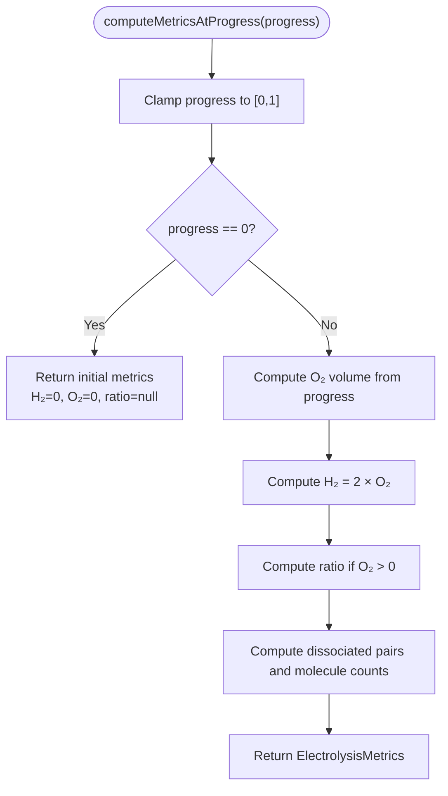
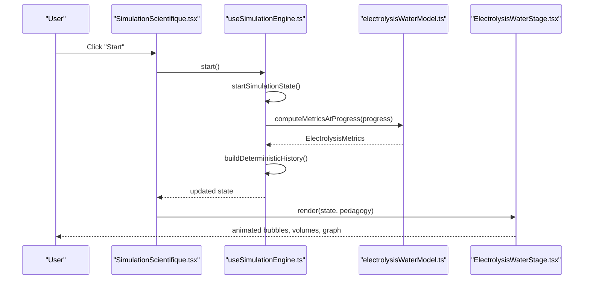
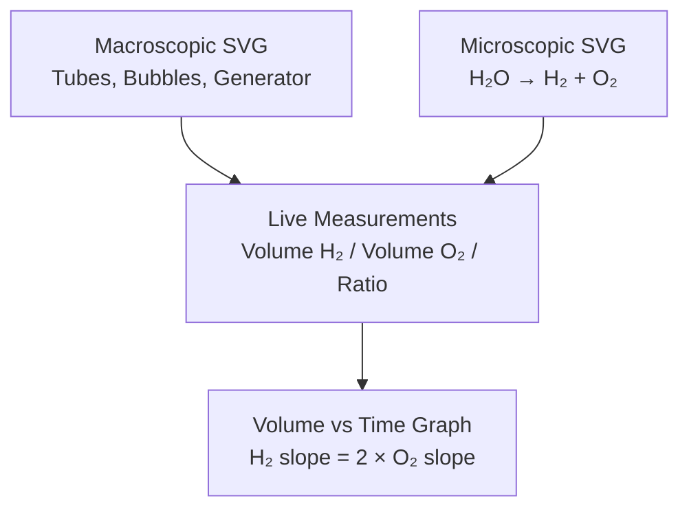
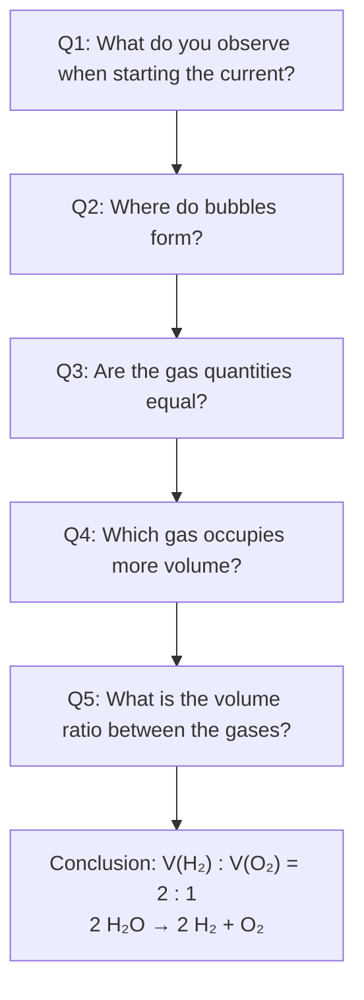
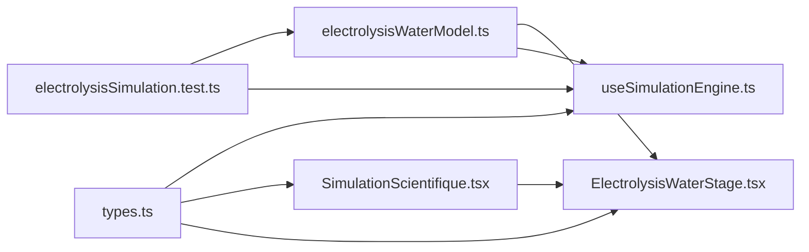

# Water Electrolysis Simulation

<cite>
**Referenced Files in This Document**
- [ElectrolysisWaterStage.tsx](file://src/components/physics/simulations/pilots/ElectrolysisWaterStage.tsx)
- [electrolysisWaterModel.ts](file://src/components/physics/simulations/pilots/electrolysisWaterModel.ts)
- [SimulationScientifique.tsx](file://src/components/physics/simulations/SimulationScientifique.tsx)
- [types.ts](file://src/components/physics/simulations/types.ts)
- [useSimulationEngine.ts](file://src/components/physics/simulations/useSimulationEngine.ts)
- [electrolysisSimulation.test.ts](file://src/components/physics/simulations/__tests__/electrolysisSimulation.test.ts)
</cite>

## Table of Contents
1. [Introduction](#introduction)
2. [Project Structure](#project-structure)
3. [Core Components](#core-components)
4. [Architecture Overview](#architecture-overview)
5. [Detailed Component Analysis](#detailed-component-analysis)
6. [Dependency Analysis](#dependency-analysis)
7. [Performance Considerations](#performance-considerations)
8. [Troubleshooting Guide](#troubleshooting-guide)
9. [Conclusion](#conclusion)

## Introduction
This document explains the water electrolysis simulation used in a physics-chemistry learning framework for middle-school students. The simulation models the decomposition of liquid water into hydrogen and oxygen gases:

- Scientific equation: 2 H₂O → 2 H₂ + O₂
- Macroscopic observation: gas bubbles at both electrodes, with more hydrogen produced than oxygen
- Microscopic model: simplified molecular transformation from water molecules to hydrogen and oxygen molecules
- Key discovery: the collected volumes satisfy V(H₂) : V(O₂) = 2 : 1

The system is built as a reusable simulation framework where each simulation has:
- Declarative pedagogical content
- A deterministic scientific model
- A runtime engine managing animation, progress, parameters, and history
- A stage component rendering macroscopic and microscopic views
- Guided questions and dynamic observations

## Project Structure
The water electrolysis simulation lives under the physics simulations module. Its main responsibilities are split across five files:

| File | Responsibility |
|---|---|
| `ElectrolysisWaterStage.tsx` | Interactive SVG scene showing macroscopic apparatus, microscopic molecules, real-time measurements, and volume vs time graph |
| `electrolysisWaterModel.ts` | Deterministic scientific model, metrics interface, constants, and pedagogical content |
| `SimulationScientifique.tsx` | Generic simulation shell: controls, representation modes, guided mode, fallback view, error boundary |
| `types.ts` | Shared types for state, parameters, registry entries, and pedagogical structures |
| `useSimulationEngine.ts` | Animation loop, state transitions, deterministic history building, reduced motion support |
| `electrolysisSimulation.test.ts` | Automated tests covering initialization, progression, pause/resume, reset, ratio invariants, speed, and accessibility |

**Diagram sources**
- [SimulationScientifique.tsx:138-170](file://src/components/physics/simulations/SimulationScientifique.tsx#L138-L170)
- [useSimulationEngine.ts:309-479](file://src/components/physics/simulations/useSimulationEngine.ts#L309-L479)
- [ElectrolysisWaterStage.tsx:67-70](file://src/components/physics/simulations/pilots/ElectrolysisWaterStage.tsx#L67-L70)
- [electrolysisWaterModel.ts:35-116](file://src/components/physics/simulations/pilots/electrolysisWaterModel.ts#L35-L116)
- [types.ts:242-289](file://src/components/physics/simulations/types.ts#L242-L289)
- [electrolysisSimulation.test.ts:45-63](file://src/components/physics/simulations/__tests__/electrolysisSimulation.test.ts#L45-L63)

**Section sources**
- [ElectrolysisWaterStage.tsx:1-826](file://src/components/physics/simulations/pilots/ElectrolysisWaterStage.tsx#L1-L826)
- [electrolysisWaterModel.ts:1-268](file://src/components/physics/simulations/pilots/electrolysisWaterModel.ts#L1-L268)
- [SimulationScientifique.tsx:1-800](file://src/components/physics/simulations/SimulationScientifique.tsx#L1-L800)
- [types.ts:1-290](file://src/components/physics/simulations/types.ts#L1-L290)
- [useSimulationEngine.ts:1-480](file://src/components/physics/simulations/useSimulationEngine.ts#L1-L480)
- [electrolysisSimulation.test.ts:1-456](file://src/components/physics/simulations/__tests__/electrolysisSimulation.test.ts#L1-L456)

## Core Components
The simulation is composed of four core layers:

1. **Scientific model**: Pure functions computing volumes, molecule counts, ratios, and invariants from normalized progress.
2. **Runtime engine**: React hook managing status, progress, elapsed time, speed, parameters, representation mode, and history.
3. **Stage component**: SVG-based visualization of macroscopic and microscopic representations, plus live measurements and graphs.
4. **Pedagogical content**: Arabic/French titles, objectives, dynamic observations, guided questions, conclusions, and fallback data.

Key implementation points:
- The maximum hydrogen volume is 20 units; the maximum oxygen volume is 10 units.
- The volume invariant is enforced by computing oxygen first and deriving hydrogen as exactly twice that value.
- The microscopic model tracks dissociated pairs of water molecules and resulting H₂ and O₂ molecules.
- The interactive UI exposes play, pause, reset, speed selection, progress slider, representation toggles, and guided/exploration modes.

**Section sources**
- [electrolysisWaterModel.ts:7-28](file://src/components/physics/simulations/pilots/electrolysisWaterModel.ts#L7-L28)
- [electrolysisWaterModel.ts:51-81](file://src/components/physics/simulations/pilots/electrolysisWaterModel.ts#L51-L81)
- [useSimulationEngine.ts:100-128](file://src/components/physics/simulations/useSimulationEngine.ts#L100-L128)
- [SimulationScientifique.tsx:581-717](file://src/components/physics/simulations/SimulationScientifique.tsx#L581-L717)

## Architecture Overview
The architecture separates concerns so that scientific laws remain pure and testable while the UI remains flexible and accessible.

**Diagram sources**
- [types.ts:121-146](file://src/components/physics/simulations/types.ts#L121-L146)
- [types.ts:207-235](file://src/components/physics/simulations/types.ts#L207-L235)
- [types.ts:242-289](file://src/components/physics/simulations/types.ts#L242-L289)
- [electrolysisWaterModel.ts:7-24](file://src/components/physics/simulations/pilots/electrolysisWaterModel.ts#L7-L24)

## Detailed Component Analysis

### Scientific Model: Water Decomposition Invariants
The scientific model defines the deterministic behavior of water electrolysis. It ensures that:
- At progress 0, all volumes and product molecules are zero.
- For any positive progress, V(H₂) = 2 × V(O₂).
- The ratio H₂/O₂ equals 2 whenever oxygen volume is greater than zero.
- Atom conservation holds in the simplified microscopic model: total hydrogen atoms equal 20 and total oxygen atoms equal 10.

**Diagram sources**
- [electrolysisWaterModel.ts:51-81](file://src/components/physics/simulations/pilots/electrolysisWaterModel.ts#L51-L81)

**Section sources**
- [electrolysisWaterModel.ts:30-34](file://src/components/physics/simulations/pilots/electrolysisWaterModel.ts#L30-L34)
- [electrolysisWaterModel.ts:51-81](file://src/components/physics/simulations/pilots/electrolysisWaterModel.ts#L51-L81)
- [electrolysisWaterModel.ts:90-115](file://src/components/physics/simulations/pilots/electrolysisWaterModel.ts#L90-L115)

### Runtime Engine: Animation, Progress, and History
The runtime engine provides:
- A deterministic history builder that samples the model at fixed steps up to the current progress.
- State transition functions for start, pause, reset, speed change, parameter change, and jump-to-progress.
- An animation loop using `requestAnimationFrame`, paused when the component is out of view or when reduced motion is enabled.
- Automatic detection of system-level reduced motion preferences.

**Diagram sources**
- [SimulationScientifique.tsx:603-644](file://src/components/physics/simulations/SimulationScientifique.tsx#L603-L644)
- [useSimulationEngine.ts:133-165](file://src/components/physics/simulations/useSimulationEngine.ts#L133-L165)
- [useSimulationEngine.ts:375-405](file://src/components/physics/simulations/useSimulationEngine.ts#L375-L405)
- [ElectrolysisWaterStage.tsx:67-90](file://src/components/physics/simulations/pilots/ElectrolysisWaterStage.tsx#L67-L90)

**Section sources**
- [useSimulationEngine.ts:57-95](file://src/components/physics/simulations/useSimulationEngine.ts#L57-L95)
- [useSimulationEngine.ts:133-302](file://src/components/physics/simulations/useSimulationEngine.ts#L133-L302)
- [useSimulationEngine.ts:309-479](file://src/components/physics/simulations/useSimulationEngine.ts#L309-L479)

### Stage Component: Macroscopic and Microscopic Views
The stage component renders three educational layers:

1. **Macroscopic level**: An interactive laboratory diagram with two graduated tubes, electrodes, a DC generator, rising bubbles, and real-time volume labels.
2. **Microscopic level**: A simplified molecular diagram showing water molecules decreasing and H₂ and O₂ molecules increasing according to the stoichiometry.
3. **Measurements and graph**: Live cards for H₂ and O₂ volumes, the computed ratio, and a Volume vs Time chart showing the steeper slope for hydrogen.

**Diagram sources**
- [ElectrolysisWaterStage.tsx:131-494](file://src/components/physics/simulations/pilots/ElectrolysisWaterStage.tsx#L131-L494)
- [ElectrolysisWaterStage.tsx:497-599](file://src/components/physics/simulations/pilots/ElectrolysisWaterStage.tsx#L497-L599)
- [ElectrolysisWaterStage.tsx:602-800](file://src/components/physics/simulations/pilots/ElectrolysisWaterStage.tsx#L602-L800)

**Section sources**
- [ElectrolysisWaterStage.tsx:12-65](file://src/components/physics/simulations/pilots/ElectrolysisWaterStage.tsx#L12-L65)
- [ElectrolysisWaterStage.tsx:73-130](file://src/components/physics/simulations/pilots/ElectrolysisWaterStage.tsx#L73-L130)
- [ElectrolysisWaterStage.tsx:602-800](file://src/components/physics/simulations/pilots/ElectrolysisWaterStage.tsx#L602-L800)

### Pedagogical Content: Guided Discovery
The pedagogical content structures student exploration through:
- Arabic and French titles and objectives
- Macroscopic and microscopic warnings clarifying what is observable versus modeled
- Dynamic observations triggered by progress thresholds
- Five progressive guided questions leading from bubble observation to the 2:1 volume ratio
- Conclusions linking experimental results to the balanced chemical equation

**Diagram sources**
- [electrolysisWaterModel.ts:188-241](file://src/components/physics/simulations/pilots/electrolysisWaterModel.ts#L188-L241)
- [electrolysisWaterModel.ts:243-252](file://src/components/physics/simulations/pilots/electrolysisWaterModel.ts#L243-L252)

**Section sources**
- [electrolysisWaterModel.ts:118-148](file://src/components/physics/simulations/pilots/electrolysisWaterModel.ts#L118-L148)
- [electrolysisWaterModel.ts:149-186](file://src/components/physics/simulations/pilots/electrolysisWaterModel.ts#L149-L186)
- [electrolysisWaterModel.ts:188-252](file://src/components/physics/simulations/pilots/electrolysisWaterModel.ts#L188-L252)

### ElectrolysisMetrics Interface
The `ElectrolysisMetrics` interface captures all measurable and model-derived values shown to the learner:

| Field | Meaning |
|---|---|
| `volumeH2` | Collected hydrogen volume in arbitrary units, ranging from 0 to 20 |
| `volumeO2` | Collected oxygen volume in arbitrary units, ranging from 0 to 10 |
| `ratioH2ToO2` | Computed ratio of hydrogen to oxygen volume; null at the initial state |
| `dissociatedPairs` | Number of dissociated water pairs in the simplified microscopic sample |
| `waterMoleculesCount` | Remaining water molecules in the microscopic sample |
| `h2MoleculesCount` | Formed hydrogen molecules in the microscopic sample |
| `o2MoleculesCount` | Formed oxygen molecules in the microscopic sample |
| `isCurrentFlowing` | Whether the simulated electrical circuit is closed during active electrolysis |

This interface is consumed by the stage component to display volumes, ratios, molecule counts, and bubble animations.

**Section sources**
- [electrolysisWaterModel.ts:7-24](file://src/components/physics/simulations/pilots/electrolysisWaterModel.ts#L7-L24)
- [ElectrolysisWaterStage.tsx:71-90](file://src/components/physics/simulations/pilots/ElectrolysisWaterStage.tsx#L71-L90)
- [ElectrolysisWaterStage.tsx:622-689](file://src/components/physics/simulations/pilots/ElectrolysisWaterStage.tsx#L622-L689)

### Interactive Features
The simulation supports several interactive behaviors:

- **Current control**: Play starts the simulation, Pause freezes it, Reset returns to the initial state.
- **Progress tracking**: A slider allows jumping to any progress point from 0% to 100%.
- **Real-time volume measurements**: Cards show current H₂ and O₂ volumes and the computed ratio.
- **2:1 volume ratio discovery**: The UI highlights that hydrogen volume is double oxygen volume, consistent with the chemical equation.
- **Representation mode**: Learners can toggle macroscopic, microscopic, or both views.
- **Guided mode**: Progressive questions appear with hints and answers tied to specific progress targets.
- **Reduced motion**: Animations are disabled or converted to discrete steps for accessibility.

**Section sources**
- [SimulationScientifique.tsx:596-717](file://src/components/physics/simulations/SimulationScientifique.tsx#L596-L717)
- [SimulationScientifique.tsx:318-395](file://src/components/physics/simulations/SimulationScientifique.tsx#L318-L395)
- [SimulationScientifique.tsx:719-800](file://src/components/physics/simulations/SimulationScientifique.tsx#L719-L800)
- [ElectrolysisWaterStage.tsx:602-800](file://src/components/physics/simulations/pilots/ElectrolysisWaterStage.tsx#L602-L800)

## Dependency Analysis
The simulation depends on shared framework types and uses the generic simulation shell to provide a consistent user experience.

**Diagram sources**
- [types.ts:1-290](file://src/components/physics/simulations/types.ts#L1-L290)
- [useSimulationEngine.ts:1-10](file://src/components/physics/simulations/useSimulationEngine.ts#L1-L10)
- [SimulationScientifique.tsx:1-14](file://src/components/physics/simulations/SimulationScientifique.tsx#L1-L14)
- [ElectrolysisWaterStage.tsx:1-6](file://src/components/physics/simulations/pilots/ElectrolysisWaterStage.tsx#L1-L6)
- [electrolysisWaterModel.ts:1-5](file://src/components/physics/simulations/pilots/electrolysisWaterModel.ts#L1-L5)
- [electrolysisSimulation.test.ts:1-37](file://src/components/physics/simulations/__tests__/electrolysisSimulation.test.ts#L1-L37)

**Section sources**
- [types.ts:1-290](file://src/components/physics/simulations/types.ts#L1-L290)
- [useSimulationEngine.ts:1-10](file://src/components/physics/simulations/useSimulationEngine.ts#L1-L10)
- [SimulationScientifique.tsx:1-14](file://src/components/physics/simulations/SimulationScientifique.tsx#L1-L14)
- [ElectrolysisWaterStage.tsx:1-6](file://src/components/physics/simulations/pilots/ElectrolysisWaterStage.tsx#L1-L6)
- [electrolysisWaterModel.ts:1-5](file://src/components/physics/simulations/pilots/electrolysisWaterModel.ts#L1-L5)
- [electrolysisSimulation.test.ts:1-37](file://src/components/physics/simulations/__tests__/electrolysisSimulation.test.ts#L1-L37)

## Performance Considerations
The simulation is designed for educational clarity rather than high-performance computation. Important performance characteristics include:

- **Deterministic history sampling**: The history is rebuilt from scratch up to the current progress with a fixed number of steps. This keeps the graph reproducible but recomputes on progress changes.
- **SVG rendering**: All visuals are drawn with SVG elements. Bubble animations use simple arithmetic offsets and conditional rendering to avoid heavy layout work.
- **Animation loop optimization**: The frame loop caps delta calculations and pauses when the component is not visible.
- **Reduced motion**: Disabling continuous animation avoids unnecessary re-renders and improves accessibility.
- **Mathematical invariants**: By deriving hydrogen volume directly from oxygen volume, the model avoids floating-point drift in the 2:1 ratio.

[No sources needed since this section provides general guidance]

## Troubleshooting Guide
Common issues and their likely causes:

| Symptom | Likely Cause | Resolution |
|---|---|---|
| No bubbles appear | Simulation is stopped or reduced motion is enabled | Start the simulation or check the reduced motion toggle |
| Volumes stay at zero | Progress is still at 0 or the simulation was reset | Move the progress slider or click Start |
| Ratio shows 0:0 | Oxygen volume is still zero | Wait until some electrolysis occurs; the ratio becomes defined only when O₂ > 0 |
| Graph does not update | Progress slider is not moving or animation is paused | Ensure the simulation is running or manually adjust the progress slider |
| Microscopic view shows no molecules | Representation mode is set to macroscopic only | Switch representation mode to microscopic or both |
| Error boundary appears | Rendering error inside the interactive simulation | Check console errors; the fallback view should still display key values and the equation |

**Section sources**
- [SimulationScientifique.tsx:110-133](file://src/components/physics/simulations/SimulationScientifique.tsx#L110-L133)
- [SimulationScientifique.tsx:46-108](file://src/components/physics/simulations/SimulationScientifique.tsx#L46-L108)
- [ElectrolysisWaterStage.tsx:89-93](file://src/components/physics/simulations/pilots/ElectrolysisWaterStage.tsx#L89-L93)
- [ElectrolysisWaterStage.tsx:674-689](file://src/components/physics/simulations/pilots/ElectrolysisWaterStage.tsx#L674-L689)

## Conclusion
The water electrolysis simulation combines a rigorous scientific model with an accessible, multi-representation UI. It teaches students to:

- Observe macroscopic gas bubbles at the cathode and anode
- Measure collected hydrogen and oxygen volumes over time
- Discover the constant 2:1 volume ratio
- Connect experimental observations to the balanced equation 2 H₂O → 2 H₂ + O₂
- Understand a simplified microscopic transformation from water molecules to hydrogen and oxygen molecules

The framework’s separation of pedagogical content, deterministic science, runtime engine, and stage rendering makes the simulation easy to integrate, customize, and extend for other chemistry topics.

[No sources needed since this section summarizes without analyzing specific files]