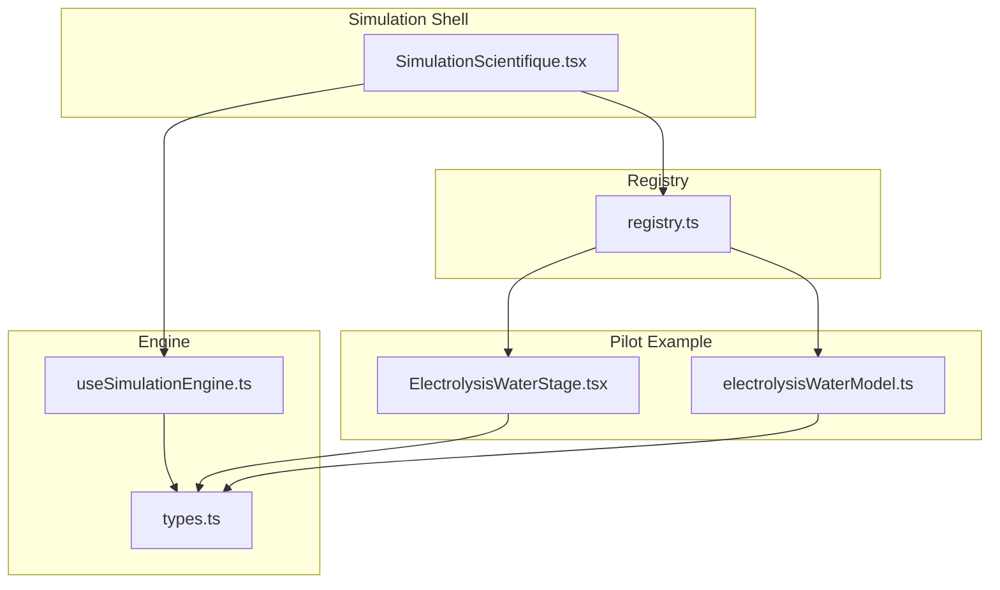
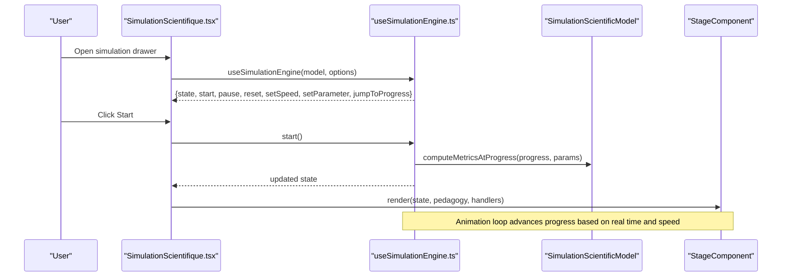
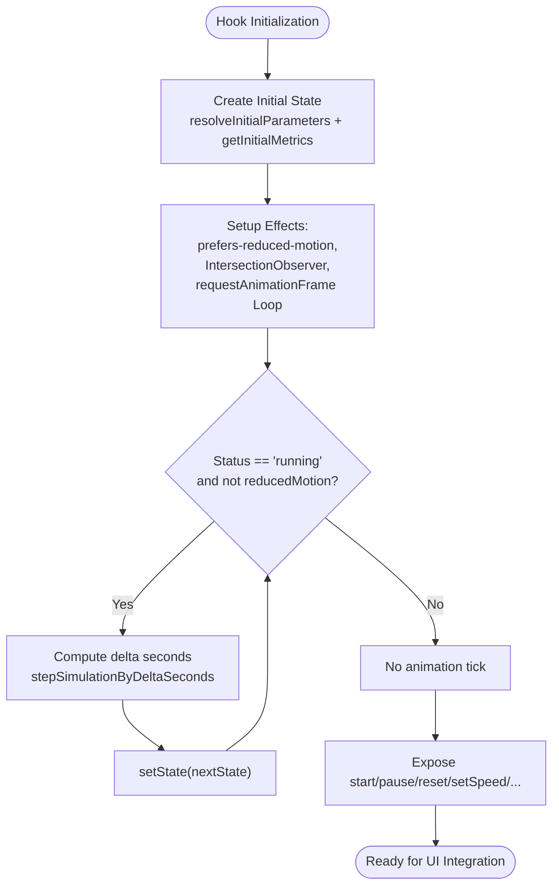
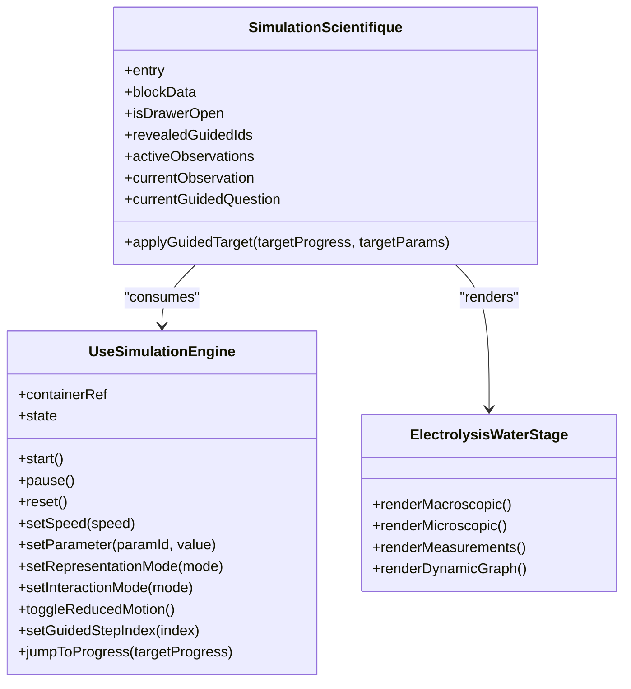
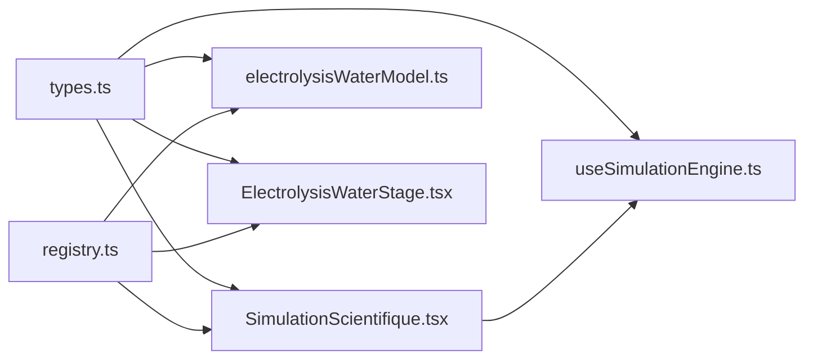

# Simulation Engine Hooks

<cite>
**Referenced Files in This Document**
- [useSimulationEngine.ts](file://src/components/physics/simulations/useSimulationEngine.ts)
- [types.ts](file://src/components/physics/simulations/types.ts)
- [SimulationScientifique.tsx](file://src/components/physics/simulations/SimulationScientifique.tsx)
- [registry.ts](file://src/components/physics/simulations/registry.ts)
- [electrolysisWaterModel.ts](file://src/components/physics/simulations/pilots/electrolysisWaterModel.ts)
- [ElectrolysisWaterStage.tsx](file://src/components/physics/simulations/pilots/ElectrolysisWaterStage.tsx)
</cite>

## Table of Contents
1. [Introduction](#introduction)
2. [Project Structure](#project-structure)
3. [Core Components](#core-components)
4. [Architecture Overview](#architecture-overview)
5. [Detailed Component Analysis](#detailed-component-analysis)
6. [Dependency Analysis](#dependency-analysis)
7. [Performance Considerations](#performance-considerations)
8. [Troubleshooting Guide](#troubleshooting-guide)
9. [Conclusion](#conclusion)

## Introduction
This document explains the simulation engine hooks system with a focus on `useSimulationEngine`. The hook provides:
- Simulation lifecycle management (start, pause, reset, completion).
- Deterministic state synchronization between scientific model and React UI.
- Component communication through controlled parameters, speed, representation mode, interaction mode, guided steps, and progress jumping.
- Accessibility and performance features such as reduced motion support, off-screen animation pausing, and frame-rate-aware time stepping.

The documentation is structured for both developers integrating custom simulation stages and educators extending the framework with new simulations.

## Project Structure
The simulation engine lives under the physics simulations module. The most relevant files are:
- `useSimulationEngine.ts`: Hook implementation, pure state transitions, parameter resolution, deterministic history building.
- `types.ts`: Shared types for runtime state, scientific model, stage props, registry entries, and pedagogical content.
- `SimulationScientifique.tsx`: Generic interactive simulation shell that consumes the hook and renders controls, parameters, and the stage component.
- `registry.ts`: Central registry mapping simulation identifiers to pedagogy, scientific model, and stage components.
- `pilots/electrolysisWaterModel.ts`: Example scientific model implementing the deterministic simulation contract.
- `pilots/ElectrolysisWaterStage.tsx`: Example stage component rendering macroscopic and microscopic views plus dynamic graphs.

**Diagram sources**
- [SimulationScientifique.tsx:138-170](file://src/components/physics/simulations/SimulationScientifique.tsx#L138-L170)
- [useSimulationEngine.ts:309-479](file://src/components/physics/simulations/useSimulationEngine.ts#L309-L479)
- [registry.ts:42-81](file://src/components/physics/simulations/registry.ts#L42-L81)
- [electrolysisWaterModel.ts:35-116](file://src/components/physics/simulations/pilots/electrolysisWaterModel.ts#L35-L116)
- [ElectrolysisWaterStage.tsx:67-71](file://src/components/physics/simulations/pilots/ElectrolysisWaterStage.tsx#L67-L71)

**Section sources**
- [useSimulationEngine.ts:1-479](file://src/components/physics/simulations/useSimulationEngine.ts#L1-L479)
- [types.ts:1-290](file://src/components/physics/simulations/types.ts#L1-L290)
- [SimulationScientifique.tsx:1-800](file://src/components/physics/simulations/SimulationScientifique.tsx#L1-L800)
- [registry.ts:1-103](file://src/components/physics/simulations/registry.ts#L1-L103)
- [electrolysisWaterModel.ts:1-268](file://src/components/physics/simulations/pilots/electrolysisWaterModel.ts#L1-L268)
- [ElectrolysisWaterStage.tsx:1-800](file://src/components/physics/simulations/pilots/ElectrolysisWaterStage.tsx#L1-L800)

## Core Components
- `useSimulationEngine` hook:
  - Manages React state for simulation runtime.
  - Drives an animation loop using `requestAnimationFrame`.
  - Exposes lifecycle methods (`start`, `pause`, `reset`), parameter control (`setParameter`), speed control (`setSpeed`), representation and interaction modes, guided step index, and progress jumping (`jumpToProgress`).
- Pure state transition functions:
  - `createInitialSimulationState`, `startSimulationState`, `pauseSimulationState`, `resetSimulationState`, `setSimulationSpeedState`, `setSimulationParameterState`, `stepSimulationByDeltaSeconds`, `jumpToSimulationProgress`.
- Deterministic helpers:
  - `clampProgress`, `resolveInitialParameters`, `buildDeterministicHistory`.
- Types:
  - `SimulationRuntimeState`, `SimulationScientificModel`, `SimulationStageProps`, `SimulationRegistryEntry`, and related enums/interfaces.

Key responsibilities:
- Lifecycle: start → running → paused/completed; reset returns to stopped.
- Time: nominal duration drives progress; speed scales effective delta time.
- Parameters: validated against model definitions; metrics recomputed deterministically.
- History: sampled points for charts and time-based visualization.
- Accessibility: respects `prefers-reduced-motion`; pauses when out of viewport.

**Section sources**
- [useSimulationEngine.ts:10-17](file://src/components/physics/simulations/useSimulationEngine.ts#L10-L17)
- [useSimulationEngine.ts:22-26](file://src/components/physics/simulations/useSimulationEngine.ts#L22-L26)
- [useSimulationEngine.ts:31-55](file://src/components/physics/simulations/useSimulationEngine.ts#L31-L55)
- [useSimulationEngine.ts:61-95](file://src/components/physics/simulations/useSimulationEngine.ts#L61-L95)
- [useSimulationEngine.ts:100-128](file://src/components/physics/simulations/useSimulationEngine.ts#L100-L128)
- [useSimulationEngine.ts:133-165](file://src/components/physics/simulations/useSimulationEngine.ts#L133-L165)
- [useSimulationEngine.ts:167-178](file://src/components/physics/simulations/useSimulationEngine.ts#L167-L178)
- [useSimulationEngine.ts:180-202](file://src/components/physics/simulations/useSimulationEngine.ts#L180-L202)
- [useSimulationEngine.ts:204-215](file://src/components/physics/simulations/useSimulationEngine.ts#L204-L215)
- [useSimulationEngine.ts:221-252](file://src/components/physics/simulations/useSimulationEngine.ts#L221-L252)
- [useSimulationEngine.ts:254-279](file://src/components/physics/simulations/useSimulationEngine.ts#L254-L279)
- [useSimulationEngine.ts:281-302](file://src/components/physics/simulations/useSimulationEngine.ts#L281-L302)
- [useSimulationEngine.ts:309-479](file://src/components/physics/simulations/useSimulationEngine.ts#L309-L479)
- [types.ts:52-64](file://src/components/physics/simulations/types.ts#L52-L64)
- [types.ts:121-146](file://src/components/physics/simulations/types.ts#L121-L146)
- [types.ts:242-260](file://src/components/physics/simulations/types.ts#L242-L260)
- [types.ts:265-275](file://src/components/physics/simulations/types.ts#L265-L275)
- [types.ts:280-289](file://src/components/physics/simulations/types.ts#L280-L289)

## Architecture Overview
The architecture separates concerns into three layers:
- Scientific Model Layer: pure, deterministic computations over normalized progress and parameters.
- Engine Layer: React hook managing lifecycle, timing, accessibility, and state transitions.
- Presentation Layer: generic simulation shell and specific stage components rendering visuals and controls.

**Diagram sources**
- [SimulationScientifique.tsx:154-170](file://src/components/physics/simulations/SimulationScientifique.tsx#L154-L170)
- [useSimulationEngine.ts:309-479](file://src/components/physics/simulations/useSimulationEngine.ts#L309-L479)
- [types.ts:242-260](file://src/components/physics/simulations/types.ts#L242-L260)
- [types.ts:265-275](file://src/components/physics/simulations/types.ts#L265-L275)

## Detailed Component Analysis

### useSimulationEngine Hook
Purpose:
- Provide a single source of truth for simulation runtime state.
- Ensure deterministic computation of metrics and history from the scientific model.
- Manage animation loop safely with cleanup and visibility checks.
- Expose stable callbacks for UI integration.

Parameters:
- `model`: A `SimulationScientificModel<TMetrics, TParams>` implementing deterministic metric computation, initial metrics, history extraction, and optional parameter definitions.
- `options`: Optional `SimulationEngineOptions<TParams>` including default representation mode, default interaction mode, initial reduced motion flag, and initial parameter overrides.

Return values:
- `containerRef`: Ref for intersection observer-based visibility detection.
- `state`: `SimulationRuntimeState<TMetrics, TParams>` containing status, progress, elapsed time, speed, representation mode, interaction mode, reduced motion flag, guided step index, current parameters, current metrics, and sampled history.
- Lifecycle methods: `start`, `pause`, `reset`.
- Control methods: `setSpeed`, `setParameter`, `setRepresentationMode`, `setInteractionMode`, `toggleReducedMotion`, `setGuidedStepIndex`, `jumpToProgress`.

Lifecycle behavior:
- Initial state is created via `createInitialSimulationState`, which resolves parameters and computes initial metrics.
- `start` transitions to running or jumps to a pedagogical step in reduced motion mode.
- `pause` only affects running state.
- `reset` clears progress and history, recalculating initial metrics with current parameters.
- `setSpeed` updates simulation speed without changing scientific laws.
- `setParameter` validates and clamps values against model parameter definitions, then recomputes metrics and history.
- `stepSimulationByDeltaSeconds` advances progress based on real elapsed time multiplied by speed, clamping to [0,1] and marking completed at 1.
- `jumpToSimulationProgress` clamps target progress and sets appropriate status (stopped at 0, completed at 1, paused otherwise).

Animation loop:
- Uses `requestAnimationFrame` with frame-time delta capped to avoid large jumps.
- Pauses automatically when `reducedMotion` is true or when the container is not intersecting the viewport.
- Cleans up animation frames on unmount or when stopping/resetting.

Accessibility:
- Detects `prefers-reduced-motion` and sets `reducedMotion` accordingly.
- Provides manual toggle for reduced motion.
- When reduced motion is enabled, starting advances to a pedagogical milestone rather than continuous animation.

Integration patterns:
- The generic shell `SimulationScientifique.tsx` calls the hook once per simulation instance and passes returned methods to UI controls and the stage component.
- Custom stages receive `state` and can read metrics/history while controlling simulation via provided handlers.

**Diagram sources**
- [useSimulationEngine.ts:309-479](file://src/components/physics/simulations/useSimulationEngine.ts#L309-L479)
- [useSimulationEngine.ts:334-351](file://src/components/physics/simulations/useSimulationEngine.ts#L334-L351)
- [useSimulationEngine.ts:354-373](file://src/components/physics/simulations/useSimulationEngine.ts#L354-L373)
- [useSimulationEngine.ts:376-405](file://src/components/physics/simulations/useSimulationEngine.ts#L376-L405)

**Section sources**
- [useSimulationEngine.ts:10-17](file://src/components/physics/simulations/useSimulationEngine.ts#L10-L17)
- [useSimulationEngine.ts:100-128](file://src/components/physics/simulations/useSimulationEngine.ts#L100-L128)
- [useSimulationEngine.ts:133-165](file://src/components/physics/simulations/useSimulationEngine.ts#L133-L165)
- [useSimulationEngine.ts:221-252](file://src/components/physics/simulations/useSimulationEngine.ts#L221-L252)
- [useSimulationEngine.ts:254-279](file://src/components/physics/simulations/useSimulationEngine.ts#L254-L279)
- [useSimulationEngine.ts:281-302](file://src/components/physics/simulations/useSimulationEngine.ts#L281-L302)
- [useSimulationEngine.ts:309-479](file://src/components/physics/simulations/useSimulationEngine.ts#L309-L479)

### Simulation Runtime State
The runtime state object encapsulates all observable aspects of a simulation instance:
- Status: stopped, running, paused, completed.
- Progress: normalized value from 0 to 1.
- Elapsed time: simulated seconds derived from progress and nominal duration.
- Speed: multiplier for animation time (0.5x, 1x, 1.5x, 2x).
- Representation mode: macroscopic, microscopic, or both.
- Interaction mode: exploration or guided.
- Reduced motion: boolean indicating reduced animations.
- Guided step index: active step in guided observation mode.
- Params: user-adjustable scientific parameters.
- Metrics: computed scientific quantities.
- History: sampled points for charting and time-based visualization.

Complexity considerations:
- History length grows with progress; built deterministically with up to 20 sample steps plus the current point.
- Parameter changes trigger full recomputation of metrics and history to maintain consistency.

**Section sources**
- [types.ts:52-64](file://src/components/physics/simulations/types.ts#L52-L64)
- [types.ts:121-146](file://src/components/physics/simulations/types.ts#L121-L146)
- [useSimulationEngine.ts:61-95](file://src/components/physics/simulations/useSimulationEngine.ts#L61-L95)

### Scientific Model Contract
The scientific model defines the deterministic core of each simulation:
- `nominalDurationSeconds`: total duration at speed 1x.
- `parameters` (optional): declarative list of manipulable parameters with min/max/step/default and presets.
- `getInitialParameters` (optional): returns initial parameter defaults.
- `getInitialMetrics(params)`: returns exact initial metrics at progress 0.
- `computeMetricsAtProgress(progress, params)`: pure function computing metrics for any normalized progress.
- `extractHistoryValues(metrics, params)`: extracts numeric values for charting.
- `validateInvariants(metrics, progress, params)` (optional but recommended): asserts scientific invariants for testing.

Example:
- Electrolysis water model implements volume relations and microscopic conservation invariants.

**Section sources**
- [types.ts:242-260](file://src/components/physics/simulations/types.ts#L242-L260)
- [electrolysisWaterModel.ts:35-116](file://src/components/physics/simulations/pilots/electrolysisWaterModel.ts#L35-L116)

### Stage Component Contract
Stage components render the visual representation and interact with the simulation state:
- Props include `state`, `pedagogy`, and handlers like `onStart`, `onPause`, `onReset`, and optional `onParameterChange`.
- They should be pure presentational components reading from `state.metrics`, `history`, and other fields.
- They do not mutate simulation state directly; mutations go through hook-provided methods.

Example:
- Electrolysis stage renders macroscopic tubes, microscopic molecules, live measurements, and dynamic graphs driven by `state.history` and `metrics`.

**Section sources**
- [types.ts:265-275](file://src/components/physics/simulations/types.ts#L265-L275)
- [ElectrolysisWaterStage.tsx:67-71](file://src/components/physics/simulations/pilots/ElectrolysisWaterStage.tsx#L67-L71)
- [ElectrolysisWaterStage.tsx:102-130](file://src/components/physics/simulations/pilots/ElectrolysisWaterStage.tsx#L102-L130)

### Integration with Simulation Shell
The generic simulation shell:
- Resolves supported representation modes from pedagogy.
- Calls `useSimulationEngine` with model and options.
- Renders parameter controls bound to `setParameter`.
- Passes `state` and handlers to the stage component.
- Provides global controls for play/pause/reset, speed selection, reduced motion toggle, and progress slider.

**Diagram sources**
- [SimulationScientifique.tsx:138-170](file://src/components/physics/simulations/SimulationScientifique.tsx#L138-L170)
- [SimulationScientifique.tsx:238-245](file://src/components/physics/simulations/SimulationScientifique.tsx#L238-L245)
- [SimulationScientifique.tsx:584-591](file://src/components/physics/simulations/SimulationScientifique.tsx#L584-L591)
- [ElectrolysisWaterStage.tsx:67-71](file://src/components/physics/simulations/pilots/ElectrolysisWaterStage.tsx#L67-L71)

**Section sources**
- [SimulationScientifique.tsx:138-170](file://src/components/physics/simulations/SimulationScientifique.tsx#L138-L170)
- [SimulationScientifique.tsx:238-245](file://src/components/physics/simulations/SimulationScientifique.tsx#L238-L245)
- [SimulationScientifique.tsx:584-591](file://src/components/physics/simulations/SimulationScientifique.tsx#L584-L591)

## Dependency Analysis
Coupling and cohesion:
- The hook depends only on React primitives and shared types; it does not import UI components.
- The shell depends on the hook and registry; it orchestrates UI and delegates scientific computation to the model.
- Registry decouples simulation identifiers from their implementations, enabling extensibility.
- Pilot models and stages depend on shared types and the hook’s state shape.

External dependencies:
- Browser APIs: `window.matchMedia`, `IntersectionObserver`, `requestAnimationFrame`.
- React hooks: `useState`, `useEffect`, `useRef`, `useCallback`.

Potential circular dependencies:
- None observed; imports flow from shell → hook → types, and pilots → types.

**Diagram sources**
- [types.ts:1-290](file://src/components/physics/simulations/types.ts#L1-L290)
- [useSimulationEngine.ts:1-8](file://src/components/physics/simulations/useSimulationEngine.ts#L1-L8)
- [SimulationScientifique.tsx:1-14](file://src/components/physics/simulations/SimulationScientifique.tsx#L1-L14)
- [registry.ts:1-31](file://src/components/physics/simulations/registry.ts#L1-L31)
- [electrolysisWaterModel.ts:1-5](file://src/components/physics/simulations/pilots/electrolysisWaterModel.ts#L1-L5)
- [ElectrolysisWaterStage.tsx:1-7](file://src/components/physics/simulations/pilots/ElectrolysisWaterStage.tsx#L1-L7)

**Section sources**
- [registry.ts:42-81](file://src/components/physics/simulations/registry.ts#L42-L81)
- [useSimulationEngine.ts:309-479](file://src/components/physics/simulations/useSimulationEngine.ts#L309-L479)
- [SimulationScientifique.tsx:138-170](file://src/components/physics/simulations/SimulationScientifique.tsx#L138-L170)

## Performance Considerations
- Deterministic history sampling limits chart data growth and ensures reproducible outputs.
- Frame delta capping prevents large time jumps during tab switching or heavy workloads.
- IntersectionObserver pauses animation when the simulation is off-screen, reducing unnecessary computation.
- Reduced motion mode avoids continuous animation loops and uses discrete pedagogical steps.
- Parameter validation clamps values to declared ranges, avoiding expensive invalid computations.
- Callbacks are memoized with `useCallback` to minimize re-renders in child components.

Optimization strategies:
- Keep scientific model functions pure and lightweight.
- Avoid heavy computations inside render paths; rely on `computeMetricsAtProgress` and `extractHistoryValues`.
- Use presets for parameters to reduce frequent slider updates.
- Limit history points if needed by adjusting sampling logic in future extensions.

[No sources needed since this section provides general guidance]

## Troubleshooting Guide
Common issues and resolutions:
- Simulation does not start:
  - Check that `status` is not already running and that reduced motion is not forcing a paused state.
  - Verify model `nominalDurationSeconds` is positive.
- Progress stuck or not advancing:
  - Ensure the container is visible; off-screen simulations pause automatically.
  - Confirm speed is not zero and animation loop is active.
- Parameter changes have no effect:
  - Validate that parameter IDs match model definitions.
  - Ensure values are within declared min/max ranges.
- Chart not updating:
  - Confirm `extractHistoryValues` returns expected keys.
  - Check that history is rebuilt after parameter changes.
- Accessibility concerns:
  - Respect `prefers-reduced-motion`; toggle reduced motion manually if needed.
  - Provide meaningful aria labels for controls.

Error handling:
- The shell includes an error boundary that falls back to static content if interactive rendering fails.
- Models should implement `validateInvariants` to catch scientific inconsistencies during development and tests.

**Section sources**
- [SimulationScientifique.tsx:114-133](file://src/components/physics/simulations/SimulationScientifique.tsx#L114-L133)
- [useSimulationEngine.ts:334-351](file://src/components/physics/simulations/useSimulationEngine.ts#L334-L351)
- [useSimulationEngine.ts:354-373](file://src/components/physics/simulations/useSimulationEngine.ts#L354-L373)
- [useSimulationEngine.ts:221-252](file://src/components/physics/simulations/useSimulationEngine.ts#L221-L252)
- [electrolysisWaterModel.ts:90-116](file://src/components/physics/simulations/pilots/electrolysisWaterModel.ts#L90-L116)

## Conclusion
The `useSimulationEngine` hook centralizes simulation lifecycle, state synchronization, and component communication in a predictable, accessible, and performant way. By separating scientific computation from presentation and providing deterministic state transitions, it enables robust extension through new models and stages. Developers can integrate custom simulation stages by adhering to the model and stage contracts, leveraging the hook’s API for lifecycle control, parameter validation, and animated progression. Educators can extend the framework by registering new simulations in the central registry and defining clear pedagogical content and scientific invariants.

[No sources needed since this section summarizes without analyzing specific files]