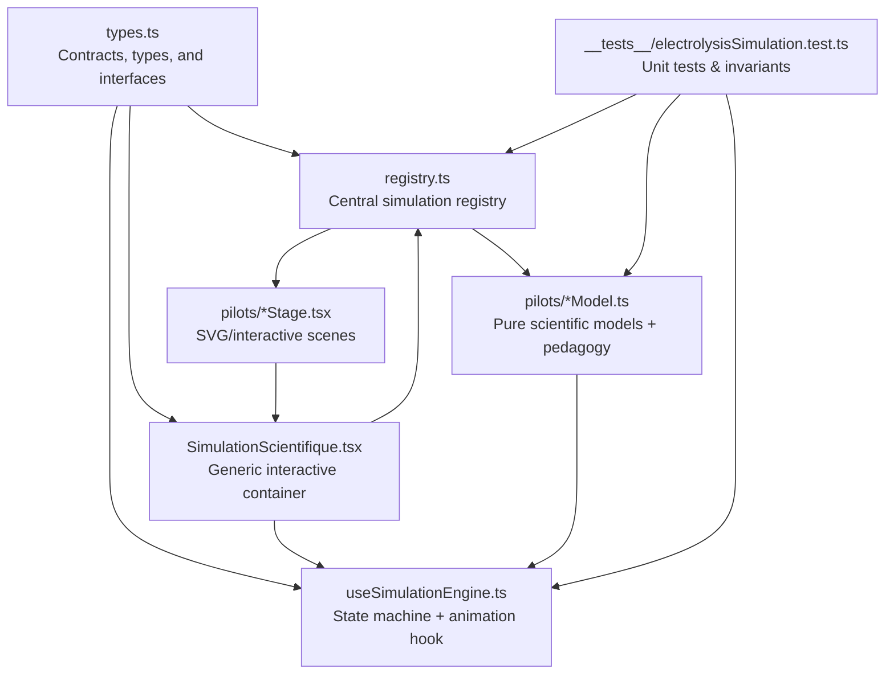
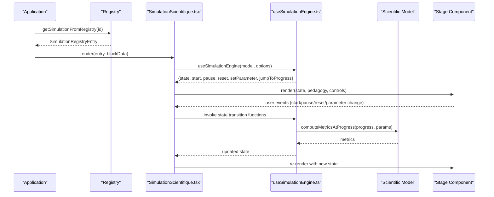
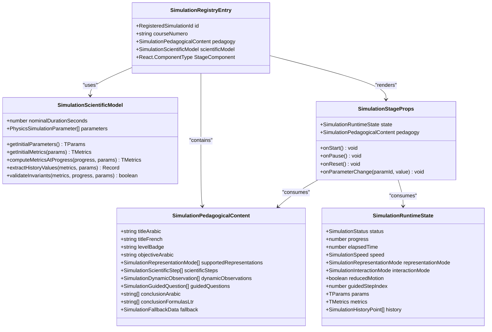
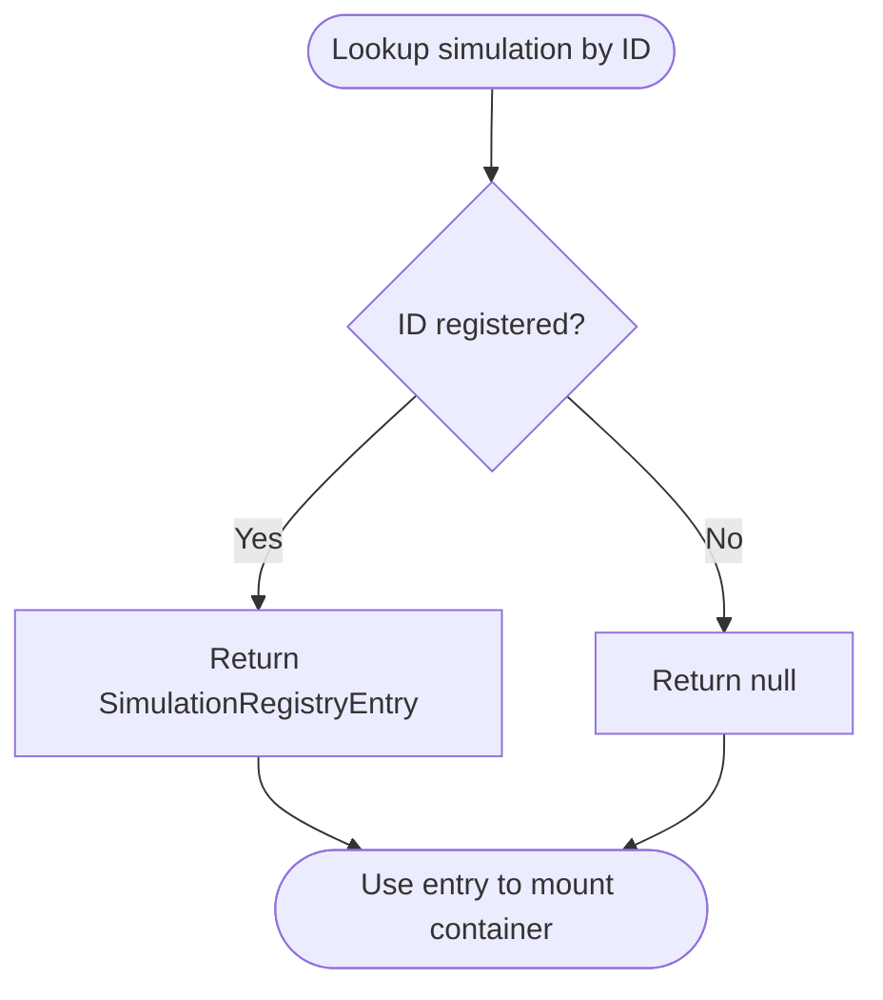
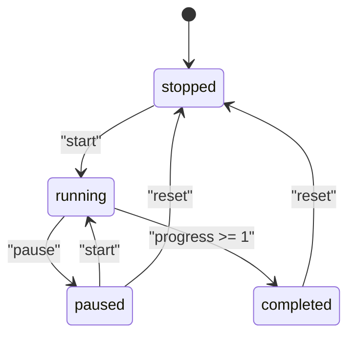
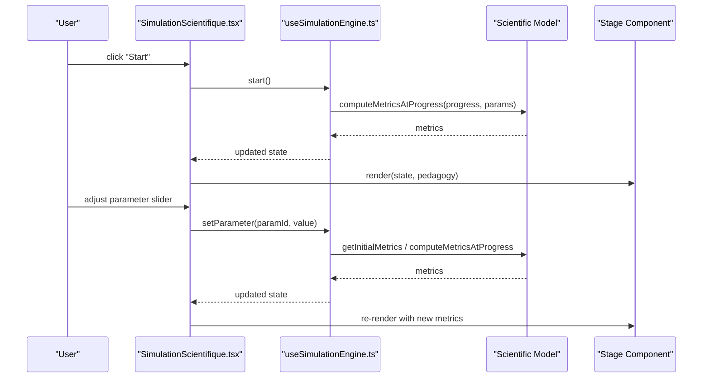
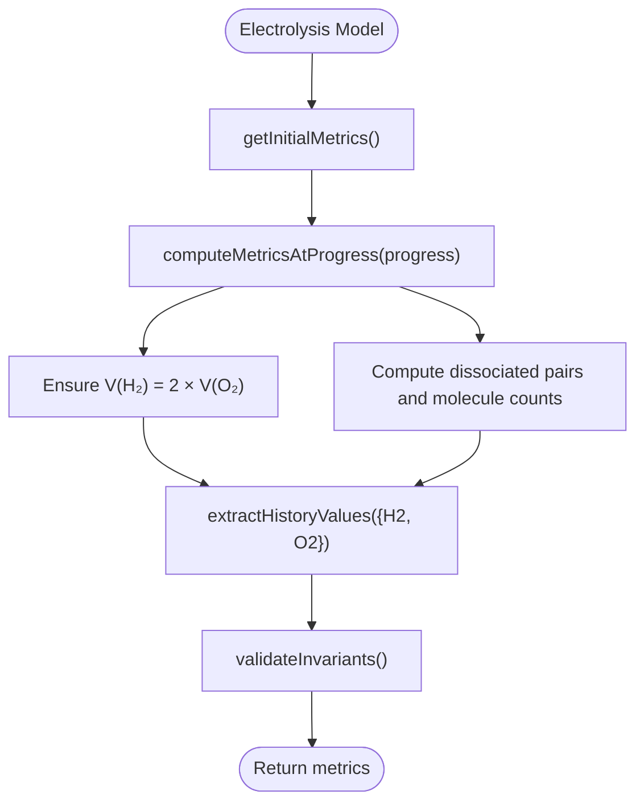
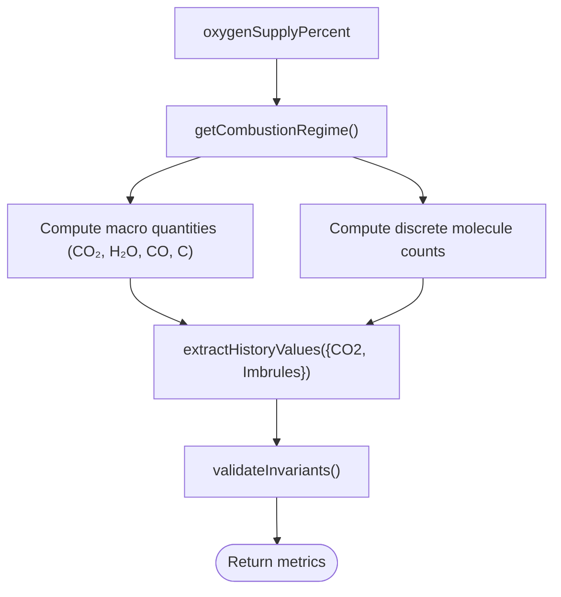
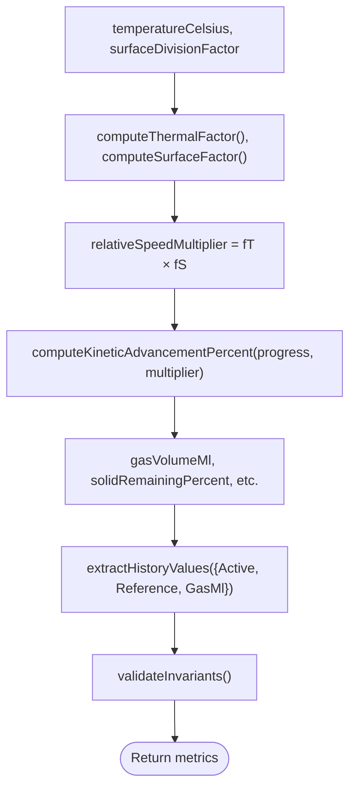
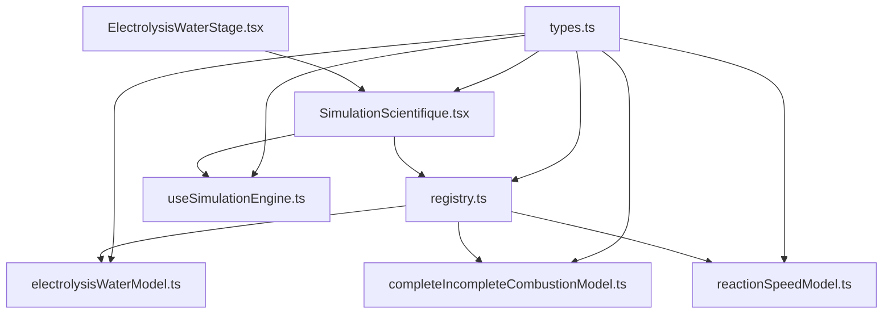

# Simulation Framework

<cite>
**Referenced Files in This Document**
- [types.ts](file://src/components/physics/simulations/types.ts)
- [registry.ts](file://src/components/physics/simulations/registry.ts)
- [useSimulationEngine.ts](file://src/components/physics/simulations/useSimulationEngine.ts)
- [SimulationScientifique.tsx](file://src/components/physics/simulations/SimulationScientifique.tsx)
- [electrolysisWaterModel.ts](file://src/components/physics/simulations/pilots/electrolysisWaterModel.ts)
- [ElectrolysisWaterStage.tsx](file://src/components/physics/simulations/pilots/ElectrolysisWaterStage.tsx)
- [completeIncompleteCombustionModel.ts](file://src/components/physics/simulations/pilots/completeIncompleteCombustionModel.ts)
- [reactionSpeedModel.ts](file://src/components/physics/simulations/pilots/reactionSpeedModel.ts)
- [README_SIMULATIONS.md](file://src/components/physics/simulations/README_SIMULATIONS.md)
- [electrolysisSimulation.test.ts](file://src/components/physics/simulations/__tests__/electrolysisSimulation.test.ts)
</cite>

## Table of Contents
1. [Introduction](#introduction)
2. [Project Structure](#project-structure)
3. [Core Components](#core-components)
4. [Architecture Overview](#architecture-overview)
5. [Detailed Component Analysis](#detailed-component-analysis)
6. [Dependency Analysis](#dependency-analysis)
7. [Performance Considerations](#performance-considerations)
8. [Troubleshooting Guide](#troubleshooting-guide)
9. [Conclusion](#conclusion)
10. [Appendices](#appendices)

## Introduction
This document explains the simulation framework used for interactive physics and chemistry visualizations in the 3AM curriculum. It focuses on:
- The registry pattern that centralizes scientific simulations.
- The hook-based simulation engine that manages lifecycle, state, animation, parameters, and accessibility.
- The type system that separates pedagogical content, pure scientific models, runtime state, and rendering stages.
- How to register new simulations, implement deterministic scientific models, and build interactive SVG stages.
- Examples from water electrolysis, complete/incomplete combustion, and reaction speed factors.
- Lifecycle, state transitions, communication between components, performance considerations, testing strategies, and best practices.

The framework is designed so that adding a new simulation does not require modifying the core engine or UI container; instead, developers extend the registry with a model, pedagogy, and stage component.

## Project Structure
The simulation framework lives under `src/components/physics/simulations/`. Its main responsibilities are separated into:
- Types and contracts.
- Central registry of registered simulations.
- Generic React hook managing simulation state and animation.
- Generic interactive container handling controls, guided mode, fallbacks, and PDF export behavior.
- Pilot implementations for specific scientific simulations (model + stage).
- Tests validating engine behavior and scientific invariants.

**Diagram sources**
- [types.ts:1-290](file://src/components/physics/simulations/types.ts#L1-L290)
- [registry.ts:1-103](file://src/components/physics/simulations/registry.ts#L1-L103)
- [useSimulationEngine.ts:1-480](file://src/components/physics/simulations/useSimulationEngine.ts#L1-L480)
- [SimulationScientifique.tsx:1-800](file://src/components/physics/simulations/SimulationScientifique.tsx#L1-L800)
- [electrolysisWaterModel.ts:1-268](file://src/components/physics/simulations/pilots/electrolysisWaterModel.ts#L1-L268)
- [ElectrolysisWaterStage.tsx:1-800](file://src/components/physics/simulations/pilots/ElectrolysisWaterStage.tsx#L1-L800)
- [electrolysisSimulation.test.ts:1-456](file://src/components/physics/simulations/__tests__/electrolysisSimulation.test.ts#L1-L456)

**Section sources**
- [README_SIMULATIONS.md:1-60](file://src/components/physics/simulations/README_SIMULATIONS.md#L1-L60)

## Core Components
The framework defines a strict separation of concerns:
- **Types**: generic contracts for metrics, parameters, runtime state, pedagogy, and registry entries.
- **Registry**: centralized map of registered simulations, each pairing pedagogy, scientific model, and stage component.
- **Engine Hook**: pure state transitions plus a React hook managing requestAnimationFrame, reduced motion, parameter updates, and progress control.
- **Interactive Container**: renders controls, parameters, observation panels, guided questions, and delegates visualization to the stage component.
- **Pilot Models**: pure deterministic functions computing metrics at any normalized progress, with validation invariants.
- **Pilot Stages**: React components drawing macroscopic/microscopic views, real-time measurements, and dynamic graphs.

Key responsibilities:
- Scientific determinism: all model computations are pure and reproducible.
- Accessibility: respects `prefers-reduced-motion`, provides aria labels, and supports static step progression.
- Extensibility: new simulations are added by registering a model, pedagogy, and stage without changing the engine.

**Section sources**
- [types.ts:17-290](file://src/components/physics/simulations/types.ts#L17-L290)
- [registry.ts:32-103](file://src/components/physics/simulations/registry.ts#L32-L103)
- [useSimulationEngine.ts:19-480](file://src/components/physics/simulations/useSimulationEngine.ts#L19-L480)
- [SimulationScientifique.tsx:135-800](file://src/components/physics/simulations/SimulationScientifique.tsx#L135-L800)

## Architecture Overview
At runtime, the application resolves a simulation by ID through the registry, then mounts the interactive container. The container initializes the engine with the scientific model and options, renders the stage component with current state, and wires user interactions to engine methods.

**Diagram sources**
- [registry.ts:86-103](file://src/components/physics/simulations/registry.ts#L86-L103)
- [SimulationScientifique.tsx:135-170](file://src/components/physics/simulations/SimulationScientifique.tsx#L135-L170)
- [useSimulationEngine.ts:309-479](file://src/components/physics/simulations/useSimulationEngine.ts#L309-L479)
- [electrolysisWaterModel.ts:35-116](file://src/components/physics/simulations/pilots/electrolysisWaterModel.ts#L35-L116)
- [ElectrolysisWaterStage.tsx:67-131](file://src/components/physics/simulations/pilots/ElectrolysisWaterStage.tsx#L67-L131)

## Detailed Component Analysis

### Type System and Contracts
The type system enforces separation between:
- **Pedagogical content**: titles, objectives, supported representations, scientific steps, dynamic observations, guided questions, conclusions, and fallback data.
- **Scientific model**: pure functions for initial metrics, metric computation at progress, history extraction, and invariant validation.
- **Runtime state**: status, progress, elapsed time, speed, representation mode, interaction mode, reduced motion flag, guided step index, parameters, metrics, and history.
- **Stage props**: state, pedagogy, and callbacks for start, pause, reset, and parameter changes.
- **Registry entry**: id, course number, pedagogy, scientific model, and stage component.

Important design points:
- Metrics and parameters are generic, allowing each simulation to define its own domain types.
- Parameters can be exposed via sliders or preset buttons, with optional presets-only modes.
- Representation modes support macroscopic, microscopic, or both, enabling dual-level visualization.
- Guided questions include target progress and optional target parameters to guide learners.

**Diagram sources**
- [types.ts:109-290](file://src/components/physics/simulations/types.ts#L109-L290)

**Section sources**
- [types.ts:17-290](file://src/components/physics/simulations/types.ts#L17-L290)

### Registry Pattern Implementation
The registry centralizes all active simulations. Each entry includes:
- A unique identifier.
- Course number mapping.
- Pedagogical content.
- Scientific model.
- Stage component.

Utility functions provide safe lookup and registration checks. Future simulation IDs are reserved but not yet implemented.

**Diagram sources**
- [registry.ts:42-103](file://src/components/physics/simulations/registry.ts#L42-L103)

**Section sources**
- [registry.ts:1-103](file://src/components/physics/simulations/registry.ts#L1-L103)

### Hook-Based Simulation Control System
The engine hook encapsulates:
- Initial state creation.
- Pure state transition functions.
- Animation loop using `requestAnimationFrame`.
- Reduced motion detection and handling.
- Intersection observer to pause when off-screen.
- Parameter updates and progress jumping.
- Speed control.

Lifecycle states:
- `stopped`: initial state before starting.
- `running`: advancing progress based on delta time and speed.
- `paused`: halted but preserving progress and metrics.
- `completed`: reached end of simulation duration.

**Diagram sources**
- [useSimulationEngine.ts:133-302](file://src/components/physics/simulations/useSimulationEngine.ts#L133-L302)

**Section sources**
- [useSimulationEngine.ts:19-480](file://src/components/physics/simulations/useSimulationEngine.ts#L19-L480)

### Interactive Container and Communication Patterns
The interactive container:
- Resolves supported representation modes from pedagogy.
- Initializes the engine with default representation and interaction modes.
- Renders a collapsible drawer containing controls, parameters, and guidance.
- Manages guided question reveals and dynamic observations based on progress.
- Wires user actions to engine methods.
- Provides fallback view if initialization fails or an error occurs.

Communication patterns:
- Container calls engine methods (`start`, `pause`, `reset`, `setParameter`, `jumpToProgress`).
- Engine computes metrics via the scientific model and returns updated state.
- Stage consumes state and pedagogy to render visuals and measurements.
- Observations and guided questions are driven by pedagogy and current progress.

**Diagram sources**
- [SimulationScientifique.tsx:135-170](file://src/components/physics/simulations/SimulationScientifique.tsx#L135-L170)
- [SimulationScientifique.tsx:584-591](file://src/components/physics/simulations/SimulationScientifique.tsx#L584-L591)
- [useSimulationEngine.ts:407-479](file://src/components/physics/simulations/useSimulationEngine.ts#L407-L479)

**Section sources**
- [SimulationScientifique.tsx:135-800](file://src/components/physics/simulations/SimulationScientifique.tsx#L135-L800)

### Example Simulations

#### Water Electrolysis
- Scientific model computes volumes of H₂ and O₂, maintains the strict volumetric ratio V(H₂) = 2 × V(O₂), and tracks micro-level molecule counts.
- Pedagogy guides learners through manipulation, observation, measurement, comparison, and conclusion phases.
- Stage renders macroscopic apparatus with gas tubes, bubbles, and a dynamic graph of volume vs time, plus a simplified micro-level molecular view.

**Diagram sources**
- [electrolysisWaterModel.ts:35-116](file://src/components/physics/simulations/pilots/electrolysisWaterModel.ts#L35-L116)

**Section sources**
- [electrolysisWaterModel.ts:1-268](file://src/components/physics/simulations/pilots/electrolysisWaterModel.ts#L1-L268)
- [ElectrolysisWaterStage.tsx:1-800](file://src/components/physics/simulations/pilots/ElectrolysisWaterStage.tsx#L1-L800)

#### Complete and Incomplete Combustion
- Scientific model determines combustion regime based on oxygen supply percentage.
- Produces CO₂ and H₂O in complete combustion; adds toxic CO and soot C in incomplete combustion.
- Validates atom conservation across C, H, and O in the micro-level sample.
- Pedagogy emphasizes safety implications and experimental identification of products.

**Diagram sources**
- [completeIncompleteCombustionModel.ts:83-127](file://src/components/physics/simulations/pilots/completeIncompleteCombustionModel.ts#L83-L127)
- [completeIncompleteCombustionModel.ts:166-291](file://src/components/physics/simulations/pilots/completeIncompleteCombustionModel.ts#L166-L291)

**Section sources**
- [completeIncompleteCombustionModel.ts:1-524](file://src/components/physics/simulations/pilots/completeIncompleteCombustionModel.ts#L1-L524)

#### Reaction Speed Factors
- Scientific model combines temperature and surface division factors to compute kinetic advancement.
- Tracks reference vs active reaction curves, gas volume, thermal agitation, and effective collisions per second.
- Pedagogy highlights how higher temperature and finer powder increase effective collisions and reduce reaction time.

**Diagram sources**
- [reactionSpeedModel.ts:103-133](file://src/components/physics/simulations/pilots/reactionSpeedModel.ts#L103-L133)
- [reactionSpeedModel.ts:181-241](file://src/components/physics/simulations/pilots/reactionSpeedModel.ts#L181-L241)

**Section sources**
- [reactionSpeedModel.ts:1-462](file://src/components/physics/simulations/pilots/reactionSpeedModel.ts#L1-L462)

## Dependency Analysis
The framework exhibits clear layering:
- Types are consumed by registry, engine, container, and pilots.
- Registry imports pilot models and stages, exposing them via identifiers.
- Engine depends only on types and model contracts, ensuring decoupling from specific simulations.
- Container depends on registry and engine, orchestrating UI and state.
- Pilots depend on engine utilities (e.g., clampProgress) and types.

**Diagram sources**
- [types.ts:1-290](file://src/components/physics/simulations/types.ts#L1-L290)
- [registry.ts:1-103](file://src/components/physics/simulations/registry.ts#L1-L103)
- [useSimulationEngine.ts:1-480](file://src/components/physics/simulations/useSimulationEngine.ts#L1-L480)
- [SimulationScientifique.tsx:1-800](file://src/components/physics/simulations/SimulationScientifique.tsx#L1-L800)
- [electrolysisWaterModel.ts:1-268](file://src/components/physics/simulations/pilots/electrolysisWaterModel.ts#L1-L268)
- [completeIncompleteCombustionModel.ts:1-524](file://src/components/physics/simulations/pilots/completeIncompleteCombustionModel.ts#L1-L524)
- [reactionSpeedModel.ts:1-462](file://src/components/physics/simulations/pilots/reactionSpeedModel.ts#L1-L462)
- [ElectrolysisWaterStage.tsx:1-800](file://src/components/physics/simulations/pilots/ElectrolysisWaterStage.tsx#L1-L800)

**Section sources**
- [registry.ts:1-103](file://src/components/physics/simulations/registry.ts#L1-L103)
- [useSimulationEngine.ts:1-480](file://src/components/physics/simulations/useSimulationEngine.ts#L1-L480)
- [SimulationScientifique.tsx:1-800](file://src/components/physics/simulations/SimulationScientifique.tsx#L1-L800)

## Performance Considerations
- Deterministic history building: the engine samples up to 20 steps for history generation, balancing accuracy and performance.
- Animation loop throttling: delta time is clamped to avoid large jumps and ensure stable progression.
- Reduced motion: disables continuous animation loop and uses step-based progression for accessibility.
- Off-screen pausing: intersection observer pauses running simulations when not visible, saving CPU cycles.
- Pure model functions: no side effects, enabling memoization and testability.

Best practices:
- Keep model computations pure and fast.
- Avoid heavy DOM operations inside the animation loop; prefer SVG updates driven by state.
- Use presets for parameters to reduce frequent slider updates.
- Leverage reduced motion for users who prefer static visuals.

[No sources needed since this section provides general guidance]

## Troubleshooting Guide
Common issues and resolutions:
- Simulation not found: verify the simulation ID exists in the registry and is registered correctly.
- State not updating: ensure engine methods are called from the container and that parameters are valid within min/max ranges.
- Animation not running: check reduced motion settings and visibility (off-screen pausing).
- Error boundary fallback: if the interactive stage throws, the fallback view will render automatically; inspect console errors and validate model invariants.

Testing strategy:
- Unit tests cover engine state transitions, speed control, parameter updates, and scientific invariants.
- Tests assert physical laws (e.g., volumetric ratios, atom conservation, energy balance).
- Integration tests verify registry completeness and course block presence.

**Section sources**
- [electrolysisSimulation.test.ts:1-456](file://src/components/physics/simulations/__tests__/electrolysisSimulation.test.ts#L1-L456)
- [SimulationScientifique.tsx:110-133](file://src/components/physics/simulations/SimulationScientifique.tsx#L110-L133)

## Conclusion
The simulation framework provides a robust, extensible architecture for interactive scientific visualizations. By separating pedagogical content, pure scientific models, runtime state, and rendering stages, it ensures reproducibility, accessibility, and maintainability. Developers can add new simulations by implementing a model, pedagogy, and stage, then registering them centrally. Existing examples demonstrate best practices for modeling chemical reactions, controlling parameters, and guiding learners through structured scientific inquiry.

[No sources needed since this section summarizes without analyzing specific files]

## Appendices

### Public API for Simulation Developers
- Implement `SimulationScientificModel<TMetrics, TParams>` with pure functions for initial metrics, metric computation, history extraction, and invariant validation.
- Optionally declare `parameters` to expose manipulable variables with constraints and presets.
- Create a React component implementing `SimulationStageProps<TMetrics, TParams>` to render macroscopic/microscopic views and dynamic graphs.
- Register the simulation in `simulationRegistry` with an ID, course number, pedagogy, model, and stage component.
- Add declarative simulation blocks in course data to integrate with the curriculum.

**Section sources**
- [types.ts:237-290](file://src/components/physics/simulations/types.ts#L237-L290)
- [README_SIMULATIONS.md:43-60](file://src/components/physics/simulations/README_SIMULATIONS.md#L43-L60)

### Integration Patterns with Main Application
- Courses include simulation blocks referencing registered simulation IDs.
- The application resolves simulations via the registry and mounts the interactive container.
- Fallback views ensure graceful degradation when interactive rendering fails.
- PDF export triggers container drawer expansion to include simulation content.

**Section sources**
- [registry.ts:42-103](file://src/components/physics/simulations/registry.ts#L42-L103)
- [SimulationScientifique.tsx:185-196](file://src/components/physics/simulations/SimulationScientifique.tsx#L185-L196)