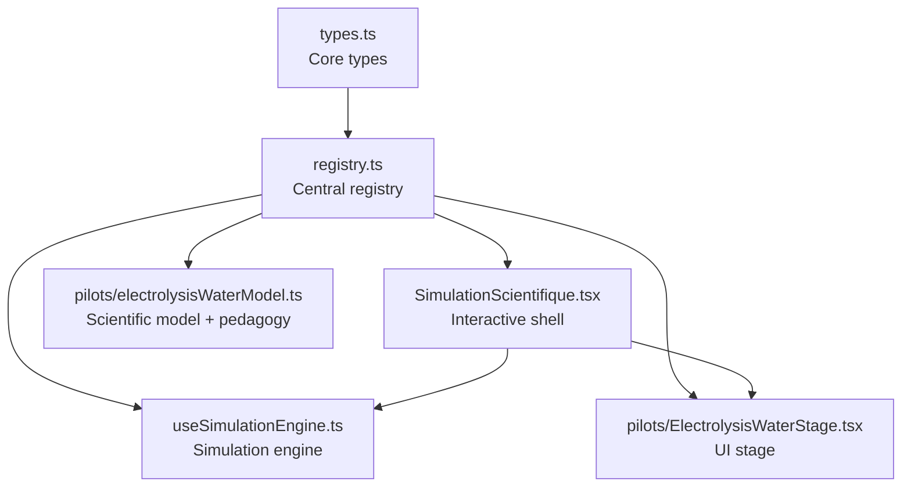
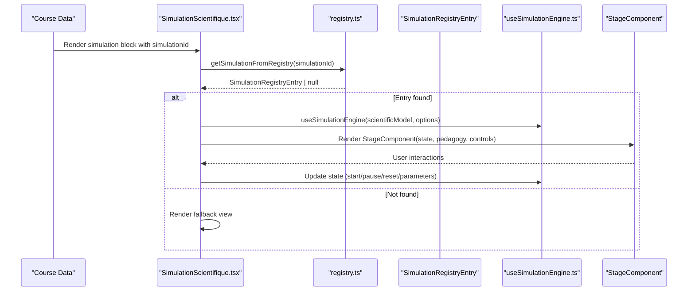
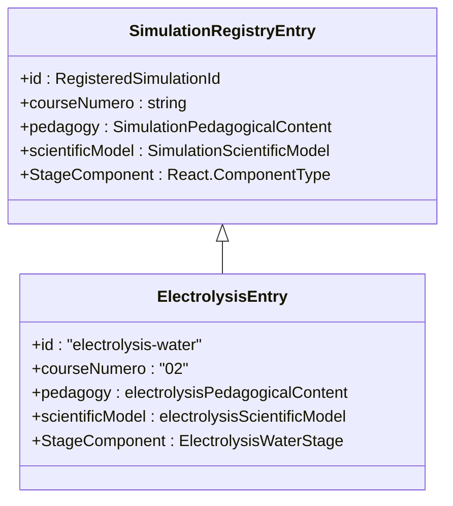
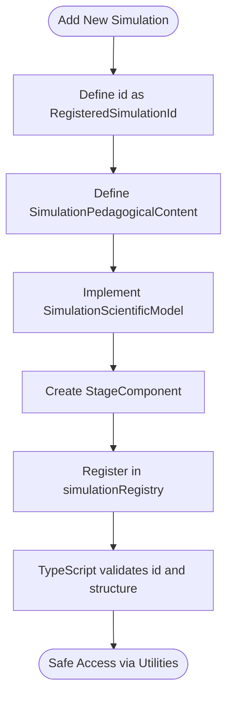
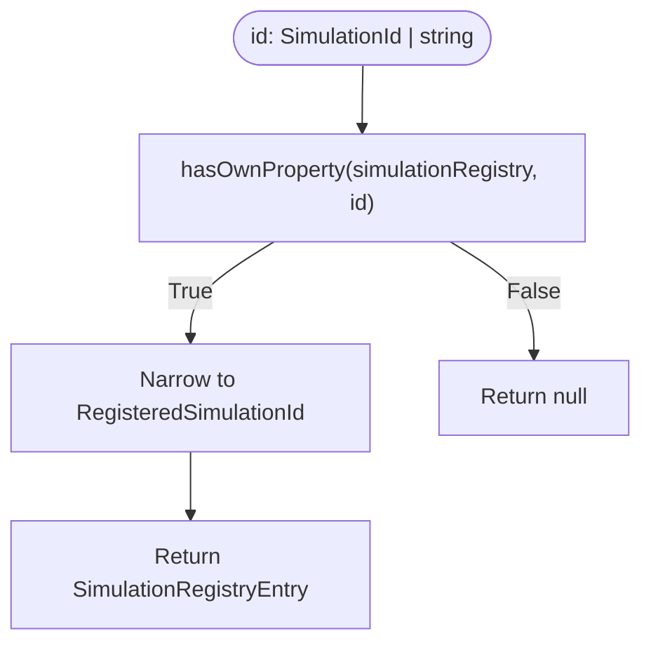
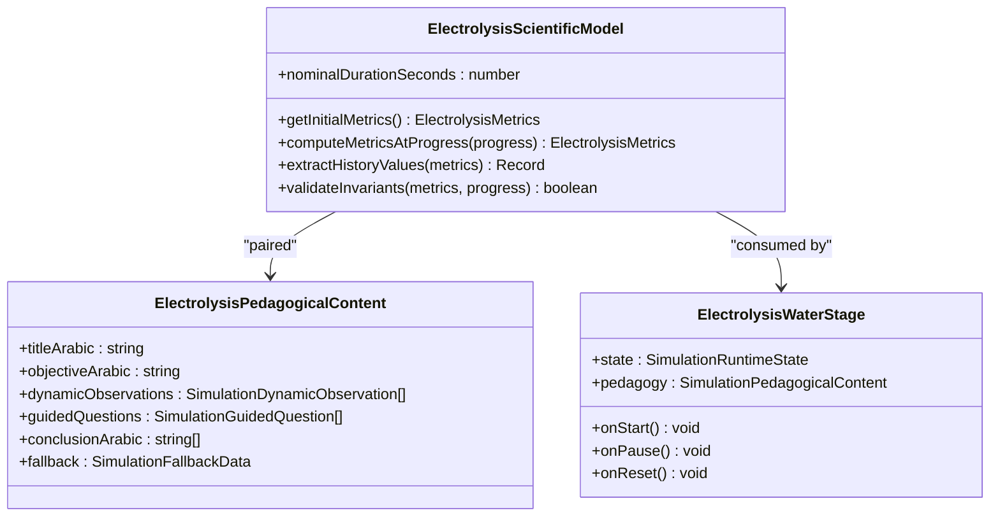
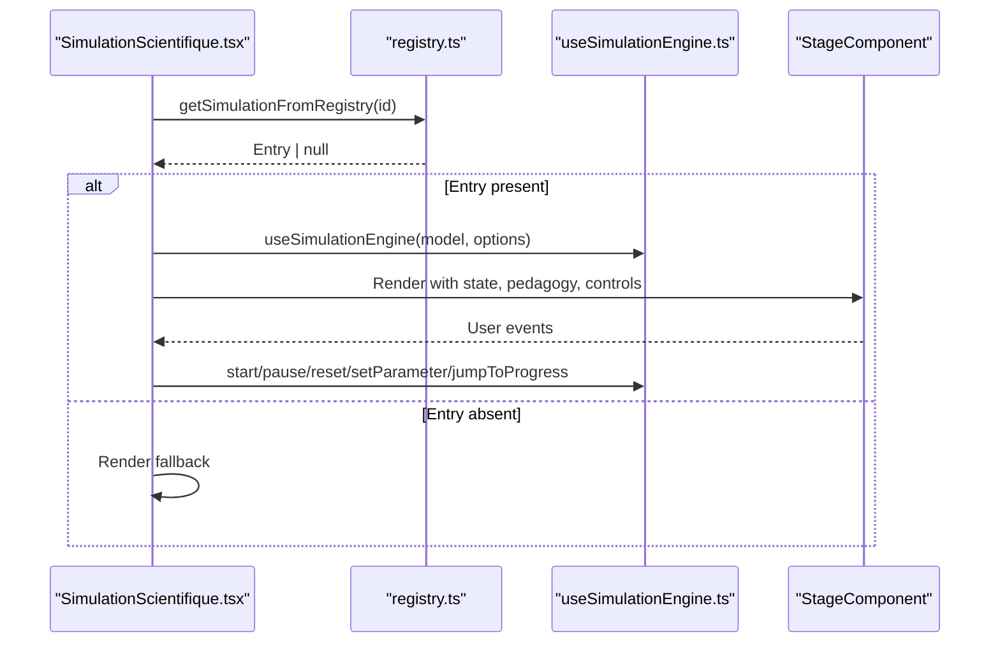
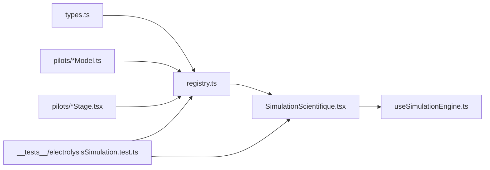

# Simulation Registry System

<cite>
**Referenced Files in This Document**
- [registry.ts](file://src/components/physics/simulations/registry.ts)
- [types.ts](file://src/components/physics/simulations/types.ts)
- [SimulationScientifique.tsx](file://src/components/physics/simulations/SimulationScientifique.tsx)
- [useSimulationEngine.ts](file://src/components/physics/simulations/useSimulationEngine.ts)
- [electrolysisWaterModel.ts](file://src/components/physics/simulations/pilots/electrolysisWaterModel.ts)
- [ElectrolysisWaterStage.tsx](file://src/components/physics/simulations/pilots/ElectrolysisWaterStage.tsx)
- [electrolysisSimulation.test.ts](file://src/components/physics/simulations/__tests__/electrolysisSimulation.test.ts)
</cite>

## Table of Contents
1. [Introduction](#introduction)
2. [Project Structure](#project-structure)
3. [Core Components](#core-components)
4. [Architecture Overview](#architecture-overview)
5. [Detailed Component Analysis](#detailed-component-analysis)
6. [Dependency Analysis](#dependency-analysis)
7. [Performance Considerations](#performance-considerations)
8. [Troubleshooting Guide](#troubleshooting-guide)
9. [Conclusion](#conclusion)

## Introduction
This document explains the centralized simulation registry system used by the Physics-Chemistry module. The system provides a single source of truth for scientific simulations, separating pedagogical content, deterministic scientific models, and UI stage components behind a type-safe registration interface. It also documents how simulations are safely accessed through `isSimulationRegistered` and `getSimulationFromRegistry`, and how the `RegisteredSimulationId` type enforces safe references across the application.

## Project Structure
The simulation framework lives under the Physics-Chemistry simulations directory:

- `types.ts`: Core type definitions for models, runtime state, pedagogy, stages, and registry entries.
- `registry.ts`: Centralized registry object and safe access utilities.
- `SimulationScientifique.tsx`: Generic interactive simulation shell that consumes a registry entry.
- `useSimulationEngine.ts`: Deterministic simulation engine hook and pure state transitions.
- `pilots/*`: Concrete pilot simulations (model + pedagogy + stage), starting with water electrolysis.
- `__tests__/electrolysisSimulation.test.ts`: Tests validating registry contents and integration.



**Diagram sources**
- [types.ts:1-290](file://src/components/physics/simulations/types.ts#L1-L290)
- [registry.ts:1-103](file://src/components/physics/simulations/registry.ts#L1-L103)
- [SimulationScientifique.tsx:1-140](file://src/components/physics/simulations/SimulationScientifique.tsx#L1-L140)
- [useSimulationEngine.ts:1-128](file://src/components/physics/simulations/useSimulationEngine.ts#L1-L128)
- [electrolysisWaterModel.ts:1-116](file://src/components/physics/simulations/pilots/electrolysisWaterModel.ts#L1-L116)
- [ElectrolysisWaterStage.tsx:1-131](file://src/components/physics/simulations/pilots/ElectrolysisWaterStage.tsx#L1-L131)

**Section sources**
- [registry.ts:1-103](file://src/components/physics/simulations/registry.ts#L1-L103)
- [types.ts:1-290](file://src/components/physics/simulations/types.ts#L1-L290)

## Core Components
- **SimulationRegistryEntry**: A strongly typed descriptor linking an id, course number, pedagogical content, scientific model, and React stage component.
- **RegisteredSimulationId**: A union of currently implemented simulation identifiers, ensuring only valid IDs are accepted at compile time.
- **SimulationId**: Extends registered IDs with reserved future IDs to allow forward planning while keeping current registrations strict.
- **SimulationScientificModel<TMetrics, TParams>**: Pure, deterministic model exposing initial metrics, metric computation at progress, history extraction, and invariant validation.
- **SimulationPedagogicalContent**: Declarative content including objectives, dynamic observations, guided questions, conclusions, and fallback data.
- **SimulationStageProps<TMetrics, TParams>**: Props passed to the visualization stage, including runtime state, pedagogy, and control callbacks.
- **SimulationRuntimeState<TMetrics, TParams>**: Generic runtime state tracking status, progress, speed, representation mode, parameters, metrics, and history.

These types form the contract between the registry, the engine, and the UI.

**Section sources**
- [types.ts:20-38](file://src/components/physics/simulations/types.ts#L20-L38)
- [types.ts:207-235](file://src/components/physics/simulations/types.ts#L207-L235)
- [types.ts:242-260](file://src/components/physics/simulations/types.ts#L242-L260)
- [types.ts:265-275](file://src/components/physics/simulations/types.ts#L265-L275)
- [types.ts:280-289](file://src/components/physics/simulations/types.ts#L280-L289)
- [types.ts:121-146](file://src/components/physics/simulations/types.ts#L121-L146)

## Architecture Overview
The registry is the central hub where each simulation is declared once with its complete definition. Consumers retrieve a simulation by ID using safe utilities that return either a fully-typed entry or null if not implemented. The generic shell renders the appropriate stage component and drives it via the simulation engine.



**Diagram sources**
- [SimulationScientifique.tsx:10-140](file://src/components/physics/simulations/SimulationScientifique.tsx#L10-L140)
- [registry.ts:86-102](file://src/components/physics/simulations/registry.ts#L86-L102)
- [useSimulationEngine.ts:309-479](file://src/components/physics/simulations/useSimulationEngine.ts#L309-L479)

**Section sources**
- [SimulationScientifique.tsx:10-140](file://src/components/physics/simulations/SimulationScientifique.tsx#L10-L140)
- [registry.ts:86-102](file://src/components/physics/simulations/registry.ts#L86-L102)

## Detailed Component Analysis

### Centralized Registry Pattern
The registry is a plain object keyed by `RegisteredSimulationId`. Each entry includes:
- `id`: Stable identifier matching the key.
- `courseNumero`: Curriculum mapping (e.g., '02', '04', '06', '09', '10').
- `pedagogy`: Declarative educational content.
- `scientificModel`: Deterministic scientific model.
- `StageComponent`: React component rendering the simulation scene.

Registration examples include water electrolysis, complete/incomplete combustion, reaction speed, energy balance, and power-energy conversion.



**Diagram sources**
- [registry.ts:42-81](file://src/components/physics/simulations/registry.ts#L42-L81)
- [types.ts:280-289](file://src/components/physics/simulations/types.ts#L280-L289)
- [electrolysisWaterModel.ts:35-116](file://src/components/physics/simulations/pilots/electrolysisWaterModel.ts#L35-L116)
- [ElectrolysisWaterStage.tsx:67-131](file://src/components/physics/simulations/pilots/ElectrolysisWaterStage.tsx#L67-L131)

**Section sources**
- [registry.ts:42-81](file://src/components/physics/simulations/registry.ts#L42-L81)

### Registration Process and Type Safety
- **Registration**: Add a new entry to `simulationRegistry` with all required fields. Ensure the id matches one of the allowed `RegisteredSimulationId` values.
- **Type Safety**: TypeScript enforces that registry keys must be from `RegisteredSimulationId`. Accessors like `getSimulationFromRegistry` accept broader `SimulationId` but narrow to registered entries at runtime.
- **Future Planning**: `FutureSimulationId` reserves identifiers for upcoming simulations without weakening current type safety.



**Diagram sources**
- [types.ts:20-38](file://src/components/physics/simulations/types.ts#L20-L38)
- [registry.ts:42-81](file://src/components/physics/simulations/registry.ts#L42-L81)

**Section sources**
- [types.ts:20-38](file://src/components/physics/simulations/types.ts#L20-L38)
- [registry.ts:42-81](file://src/components/physics/simulations/registry.ts#L42-L81)

### Safe Simulation Access Utilities
- **isSimulationRegistered(id)**: Type guard returning true if the id exists in the registry; narrows the input to `RegisteredSimulationId`.
- **getSimulationFromRegistry(id)**: Returns the registry entry if registered, otherwise null.



**Diagram sources**
- [registry.ts:86-102](file://src/components/physics/simulations/registry.ts#L86-L102)

**Section sources**
- [registry.ts:86-102](file://src/components/physics/simulations/registry.ts#L86-L102)

### RegisteredSimulationId Type System
`RegisteredSimulationId` enumerates active simulations:
- `'electrolysis-water'`
- `'complete-incomplete-combustion'`
- `'reaction-speed'`
- `'energy-balance'`
- `'power-energy-conversion'`

This union ensures that any code referencing a simulation id is constrained to known implementations, preventing typos and missing implementations at compile time.

```mermaid
classDiagram
class RegisteredSimulationId {
<<union>>
"electrolysis-water"
"complete-incomplete-combustion"
"reaction-speed"
"energy-balance"
"power-energy-conversion"
}
class FutureSimulationId {
<<union>>
"carbon-combustion"
"equation-balancing"
"functional-chain"
"energy-chain"
"ohm-law"
"light-dispersion"
}
class SimulationId {
<<union>>
RegisteredSimulationId
FutureSimulationId
}
RegisteredSimulationId <|-- SimulationId
FutureSimulationId <|-- SimulationId
```

**Diagram sources**
- [types.ts:20-38](file://src/components/physics/simulations/types.ts#L20-L38)

**Section sources**
- [types.ts:20-38](file://src/components/physics/simulations/types.ts#L20-L38)

### Example: Water Electrolysis Simulation
The water electrolysis pilot demonstrates the full pattern:
- **Scientific Model**: Defines nominal duration, initial metrics, deterministic metric computation, history extraction, and invariant validation.
- **Pedagogical Content**: Includes objectives, dynamic observations, guided questions, conclusions, and fallback data.
- **Stage Component**: Renders macroscopic and microscopic views, real-time measurements, and a dynamic chart.



**Diagram sources**
- [electrolysisWaterModel.ts:35-116](file://src/components/physics/simulations/pilots/electrolysisWaterModel.ts#L35-L116)
- [electrolysisWaterModel.ts:121-267](file://src/components/physics/simulations/pilots/electrolysisWaterModel.ts#L121-L267)
- [ElectrolysisWaterStage.tsx:67-131](file://src/components/physics/simulations/pilots/ElectrolysisWaterStage.tsx#L67-L131)

**Section sources**
- [electrolysisWaterModel.ts:35-116](file://src/components/physics/simulations/pilots/electrolysisWaterModel.ts#L35-L116)
- [electrolysisWaterModel.ts:121-267](file://src/components/physics/simulations/pilots/electrolysisWaterModel.ts#L121-L267)
- [ElectrolysisWaterStage.tsx:67-131](file://src/components/physics/simulations/pilots/ElectrolysisWaterStage.tsx#L67-L131)

### Interactive Shell and Engine Integration
The generic shell:
- Retrieves the registry entry using `getSimulationFromRegistry`.
- Initializes the simulation engine with the scientific model and options.
- Renders the stage component with state, pedagogy, and control callbacks.
- Provides fallback rendering when the simulation is not implemented or errors occur.



**Diagram sources**
- [SimulationScientifique.tsx:10-140](file://src/components/physics/simulations/SimulationScientifique.tsx#L10-L140)
- [useSimulationEngine.ts:309-479](file://src/components/physics/simulations/useSimulationEngine.ts#L309-L479)

**Section sources**
- [SimulationScientifique.tsx:10-140](file://src/components/physics/simulations/SimulationScientifique.tsx#L10-L140)
- [useSimulationEngine.ts:309-479](file://src/components/physics/simulations/useSimulationEngine.ts#L309-L479)

## Dependency Analysis
The registry depends on:
- Types defined in `types.ts`.
- Pilot models and stages imported into `registry.ts`.

The shell depends on:
- Registry utilities (`getSimulationFromRegistry`).
- Simulation engine hook (`useSimulationEngine`).
- Stage components provided by each simulation’s registry entry.

Tests validate:
- All registered ids pass `isSimulationRegistered`.
- `getSimulationFromRegistry` returns non-null for registered ids.
- Each simulation includes five guided questions.
- Course sections include simulation blocks linked to registry ids.



**Diagram sources**
- [types.ts:1-290](file://src/components/physics/simulations/types.ts#L1-L290)
- [registry.ts:1-103](file://src/components/physics/simulations/registry.ts#L1-L103)
- [SimulationScientifique.tsx:1-140](file://src/components/physics/simulations/SimulationScientifique.tsx#L1-L140)
- [useSimulationEngine.ts:1-480](file://src/components/physics/simulations/useSimulationEngine.ts#L1-L480)
- [electrolysisSimulation.test.ts:347-402](file://src/components/physics/simulations/__tests__/electrolysisSimulation.test.ts#L347-L402)

**Section sources**
- [registry.ts:1-103](file://src/components/physics/simulations/registry.ts#L1-L103)
- [SimulationScientifique.tsx:1-140](file://src/components/physics/simulations/SimulationScientifique.tsx#L1-L140)
- [useSimulationEngine.ts:1-480](file://src/components/physics/simulations/useSimulationEngine.ts#L1-L480)
- [electrolysisSimulation.test.ts:347-402](file://src/components/physics/simulations/__tests__/electrolysisSimulation.test.ts#L347-L402)

## Performance Considerations
- **Deterministic Computation**: Metrics are computed purely based on normalized progress and parameters, enabling reproducible results and efficient history building.
- **Animation Loop Control**: The engine uses `requestAnimationFrame` with visibility checks and reduced-motion support to avoid unnecessary work when off-screen or when animations are disabled.
- **Clamping and Bounds**: Progress clamping prevents out-of-range computations and stabilizes state transitions.
- **Minimal Re-renders**: State updates are granular (start, pause, reset, parameter changes, speed changes), reducing unnecessary re-renders in the UI.

[No sources needed since this section provides general guidance]

## Troubleshooting Guide
Common issues and resolutions:
- **Unknown Simulation Id**: If `getSimulationFromRegistry` returns null, ensure the id is included in `RegisteredSimulationId` and registered in `simulationRegistry`.
- **Missing Pedagogical Content**: Verify that every registry entry includes complete `SimulationPedagogicalContent`, especially dynamic observations and guided questions.
- **Invalid Parameters**: When updating parameters, ensure values respect min/max bounds defined in the model’s parameters.
- **Reduced Motion Behavior**: In reduced motion mode, starting the simulation may jump to a pedagogical milestone rather than animate continuously.

Validation helpers:
- Use `isSimulationRegistered` before accessing a simulation to prevent null dereferences.
- Run tests to confirm all registered simulations have five guided questions and are linked to course sections.

**Section sources**
- [registry.ts:86-102](file://src/components/physics/simulations/registry.ts#L86-L102)
- [electrolysisSimulation.test.ts:347-402](file://src/components/physics/simulations/__tests__/electrolysisSimulation.test.ts#L347-L402)

## Conclusion
The simulation registry system provides a robust, type-safe foundation for managing scientific simulations in the Physics-Chemistry module. By centralizing registration and enforcing strict typing through `RegisteredSimulationId`, the system ensures consistency, extensibility, and safety. The generic shell and deterministic engine decouple UI concerns from scientific logic, while pedagogical content guides learners through structured exploration. Adding new simulations follows a clear pattern: define model and pedagogy, implement a stage component, and register the entry with a valid id.

[No sources needed since this section summarizes without analyzing specific files]