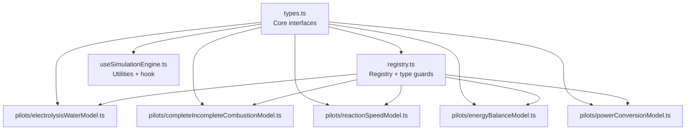
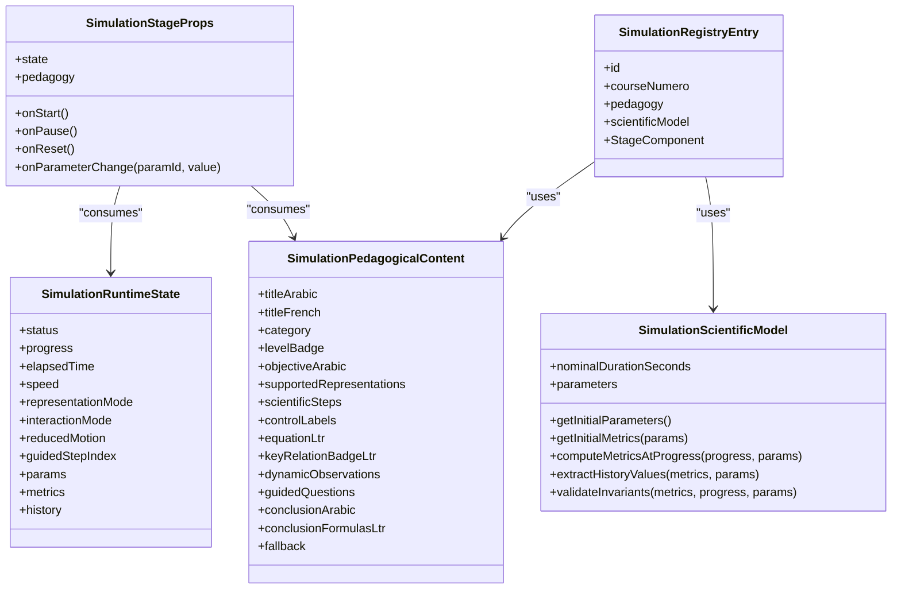
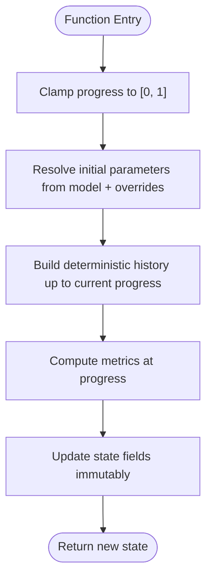
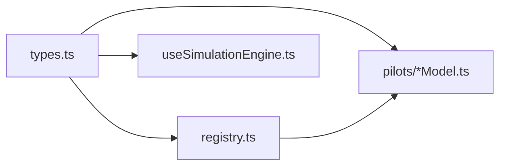

# Type Definitions and Interfaces

<cite>
**Referenced Files in This Document**
- [types.ts](file://src/components/physics/simulations/types.ts)
- [registry.ts](file://src/components/physics/simulations/registry.ts)
- [useSimulationEngine.ts](file://src/components/physics/simulations/useSimulationEngine.ts)
- [electrolysisWaterModel.ts](file://src/components/physics/simulations/pilots/electrolysisWaterModel.ts)
- [completeIncompleteCombustionModel.ts](file://src/components/physics/simulations/pilots/completeIncompleteCombustionModel.ts)
- [reactionSpeedModel.ts](file://src/components/physics/simulations/pilots/reactionSpeedModel.ts)
- [energyBalanceModel.ts](file://src/components/physics/simulations/pilots/energyBalanceModel.ts)
- [powerConversionModel.ts](file://src/components/physics/simulations/pilots/powerConversionModel.ts)
</cite>

## Table of Contents
1. [Introduction](#introduction)
2. [Project Structure](#project-structure)
3. [Core Components](#core-components)
4. [Architecture Overview](#architecture-overview)
5. [Detailed Component Analysis](#detailed-component-analysis)
6. [Dependency Analysis](#dependency-analysis)
7. [Performance Considerations](#performance-considerations)
8. [Troubleshooting Guide](#troubleshooting-guide)
9. [Conclusion](#conclusion)

## Introduction
This document explains the simulation framework’s type system for the Physics-Chemistry 3AM interactive simulations. It focuses on the core TypeScript interfaces and types that enforce type safety across pedagogical content, scientific models, runtime state, rendering props, and the central registry. It also documents utility functions, type guards, generic constraints, and practical examples for extending the framework with new simulations.

The framework separates responsibilities into:
- Declarative pedagogical content
- Pure deterministic scientific models
- Generic runtime state
- Typed stage rendering props
- A centralized registry of registered simulations
- Utility helpers for parameter resolution, history building, and state transitions

## Project Structure
The simulation type system lives primarily under `src/components/physics/simulations`. The most important files are:
- `types.ts`: Core interfaces and shared types
- `registry.ts`: Central registry and type guard utilities
- `useSimulationEngine.ts`: Engine utilities and React hook
- Pilot model files: domain-specific implementations of `SimulationScientificModel` and `SimulationPedagogicalContent`

**Diagram sources**
- [types.ts:1-290](file://src/components/physics/simulations/types.ts#L1-L290)
- [registry.ts:1-103](file://src/components/physics/simulations/registry.ts#L1-L103)
- [useSimulationEngine.ts:1-480](file://src/components/physics/simulations/useSimulationEngine.ts#L1-L480)
- [electrolysisWaterModel.ts:1-268](file://src/components/physics/simulations/pilots/electrolysisWaterModel.ts#L1-L268)
- [completeIncompleteCombustionModel.ts:1-524](file://src/components/physics/simulations/pilots/completeIncompleteCombustionModel.ts#L1-L524)
- [reactionSpeedModel.ts:1-462](file://src/components/physics/simulations/pilots/reactionSpeedModel.ts#L1-L462)
- [energyBalanceModel.ts:1-485](file://src/components/physics/simulations/pilots/energyBalanceModel.ts#L1-L485)
- [powerConversionModel.ts:1-446](file://src/components/physics/simulations/pilots/powerConversionModel.ts#L1-L446)

**Section sources**
- [types.ts:1-290](file://src/components/physics/simulations/types.ts#L1-L290)
- [registry.ts:1-103](file://src/components/physics/simulations/registry.ts#L1-L103)
- [useSimulationEngine.ts:1-480](file://src/components/physics/simulations/useSimulationEngine.ts#L1-L480)

## Core Components
This section summarizes the key interfaces and their roles.

- `SimulationRuntimeState<TMetrics, TParams>`: Generic runtime state holding status, progress, speed, representation mode, interaction mode, reduced motion flag, guided step index, parameters, metrics, and sampled history.
- `SimulationScientificModel<TMetrics, TParams>`: Pure deterministic model interface defining nominal duration, optional parameters, initial metrics, metric computation at normalized progress, history extraction, and invariant validation.
- `SimulationPedagogicalContent`: Declarative content describing titles, objectives, supported representations, scientific steps, control labels, equations, dynamic observations, guided questions, conclusions, and fallback data.
- `SimulationStageProps<TMetrics, TParams>`: Props passed to a specific Stage component receiving typed state, pedagogy, and lifecycle callbacks.
- `SimulationRegistryEntry<TMetrics, TParams>`: Central registry entry tying an id, course number, pedagogy, scientific model, and Stage component together.

Additional supporting types include:
- `RegisteredSimulationId`, `FutureSimulationId`, `SimulationId`
- `SimulationCategory`, `SimulationStatus`, `SimulationSpeed`, `SimulationRepresentationMode`, `SimulationInteractionMode`
- `PhysicsSimulationParameter`, `PhysicsSimulationParameterOption`
- `SimulationHistoryPoint`, `SimulationDynamicObservation`, `SimulationGuidedQuestion`, `SimulationScientificStep`, `SimulationFallbackData`, `PhysicsSimulationBlockData`

These types ensure that every simulation is composed from consistent, strongly-typed parts, preventing mismatches between model outputs, UI state, and registry entries.

**Section sources**
- [types.ts:17-290](file://src/components/physics/simulations/types.ts#L17-L290)

## Architecture Overview
The type system enforces a clean separation between declarative content, pure scientific logic, runtime state, and rendering.

**Diagram sources**
- [types.ts:118-290](file://src/components/physics/simulations/types.ts#L118-L290)

## Detailed Component Analysis

### SimulationRuntimeState
`SimulationRuntimeState<TMetrics, TParams>` is the central runtime contract. It carries:
- Control flags: `status`, `speed`, `representationMode`, `interactionMode`, `reducedMotion`
- Progress tracking: `progress`, `elapsedTime`, `guidedStepIndex`
- Domain data: `params` (user-manipulated parameters), `metrics` (computed values), `history` (sampled chart points)

Generic constraints:
- `TMetrics` defaults to `Record<string, number>` but can be narrowed per simulation
- `TParams extends Record<string, number>` ensures parameters are numeric and keyed by string identifiers

Type safety benefits:
- State transitions in the engine preserve generic types
- Stage components receive fully typed `state.params` and `state.metrics`
- History sampling uses `SimulationHistoryPoint` with typed `values`

Example usage pattern:
- Create initial state using `createInitialSimulationState(model, options)`
- Transition state using pure functions like `startSimulationState`, `stepSimulationByDeltaSeconds`, `setSimulationParameterState`
- Render via `SimulationStageProps` which receives the same generic types

**Section sources**
- [types.ts:118-146](file://src/components/physics/simulations/types.ts#L118-L146)
- [useSimulationEngine.ts:100-128](file://src/components/physics/simulations/useSimulationEngine.ts#L100-L128)
- [useSimulationEngine.ts:133-302](file://src/components/physics/simulations/useSimulationEngine.ts#L133-L302)

### SimulationScientificModel
`SimulationScientificModel<TMetrics, TParams>` defines the pure scientific contract:
- `nominalDurationSeconds`: base cycle duration at 1x speed
- Optional `parameters`: declarative list of manipulable parameters
- `getInitialParameters`: optional default parameter resolver
- `getInitialMetrics`: deterministic initial metrics
- `computeMetricsAtProgress`: deterministic metric computation given normalized progress and parameters
- `extractHistoryValues`: map metrics to chart-friendly numeric records
- `validateInvariants`: assertions used by tests and internal checks

Constraints:
- Functions must be pure and deterministic
- Metrics and parameters are strongly typed through generics

Examples in the codebase:
- Water electrolysis model implements `ElectrolysisMetrics`
- Complete/incomplete combustion model implements `CombustionMetrics` and `CombustionParams`
- Reaction speed model implements `ReactionSpeedMetrics` and `ReactionSpeedParams`
- Energy balance model implements `EnergyBalanceMetrics` and `EnergyBalanceParams`
- Power conversion model implements `PowerConversionMetrics` and `PowerConversionParams`

**Section sources**
- [types.ts:237-260](file://src/components/physics/simulations/types.ts#L237-L260)
- [electrolysisWaterModel.ts:30-116](file://src/components/physics/simulations/pilots/electrolysisWaterModel.ts#L30-L116)
- [completeIncompleteCombustionModel.ts:127-347](file://src/components/physics/simulations/pilots/completeIncompleteCombustionModel.ts#L127-L347)
- [reactionSpeedModel.ts:139-287](file://src/components/physics/simulations/pilots/reactionSpeedModel.ts#L139-L287)
- [energyBalanceModel.ts:192-315](file://src/components/physics/simulations/pilots/energyBalanceModel.ts#L192-L315)
- [powerConversionModel.ts:153-264](file://src/components/physics/simulations/pilots/powerConversionModel.ts#L153-L264)

### SimulationPedagogicalContent
`SimulationPedagogicalContent` describes the educational narrative and UI behavior without coupling to any specific course file:
- Titles, category, level badge, objective
- Supported representation modes
- Scientific steps guiding the learner
- Customizable control labels
- Equations and relation badges
- Dynamic observations tied to progress thresholds
- Guided questions with target progress and optional target parameters
- Conclusions and formulas
- Fallback static view data

This interface decouples pedagogy from implementation, enabling reuse across different courses and stages.

**Section sources**
- [types.ts:203-235](file://src/components/physics/simulations/types.ts#L203-L235)
- [electrolysisWaterModel.ts:121-267](file://src/components/physics/simulations/pilots/electrolysisWaterModel.ts#L121-L267)
- [completeIncompleteCombustionModel.ts:349-522](file://src/components/physics/simulations/pilots/completeIncompleteCombustionModel.ts#L349-L522)
- [reactionSpeedModel.ts:292-461](file://src/components/physics/simulations/pilots/reactionSpeedModel.ts#L292-L461)
- [energyBalanceModel.ts:320-484](file://src/components/physics/simulations/pilots/energyBalanceModel.ts#L320-L484)
- [powerConversionModel.ts:266-445](file://src/components/physics/simulations/pilots/powerConversionModel.ts#L266-L445)

### SimulationStageProps
`SimulationStageProps<TMetrics, TParams>` is the typed bridge between the engine and the visual stage:
- Receives `state` and `pedagogy`
- Exposes lifecycle callbacks: `onStart`, `onPause`, `onReset`
- Optional `onParameterChange` for updating parameters safely

This ensures that Stage components cannot accidentally mutate state directly; they must call provided callbacks, preserving immutability and determinism.

**Section sources**
- [types.ts:262-275](file://src/components/physics/simulations/types.ts#L262-L275)

### SimulationRegistryEntry
`SimulationRegistryEntry<TMetrics, TParams>` ties everything together:
- `id`: registered simulation identifier
- `courseNumero`: associated course number
- `pedagogy`: declarative content
- `scientificModel`: pure model
- `StageComponent`: React component typed with `SimulationStageProps`

The registry enforces that only valid `RegisteredSimulationId` values are used, and provides type-safe lookup utilities.

**Section sources**
- [types.ts:277-290](file://src/components/physics/simulations/types.ts#L277-L290)
- [registry.ts:42-81](file://src/components/physics/simulations/registry.ts#L42-L81)

### Supporting Types and Utilities

#### Identifier and Category Types
- `RegisteredSimulationId`: currently implemented simulation ids
- `FutureSimulationId`: reserved ids for future extensions
- `SimulationId`: union of both
- `SimulationCategory`: classification such as laboratory, microscopic-model, parameter-sim, energy-chain-bilan, dynamic-graph

These types prevent typos and enable exhaustive handling in switch statements or routing logic.

**Section sources**
- [types.ts:17-64](file://src/components/physics/simulations/types.ts#L17-L64)

#### Parameter Definition Types
- `PhysicsSimulationParameterOption`: predefined option with numeric value and bilingual labels
- `PhysicsSimulationParameter`: declarative definition of a manipulable scientific parameter including min/max/step/default, optional presets, and presets-only mode

These types drive automatic UI controls and constrain user input ranges.

**Section sources**
- [types.ts:65-92](file://src/components/physics/simulations/types.ts#L65-L92)

#### History and Observation Types
- `SimulationHistoryPoint`: point with normalized progress, elapsed seconds, and numeric values for charting
- `SimulationDynamicObservation`: observation triggered by minimum progress
- `SimulationGuidedQuestion`: progressive question with target progress and optional target parameters
- `SimulationScientificStep`: five-step scientific method labels
- `SimulationFallbackData`: static fallback view structure

**Section sources**
- [types.ts:109-201](file://src/components/physics/simulations/types.ts#L109-L201)

#### Engine Utilities and Type Guards
- `clampProgress(value)`: clamps progress to `[0, 1]`
- `resolveInitialParameters(model, overrides)`: resolves parameters from model definitions and optional overrides
- `buildDeterministicHistory(model, progress, params)`: builds deterministic sampled history
- `createInitialSimulationState(model, options)`: creates initial runtime state
- State transition functions: `startSimulationState`, `pauseSimulationState`, `resetSimulationState`, `setSimulationSpeedState`, `setSimulationParameterState`, `stepSimulationByDeltaSeconds`, `jumpToSimulationProgress`
- `useSimulationEngine(model, options)`: React hook managing animation loop, reduced motion, visibility, and exposed actions

Registry utilities:
- `isSimulationRegistered(id)`: type guard narrowing `SimulationId | string` to `RegisteredSimulationId`
- `getSimulationFromRegistry(id)`: safe lookup returning entry or null

These utilities are generic over `TMetrics` and `TParams`, ensuring end-to-end type safety.

**Diagram sources**
- [useSimulationEngine.ts:22-95](file://src/components/physics/simulations/useSimulationEngine.ts#L22-L95)
- [useSimulationEngine.ts:100-128](file://src/components/physics/simulations/useSimulationEngine.ts#L100-L128)
- [useSimulationEngine.ts:133-302](file://src/components/physics/simulations/useSimulationEngine.ts#L133-L302)

**Section sources**
- [useSimulationEngine.ts:22-302](file://src/components/physics/simulations/useSimulationEngine.ts#L22-L302)
- [registry.ts:86-102](file://src/components/physics/simulations/registry.ts#L86-L102)

## Dependency Analysis
The type system creates clear dependency boundaries:
- `types.ts` is the foundation consumed by all other modules
- `registry.ts` depends on `types.ts` and imports pilot models
- `useSimulationEngine.ts` depends on `types.ts` and exports utilities used by components
- Pilot models depend on `types.ts` and optionally import `clampProgress` from the engine

**Diagram sources**
- [types.ts:1-290](file://src/components/physics/simulations/types.ts#L1-L290)
- [registry.ts:1-103](file://src/components/physics/simulations/registry.ts#L1-L103)
- [useSimulationEngine.ts:1-480](file://src/components/physics/simulations/useSimulationEngine.ts#L1-L480)
- [electrolysisWaterModel.ts:1-268](file://src/components/physics/simulations/pilots/electrolysisWaterModel.ts#L1-L268)
- [completeIncompleteCombustionModel.ts:1-524](file://src/components/physics/simulations/pilots/completeIncompleteCombustionModel.ts#L1-L524)
- [reactionSpeedModel.ts:1-462](file://src/components/physics/simulations/pilots/reactionSpeedModel.ts#L1-L462)
- [energyBalanceModel.ts:1-485](file://src/components/physics/simulations/pilots/energyBalanceModel.ts#L1-L485)
- [powerConversionModel.ts:1-446](file://src/components/physics/simulations/pilots/powerConversionModel.ts#L1-L446)

**Section sources**
- [registry.ts:1-103](file://src/components/physics/simulations/registry.ts#L1-L103)
- [useSimulationEngine.ts:1-480](file://src/components/physics/simulations/useSimulationEngine.ts#L1-L480)

## Performance Considerations
- Deterministic metric computation avoids side effects, enabling memoization and stable history generation
- `clampProgress` prevents invalid progress values from causing unnecessary recomputation
- `buildDeterministicHistory` samples at most 20 steps plus the final point, balancing chart fidelity and performance
- Reduced motion mode switches to discrete pedagogical steps instead of continuous animation, improving accessibility and reducing frame cost
- Animation loop caps delta time to avoid large jumps when tabs are inactive

[No sources needed since this section provides general guidance]

## Troubleshooting Guide
Common issues and how the type system helps diagnose them:

- Mismatched metrics shape: If a Stage component accesses a field not present in `TMetrics`, TypeScript will error at compile time. Ensure `computeMetricsAtProgress` returns the expected metric structure.
- Invalid parameter ranges: Use `PhysicsSimulationParameter.min/max/step` and rely on `setSimulationParameterState` to clamp values automatically.
- Missing registry entry: Use `isSimulationRegistered` before accessing the registry; it narrows the id type and returns null for unimplemented simulations.
- Invariant failures: Implement `validateInvariants` to catch scientific inconsistencies during development and testing.

**Section sources**
- [registry.ts:86-102](file://src/components/physics/simulations/registry.ts#L86-L102)
- [useSimulationEngine.ts:221-252](file://src/components/physics/simulations/useSimulationEngine.ts#L221-L252)

## Conclusion
The simulation framework’s type system provides a robust, extensible foundation for building interactive physics and chemistry simulations. By enforcing strict contracts through `SimulationRuntimeState`, `SimulationScientificModel`, `SimulationPedagogicalContent`, `SimulationStageProps`, and `SimulationRegistryEntry`, the framework guarantees type safety across the entire ecosystem. Utility functions and type guards further reduce runtime errors and improve developer experience. Extending the framework involves implementing the core interfaces and registering the simulation in the central registry, ensuring consistency and maintainability.

[No sources needed since this section summarizes without analyzing specific files]