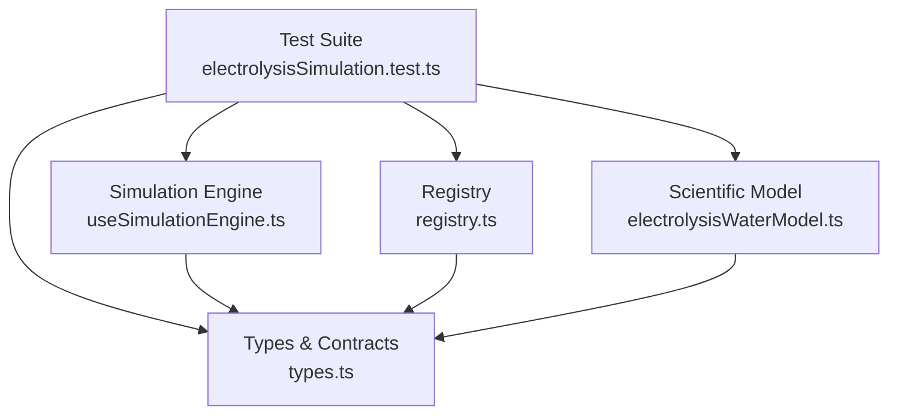
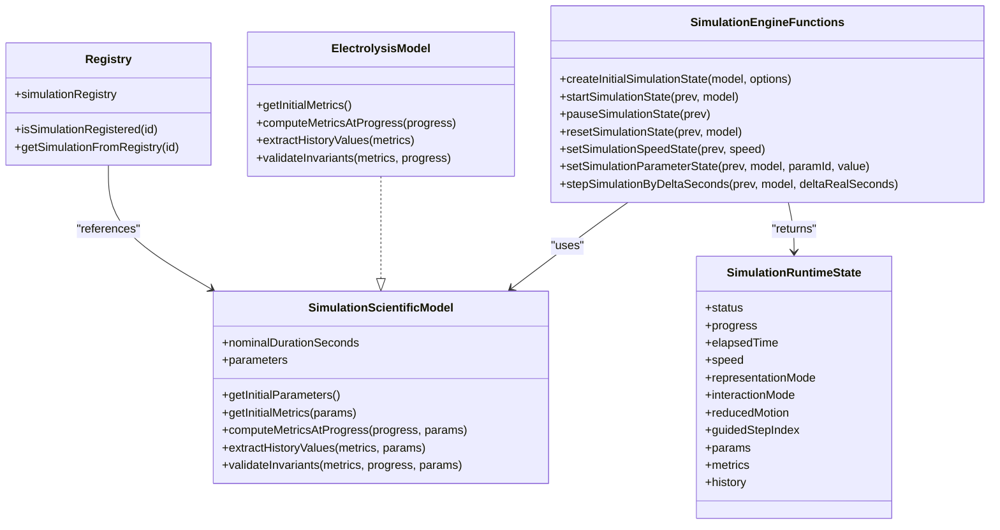
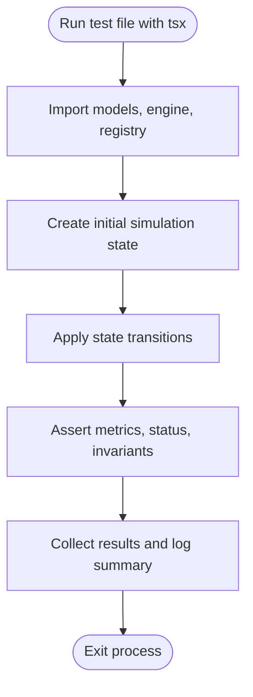
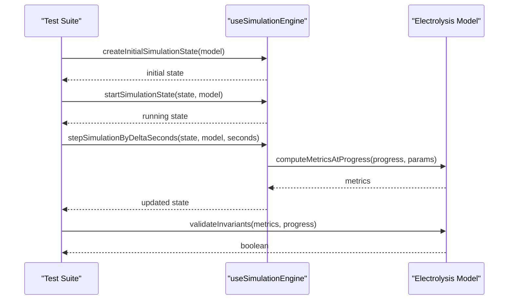
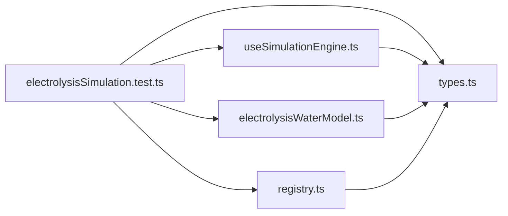

# Testing Strategy

<cite>
**Referenced Files in This Document**
- [electrolysisSimulation.test.ts](file://src/components/physics/simulations/__tests__/electrolysisSimulation.test.ts)
- [useSimulationEngine.ts](file://src/components/physics/simulations/useSimulationEngine.ts)
- [types.ts](file://src/components/physics/simulations/types.ts)
- [registry.ts](file://src/components/physics/simulations/registry.ts)
- [electrolysisWaterModel.ts](file://src/components/physics/simulations/pilots/electrolysisWaterModel.ts)
- [package.json](file://package.json)
- [vite.config.ts](file://vite.config.ts)
</cite>

## Table of Contents
1. [Introduction](#introduction)
2. [Project Structure](#project-structure)
3. [Core Components](#core-components)
4. [Architecture Overview](#architecture-overview)
5. [Detailed Component Analysis](#detailed-component-analysis)
6. [Dependency Analysis](#dependency-analysis)
7. [Performance Considerations](#performance-considerations)
8. [Troubleshooting Guide](#troubleshooting-guide)
9. [Conclusion](#conclusion)

## Introduction
This document explains the testing strategy and implementation for the Physics-Chemistry 3AM simulation framework. The project uses a deterministic, pure-function-based scientific model layer that is explicitly designed to be unit-testable. Tests are written as Node scripts executed with `tsx`, using Node’s built-in strict assertion module rather than a dedicated test runner like Jest or Vitest.

The primary example is the electrolysis simulation test suite, which validates:
- Simulation engine state transitions (start, pause, resume, reset).
- Scientific invariants (stoichiometric ratios, conservation laws).
- Parameter sensitivity (speed, oxygen supply, temperature, surface area, energy balance, power conversion).
- Registry integrity and course integration.
- Accessibility behavior under reduced motion.

## Project Structure
Testing-related code is concentrated under the simulations feature folder:
- Test file: `src/components/physics/simulations/__tests__/electrolysisSimulation.test.ts`
- Engine and types: `useSimulationEngine.ts`, `types.ts`
- Registry: `registry.ts`
- Pilot models: `pilots/electrolysisWaterModel.ts` and related pilot files
- Configuration: `package.json`, `vite.config.ts`

**Diagram sources**
- [electrolysisSimulation.test.ts:1-38](file://src/components/physics/simulations/__tests__/electrolysisSimulation.test.ts#L1-L38)
- [useSimulationEngine.ts:10-17](file://src/components/physics/simulations/useSimulationEngine.ts#L10-L17)
- [types.ts:242-260](file://src/components/physics/simulations/types.ts#L242-L260)
- [registry.ts:42-81](file://src/components/physics/simulations/registry.ts#L42-L81)
- [electrolysisWaterModel.ts:35-116](file://src/components/physics/simulations/pilots/electrolysisWaterModel.ts#L35-L116)

**Section sources**
- [electrolysisSimulation.test.ts:1-38](file://src/components/physics/simulations/__tests__/electrolysisSimulation.test.ts#L1-L38)
- [package.json:6-12](file://package.json#L6-L12)
- [vite.config.ts:6-22](file://vite.config.ts#L6-L22)

## Core Components
The testing approach relies on three core components:

1. **Deterministic Scientific Models**
   - Each simulation exposes a pure `SimulationScientificModel` interface with methods such as `getInitialMetrics`, `computeMetricsAtProgress`, `extractHistoryValues`, and `validateInvariants`.
   - These functions have no side effects, making them ideal for unit tests.

2. **Pure State Transition Functions**
   - The engine exports pure functions like `createInitialSimulationState`, `startSimulationState`, `pauseSimulationState`, `resetSimulationState`, `setSimulationSpeedState`, `setSimulationParameterState`, and `stepSimulationByDeltaSeconds`.
   - Tests compose these functions to simulate user interactions without rendering UI.

3. **Centralized Registry**
   - The registry maps simulation IDs to their pedagogical content, scientific model, and stage component.
   - Tests assert that all expected simulations are registered and integrated into courses.

**Section sources**
- [types.ts:242-260](file://src/components/physics/simulations/types.ts#L242-L260)
- [useSimulationEngine.ts:100-279](file://src/components/physics/simulations/useSimulationEngine.ts#L100-L279)
- [registry.ts:42-102](file://src/components/physics/simulations/registry.ts#L42-L102)

## Architecture Overview
The simulation architecture separates concerns into layers:
- **Pedagogical Content**: Declarative metadata describing learning objectives, steps, observations, and guided questions.
- **Scientific Model**: Pure, deterministic computation of metrics from normalized progress and parameters.
- **Runtime State**: Immutable-like state transitions driven by pure functions.
- **Stage Component**: React component responsible for rendering visuals and handling user input.
- **Registry**: Central mapping of simulation identifiers to their full definition.

**Diagram sources**
- [types.ts:121-146](file://src/components/physics/simulations/types.ts#L121-L146)
- [types.ts:242-260](file://src/components/physics/simulations/types.ts#L242-L260)
- [useSimulationEngine.ts:100-279](file://src/components/physics/simulations/useSimulationEngine.ts#L100-L279)
- [electrolysisWaterModel.ts:35-116](file://src/components/physics/simulations/pilots/electrolysisWaterModel.ts#L35-L116)
- [registry.ts:42-102](file://src/components/physics/simulations/registry.ts#L42-L102)

## Detailed Component Analysis

### Unit Testing Framework Setup
- **Execution Environment**: Tests run via `tsx`, which executes TypeScript directly in Node.
- **Assertion Library**: Uses Node’s built-in `node:assert/strict` for strict assertions.
- **No Dedicated Test Runner**: There is no Jest or Vitest configuration; tests are plain modules that execute immediately when run.
- **Scripts**: No explicit test script exists in `package.json`; the test comment indicates running with `npx tsx ...`.

**Diagram sources**
- [electrolysisSimulation.test.ts:39-45](file://src/components/physics/simulations/__tests__/electrolysisSimulation.test.ts#L39-L45)
- [electrolysisSimulation.test.ts:446-455](file://src/components/physics/simulations/__tests__/electrolysisSimulation.test.ts#L446-L455)

**Section sources**
- [electrolysisSimulation.test.ts:1-45](file://src/components/physics/simulations/__tests__/electrolysisSimulation.test.ts#L1-L45)
- [package.json:6-12](file://package.json#L6-L12)

### Test File Organization
- All simulation tests live under `src/components/physics/simulations/__tests__/`.
- The single test file aggregates multiple scenarios:
  - Initialization and lifecycle (start, pause, resume, reset).
  - Scientific invariants (volume ratio, atom conservation).
  - Speed and parameter sensitivity.
  - Course-specific simulations (combustion, reaction speed, energy balance, power conversion).
  - Registry and course integration checks.
  - Reduced motion accessibility behavior.

**Section sources**
- [electrolysisSimulation.test.ts:45-455](file://src/components/physics/simulations/__tests__/electrolysisSimulation.test.ts#L45-L455)

### Mocking Strategies
- **No mocking framework used**: The design avoids mocks by relying on pure functions and deterministic models.
- **State isolation**: Each test creates its own simulation state, ensuring no cross-test interference.
- **Parameter overrides**: Tests pass `initialParams` to `createInitialSimulationState` to control model inputs without altering shared state.

**Section sources**
- [useSimulationEngine.ts:100-128](file://src/components/physics/simulations/useSimulationEngine.ts#L100-L128)
- [electrolysisSimulation.test.ts:249-258](file://src/components/physics/simulations/__tests__/electrolysisSimulation.test.ts#L249-L258)

### Simulation Testing Approach
The electrolysis simulation test demonstrates how to validate complex scientific simulations:
- **Deterministic Progression**: Tests advance time using `stepSimulationByDeltaSeconds`, asserting exact metric values at specific progress points.
- **Invariant Validation**: Each model provides `validateInvariants`, which tests call to ensure physical laws hold across all states.
- **Ratio Verification**: For electrolysis, the test verifies that the H₂/O₂ volume ratio remains exactly 2 across many progress steps.
- **Reduced Motion**: Tests verify that animations are bypassed and the simulation jumps to key pedagogical milestones.

**Diagram sources**
- [electrolysisSimulation.test.ts:69-81](file://src/components/physics/simulations/__tests__/electrolysisSimulation.test.ts#L69-L81)
- [useSimulationEngine.ts:254-279](file://src/components/physics/simulations/useSimulationEngine.ts#L254-L279)
- [electrolysisWaterModel.ts:51-81](file://src/components/physics/simulations/pilots/electrolysisWaterModel.ts#L51-L81)

**Section sources**
- [electrolysisSimulation.test.ts:69-81](file://src/components/physics/simulations/__tests__/electrolysisSimulation.test.ts#L69-L81)
- [electrolysisSimulation.test.ts:147-164](file://src/components/physics/simulations/__tests__/electrolysisSimulation.test.ts#L147-L164)
- [electrolysisSimulation.test.ts:399-418](file://src/components/physics/simulations/__tests__/electrolysisSimulation.test.ts#L399-L418)

### Component Testing Patterns
- **State-driven testing**: Instead of rendering React components, tests manipulate runtime state and assert derived metrics.
- **Interaction simulation**: User actions (start, pause, reset, parameter change) are modeled as function calls.
- **Accessibility testing**: Reduced motion mode is tested by initializing the state with `initialReducedMotion: true`.

**Section sources**
- [useSimulationEngine.ts:133-165](file://src/components/physics/simulations/useSimulationEngine.ts#L133-L165)
- [useSimulationEngine.ts:180-202](file://src/components/physics/simulations/useSimulationEngine.ts#L180-L202)
- [useSimulationEngine.ts:221-252](file://src/components/physics/simulations/useSimulationEngine.ts#L221-L252)

### Test Data Management
- **Inline test data**: Test cases define expected values directly within the test file.
- **Course integration data**: Tests import `PHYSICS_CHEMISTRY_COURSES` and `COURSES_DATA` to verify simulation blocks are present in course structures.
- **Registry keys**: Tests assert the exact set of registered simulation IDs.

**Section sources**
- [electrolysisSimulation.test.ts:335-394](file://src/components/physics/simulations/__tests__/electrolysisSimulation.test.ts#L335-L394)

### Utilities and Assertion Patterns
- **Strict assertions**: `assert.equal`, `assert.ok`, `assert.deepEqual` are used throughout.
- **Result collection**: Tests push human-readable result strings into an array and print a summary at the end.
- **Numerical tolerance**: Where needed, tests use rounding or epsilon comparisons to handle floating-point precision.

**Section sources**
- [electrolysisSimulation.test.ts:46-64](file://src/components/physics/simulations/__tests__/electrolysisSimulation.test.ts#L46-L64)
- [electrolysisSimulation.test.ts:446-455](file://src/components/physics/simulations/__tests__/electrolysisSimulation.test.ts#L446-L455)

### Continuous Integration Setup
- **No CI configuration found**: There is no GitHub Actions, GitLab CI, or similar pipeline in the repository.
- **No test script in package.json**: The `scripts` section does not include a `test` command.
- **Recommendation**: Add a `test` script that runs the test file with `tsx`, and consider integrating it into a CI workflow.

**Section sources**
- [package.json:6-12](file://package.json#L6-L12)

## Dependency Analysis
The test suite depends on:
- **Engine functions**: For state creation and transitions.
- **Scientific models**: For computing metrics and validating invariants.
- **Registry**: For verifying simulation registration and course integration.
- **Course data**: For ensuring simulations are embedded in curriculum content.

**Diagram sources**
- [electrolysisSimulation.test.ts:1-38](file://src/components/physics/simulations/__tests__/electrolysisSimulation.test.ts#L1-L38)
- [useSimulationEngine.ts:1-9](file://src/components/physics/simulations/useSimulationEngine.ts#L1-L9)
- [electrolysisWaterModel.ts:1-5](file://src/components/physics/simulations/pilots/electrolysisWaterModel.ts#L1-L5)
- [registry.ts:1-5](file://src/components/physics/simulations/registry.ts#L1-L5)
- [types.ts:1-15](file://src/components/physics/simulations/types.ts#L1-L15)

**Section sources**
- [electrolysisSimulation.test.ts:1-38](file://src/components/physics/simulations/__tests__/electrolysisSimulation.test.ts#L1-L38)

## Performance Considerations
- **Deterministic computations**: All scientific calculations are pure and fast, enabling rapid test execution.
- **No DOM or network I/O**: Tests avoid heavy browser APIs, keeping them lightweight.
- **Minimal history generation**: History is sampled up to a fixed number of steps, preventing excessive memory usage during tests.

[No sources needed since this section provides general guidance]

## Troubleshooting Guide
Common issues and resolutions:
- **Floating-point precision**: Use rounding or small tolerances when comparing computed metrics.
- **State mutation**: Ensure each test creates a fresh state; avoid sharing state between tests.
- **Missing registry entries**: Verify that new simulations are added to both the registry and course data.
- **Reduced motion behavior**: Confirm that tests initialize state with `initialReducedMotion: true` when checking accessibility paths.

**Section sources**
- [electrolysisSimulation.test.ts:147-164](file://src/components/physics/simulations/__tests__/electrolysisSimulation.test.ts#L147-L164)
- [useSimulationEngine.ts:142-154](file://src/components/physics/simulations/useSimulationEngine.ts#L142-L154)

## Conclusion
The testing strategy emphasizes determinism, purity, and separation of concerns. By modeling scientific logic as pure functions and simulating user interactions through state transitions, the tests provide strong guarantees about correctness without relying on UI rendering or external services. The electrolysis simulation test serves as a comprehensive example of how to validate complex scientific behaviors, parameter sensitivity, and accessibility requirements. To improve maintainability, consider adding a formal test script and integrating automated CI checks.

[No sources needed since this section summarizes without analyzing specific files]