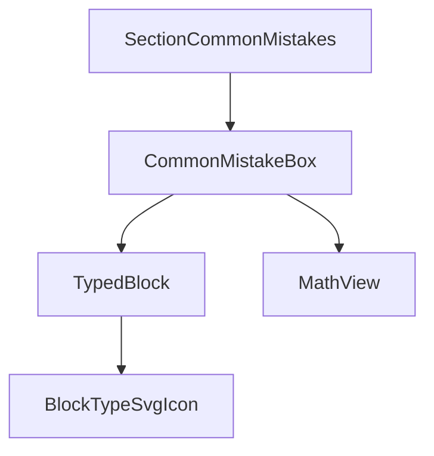
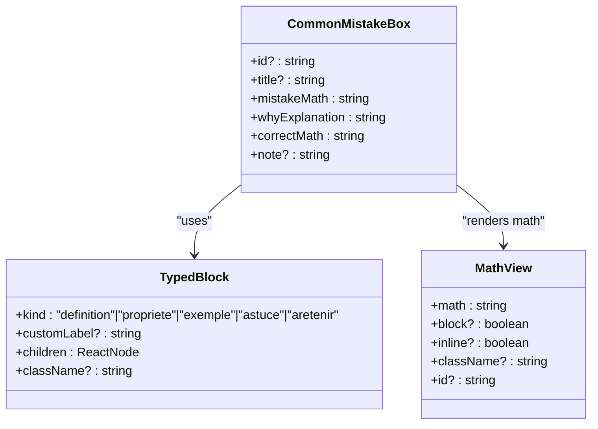
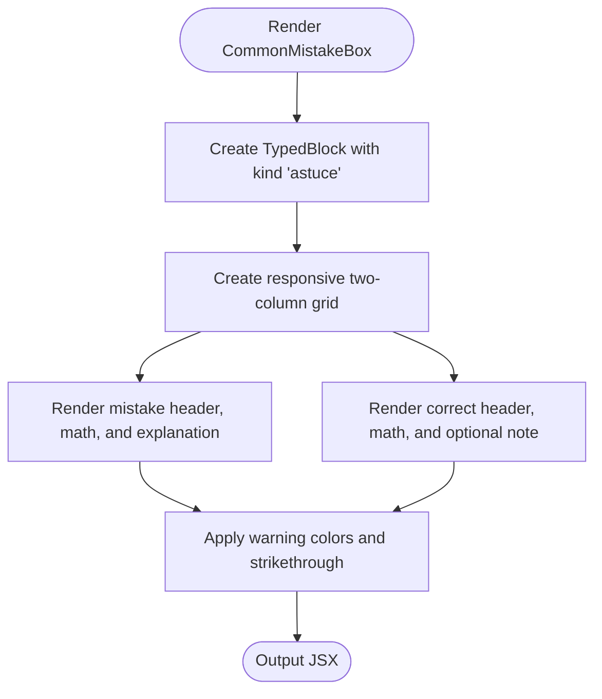
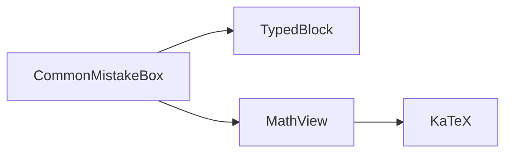

# Common Mistake Box Component

<cite>
**Referenced Files in This Document**
- [CommonMistakeBox.tsx](file://src/components/CommonMistakeBox.tsx)
- [SectionCommonMistakes.tsx](file://src/components/SectionCommonMistakes.tsx)
- [SchoolMouvBlocks.tsx](file://src/components/SchoolMouvBlocks.tsx)
- [MathView.tsx](file://src/components/MathView.tsx)
</cite>

## Table of Contents
1. [Introduction](#introduction)
2. [Project Structure](#project-structure)
3. [Core Components](#core-components)
4. [Architecture Overview](#architecture-overview)
5. [Detailed Component Analysis](#detailed-component-analysis)
6. [Dependency Analysis](#dependency-analysis)
7. [Performance Considerations](#performance-considerations)
8. [Troubleshooting Guide](#troubleshooting-guide)
9. [Conclusion](#conclusion)
10. [Appendices](#appendices)

## Introduction
The Common Mistake Box component is an educational UI element designed to highlight frequent student errors and guide learners toward correct mathematical reasoning. It presents a side-by-side comparison between a common incorrect approach and the correct method, accompanied by concise explanations and optional rules or notes. The component uses a consistent visual language with warning colors, icons, and layout patterns to draw attention to important learning points while maintaining clarity and accessibility.

## Project Structure
The Common Mistake Box lives within the components directory alongside other course-related UI blocks. It composes two core building blocks:
- TypedBlock from SchoolMouvBlocks for labeled, icon-accented content containers
- MathView from MathView for rendering LaTeX math expressions

A dedicated section component demonstrates how to use Common Mistake Box to present multiple mistakes in a structured lesson flow.

**Diagram sources**
- [SectionCommonMistakes.tsx:1-49](file://src/components/SectionCommonMistakes.tsx#L1-L49)
- [CommonMistakeBox.tsx:1-70](file://src/components/CommonMistakeBox.tsx#L1-L70)
- [SchoolMouvBlocks.tsx:213-239](file://src/components/SchoolMouvBlocks.tsx#L213-L239)
- [MathView.tsx:1-200](file://src/components/MathView.tsx#L1-L200)

**Section sources**
- [CommonMistakeBox.tsx:1-70](file://src/components/CommonMistakeBox.tsx#L1-L70)
- [SectionCommonMistakes.tsx:1-49](file://src/components/SectionCommonMistakes.tsx#L1-L49)

## Core Components
- CommonMistakeBox: Renders a pedagogical alert block comparing a common mistake with the correct approach. It accepts props for title, mistake description, explanation, correct solution, and optional note.
- TypedBlock: A generic container that adds an icon, label, and right-aligned dotted rail for emphasis.
- MathView: Renders LaTeX math using KaTeX and supports inline or block display modes.
- formatTextWithSuperscripts: Formats plain text with superscripts and concept highlights for readable explanations.

Key responsibilities:
- Visual distinction between incorrect and correct approaches
- Clear labeling and iconography
- Consistent spacing, borders, and color accents
- Support for math rendering and formatted text

**Section sources**
- [CommonMistakeBox.tsx:5-21](file://src/components/CommonMistakeBox.tsx#L5-L21)
- [SchoolMouvBlocks.tsx:213-239](file://src/components/SchoolMouvBlocks.tsx#L213-L239)
- [MathView.tsx:6-12](file://src/components/MathView.tsx#L6-L12)
- [MathView.tsx:129-195](file://src/components/MathView.tsx#L129-L195)

## Architecture Overview
The component architecture follows a composition pattern:
- SectionCommonMistakes orchestrates multiple CommonMistakeBox instances to present a curated list of mistakes.
- CommonMistakeBox composes TypedBlock and MathView to render a styled, accessible, and math-capable block.
- TypedBlock provides consistent styling and iconography across different block types, including “astuce” used here.
- MathView handles LaTeX rendering and text formatting utilities.

**Diagram sources**
- [CommonMistakeBox.tsx:5-21](file://src/components/CommonMistakeBox.tsx#L5-L21)
- [SchoolMouvBlocks.tsx:213-239](file://src/components/SchoolMouvBlocks.tsx#L213-L239)
- [MathView.tsx:6-12](file://src/components/MathView.tsx#L6-L12)

## Detailed Component Analysis

### CommonMistakeBox Props Interface
The component exposes a focused interface for presenting mistakes and corrections:
- id: Optional DOM identifier for anchoring or testing.
- title: Optional heading inside the block; defaults to a pedagogical alert phrase.
- mistakeMath: Required LaTeX string describing the common incorrect approach.
- whyExplanation: Required explanatory text clarifying why the mistake occurs.
- correctMath: Required LaTeX string showing the correct approach.
- note: Optional rule or reminder text displayed under the correct approach.

Usage example (conceptual):
- Provide a clear title describing the mistake category.
- Use concise, learner-friendly explanations.
- Keep LaTeX minimal and accurate for both mistake and correction.
- Add a short rule when helpful to reinforce the correct procedure.

**Section sources**
- [CommonMistakeBox.tsx:5-21](file://src/components/CommonMistakeBox.tsx#L5-L21)

### Visual Design System
The component emphasizes critical information through:
- Warning color accent: A distinctive purple accent (#C94BA6) is used for labels, dots, borders, and strikethrough decoration on the incorrect expression.
- Layout pattern: A two-column grid separates the incorrect and correct approaches, stacking vertically on small screens.
- Iconography: The “astuce” kind displays a lightbulb-style icon via BlockTypeSvgIcon, signaling a tip or caution.
- Borders and backgrounds:
  - Incorrect column: Soft background tint with subtle border and strikethrough decoration on the math expression.
  - Correct column: White background with a soft accent border to signal correctness.
- Typography: Bold headings and clear hierarchy; explanations are compact and readable.

Accessibility considerations:
- The incorrect math area uses strikethrough decoration to visually indicate error.
- The block is wrapped in a right-to-left context for Arabic content, ensuring proper text direction.
- Math expressions are rendered in left-to-right mode to preserve mathematical notation.
- Interactive elements should remain keyboard-accessible where applicable (e.g., if concept links are added).

**Section sources**
- [CommonMistakeBox.tsx:22-69](file://src/components/CommonMistakeBox.tsx#L22-L69)
- [SchoolMouvBlocks.tsx:90-133](file://src/components/SchoolMouvBlocks.tsx#L90-L133)
- [SchoolMouvBlocks.tsx:213-239](file://src/components/SchoolMouvBlocks.tsx#L213-L239)

### Data Flow and Rendering Logic
The component renders as follows:
1. Accepts props and constructs a TypedBlock with kind “astuce”.
2. Creates a responsive grid with two columns:
   - Left column: Displays the common mistake with a descriptive header, the LaTeX expression, and an explanation.
   - Right column: Displays the correct approach with a descriptive header, the LaTeX expression, and an optional rule/note.
3. Uses MathView to render LaTeX in both columns.
4. Applies consistent spacing, borders, and accent colors to emphasize importance.

**Diagram sources**
- [CommonMistakeBox.tsx:22-69](file://src/components/CommonMistakeBox.tsx#L22-L69)

### Usage Example: SectionCommonMistakes
The section component demonstrates three typical mistakes:
- Adding numerators and denominators directly when fractions have different denominators.
- Adding denominators when they are equal.
- Multiplying only the numerator during equivalence transformations.

Each instance includes:
- A descriptive title
- A LaTeX expression representing the mistake
- An explanation of why it is wrong
- The correct LaTeX expression
- A concise rule or reminder

This pattern ensures consistency and clarity across lessons.

**Section sources**
- [SectionCommonMistakes.tsx:21-46](file://src/components/SectionCommonMistakes.tsx#L21-L46)

### Pedagogical Best Practices
- Be explicit about the misconception: Title should name the specific error.
- Explain the underlying principle: WhyExplanation should clarify the conceptual reason.
- Show the correct method clearly: correctMath should be minimal and stepwise.
- Reinforce with a rule: note should summarize the key takeaway.
- Maintain visual contrast: Use accent colors sparingly to avoid overwhelming learners.
- Keep explanations concise: Focus on actionable insights.

[No sources needed since this section provides general guidance]

### Accessibility Considerations
- Text direction: The block sets RTL for Arabic content; math expressions set LTR to preserve notation.
- Semantic structure: Headings and labels help screen readers understand sections.
- Color contrast: Accent colors should maintain sufficient contrast against backgrounds.
- Keyboard navigation: Any interactive elements (e.g., concept reminders) must be focusable and operable.
- Meaningful labels: Titles and headers should describe the mistake and correction clearly.

**Section sources**
- [CommonMistakeBox.tsx:32-38](file://src/components/CommonMistakeBox.tsx#L32-L38)
- [CommonMistakeBox.tsx:51-57](file://src/components/CommonMistakeBox.tsx#L51-L57)

## Dependency Analysis
Common Mistake Box depends on:
- TypedBlock for consistent block styling and iconography
- MathView for LaTeX rendering and text formatting
- KaTeX (via MathView) for math rendering

**Diagram sources**
- [CommonMistakeBox.tsx:1-3](file://src/components/CommonMistakeBox.tsx#L1-L3)
- [MathView.tsx:1-3](file://src/components/MathView.tsx#L1-L3)

**Section sources**
- [CommonMistakeBox.tsx:1-3](file://src/components/CommonMistakeBox.tsx#L1-L3)
- [MathView.tsx:1-3](file://src/components/MathView.tsx#L1-L3)

## Performance Considerations
- Math rendering cost: Frequent re-renders of complex LaTeX can impact performance. Consider memoizing static math strings where possible.
- Grid layout: Two-column grids are efficient but ensure content does not cause excessive reflows on small screens.
- Text formatting: Superscript formatting and concept highlighting add processing overhead; keep explanations concise.
- Lazy loading: If many mistakes are presented, consider lazy-loading sections to reduce initial bundle size.

[No sources needed since this section provides general guidance]

## Troubleshooting Guide
- Incorrect LaTeX rendering: Ensure mistakeMath and correctMath contain valid LaTeX syntax. Check for missing braces or unsupported commands.
- Direction issues: Verify that RTL contexts are applied to Arabic text and LTR contexts to math expressions.
- Styling inconsistencies: Confirm that accent colors and borders match design tokens; check Tailwind classes for conflicts.
- Missing explanations: Always provide whyExplanation to avoid ambiguous corrections.
- Overuse of notes: Limit note usage to essential rules to prevent clutter.

**Section sources**
- [CommonMistakeBox.tsx:22-69](file://src/components/CommonMistakeBox.tsx#L22-L69)

## Conclusion
The Common Mistake Box component provides a clear, consistent, and accessible way to highlight frequent student errors and guide learners toward correct mathematical practices. By combining a structured layout, warning colors, icons, and math rendering, it reinforces pedagogical goals while maintaining readability and usability. When used thoughtfully, it enhances learning outcomes by making misconceptions visible and corrections actionable.

[No sources needed since this section summarizes without analyzing specific files]

## Appendices

### Props Reference
- id: Optional string for DOM identification.
- title: Optional string for block heading; defaults to a pedagogical alert phrase.
- mistakeMath: Required LaTeX string for the incorrect approach.
- whyExplanation: Required string explaining the misconception.
- correctMath: Required LaTeX string for the correct approach.
- note: Optional string for a rule or reminder.

**Section sources**
- [CommonMistakeBox.tsx:5-21](file://src/components/CommonMistakeBox.tsx#L5-L21)

### Visual Tokens Summary
- Accent color: #C94BA6 used for icons, labels, borders, and decorations.
- Backgrounds: Soft tint for incorrect column; white for correct column.
- Borders: Subtle borders to separate sections; accent border on correct column.
- Typography: Bold headings; compact, readable explanations.

**Section sources**
- [CommonMistakeBox.tsx:27-64](file://src/components/CommonMistakeBox.tsx#L27-L64)
- [SchoolMouvBlocks.tsx:90-133](file://src/components/SchoolMouvBlocks.tsx#L90-L133)