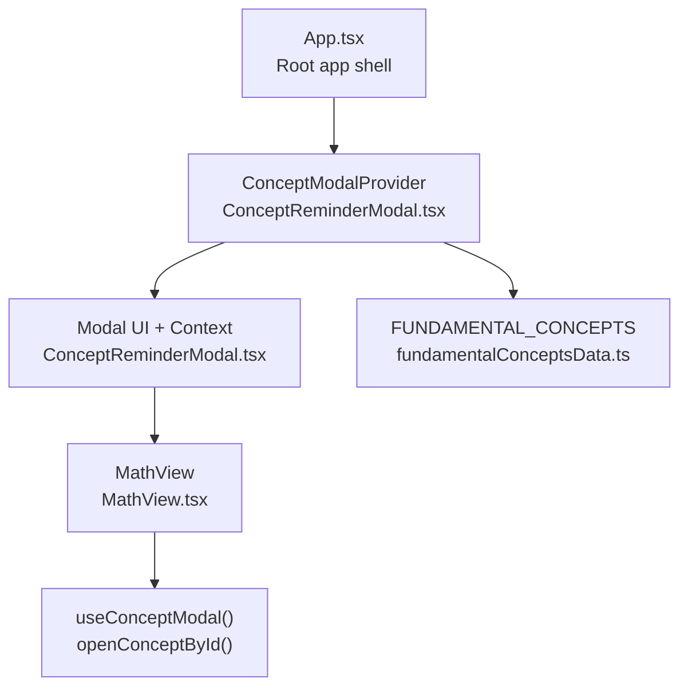
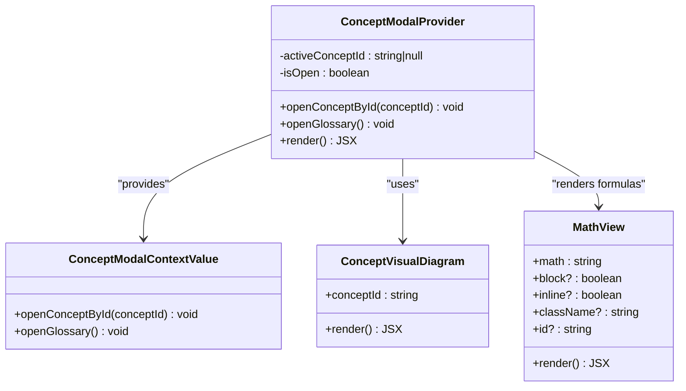
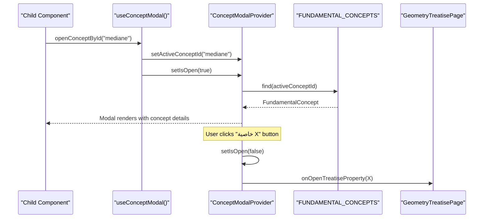
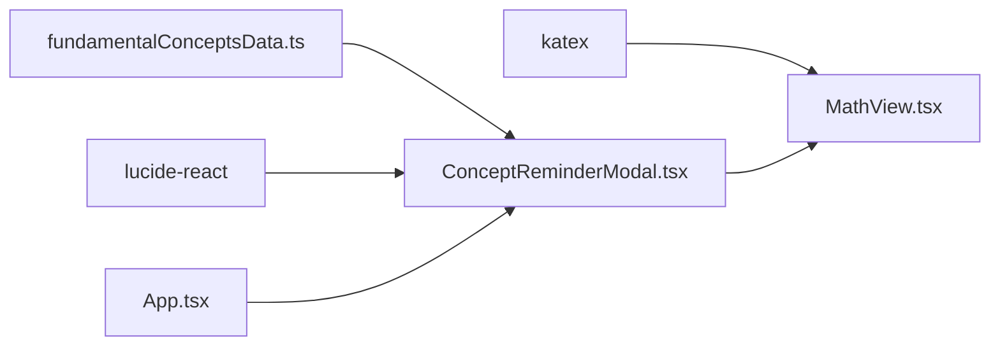

# Concept Reminder Modal Component

<cite>
**Referenced Files in This Document**
- [ConceptReminderModal.tsx](file://src/components/ConceptReminderModal.tsx)
- [fundamentalConceptsData.ts](file://src/data/fundamentalConceptsData.ts)
- [MathView.tsx](file://src/components/MathView.tsx)
- [App.tsx](file://src/App.tsx)
</cite>

## Table of Contents
1. [Introduction](#introduction)
2. [Project Structure](#project-structure)
3. [Core Components](#core-components)
4. [Architecture Overview](#architecture-overview)
5. [Detailed Component Analysis](#detailed-component-analysis)
6. [Dependency Analysis](#dependency-analysis)
7. [Performance Considerations](#performance-considerations)
8. [Troubleshooting Guide](#troubleshooting-guide)
9. [Conclusion](#conclusion)

## Introduction
The Concept Reminder Modal is an overlay component that provides contextual concept reminders and quick reference information during learning activities. It renders a rich, bilingual (Arabic/French) modal with:
- A visual diagram for each fundamental concept
- Official definitions and key properties
- Practical guidance on how to apply or prove concepts in exercises
- Warnings about common confusions
- Optional links to related geometry treatise properties

It is designed as a provider-based system so any child component can open the modal programmatically without prop drilling.

## Project Structure
The modal lives under `src/components` and integrates with:
- A data layer containing all fundamental concepts and their metadata
- A math rendering utility that also makes text clickable to open the modal
- The application root where the provider is mounted and cross-navigation to the geometry treatise is wired

**Diagram sources**
- [App.tsx:233-242](file://src/App.tsx#L233-L242)
- [ConceptReminderModal.tsx:15-25](file://src/components/ConceptReminderModal.tsx#L15-L25)
- [ConceptReminderModal.tsx:378-407](file://src/components/ConceptReminderModal.tsx#L378-L407)
- [MathView.tsx:1-12](file://src/components/MathView.tsx#L1-L12)
- [MathView.tsx:53-121](file://src/components/MathView.tsx#L53-L121)

**Section sources**
- [App.tsx:233-242](file://src/App.tsx#L233-L242)
- [ConceptReminderModal.tsx:15-25](file://src/components/ConceptReminderModal.tsx#L15-L25)
- [ConceptReminderModal.tsx:378-407](file://src/components/ConceptReminderModal.tsx#L378-L407)
- [MathView.tsx:1-12](file://src/components/MathView.tsx#L1-L12)
- [MathView.tsx:53-121](file://src/components/MathView.tsx#L53-L121)

## Core Components
- ConceptModalProvider: Provides context and controls modal lifecycle (open/close), active concept selection, and category-scoped navigation.
- useConceptModal: Hook to access modal actions from anywhere inside the provider tree.
- ConceptVisualDiagram: Renders a dedicated SVG illustration per concept id.
- MathView: Renders LaTeX formulas and Arabic/French text; also highlights clickable concept keywords that open the modal.

Key responsibilities:
- State management for modal visibility and active concept
- Rendering structured content sections (definition, properties, how-to, pitfalls)
- Providing a category-filtered switcher bar for related concepts
- Integrating with external navigation via onOpenTreatiseProperty

**Section sources**
- [ConceptReminderModal.tsx:15-25](file://src/components/ConceptReminderModal.tsx#L15-L25)
- [ConceptReminderModal.tsx:33-376](file://src/components/ConceptReminderModal.tsx#L33-L376)
- [ConceptReminderModal.tsx:378-592](file://src/components/ConceptReminderModal.tsx#L378-L592)
- [MathView.tsx:350-579](file://src/components/MathView.tsx#L350-L579)

## Architecture Overview
The modal uses React Context to expose two primary actions:
- openConceptById(conceptId): Opens the modal for a specific concept
- openGlossary(): Opens the modal with the first concept if none is selected

The provider holds:
- activeConceptId: string | null
- isOpen: boolean
- Derived activeConcept and sameCategoryConcepts for the switcher

**Diagram sources**
- [ConceptReminderModal.tsx:15-25](file://src/components/ConceptReminderModal.tsx#L15-L25)
- [ConceptReminderModal.tsx:378-407](file://src/components/ConceptReminderModal.tsx#L378-L407)
- [ConceptReminderModal.tsx:33-376](file://src/components/ConceptReminderModal.tsx#L33-L376)
- [MathView.tsx:6-12](file://src/components/MathView.tsx#L6-L12)

## Detailed Component Analysis

### Props Interface and Usage

#### ConceptModalProvider
- children: React.ReactNode
- onOpenTreatiseProperty?: (propertyId: number) => void

Behavior:
- Wraps the app to provide modal context
- Manages modal state and renders the overlay when open
- Delegates opening of geometry treatise properties to parent via callback

Integration example path:
- [App.tsx:233-242](file://src/App.tsx#L233-L242)

**Section sources**
- [ConceptReminderModal.tsx:27-30](file://src/components/ConceptReminderModal.tsx#L27-L30)
- [ConceptReminderModal.tsx:378-407](file://src/components/ConceptReminderModal.tsx#L378-L407)
- [App.tsx:233-242](file://src/App.tsx#L233-L242)

#### useConceptModal
Returns:
- openConceptById(conceptId: string): void
- openGlossary(): void

Usage example path:
- [MathView.tsx:53-121](file://src/components/MathView.tsx#L53-L121)

**Section sources**
- [ConceptReminderModal.tsx:15-25](file://src/components/ConceptReminderModal.tsx#L15-L25)
- [MathView.tsx:53-121](file://src/components/MathView.tsx#L53-L121)

#### ConceptVisualDiagram
Props:
- conceptId: string

Responsibilities:
- Renders a tailored SVG diagram based on concept id
- Supports numerical/algebraic and geometry diagrams
- Uses consistent styling and labels

Example paths:
- [ConceptReminderModal.tsx:33-376](file://src/components/ConceptReminderModal.tsx#L33-L376)

**Section sources**
- [ConceptReminderModal.tsx:33-376](file://src/components/ConceptReminderModal.tsx#L33-L376)

#### MathView
Props:
- math: string
- block?: boolean
- inline?: boolean
- className?: string
- id?: string

Responsibilities:
- Renders LaTeX using KaTeX
- Handles mixed Arabic/math text
- Highlights clickable concept keywords that open the modal via useConceptModal

Example path:
- [MathView.tsx:350-579](file://src/components/MathView.tsx#L350-L579)

**Section sources**
- [MathView.tsx:6-12](file://src/components/MathView.tsx#L6-L12)
- [MathView.tsx:350-579](file://src/components/MathView.tsx#L350-L579)

### Modal Lifecycle and Behavior Controls

Lifecycle states:
- Closed: isOpen = false
- Open: isOpen = true, activeConcept resolved from FUNDAMENTAL_CONCEPTS by activeConceptId

Control flow:
- openConceptById sets activeConceptId and opens modal
- openGlossary ensures a default concept is selected if none is set, then opens modal
- Clicking backdrop closes modal
- Switcher buttons update activeConceptId within the same category

**Diagram sources**
- [ConceptReminderModal.tsx:385-395](file://src/components/ConceptReminderModal.tsx#L385-L395)
- [ConceptReminderModal.tsx:409-419](file://src/components/ConceptReminderModal.tsx#L409-L419)
- [ConceptReminderModal.tsx:558-584](file://src/components/ConceptReminderModal.tsx#L558-L584)
- [App.tsx:233-242](file://src/App.tsx#L233-L242)

**Section sources**
- [ConceptReminderModal.tsx:385-395](file://src/components/ConceptReminderModal.tsx#L385-L395)
- [ConceptReminderModal.tsx:409-419](file://src/components/ConceptReminderModal.tsx#L409-L419)
- [ConceptReminderModal.tsx:558-584](file://src/components/ConceptReminderModal.tsx#L558-L584)
- [App.tsx:233-242](file://src/App.tsx#L233-L242)

### Accessibility and Focus Management
- The modal overlay uses role="dialog" and aria-modal="true" to signal accessibility semantics.
- Direction is set to RTL for Arabic content.
- Close button has aria-label for screen readers.
- Clicking the backdrop closes the modal.
- No explicit focus trap is implemented; consider adding focus management for enhanced accessibility.

**Section sources**
- [ConceptReminderModal.tsx:409-419](file://src/components/ConceptReminderModal.tsx#L409-L419)
- [ConceptReminderModal.tsx:441-448](file://src/components/ConceptReminderModal.tsx#L441-L448)

### Animation Transitions
- The modal does not implement explicit CSS transitions or animations.
- It appears/disappears conditionally based on isOpen.
- For smoother UX, consider adding fade/scale transitions around the overlay and modal card.

[No sources needed since this section provides general guidance]

### Content Model and Examples

The modal displays:
- Visual diagram (SVG)
- Formula rendered via MathView
- Definition (Arabic/French)
- Key properties (numbered list)
- How to apply/prove in exercises
- Common confusion warning
- Related treatise property links (optional)

Examples of reminder types:
- Mathematical concepts: e.g., relative numbers, sign rules, powers, scientific notation
- Procedural hints: e.g., operation priorities, fraction unification, cross product
- Theoretical background: e.g., triangle medians, heights, bisectors, circle properties

Data model path:
- [fundamentalConceptsData.ts:1-20](file://src/data/fundamentalConceptsData.ts#L1-L20)
- [fundamentalConceptsData.ts:22-423](file://src/data/fundamentalConceptsData.ts#L22-L423)
- [fundamentalConceptsData.ts:428-627](file://src/data/fundamentalConceptsData.ts#L428-L627)

**Section sources**
- [ConceptReminderModal.tsx:477-584](file://src/components/ConceptReminderModal.tsx#L477-L584)
- [fundamentalConceptsData.ts:1-20](file://src/data/fundamentalConceptsData.ts#L1-L20)
- [fundamentalConceptsData.ts:22-423](file://src/data/fundamentalConceptsData.ts#L22-L423)
- [fundamentalConceptsData.ts:428-627](file://src/data/fundamentalConceptsData.ts#L428-L627)

### Customization Options for Styling
- Tailwind classes are used throughout for layout, colors, spacing, and typography.
- The modal container supports responsive sizing and scrollable content.
- Category switcher and content cards are styled with consistent color tokens.
- To customize:
  - Adjust Tailwind classes in the modal overlay and content sections
  - Extend ConceptVisualDiagram to support additional concept ids and diagrams
  - Modify MathView props to control formula rendering behavior

**Section sources**
- [ConceptReminderModal.tsx:409-584](file://src/components/ConceptReminderModal.tsx#L409-L584)
- [MathView.tsx:350-579](file://src/components/MathView.tsx#L350-L579)

### Integration Patterns with Other Learning Components
- Any component wrapped by ConceptModalProvider can call useConceptModal().openConceptById(...) to open the modal for a specific concept.
- MathView automatically detects concept keywords in text and renders them as interactive elements that open the modal.
- The provider’s onOpenTreatiseProperty callback allows navigation to the geometry treatise page from the modal.

Integration examples:
- [MathView.tsx:53-121](file://src/components/MathView.tsx#L53-L121)
- [App.tsx:233-242](file://src/App.tsx#L233-L242)

**Section sources**
- [MathView.tsx:53-121](file://src/components/MathView.tsx#L53-L121)
- [App.tsx:233-242](file://src/App.tsx#L233-L242)

## Dependency Analysis
- ConceptReminderModal depends on:
  - FUNDAMENTAL_CONCEPTS data for content
  - MathView for formula rendering
  - lucide-react icons for UI elements
- MathView depends on:
  - katex for LaTeX rendering
  - useConceptModal hook to open the modal
- App mounts ConceptModalProvider at the root and wires cross-navigation to GeometryTreatisePage

**Diagram sources**
- [ConceptReminderModal.tsx:1-13](file://src/components/ConceptReminderModal.tsx#L1-L13)
- [ConceptReminderModal.tsx:2-3](file://src/components/ConceptReminderModal.tsx#L2-L3)
- [MathView.tsx:1-4](file://src/components/MathView.tsx#L1-L4)
- [App.tsx:11-11](file://src/App.tsx#L11-L11)

**Section sources**
- [ConceptReminderModal.tsx:1-13](file://src/components/ConceptReminderModal.tsx#L1-L13)
- [ConceptReminderModal.tsx:2-3](file://src/components/ConceptReminderModal.tsx#L2-L3)
- [MathView.tsx:1-4](file://src/components/MathView.tsx#L1-L4)
- [App.tsx:11-11](file://src/App.tsx#L11-L11)

## Performance Considerations
- Modal rendering is conditional on isOpen and activeConcept presence, minimizing unnecessary DOM.
- ConceptVisualDiagram uses static SVGs per concept id; ensure new diagrams are added only when necessary.
- MathView performs regex parsing and KaTeX rendering; keep math strings concise and avoid excessive dynamic updates.
- Category filtering computes sameCategoryConcepts on every render; consider memoizing derived values if performance becomes a concern.

[No sources needed since this section provides general guidance]

## Troubleshooting Guide
Common issues and resolutions:
- Modal does not open:
  - Ensure the component is wrapped by ConceptModalProvider
  - Verify useConceptModal is called within the provider tree
  - Check that openConceptById is invoked with a valid concept id present in FUNDAMENTAL_CONCEPTS
- Incorrect concept displayed:
  - Confirm activeConceptId matches the intended concept id
  - Validate FUNDAMENTAL_CONCEPTS contains the expected entry
- Treatise navigation not working:
  - Ensure onOpenTreatiseProperty is passed to ConceptModalProvider
  - Verify the callback navigates to the geometry treatise view

**Section sources**
- [ConceptReminderModal.tsx:385-395](file://src/components/ConceptReminderModal.tsx#L385-L395)
- [ConceptReminderModal.tsx:558-584](file://src/components/ConceptReminderModal.tsx#L558-L584)
- [App.tsx:233-242](file://src/App.tsx#L233-L242)

## Conclusion
The Concept Reminder Modal provides a robust, accessible, and visually rich overlay for contextual concept reminders. It integrates seamlessly with other components through a simple context API, supports bilingual content, and offers clear pathways to deeper resources like the geometry treatise. By following the integration patterns and customization guidelines outlined here, developers can extend and adapt the modal to meet diverse learning scenarios while maintaining consistency and accessibility.