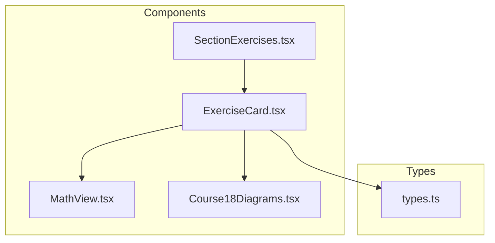
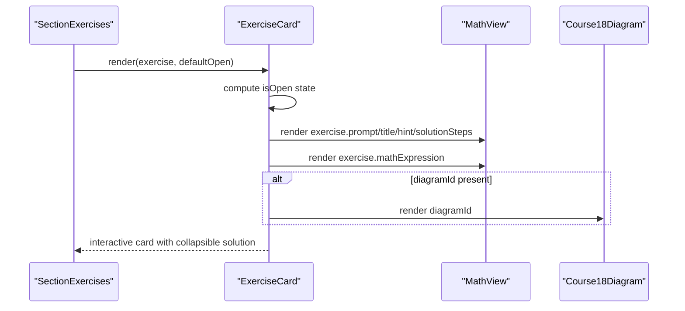
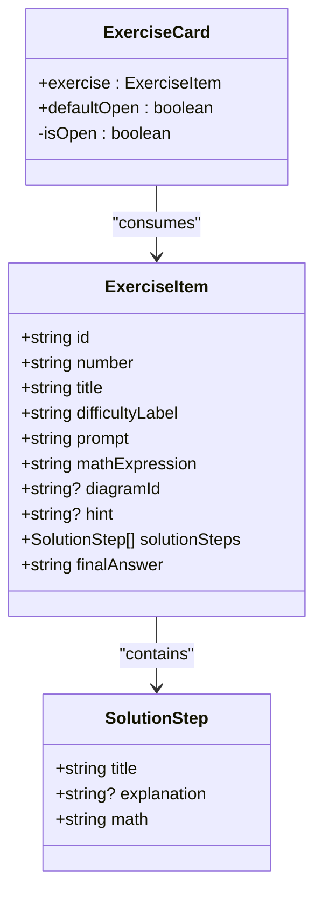
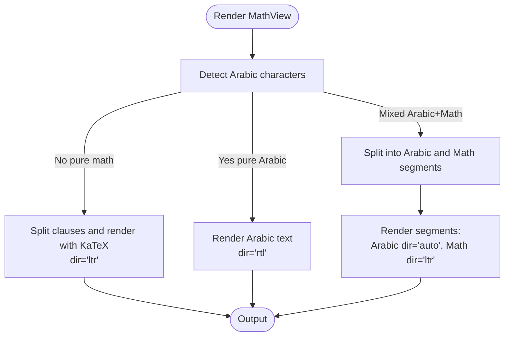
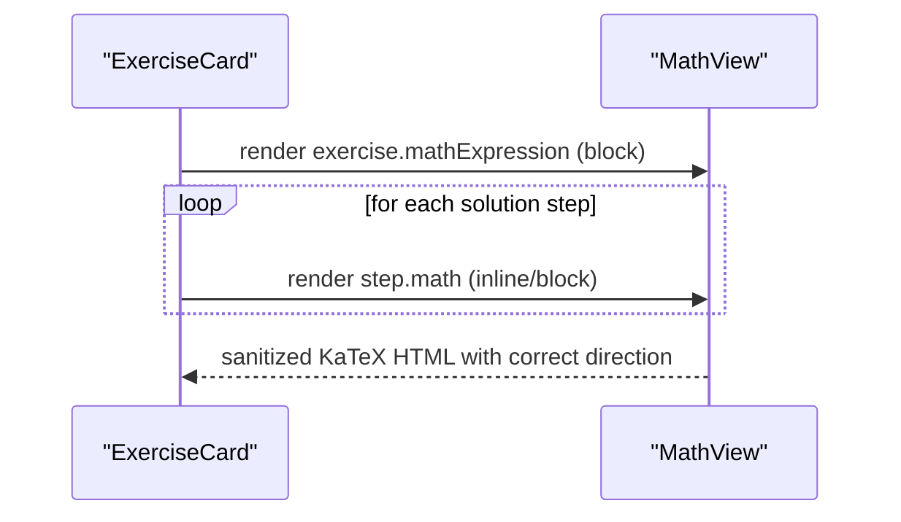
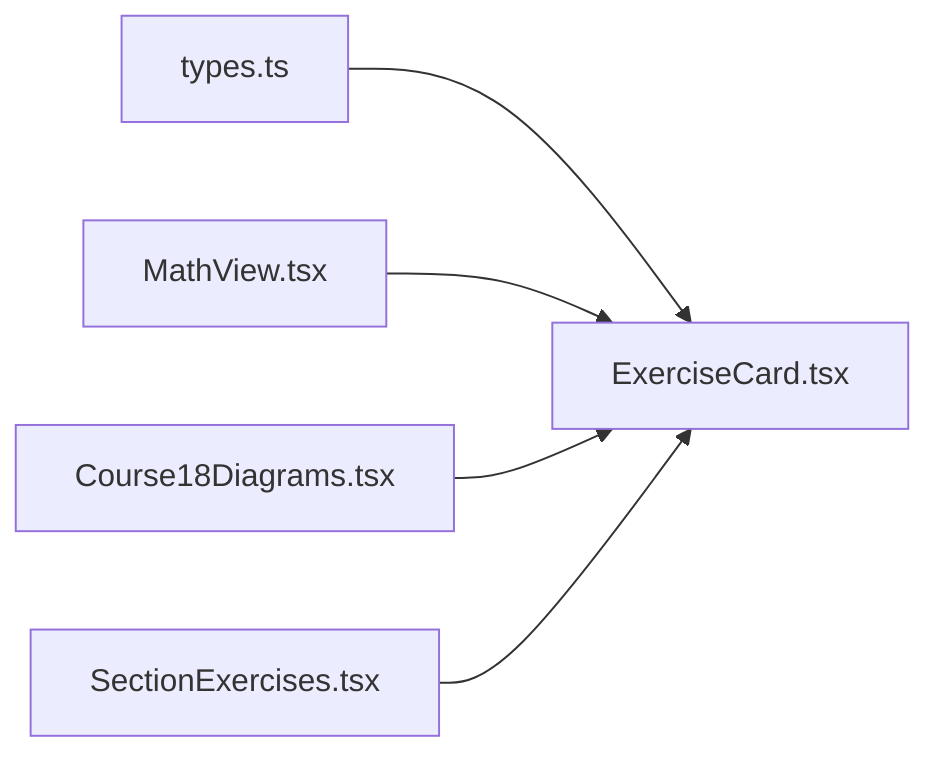

# Exercise Card Component

<cite>
**Referenced Files in This Document**
- [ExerciseCard.tsx](file://src/components/ExerciseCard.tsx)
- [MathView.tsx](file://src/components/MathView.tsx)
- [types.ts](file://src/types.ts)
- [SectionExercises.tsx](file://src/components/SectionExercises.tsx)
- [Course18Diagrams.tsx](file://src/components/Course18Diagrams.tsx)
</cite>

## Table of Contents
1. [Introduction](#introduction)
2. [Project Structure](#project-structure)
3. [Core Components](#core-components)
4. [Architecture Overview](#architecture-overview)
5. [Detailed Component Analysis](#detailed-component-analysis)
6. [Dependency Analysis](#dependency-analysis)
7. [Performance Considerations](#performance-considerations)
8. [Troubleshooting Guide](#troubleshooting-guide)
9. [Conclusion](#conclusion)
10. [Appendices](#appendices)

## Introduction
The ExerciseCard component is a reusable UI card used to display mathematical exercises with interactive, collapsible solutions. It presents the exercise number, title, difficulty label, prompt text, a primary math expression, an optional diagram, and a hint. Users can reveal step-by-step model solutions that include explanatory text and rendered formulas. The component integrates with MathView for robust formula rendering and supports Arabic text, RTL layout handling, and responsive design.

## Project Structure
ExerciseCard lives under src/components and consumes:
- ExerciseItem type from src/types.ts
- MathView and formatTextWithSuperscripts from src/components/MathView.tsx
- Course18Diagram from src/components/Course18Diagrams.tsx
- SectionExercises renders multiple ExerciseCard instances and controls default open state

**Diagram sources**
- [ExerciseCard.tsx:1-141](file://src/components/ExerciseCard.tsx#L1-L141)
- [MathView.tsx:1-580](file://src/components/MathView.tsx#L1-L580)
- [Course18Diagrams.tsx:1-200](file://src/components/Course18Diagrams.tsx#L1-L200)
- [SectionExercises.tsx:1-109](file://src/components/SectionExercises.tsx#L1-L109)
- [types.ts:1-147](file://src/types.ts#L1-L147)

**Section sources**
- [ExerciseCard.tsx:1-141](file://src/components/ExerciseCard.tsx#L1-L141)
- [SectionExercises.tsx:1-109](file://src/components/SectionExercises.tsx#L1-L109)
- [types.ts:1-147](file://src/types.ts#L1-L147)

## Core Components
- ExerciseCard: Renders a single exercise card with header, prompt, math block, optional diagram, hint, and collapsible solution steps.
- MathView: Renders LaTeX or mixed Arabic/math content using KaTeX, handles RTL/LTR directionality, and provides superscript formatting utilities.
- types.ExerciseItem: Defines the shape of exercise data consumed by ExerciseCard.
- Course18Diagram: Renders progressive geometry diagrams referenced by some exercises via diagramId.
- SectionExercises: Parent container that filters and renders multiple ExerciseCards and toggles their default open state.

Key responsibilities:
- Displaying structured exercise metadata (number, title, difficulty).
- Rendering prompts and formulas with proper typography and direction.
- Managing local open/close state for the solution section.
- Integrating optional diagrams and hints.

**Section sources**
- [ExerciseCard.tsx:7-141](file://src/components/ExerciseCard.tsx#L7-L141)
- [MathView.tsx:6-12](file://src/components/MathView.tsx#L6-L12)
- [types.ts:10-26](file://src/types.ts#L10-L26)
- [Course18Diagrams.tsx:1-52](file://src/components/Course18Diagrams.tsx#L1-L52)
- [SectionExercises.tsx:13-109](file://src/components/SectionExercises.tsx#L13-L109)

## Architecture Overview
ExerciseCard composes several smaller components to deliver a cohesive exercise experience.

**Diagram sources**
- [SectionExercises.tsx:96-105](file://src/components/SectionExercises.tsx#L96-L105)
- [ExerciseCard.tsx:12-141](file://src/components/ExerciseCard.tsx#L12-L141)
- [MathView.tsx:350-579](file://src/components/MathView.tsx#L350-L579)
- [Course18Diagrams.tsx:12-52](file://src/components/Course18Diagrams.tsx#L12-L52)

## Detailed Component Analysis

### ExerciseCard Props and Data Model
Props:
- exercise: ExerciseItem — contains all textual and mathematical content for the exercise.
- defaultOpen?: boolean — initial visibility of the solution section; defaults to false.

ExerciseItem fields used by ExerciseCard:
- id: string — unique identifier for DOM anchors and keys.
- number: string — displayed in a circular badge after stripping leading zeros.
- title: string — formatted with superscripts and concept highlighting disabled.
- difficultyLabel: string — shown next to the title.
- prompt: string — main instruction text, formatted with superscripts.
- mathExpression: string — primary formula rendered by MathView in block mode.
- diagramId?: string — optional reference to a geometry diagram.
- hint?: string — optional hint text with superscript formatting.
- solutionSteps: array of { title, explanation?, math } — each step includes a title, optional explanation, and a math block.
- finalAnswer: string — final result rendered by MathView in block mode.

**Diagram sources**
- [ExerciseCard.tsx:7-141](file://src/components/ExerciseCard.tsx#L7-L141)
- [types.ts:10-26](file://src/types.ts#L10-L26)

**Section sources**
- [ExerciseCard.tsx:7-141](file://src/components/ExerciseCard.tsx#L7-L141)
- [types.ts:10-26](file://src/types.ts#L10-L26)

### Visual Design Patterns
- Circular number badge: A small circle displays the cleaned exercise number, styled with accent color borders and text.
- Difficulty indicator: A compact label appears beside the title, using the accent color for emphasis.
- Collapsible solution section: A button toggles between showing and hiding the detailed solution. When open, a dashed accent-colored rail visually separates the solution area.
- Hint styling: Optional hints are italicized with an accent-colored left border and a labeled prefix.

These patterns provide clear visual hierarchy and affordances for interaction.

**Section sources**
- [ExerciseCard.tsx:24-40](file://src/components/ExerciseCard.tsx#L24-L40)
- [ExerciseCard.tsx:69-85](file://src/components/ExerciseCard.tsx#L69-L85)
- [ExerciseCard.tsx:87-137](file://src/components/ExerciseCard.tsx#L87-L137)

### Arabic Text Support and RTL Layout Handling
- Arabic text in prompts, hints, and labels is supported through MathView’s mixed-language rendering logic.
- MathView detects Arabic characters and chooses appropriate directionality:
  - Pure Arabic text is rendered in RTL with Arabic font classes.
  - Mixed Arabic and math segments are split into segments; math parts are forced LTR while Arabic parts use auto direction.
- Inline superscript formatting uses formatTextWithSuperscripts to convert Unicode superscripts and caret-based exponents into readable HTML.

**Diagram sources**
- [MathView.tsx:350-579](file://src/components/MathView.tsx#L350-L579)

**Section sources**
- [MathView.tsx:129-195](file://src/components/MathView.tsx#L129-L195)
- [MathView.tsx:350-579](file://src/components/MathView.tsx#L350-L579)

### Responsive Design Implementation
- Flexbox layouts adapt across screen sizes:
  - Header wraps flexibly to accommodate title and difficulty label.
  - Prompt and optional diagram stack vertically on small screens and align side-by-side on medium screens.
- Math blocks enable horizontal scrolling when needed and isolate Unicode bidirectional behavior to prevent layout issues.
- Typography scales with Tailwind breakpoints for readability on mobile and desktop.

**Section sources**
- [ExerciseCard.tsx:24-40](file://src/components/ExerciseCard.tsx#L24-L40)
- [ExerciseCard.tsx:42-67](file://src/components/ExerciseCard.tsx#L42-L67)
- [ExerciseCard.tsx:55-61](file://src/components/ExerciseCard.tsx#L55-L61)

### Integration with MathView for Formula Rendering
- Primary exercise formula is rendered via MathView in block mode, ensuring centered, multi-line display suitable for complex expressions.
- Each solution step’s math is also rendered with MathView, maintaining consistent typography and directionality.
- Superscript normalization ensures both Unicode superscripts and caret-based exponents render correctly.

**Diagram sources**
- [ExerciseCard.tsx:55-61](file://src/components/ExerciseCard.tsx#L55-L61)
- [ExerciseCard.tsx:112-118](file://src/components/ExerciseCard.tsx#L112-L118)
- [MathView.tsx:350-579](file://src/components/MathView.tsx#L350-L579)

**Section sources**
- [ExerciseCard.tsx:55-61](file://src/components/ExerciseCard.tsx#L55-L61)
- [ExerciseCard.tsx:112-118](file://src/components/ExerciseCard.tsx#L112-L118)
- [MathView.tsx:197-233](file://src/components/MathView.tsx#L197-L233)

### Optional Diagrams
- If exercise.diagramId is provided, ExerciseCard renders Course18Diagram alongside the prompt.
- Diagrams support progressive disclosure (base shape vs. demonstrated elements), aiding pedagogical clarity.

**Section sources**
- [ExerciseCard.tsx:42-67](file://src/components/ExerciseCard.tsx#L42-L67)
- [Course18Diagrams.tsx:12-52](file://src/components/Course18Diagrams.tsx#L12-L52)

### Accessibility Considerations
- Interactive toggle button exposes aria-like semantics via role="button" and keyboard support within MathView’s concept highlights; ExerciseCard’s toggle button is a native <button>, which is accessible by default.
- IDs are assigned to exercise containers and toggle buttons for programmatic access and testing.
- Direction attributes (dir="ltr"/"rtl") ensure correct reading order for math and Arabic text.
- For improved accessibility, consider adding aria-expanded to the solution toggle and aria-controls linking to the solution panel.

**Section sources**
- [ExerciseCard.tsx:77-85](file://src/components/ExerciseCard.tsx#L77-L85)
- [MathView.tsx:53-122](file://src/components/MathView.tsx#L53-L122)

## Dependency Analysis
ExerciseCard depends on:
- types.ExerciseItem for data structure.
- MathView for formula rendering and text formatting.
- Course18Diagram for optional geometric illustrations.
- SectionExercises for parent-level control over default open state and filtering.

**Diagram sources**
- [ExerciseCard.tsx:1-5](file://src/components/ExerciseCard.tsx#L1-L5)
- [SectionExercises.tsx:1-5](file://src/components/SectionExercises.tsx#L1-L5)
- [types.ts:10-26](file://src/types.ts#L10-L26)

**Section sources**
- [ExerciseCard.tsx:1-5](file://src/components/ExerciseCard.tsx#L1-L5)
- [SectionExercises.tsx:1-5](file://src/components/SectionExercises.tsx#L1-L5)
- [types.ts:10-26](file://src/types.ts#L10-L26)

## Performance Considerations
- Local state management: ExerciseCard maintains its own isOpen state per instance, minimizing re-renders to only the affected card.
- MathView memoization: Concept keyword matching and segment splitting leverage useMemo to avoid unnecessary recomputation.
- KaTeX error resilience: Malformed LaTeX falls back gracefully without bright error colors or intrusive tooltips.
- Conditional rendering: Optional diagram and hint sections reduce DOM overhead when not needed.

Recommendations:
- Avoid passing large arrays directly into MathView without memoization at the parent level.
- Keep solution steps concise to limit heavy KaTeX rendering.
- Use defaultOpen judiciously to balance user convenience and performance.

[No sources needed since this section provides general guidance]

## Troubleshooting Guide
Common issues and resolutions:
- Formulas not rendering: Ensure math strings are valid LaTeX; MathView suppresses errors but may fall back to raw text.
- Arabic text misaligned: Verify MathView receives mixed content correctly; it splits segments and applies appropriate directionality.
- Long equations overflow: MathView enables horizontal scrolling and splits long equality chains to improve readability.
- Diagram not appearing: Confirm exercise.diagramId matches a known case in Course18Diagram.

**Section sources**
- [MathView.tsx:197-233](file://src/components/MathView.tsx#L197-L233)
- [MathView.tsx:239-278](file://src/components/MathView.tsx#L239-L278)
- [Course18Diagrams.tsx:54-200](file://src/components/Course18Diagrams.tsx#L54-L200)

## Conclusion
ExerciseCard provides a polished, accessible, and responsive interface for presenting mathematical exercises with interactive solutions. Its integration with MathView ensures high-quality formula rendering and robust Arabic text support, while optional diagrams enhance conceptual understanding. By following the documented props and usage patterns, developers can consistently deliver engaging educational content.

[No sources needed since this section summarizes without analyzing specific files]

## Appendices

### Usage Examples
- Basic exercise: Provide id, number, title, difficultyLabel, prompt, mathExpression, solutionSteps, and finalAnswer.
- With diagram: Include diagramId to render an accompanying geometry figure.
- With hint: Add hint text to offer subtle guidance before revealing the solution.
- Controlled open state: Pass defaultOpen from SectionExercises to expand all solutions during PDF preparation.

**Section sources**
- [SectionExercises.tsx:25-32](file://src/components/SectionExercises.tsx#L25-L32)
- [SectionExercises.tsx:96-105](file://src/components/SectionExercises.tsx#L96-L105)
- [ExerciseCard.tsx:12-141](file://src/components/ExerciseCard.tsx#L12-L141)