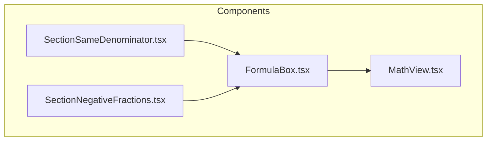
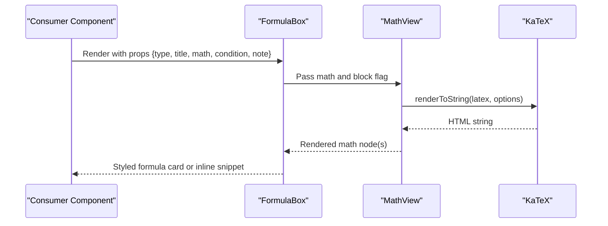
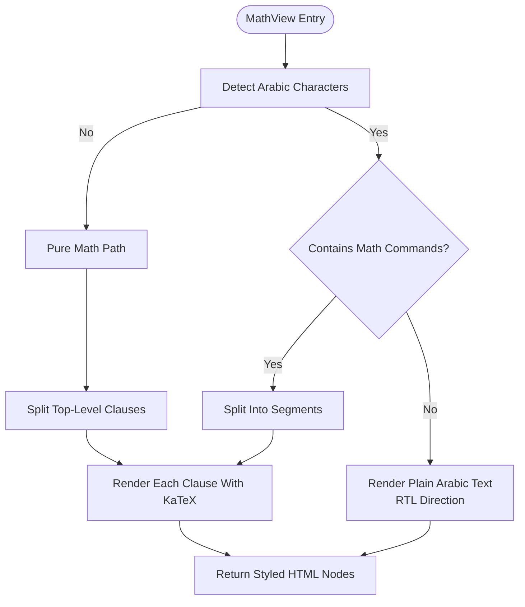
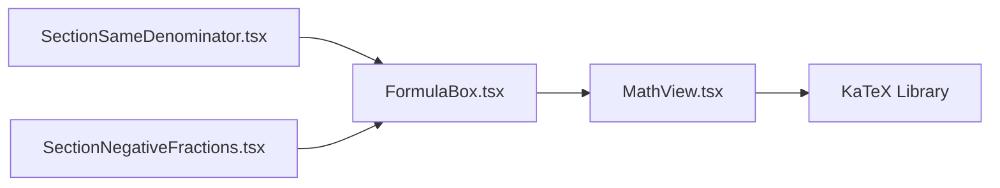

# Formula Box Component

<cite>
**Referenced Files in This Document**
- [FormulaBox.tsx](file://src/components/FormulasBox.tsx)
- [MathView.tsx](file://src/components/MathView.tsx)
- [SectionSameDenominator.tsx](file://src/components/SectionSameDenominator.tsx)
- [SectionNegativeFractions.tsx](file://src/components/SectionNegativeFractions.tsx)
</cite>

## Table of Contents
1. [Introduction](#introduction)
2. [Project Structure](#project-structure)
3. [Core Components](#core-components)
4. [Architecture Overview](#architecture-overview)
5. [Detailed Component Analysis](#detailed-component-analysis)
6. [Dependency Analysis](#dependency-analysis)
7. [Performance Considerations](#performance-considerations)
8. [Troubleshooting Guide](#troubleshooting-guide)
9. [Conclusion](#conclusion)

## Introduction
FormulaBox is a presentation component for displaying mathematical formulas and equations with consistent styling across the application. It wraps KaTeX-rendered math content through MathView, providing three visual variants: primary, secondary, and intermediate. The component supports titles, conditions, notes, and optional identifiers, enabling educational content to remain visually cohesive while clearly highlighting important formulas.

## Project Structure
FormulaBox lives under the components directory and composes MathView for rendering LaTeX into styled HTML. Consumers import FormulaBox where they need to display formulas consistently.

**Diagram sources**
- [FormulaBox.tsx:1-88](file://src/components/FormulasBox.tsx#L1-L88)
- [MathView.tsx:1-580](file://src/components/MathView.tsx#L1-L580)
- [SectionSameDenominator.tsx:1-73](file://src/components/SectionSameDenominator.tsx#L1-L73)
- [SectionNegativeFractions.tsx:1-58](file://src/components/SectionNegativeFractions.tsx#L1-L58)

**Section sources**
- [FormulaBox.tsx:1-88](file://src/components/FormulasBox.tsx#L1-L88)
- [SectionSameDenominator.tsx:1-73](file://src/components/SectionSameDenominator.tsx#L1-L73)
- [SectionNegativeFractions.tsx:1-58](file://src/components/SectionNegativeFractions.tsx#L1-L58)

## Core Components
- FormulaBox: Renders a formula card or inline snippet based on its type prop. It delegates all math rendering to MathView.
- MathView: A robust renderer that uses KaTeX to convert LaTeX strings into accessible, responsive HTML. It handles pure math, Arabic text, and mixed content, including RTL/LTR directionality and multi-clause expressions.

Key responsibilities:
- FormulaBox: UI framing, variant styling, title/condition/note layout, and passing math to MathView.
- MathView: LaTeX parsing via KaTeX, clause splitting, error resilience, and typography/direction handling.

**Section sources**
- [FormulaBox.tsx:1-88](file://src/components/FormulasBox.tsx#L1-L88)
- [MathView.tsx:1-580](file://src/components/MathView.tsx#L1-L580)

## Architecture Overview
The rendering flow starts with a consumer component (for example, SectionSameDenominator or SectionNegativeFractions), which passes LaTeX strings to FormulaBox. FormulaBox then renders MathView with the math string and block mode when appropriate. MathView uses KaTeX to generate HTML and applies consistent typography and spacing.

**Diagram sources**
- [FormulaBox.tsx:13-87](file://src/components/FormulasBox.tsx#L13-L87)
- [MathView.tsx:197-233](file://src/components/MathView.tsx#L197-L233)
- [SectionSameDenominator.tsx:38-44](file://src/components/SectionSameDenominator.tsx#L38-L44)
- [SectionNegativeFractions.tsx:24-30](file://src/components/SectionNegativeFractions.tsx#L24-L30)

## Detailed Component Analysis

### FormulaBox Props Interface
FormulaBox accepts the following props:
- type: Visual variant selector. Allowed values are 'primary', 'secondary', 'intermediate'. Defaults to 'primary'.
- title: Optional label displayed above the formula.
- math: Required LaTeX string rendered by MathView.
- condition: Optional condition line shown below the formula, also rendered by MathView.
- note: Optional explanatory text below the formula.
- id: Optional DOM identifier for accessibility and linking.

Behavior by type:
- primary: Prominent card with top accent bar, large centered formula, optional condition and note.
- secondary: Compact card with subtle background, smaller formula, optional condition and note.
- intermediate: Inline snippet suitable for embedding within paragraphs.

Styling conventions:
- Borders: Primary uses a colored border; secondary and intermediate use neutral borders.
- Backgrounds: Primary has white background; secondary uses a light slate tint; intermediate uses a muted slate background.
- Typography: Primary emphasizes larger, bold math; secondary uses medium-sized math; intermediate uses monospace-like inline style.
- Spacing: Consistent padding and margins ensure readability across screen sizes.

Usage examples from the codebase:
- Secondary variant used for negative fraction rules with a condition and note.
- Primary variant used for same-denominator addition/subtraction rules with a condition and note.

**Section sources**
- [FormulaBox.tsx:4-11](file://src/components/FormulasBox.tsx#L4-L11)
- [FormulaBox.tsx:21-51](file://src/components/FormulasBox.tsx#L21-L51)
- [FormulaBox.tsx:53-76](file://src/components/FormulasBox.tsx#L53-L76)
- [FormulaBox.tsx:78-87](file://src/components/FormulasBox.tsx#L78-L87)
- [SectionSameDenominator.tsx:38-44](file://src/components/SectionSameDenominator.tsx#L38-L44)
- [SectionNegativeFractions.tsx:24-30](file://src/components/SectionNegativeFractions.tsx#L24-L30)

### MathView Integration and Content Formatting
MathView is responsible for converting LaTeX strings into styled HTML using KaTeX. It supports:
- Block vs inline rendering via the block prop.
- Mixed Arabic and math content with correct directionality (RTL/LTR).
- Clause splitting for long expressions to improve wrapping and readability.
- Error resilience: KaTeX parse errors are sanitized to avoid jarring red text and technical tooltips.

Rendering pipeline highlights:
- Pure math without Arabic characters is split into clauses and rendered with display mode when needed.
- Pure Arabic text without math commands is rendered as plain text with RTL direction.
- Mixed content segments are parsed and interleaved, applying KaTeX only to math segments.

**Diagram sources**
- [MathView.tsx:350-579](file://src/components/MathView.tsx#L350-L579)
- [MathView.tsx:197-233](file://src/components/MathView.tsx#L197-L233)
- [MathView.tsx:285-348](file://src/components/MathView.tsx#L285-L348)

**Section sources**
- [MathView.tsx:1-580](file://src/components/MathView.tsx#L1-L580)

### Visual Design System
FormulaBox enforces a consistent design language:
- Borders:
  - Primary: Colored border with an accent bar at the top.
  - Secondary: Neutral border with a soft background.
  - Intermediate: Subtle border for inline snippets.
- Backgrounds:
  - Primary: White background for emphasis.
  - Secondary: Light slate tint for subdued emphasis.
  - Intermediate: Muted slate background for inline context.
- Typography:
  - Primary: Larger, bold math text for prominence.
  - Secondary: Medium-sized math text for clarity.
  - Intermediate: Monospace-style inline text for compactness.
- Spacing:
  - Consistent padding and margins ensure readability and alignment across devices.

These conventions help maintain a cohesive look across different types of formulas and sections.

**Section sources**
- [FormulaBox.tsx:21-51](file://src/components/FormulasBox.tsx#L21-L51)
- [FormulaBox.tsx:53-76](file://src/components/FormulasBox.tsx#L53-L76)
- [FormulaBox.tsx:78-87](file://src/components/FormulasBox.tsx#L78-L87)

### Examples of Different Formula Types
While the repository focuses on fractions, the same patterns apply to other domains:
- Algebraic expressions: Use primary or secondary variants to highlight core identities and operations.
- Geometric formulas: Use primary cards for key theorems and secondary cards for derived relationships.
- Physics equations: Use primary cards for fundamental laws and secondary cards for specific cases or constraints.

In practice, you would pass LaTeX strings representing these formulas to FormulaBox’s math prop, optionally adding title, condition, and note fields to clarify variables and assumptions.

[No sources needed since this section provides general guidance]

## Dependency Analysis
FormulaBox depends on MathView for rendering. Consumers depend on FormulaBox for consistent presentation. MathView depends on KaTeX for LaTeX-to-HTML conversion.

**Diagram sources**
- [SectionSameDenominator.tsx:1-73](file://src/components/SectionSameDenominator.tsx#L1-L73)
- [SectionNegativeFractions.tsx:1-58](file://src/components/SectionNegativeFractions.tsx#L1-L58)
- [FormulaBox.tsx:1-88](file://src/components/FormulasBox.tsx#L1-L88)
- [MathView.tsx:1-580](file://src/components/MathView.tsx#L1-L580)

**Section sources**
- [FormulaBox.tsx:1-88](file://src/components/FormulasBox.tsx#L1-L88)
- [MathView.tsx:1-580](file://src/components/MathView.tsx#L1-L580)
- [SectionSameDenominator.tsx:1-73](file://src/components/SectionSameDenominator.tsx#L1-L73)
- [SectionNegativeFractions.tsx:1-58](file://src/components/SectionNegativeFractions.tsx#L1-L58)

## Performance Considerations
- KaTeX Rendering: MathView calls KaTeX per clause. For very long expressions, clause splitting helps keep rendering efficient and improves wrapping behavior.
- Error Handling: KaTeX parse errors are sanitized to prevent heavy error UI and reduce re-renders caused by invalid markup.
- Directionality: Correct LTR/RTL handling avoids layout thrashing when mixing Arabic and math content.
- Reuse Patterns: Prefer primary/secondary cards for standalone formulas and intermediate snippets for inline mentions to minimize DOM overhead.

[No sources needed since this section provides general guidance]

## Troubleshooting Guide
Common issues and resolutions:
- Invalid LaTeX syntax: MathView sanitizes KaTeX errors to avoid bright red text and technical tooltips. Ensure your LaTeX is valid and test incrementally.
- Mixed Arabic and math: If Arabic text appears misaligned, verify that MathView detects Arabic correctly and that math commands are properly separated.
- Long expressions wrapping poorly: Use MathView’s block mode in FormulaBox to allow flexible wrapping and clause splitting.
- Styling inconsistencies: Stick to the provided type variants to maintain consistent borders, backgrounds, and typography.

**Section sources**
- [MathView.tsx:197-233](file://src/components/MathView.tsx#L197-L233)
- [FormulaBox.tsx:21-87](file://src/components/FormulasBox.tsx#L21-L87)

## Conclusion
FormulaBox provides a consistent, accessible way to present mathematical formulas across the application. By delegating rendering to MathView and enforcing a clear visual system, it ensures that algebraic, geometric, and physics-related content remains readable and cohesive. Use the appropriate type variant, leverage title/condition/note fields for clarity, and rely on MathView’s robust handling of mixed content and KaTeX rendering for reliable results.

[No sources needed since this section summarizes without analyzing specific files]