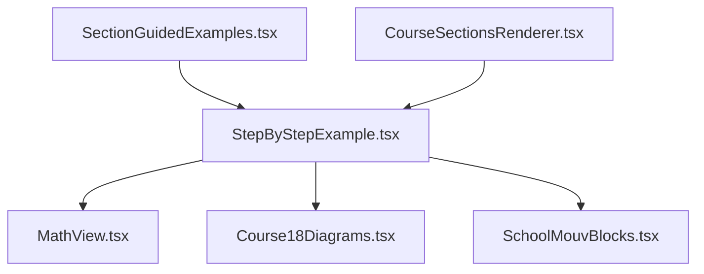
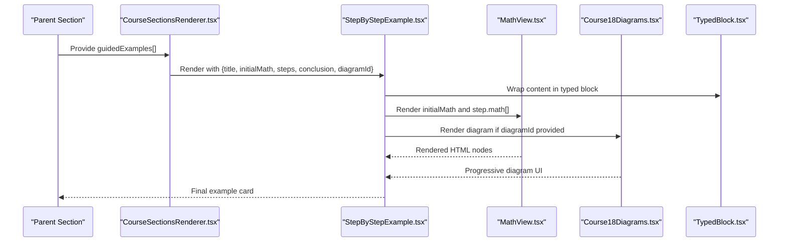
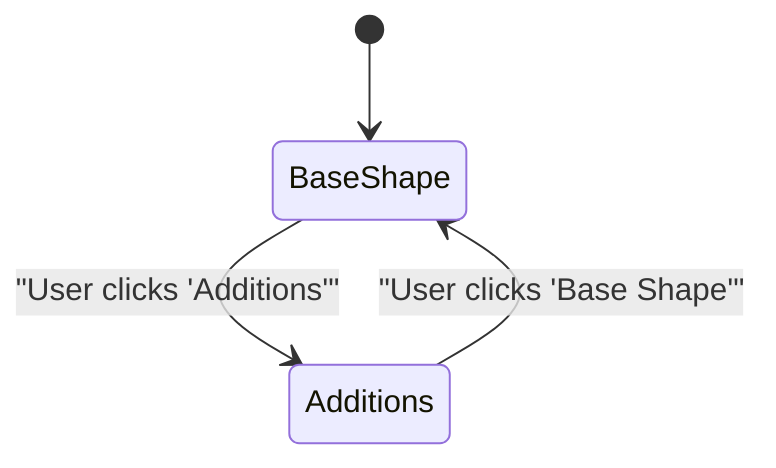
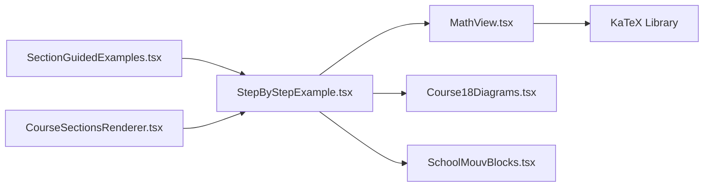

# Step-by-Step Example Component

<cite>
**Referenced Files in This Document**
- [StepByStepExample.tsx](file://src/components/StepByStepExample.tsx)
- [MathView.tsx](file://src/components/MathView.tsx)
- [Course18Diagrams.tsx](file://src/components/Course18Diagrams.tsx)
- [SchoolMouvBlocks.tsx](file://src/components/SchoolMouvBlocks.tsx)
- [SectionGuidedExamples.tsx](file://src/components/SectionGuidedExamples.tsx)
- [CourseSectionsRenderer.tsx](file://src/components/CourseSectionsRenderer.tsx)
</cite>

## Table of Contents
1. [Introduction](#introduction)
2. [Project Structure](#project-structure)
3. [Core Components](#core-components)
4. [Architecture Overview](#architecture-overview)
5. [Detailed Component Analysis](#detailed-component-analysis)
6. [Dependency Analysis](#dependency-analysis)
7. [Performance Considerations](#performance-considerations)
8. [Troubleshooting Guide](#troubleshooting-guide)
9. [Conclusion](#conclusion)

## Introduction
The Step-by-Step Example component presents progressive, numbered problem-solving workflows. It renders a problem statement with an initial mathematical expression, optional diagram, and a sequence of steps that include titles, optional explanations, and one or more math blocks. A final conclusion can be displayed as a highlighted result. The component is designed for clarity, readability, and consistent visual structure across lessons.

This documentation explains:
- The step data structure and how it drives the UI
- How navigation controls are implemented (including diagrams with progressive steps)
- State management for step progression
- Visual design patterns such as step indicators, progress tracking, and responsive layouts
- Examples of complex multi-step problems
- Animation transitions between steps
- Accessibility considerations for keyboard navigation and screen readers

## Project Structure
The Step-by-Step Example component lives under the components directory and is used by guided example sections and course renderers.

**Diagram sources**
- [SectionGuidedExamples.tsx:22-52](file://src/components/SectionGuidedExamples.tsx#L22-L52)
- [CourseSectionsRenderer.tsx:650-670](file://src/components/CourseSectionsRenderer.tsx#L650-L670)
- [StepByStepExample.tsx:1-5](file://src/components/StepByStepExample.tsx#L1-L5)

**Section sources**
- [StepByStepExample.tsx:1-111](file://src/components/StepByStepExample.tsx#L1-L111)
- [SectionGuidedExamples.tsx:1-83](file://src/components/SectionGuidedExamples.tsx#L1-L83)
- [CourseSectionsRenderer.tsx:650-670](file://src/components/CourseSectionsRenderer.tsx#L650-L670)

## Core Components
- StepByStepExample: Renders the complete guided example card, including title, initial math, optional diagram, step list, and conclusion.
- MathView: Renders LaTeX math expressions safely and beautifully, handling Arabic text, mixed content, and display modes.
- Course18Diagrams: Provides geometric diagrams with progressive step toggles to reveal base shapes and annotations.
- SchoolMouvBlocks.TypedBlock: Provides a styled block container with a labeled header and dotted rail for examples.

Key responsibilities:
- StepByStepExample composes the layout and delegates math rendering to MathView and optional diagram rendering to Course18Diagrams.
- MathView handles KaTeX rendering, Arabic/LTR directionality, and splitting long formulas into readable clauses.
- Course18Diagrams manages internal state for progressive visualization of diagrams.
- TypedBlock provides consistent styling for example blocks.

**Section sources**
- [StepByStepExample.tsx:6-20](file://src/components/StepByStepExample.tsx#L6-L20)
- [MathView.tsx:6-12](file://src/components/MathView.tsx#L6-L12)
- [Course18Diagrams.tsx:3-6](file://src/components/Course18Diagrams.tsx#L3-L6)
- [SchoolMouvBlocks.tsx:207-239](file://src/components/SchoolMouvBlocks.tsx#L207-L239)

## Architecture Overview
The component architecture follows a composition pattern:
- Parent components (guided examples section and course renderer) pass structured step data to StepByStepExample.
- StepByStepExample renders each step using MathView for equations and optionally integrates Course18Diagrams for visual aids.
- TypedBlock wraps the entire example in a consistent visual frame.

**Diagram sources**
- [CourseSectionsRenderer.tsx:650-670](file://src/components/CourseSectionsRenderer.tsx#L650-L670)
- [StepByStepExample.tsx:22-109](file://src/components/StepByStepExample.tsx#L22-L109)
- [MathView.tsx:350-579](file://src/components/MathView.tsx#L350-L579)
- [Course18Diagrams.tsx:12-36](file://src/components/Course18Diagrams.tsx#L12-L36)
- [SchoolMouvBlocks.tsx:213-239](file://src/components/SchoolMouvBlocks.tsx#L213-L239)

## Detailed Component Analysis

### Step Data Structure
The step object defines the building blocks of a guided solution:
- stepNumber: Display label for the step number; leading zeros are stripped during rendering.
- title: Step heading describing the action taken.
- detail: Optional explanation providing context or justification.
- math: Array of LaTeX strings representing equations or transformations shown per step.

The component also accepts:
- id: Optional DOM identifier for the example container.
- title: Problem title.
- initialMath: Initial problem expression rendered at the top.
- diagramId: Optional identifier passed to the diagram component.
- steps: Array of Step objects.
- conclusion: Optional final result rendered in a highlighted box.

Complexity:
- Rendering time is linear in the number of steps and math expressions.
- No internal state is managed by StepByStepExample; all state resides in child components like diagrams.

**Section sources**
- [StepByStepExample.tsx:6-20](file://src/components/StepByStepExample.tsx#L6-L20)
- [StepByStepExample.tsx:55-89](file://src/components/StepByStepExample.tsx#L55-L89)

### Navigation Controls and State Management
StepByStepExample itself does not implement navigation controls for stepping through solutions. Instead:
- Steps are presented statically in order, allowing users to scroll and read sequentially.
- The optional diagram component includes its own progressive controls to toggle between base shape and annotated additions.

Diagram progressive behavior:
- Internal state tracks whether to show base shape only or both base and annotations.
- Buttons allow switching between steps visually.
- When progressive is true, the default shows both steps; when false, it always shows additions.

**Diagram sources**
- [Course18Diagrams.tsx:12-36](file://src/components/Course18Diagrams.tsx#L12-L36)

**Section sources**
- [StepByStepExample.tsx:22-109](file://src/components/StepByStepExample.tsx#L22-L109)
- [Course18Diagrams.tsx:12-36](file://src/components/Course18Diagrams.tsx#L12-L36)

### Visual Design
Design principles:
- Consistent typography and spacing for readability.
- Clear separation between problem statement and solution steps.
- Highlighted conclusion for emphasis.
- Responsive layout using flexbox and conditional row/column arrangements.

Visual elements:
- Title and initial math are grouped at the top with a border separator.
- Each step has a bold numbered indicator, a title, optional detail paragraph, and full-width formula boxes.
- Conclusion is bold and framed with a subtle background and accent border.
- TypedBlock provides a labeled header and dotted rail for example framing.

Responsive behavior:
- On small screens, content stacks vertically; on medium and larger screens, the problem statement and optional diagram align horizontally.
- Math containers use overflow-x-auto to prevent truncation of long formulas.

Accessibility:
- Math containers set LTR direction explicitly to ensure correct rendering of equations.
- Interactive concept terms within MathView are focusable and respond to keyboard events.
- Diagram buttons are standard interactive elements with clear labels.

**Section sources**
- [StepByStepExample.tsx:31-109](file://src/components/StepByStepExample.tsx#L31-L109)
- [SchoolMouvBlocks.tsx:213-239](file://src/components/SchoolMouvBlocks.tsx#L213-L239)
- [MathView.tsx:53-122](file://src/components/MathView.tsx#L53-L122)

### Mathematical Calculations and Rendering
MathView handles:
- Pure LaTeX without Arabic: splits long chains and renders inline or block forms.
- Mixed Arabic and math: segments content, detects deduction-like sequences, and sets appropriate directionality.
- Error resilience: suppresses bright error colors and removes parse error tooltips from KaTeX output.
- Superscript normalization: converts Unicode superscripts to proper LaTeX exponents.

Rendering flow:
- Detects presence of Arabic characters.
- For pure math, splits clauses and renders via KaTeX.
- For mixed content, segments into Arabic and math parts and renders accordingly.
- Supports custom color classes and block mode for display equations.

**Section sources**
- [MathView.tsx:197-233](file://src/components/MathView.tsx#L197-L233)
- [MathView.tsx:239-348](file://src/components/MathView.tsx#L239-L348)
- [MathView.tsx:350-579](file://src/components/MathView.tsx#L350-L579)

### Examples of Complex Multi-Step Problems
Two guided examples demonstrate fraction subtraction workflows:
- Subtracting two fractions with common denominators:
  - Find least common denominator.
  - Convert fractions to equivalent forms.
  - Perform subtraction while keeping the denominator.
  - Check reducibility.
- Subtracting a fraction from a natural number:
  - Express the integer as a fraction.
  - Find common denominator.
  - Perform subtraction.

These examples illustrate:
- Structured step numbering and explanatory details.
- Multiple math expressions per step.
- Clear conclusions highlighting final results.

**Section sources**
- [SectionGuidedExamples.tsx:22-52](file://src/components/SectionGuidedExamples.tsx#L22-L52)
- [SectionGuidedExamples.tsx:55-79](file://src/components/SectionGuidedExamples.tsx#L55-L79)

### Animation Transitions Between Steps
StepByStepExample does not implement animations for step transitions. However:
- The diagram component uses CSS transitions for button states and highlights to indicate active steps.
- If animated step transitions are desired, consider adding fade/slide effects around step containers based on an index controlled by parent state.

Current behavior:
- Static rendering of steps with no built-in animation.
- Diagram buttons have transition-colors for hover and active states.

**Section sources**
- [Course18Diagrams.tsx:24-36](file://src/components/Course18Diagrams.tsx#L24-L36)

### Accessibility Considerations
Keyboard navigation:
- Concept terms inside MathView are focusable and respond to Enter and Space keys.
- Diagram buttons are native interactive elements and support keyboard activation.

Screen reader support:
- Math containers set explicit directionality to improve reading order for equations.
- TypedBlock headers provide semantic labeling for example sections.

Recommendations:
- Ensure any future interactive step controls expose aria-live regions for dynamic updates.
- Add aria-labels to diagram buttons for clearer descriptions.

**Section sources**
- [MathView.tsx:53-122](file://src/components/MathView.tsx#L53-L122)
- [Course18Diagrams.tsx:24-36](file://src/components/Course18Diagrams.tsx#L24-L36)
- [SchoolMouvBlocks.tsx:213-239](file://src/components/SchoolMouvBlocks.tsx#L213-L239)

## Dependency Analysis
Component relationships:
- StepByStepExample depends on MathView for equation rendering and TypedBlock for framing.
- Optional dependency on Course18Diagrams for visual aids.
- Parent components (SectionGuidedExamples and CourseSectionsRenderer) supply data and mount the component.

Coupling and cohesion:
- StepByStepExample is cohesive around presenting a single guided example.
- MathView encapsulates all math rendering logic, reducing coupling elsewhere.
- Diagram component is decoupled and reusable across contexts.

Potential circular dependencies:
- None observed; imports are unidirectional from parents to StepByStepExample and its children.

External integrations:
- KaTeX is used by MathView for rendering LaTeX.
- Tailwind utility classes drive styling and responsiveness.

**Diagram sources**
- [SectionGuidedExamples.tsx:1-83](file://src/components/SectionGuidedExamples.tsx#L1-L83)
- [CourseSectionsRenderer.tsx:650-670](file://src/components/CourseSectionsRenderer.tsx#L650-L670)
- [StepByStepExample.tsx:1-5](file://src/components/StepByStepExample.tsx#L1-L5)
- [MathView.tsx:1-3](file://src/components/MathView.tsx#L1-L3)

**Section sources**
- [StepByStepExample.tsx:1-111](file://src/components/StepByStepExample.tsx#L1-L111)
- [MathView.tsx:1-580](file://src/components/MathView.tsx#L1-L580)
- [Course18Diagrams.tsx:1-36](file://src/components/Course18Diagrams.tsx#L1-L36)
- [SchoolMouvBlocks.tsx:207-239](file://src/components/SchoolMouvBlocks.tsx#L207-L239)

## Performance Considerations
- Rendering cost scales linearly with the number of steps and math expressions.
- MathView performs regex-based parsing and KaTeX rendering; avoid excessively long formulas or deeply nested structures where possible.
- Use block mode for display equations to improve readability and reduce reflows.
- Diagram progressive toggles are lightweight and rely on local state.

Optimization opportunities:
- Memoize expensive computations in MathView if needed (already uses useMemo for some operations).
- Avoid unnecessary re-renders by stabilizing props passed to StepByStepExample.

[No sources needed since this section provides general guidance]

## Troubleshooting Guide
Common issues and resolutions:
- Math rendering errors:
  - Symptom: Red error spans or broken equations.
  - Resolution: MathView suppresses bright error colors and removes parse error tooltips; verify LaTeX syntax and avoid unsupported commands.
- Arabic text alignment:
  - Symptom: Incorrect directionality or misaligned equations.
  - Resolution: Ensure MathView receives mixed content correctly; it auto-detects deduction-like sequences and sets direction accordingly.
- Long formulas truncation:
  - Symptom: Equations clipped in narrow containers.
  - Resolution: Use block mode and ensure containers allow horizontal scrolling; MathView splits long equality chains for better layout.
- Diagram step visibility:
  - Symptom: Annotations not appearing.
  - Resolution: Verify progressive prop and user interaction with diagram buttons; default behavior shows both steps when progressive is true.

**Section sources**
- [MathView.tsx:197-233](file://src/components/MathView.tsx#L197-L233)
- [MathView.tsx:239-348](file://src/components/MathView.tsx#L239-L348)
- [Course18Diagrams.tsx:12-36](file://src/components/Course18Diagrams.tsx#L12-L36)

## Conclusion
The Step-by-Step Example component provides a clear, structured way to present progressive problem-solving workflows. It leverages MathView for robust equation rendering, TypedBlock for consistent visual framing, and optional Course18Diagrams for interactive geometry visuals. While it does not manage step navigation internally, it offers a stable foundation for educators to build guided examples with strong accessibility and responsive design. Future enhancements could include animated step transitions and richer interactive controls for step progression.

[No sources needed since this section summarizes without analyzing specific files]