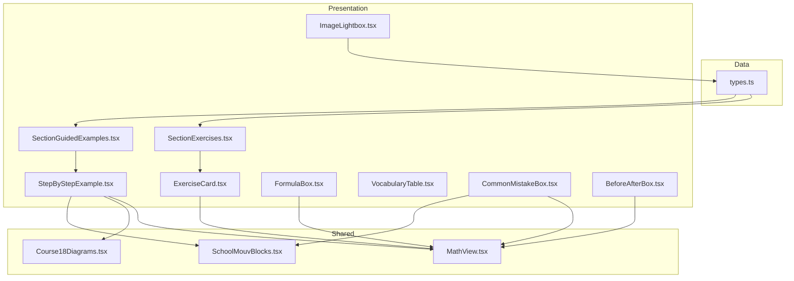
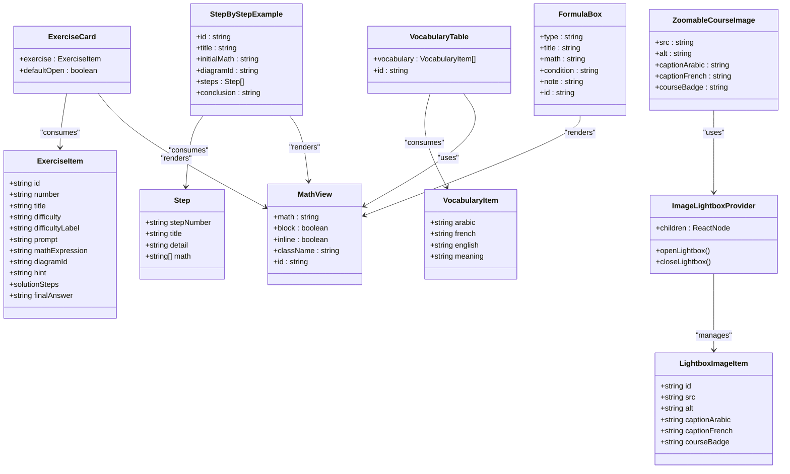
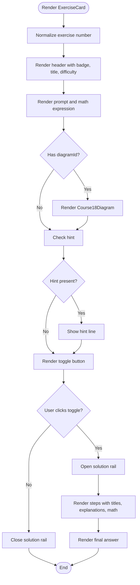
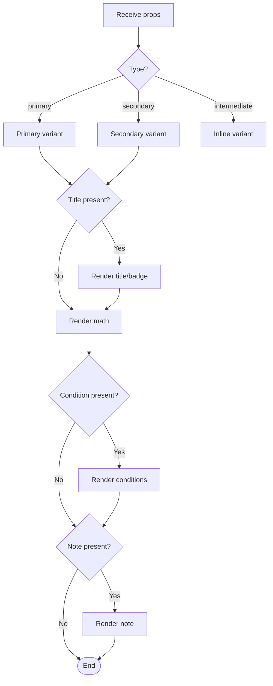
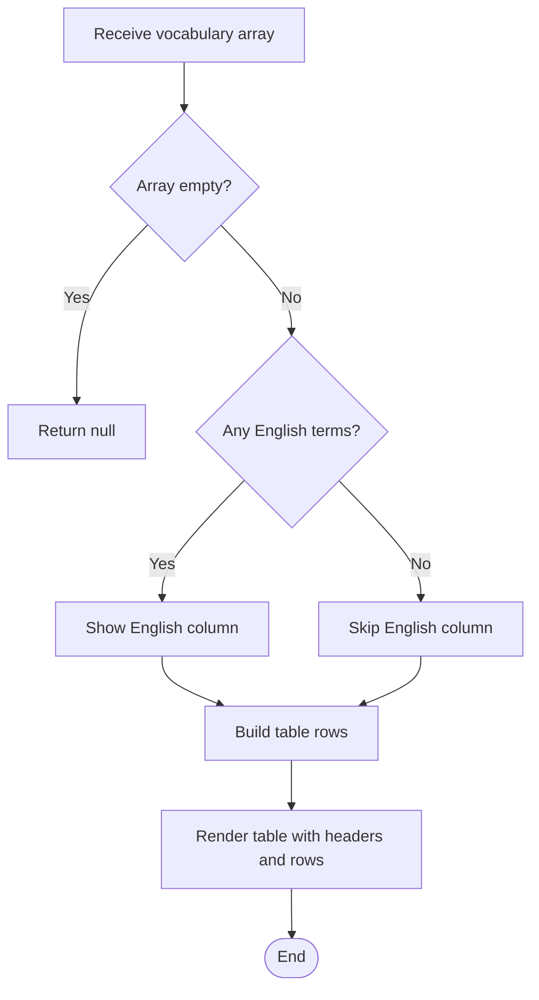
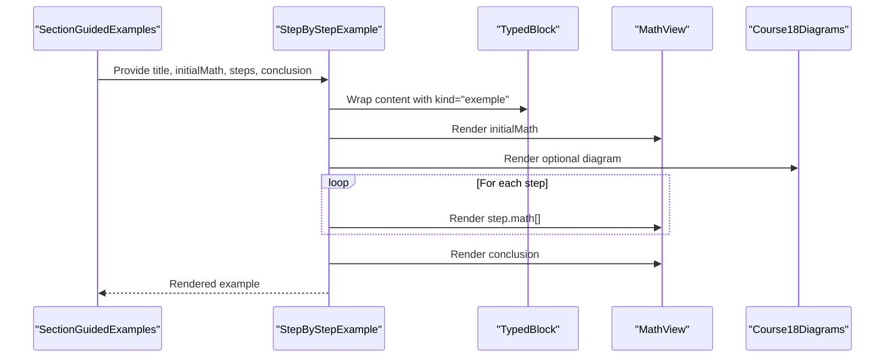
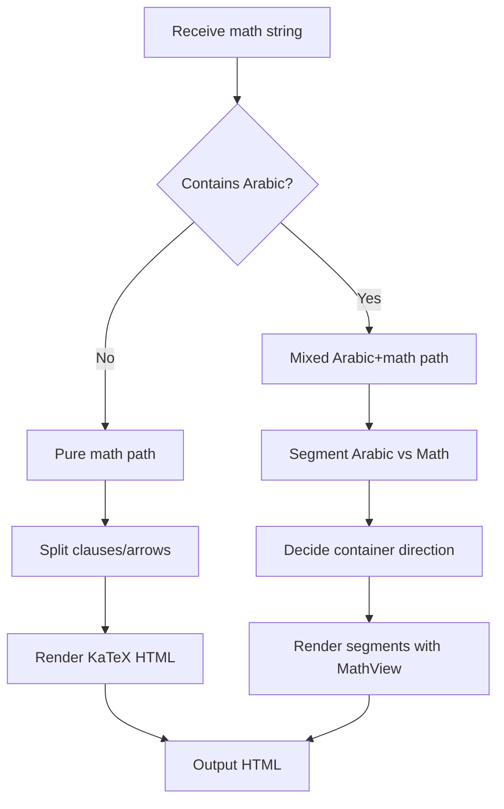
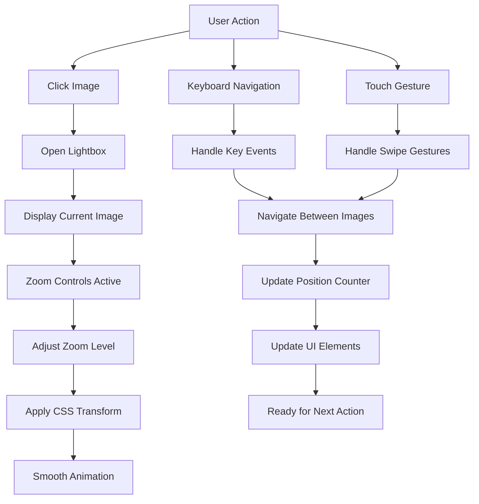
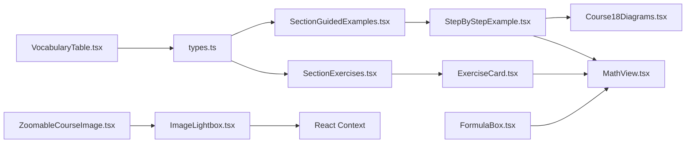

# UI Components Library

<cite>
**Referenced Files in This Document**
- [ExerciseCard.tsx](file://src/components/ExerciseCard.tsx)
- [FormulaBox.tsx](file://src/components/FormulaBox.tsx)
- [VocabularyTable.tsx](file://src/components/VocabularyTable.tsx)
- [StepByStepExample.tsx](file://src/components/StepByStepExample.tsx)
- [MathView.tsx](file://src/components/MathView.tsx)
- [ImageLightbox.tsx](file://src/components/ImageLightbox.tsx)
- [types.ts](file://src/types.ts)
- [SectionExercises.tsx](file://src/components/SectionExercises.tsx)
- [SectionGuidedExamples.tsx](file://src/components/SectionGuidedExamples.tsx)
- [CommonMistakeBox.tsx](file://src/components/CommonMistakeBox.tsx)
- [BeforeAfterBox.tsx](file://src/components/BeforeAfterBox.tsx)
- [SchoolMouvBlocks.tsx](file://src/components/SchoolMouvBlocks.tsx)
- [Course18Diagrams.tsx](file://src/components/Course18Diagrams.tsx)
- [Course01Schemas.tsx](file://src/components/physics/Course01Schemas.tsx)
- [App.tsx](file://src/App.tsx)
</cite>

## Update Summary
**Changes Made**
- Added comprehensive documentation for the enhanced ImageLightbox component
- Updated project structure diagram to include ImageLightbox integration
- Added new section covering image gallery functionality and interactive features
- Enhanced architecture overview to show ImageLightboxProvider context pattern
- Added detailed usage examples showing ZoomableCourseImage implementation

## Table of Contents
1. [Introduction](#introduction)
2. [Project Structure](#project-structure)
3. [Core Components](#core-components)
4. [Image Gallery System](#image-gallery-system)
5. [Architecture Overview](#architecture-overview)
6. [Detailed Component Analysis](#detailed-component-analysis)
7. [Dependency Analysis](#dependency-analysis)
8. [Performance Considerations](#performance-considerations)
9. [Troubleshooting Guide](#troubleshooting-guide)
10. [Conclusion](#conclusion)
11. [Appendices](#appendices)

## Introduction
This document explains the reusable UI components library used to render educational content consistently across courses. It focuses on:
- Exercise cards for practice problems with step-by-step solutions
- Formula boxes for primary, secondary, and inline formulas
- Vocabulary tables for multilingual mathematical terminology
- Step-by-step example renderers for guided problem solving
- Interactive image galleries with advanced zoom and navigation capabilities
- Supporting math rendering, diagrams, and layout blocks

The library emphasizes consistent visual design, accessibility, responsive layouts, and clear composition patterns so that course authors can assemble rich lessons without reinventing styles or logic.

## Project Structure
The components live under src/components and are composed by section-level containers. The core data model is defined in types.ts and consumed by components such as ExerciseCard and SectionExercises. Math rendering is centralized in MathView, while Course18Diagrams provides progressive geometry figures. SchoolMouvBlocks provides shared block wrappers and icons. The ImageLightbox system provides a comprehensive image gallery solution with advanced interaction capabilities.



**Diagram sources**
- [types.ts:10-33](file://src/types.ts#L10-L33)
- [SectionExercises.tsx:1-109](file://src/components/SectionExercises.tsx#L1-L109)
- [SectionGuidedExamples.tsx:1-83](file://src/components/SectionGuidedExamples.tsx#L1-L83)
- [ExerciseCard.tsx:1-141](file://src/components/ExerciseCard.tsx#L1-L141)
- [StepByStepExample.tsx:1-111](file://src/components/StepByStepExample.tsx#L1-L111)
- [FormulaBox.tsx:1-88](file://src/components/Form ulaBox.tsx#L1-L88)
- [VocabularyTable.tsx:1-83](file://src/components/VocabularyTable.tsx#L1-L83)
- [CommonMistakeBox.tsx:1-70](file://src/components/CommonMistakeBox.tsx#L1-L70)
- [BeforeAfterBox.tsx:1-410](file://src/components/BeforeAfterBox.tsx#L1-L410)
- [MathView.tsx:1-580](file://src/components/MathView.tsx#L1-L580)
- [Course18Diagrams.tsx:1-200](file://src/components/Course18Diagrams.tsx#L1-L200)
- [SchoolMouvBlocks.tsx:1-200](file://src/components/SchoolMouvBlocks.tsx#L1-L200)
- [ImageLightbox.tsx:1-530](file://src/components/ImageLightbox.tsx#L1-L530)

**Section sources**
- [types.ts:10-33](file://src/types.ts#L10-L33)
- [SectionExercises.tsx:1-109](file://src/components/SectionExercises.tsx#L1-L109)
- [SectionGuidedExamples.tsx:1-83](file://src/components/SectionGuidedExamples.tsx#L1-L83)

## Core Components
This section documents the props interfaces, styling patterns, customization options, and usage examples for each key component.

### ExerciseCard
Purpose: Renders a single exercise with title, difficulty label, prompt, optional diagram, hint, and an expandable step-by-step solution.

Props interface:
- exercise: ExerciseItem (from types.ts)
- defaultOpen?: boolean

Key behaviors:
- Displays a numbered badge and title using superscript-aware text formatting.
- Renders the exercise prompt and math expression through MathView.
- Optionally renders a progressive geometry diagram via Course18Diagrams.
- Shows a hint line when provided.
- Toggles visibility of a detailed solution rail with numbered steps, explanations, and final answer.

Styling patterns:
- Rounded card with subtle border and padding.
- Accent color highlights for difficulty labels and solution sections.
- Responsive layout adapts between stacked and side-by-side modes when a diagram is present.

Accessibility considerations:
- Toggle button exposes aria-like behavior via explicit id attributes and keyboard-friendly interactions.
- Math content uses LTR directionality and isolation to prevent RTL interference.

Responsive design:
- Uses flexbox and conditional classes to adapt to mobile and desktop widths.

Usage example:
- Consumed by SectionExercises to render filtered lists of exercises with optional "expand all" behavior.

**Section sources**
- [ExerciseCard.tsx:7-141](file://src/components/ExerciseCard.tsx#L7-L141)
- [SectionExercises.tsx:13-109](file://src/components/SectionExercises.tsx#L13-L109)
- [types.ts:10-26](file://src/types.ts#L10-L26)

### FormulaBox
Purpose: Presents mathematical formulas in three visual variants: primary, secondary, and intermediate inline.

Props interface:
- type?: 'primary' | 'secondary' | 'intermediate'
- title?: string
- math: string
- condition?: string
- note?: string
- id?: string

Key behaviors:
- Primary variant includes a top accent bar, optional title badge, large centered formula, optional conditions, and note.
- Secondary variant is a lighter container suitable for supporting formulas.
- Intermediate variant is compact inline display.

Styling patterns:
- Consistent spacing, rounded corners, and borders.
- Color-coded accents for emphasis and hierarchy.

Accessibility considerations:
- Optional id prop supports programmatic anchors.
- Math content is rendered with proper directionality.

Responsive design:
- Adapts font sizes and spacing for small screens.

Usage example:
- Used to render primary and secondary formulas within course content.

**Section sources**
- [FormulaBox.tsx:4-88](file://src/components/FormulaBox.tsx#L4-L88)

### VocabularyTable
Purpose: Displays a trilingual vocabulary table (Arabic, French, English optional) with pedagogical meanings.

Props interface:
- vocabulary: VocabularyItem[]
- id?: string

Key behaviors:
- Conditionally shows the English column only if at least one item has an English term.
- Provides a header with icon and descriptive subtitle.
- Highlights French and English terms with colored badges.

Styling patterns:
- Clean table with hover states and readable typography.
- Scrollable container for narrow screens.

Accessibility considerations:
- Semantic table structure with headers.
- Directional attributes for Latin script columns.

Responsive design:
- Horizontal scroll for small viewports.

Usage example:
- Integrated into course pages to standardize terminology presentation.

**Section sources**
- [VocabularyTable.tsx:5-83](file://src/components/VocabularyTable.tsx#L5-L83)
- [types.ts:28-33](file://src/types.ts#L28-L33)

### StepByStepExample
Purpose: Renders a guided example with initial givens, optional diagram, sequential steps, and a concluding result.

Props interface:
- id?: string
- title: string
- initialMath: string
- diagramId?: string
- steps: Step[]
- conclusion?: string

Key behaviors:
- Wraps content in a typed block from SchoolMouvBlocks.
- Renders initial givens and optional diagram.
- Iterates over steps, showing titles, optional details, and multiple math lines per step.
- Displays a bold conclusion with highlighted final formula.

Styling patterns:
- Consistent spacing, separators, and accent colors for step numbers.
- Full-width math containers to avoid truncation.

Accessibility considerations:
- TypedBlock provides semantic labeling; MathView ensures correct directionality.

Responsive design:
- Flex layout adapts to screen size; diagram appears alongside content on wider screens.

Usage example:
- Used by SectionGuidedExamples to compose multiple guided examples.

**Section sources**
- [StepByStepExample.tsx:6-111](file://src/components/StepByStepExample.tsx#L6-L111)
- [SectionGuidedExamples.tsx:22-52](file://src/components/SectionGuidedExamples.tsx#L22-L52)
- [SchoolMouvBlocks.tsx:1-200](file://src/components/SchoolMouvBlocks.tsx#L1-L200)

### MathView
Purpose: Centralized math renderer that handles pure LaTeX, Arabic text, and mixed Arabic+math content. Also formats plain text with superscripts and concept links.

Props interface:
- math: string
- block?: boolean
- inline?: boolean
- className?: string
- id?: string

Key behaviors:
- Detects Arabic characters and routes to appropriate rendering path.
- Splits long equality chains and multi-clause expressions for better wrapping.
- Normalizes Unicode superscripts and KaTeX error spans.
- Supports interactive concept highlighting for fundamental concepts.

Styling patterns:
- Automatic text color inheritance unless overridden.
- LTR direction for math segments to ensure correct rendering.

Accessibility considerations:
- aria roles and keyboard handlers for concept links.
- Proper dir attributes to isolate math from surrounding RTL text.

Responsive design:
- Flexible containers and wrap strategies for complex formulas.

Usage example:
- Used by ExerciseCard, StepByStepExample, FormulaBox, CommonMistakeBox, and BeforeAfterBox.

**Section sources**
- [MathView.tsx:6-12](file://src/components/MathView.tsx#L6-L12)
- [MathView.tsx:129-195](file://src/components/MathView.tsx#L129-L195)
- [MathView.tsx:197-233](file://src/components/MathView.tsx#L197-L233)
- [MathView.tsx:239-348](file://src/components/MathView.tsx#L239-L348)
- [MathView.tsx:350-579](file://src/components/MathView.tsx#L350-L579)

## Image Gallery System
The ImageLightbox component provides a comprehensive image gallery solution with advanced interaction capabilities for educational content.

### ImageLightboxProvider
Purpose: Global provider that manages the lightbox state and offers context-based access to lightbox functionality throughout the application.

Key features:
- Context-based API for opening/closing lightboxes
- Automatic DOM image collection from elements with `data-lightbox-item="true"` attribute
- Default course gallery images for seamless navigation
- State management for current image, zoom level, and gallery items

Props interface:
- children: React.ReactNode

Key behaviors:
- Collects images from DOM elements marked with specific data attributes
- Merges collected images with default course gallery images
- Manages lightbox open/close state and current image index
- Handles zoom level state and reset functionality

**Section sources**
- [ImageLightbox.tsx:135-143](file://src/components/ImageLightbox.tsx#L135-L143)
- [ImageLightbox.tsx:145-180](file://src/components/ImageLightbox.tsx#L145-L180)
- [ImageLightbox.tsx:182-202](file://src/components/ImageLightbox.tsx#L182-L202)

### ZoomableCourseImage
Purpose: Interactive image component that opens in the lightbox with zoom capabilities and navigation support.

Props interface:
- src: string
- alt: string
- captionArabic: string
- captionFrench?: string
- courseBadge?: string

Key features:
- Click-to-zoom functionality with floating action pill
- Keyboard accessibility (Enter/Space to open)
- Data attributes for automatic lightbox integration
- Responsive design with hover effects
- Bilingual caption support (Arabic and French)

Accessibility considerations:
- Role="button" and tabIndex for keyboard navigation
- ARIA-compliant event handlers
- Descriptive titles and alt text

**Section sources**
- [ImageLightbox.tsx:464-529](file://src/components/ImageLightbox.tsx#L464-L529)

### Lightbox Interface Features
The lightbox interface provides advanced interaction capabilities:

#### Zoom Controls
- Zoom in/out buttons with 0.35 increments
- Percentage display showing current zoom level
- Reset button to return to 100% zoom
- Double-click to toggle between 100% and 175% zoom
- Keyboard shortcuts: +/= for zoom in, - for zoom out, 0 for reset

#### Navigation Controls
- Previous/next arrow buttons for image navigation
- Thumbnail strip at the bottom for quick navigation
- Current position indicator (e.g., "3 / 10")
- Circular navigation that wraps around the gallery

#### Caption Display
- Arabic caption prominently displayed
- Optional French caption shown below
- Course badge integration for contextual information
- Line-clamp for long captions

#### Accessibility Features
- ARIA modal dialog with proper role and labels
- Keyboard navigation support (Escape to close, arrow keys for navigation)
- Screen reader compatible descriptions
- Focus management and trap

#### Mobile Responsiveness
- Touch-friendly button sizes
- Responsive layout adaptation
- Optimized for various screen sizes
- Swipe gestures support

**Section sources**
- [ImageLightbox.tsx:257-459](file://src/components/ImageLightbox.tsx#L257-L459)

### Usage Examples
The ImageLightbox system is integrated throughout the physics course materials:

```tsx
// Basic usage in course components
<ZoomableCourseImage
  src="/src/assets/images/c02_electrolyse_eau_1790802935276.jpg"
  alt="وضعية الانطلاق للدرس 02 : مقارنة تبخر الماء مع تجربة تمرير تيار كهربائي في الماء"
  captionArabic="صورة توضيحية : مقارنة بين تسخين الماء (تغير الحالة) وتمرير تيار كهربائي مستمر في وعاء به ماء مع أنبوبين منكسين"
  captionFrench="Électrolyse de l'eau (rapport 2 : 1) vs Changement d'état physique"
  courseBadge="الدرس 02"
/>
```

Integration pattern:
1. Wrap application with ImageLightboxProvider in App.tsx
2. Use ZoomableCourseImage components throughout course content
3. Images automatically integrate into the gallery system
4. Users can navigate between related images seamlessly

**Section sources**
- [Course01Schemas.tsx:544-550](file://src/components/physics/Course01Schemas.tsx#L544-L550)
- [App.tsx:234-234](file://src/App.tsx#L234-L234)

## Architecture Overview
The library follows a layered architecture:
- Data layer: types.ts defines structured models for exercises, vocabulary, and guided examples.
- Presentation layer: Components render these models with consistent styling and behavior.
- Shared utilities: MathView centralizes math rendering and text formatting; SchoolMouvBlocks provides reusable block wrappers; Course18Diagrams provides progressive figures.
- Context layer: ImageLightboxProvider provides global state management for image galleries.



**Diagram sources**
- [types.ts:10-33](file://src/types.ts#L10-L33)
- [ImageLightbox.tsx:19-26](file://src/components/ImageLightbox.tsx#L19-L26)
- [ExerciseCard.tsx:7-141](file://src/components/ExerciseCard.tsx#L7-L141)
- [StepByStepExample.tsx:6-111](file://src/components/StepByStepExample.tsx#L6-L111)
- [FormulaBox.tsx:4-88](file://src/components/FormulaBox.tsx#L4-L88)
- [VocabularyTable.tsx:5-83](file://src/components/VocabularyTable.tsx#L5-L83)
- [MathView.tsx:6-12](file://src/components/MathView.tsx#L6-L12)
- [ImageLightbox.tsx:135-143](file://src/components/ImageLightbox.tsx#L135-L143)
- [ImageLightbox.tsx:464-529](file://src/components/ImageLightbox.tsx#L464-L529)

## Detailed Component Analysis

### ExerciseCard Implementation Details
- State management: local isOpen state controls solution visibility.
- Number normalization: leading zeros are stripped for clean numbering.
- Superscript formatting: formatTextWithSuperscripts ensures consistent exponent rendering.
- Diagram integration: optional progressive diagram via Course18Diagrams.
- Solution rail: dotted accent border highlights the solution area.



**Diagram sources**
- [ExerciseCard.tsx:12-141](file://src/components/ExerciseCard.tsx#L12-L141)
- [Course18Diagrams.tsx:12-52](file://src/components/Course18Diagrams.tsx#L12-L52)

**Section sources**
- [ExerciseCard.tsx:12-141](file://src/components/ExerciseCard.tsx#L12-L141)

### FormulaBox Variants
- Primary: Emphasized box with top accent bar, optional title badge, large formula, conditions, and note.
- Secondary: Lighter container for supporting formulas.
- Intermediate: Compact inline formula.



**Diagram sources**
- [FormulaBox.tsx:13-88](file://src/components/FormulaBox.tsx#L13-L88)

**Section sources**
- [FormulaBox.tsx:13-88](file://src/components/FormulaBox.tsx#L13-L88)

### VocabularyTable Rendering Logic
- Conditional English column based on data presence.
- Accessible table headers and directional attributes for Latin columns.
- Hover states and color-coded badges for clarity.



**Diagram sources**
- [VocabularyTable.tsx:10-83](file://src/components/VocabularyTable.tsx#L10-L83)

**Section sources**
- [VocabularyTable.tsx:10-83](file://src/components/VocabularyTable.tsx#L10-L83)

### StepByStepExample Composition
- Wrapped in TypedBlock for consistent labeling.
- Initial givens and optional diagram displayed side-by-side on wide screens.
- Steps rendered with numbered headings, optional details, and full-width math containers.
- Conclusion highlighted with accent border.



**Diagram sources**
- [SectionGuidedExamples.tsx:22-52](file://src/components/SectionGuidedExamples.tsx#L22-L52)
- [StepByStepExample.tsx:22-111](file://src/components/StepByStepExample.tsx#L22-L111)
- [SchoolMouvBlocks.tsx:1-200](file://src/components/SchoolMouvBlocks.tsx#L1-L200)
- [Course18Diagrams.tsx:12-52](file://src/components/Course18Diagrams.tsx#L12-L52)

**Section sources**
- [StepByStepExample.tsx:22-111](file://src/components/StepByStepExample.tsx#L22-L111)

### MathView Processing Pipeline
- Text normalization: strips trailing backslashes, normalizes Unicode superscripts.
- Clause splitting: splits long equality chains and logical arrows for better wrapping.
- Mixed content handling: detects Arabic vs math segments and applies appropriate directionality.
- Error resilience: suppresses KaTeX error styling and tooltips.



**Diagram sources**
- [MathView.tsx:197-233](file://src/components/MathView.tsx#L197-L233)
- [MathView.tsx:239-348](file://src/components/MathView.tsx#L239-L348)
- [MathView.tsx:350-579](file://src/components/MathView.tsx#L350-L579)

**Section sources**
- [MathView.tsx:197-579](file://src/components/MathView.tsx#L197-L579)

### ImageLightbox Interaction Flow
The lightbox provides a sophisticated user experience with multiple interaction patterns:



**Diagram sources**
- [ImageLightbox.tsx:226-253](file://src/components/ImageLightbox.tsx#L226-L253)
- [ImageLightbox.tsx:204-224](file://src/components/ImageLightbox.tsx#L204-L224)
- [ImageLightbox.tsx:370-378](file://src/components/ImageLightbox.tsx#L370-L378)

**Section sources**
- [ImageLightbox.tsx:226-253](file://src/components/ImageLightbox.tsx#L226-L253)
- [ImageLightbox.tsx:204-224](file://src/components/ImageLightbox.tsx#L204-L224)
- [ImageLightbox.tsx:370-378](file://src/components/ImageLightbox.tsx#L370-L378)

## Dependency Analysis
Components depend on shared utilities and data models:
- ExerciseCard depends on ExerciseItem, MathView, and Course18Diagrams.
- StepByStepExample depends on MathView, Course18Diagrams, and TypedBlock.
- FormulaBox depends on MathView.
- VocabularyTable depends on VocabularyItem.
- SectionExercises depends on ExerciseItem and ExerciseCard.
- SectionGuidedExamples depends on StepByStepExample.
- ImageLightbox depends on React context and lucide-react icons.
- ZoomableCourseImage depends on ImageLightbox context.



**Diagram sources**
- [types.ts:10-33](file://src/types.ts#L10-L33)
- [SectionExercises.tsx:1-109](file://src/components/SectionExercises.tsx#L1-L109)
- [SectionGuidedExamples.tsx:1-83](file://src/components/SectionGuidedExamples.tsx#L1-L83)
- [ExerciseCard.tsx:1-141](file://src/components/ExerciseCard.tsx#L1-L141)
- [StepByStepExample.tsx:1-111](file://src/components/StepByStepExample.tsx#L1-L111)
- [FormulaBox.tsx:1-88](file://src/components/FormulaBox.tsx#L1-L88)
- [VocabularyTable.tsx:1-83](file://src/components/VocabularyTable.tsx#L1-L83)
- [MathView.tsx:1-580](file://src/components/MathView.tsx#L1-L580)
- [Course18Diagrams.tsx:1-200](file://src/components/Course18Diagrams.tsx#L1-L200)
- [ImageLightbox.tsx:1-530](file://src/components/ImageLightbox.tsx#L1-L530)

**Section sources**
- [types.ts:10-33](file://src/types.ts#L10-L33)
- [SectionExercises.tsx:1-109](file://src/components/SectionExercises.tsx#L1-L109)
- [SectionGuidedExamples.tsx:1-83](file://src/components/SectionGuidedExamples.tsx#L1-L83)

## Performance Considerations
- MathView memoizes concept keyword matching and splits clauses efficiently to avoid unnecessary re-renders.
- KaTeX rendering is wrapped with error suppression to prevent costly parse errors from impacting UX.
- Long equality chains are split to reduce layout thrashing on narrow screens.
- Progressive diagrams defer additional elements until user interaction, reducing initial DOM weight.
- ImageLightbox uses efficient state management with useCallback for performance optimization.
- DOM image collection is optimized with Set for duplicate detection.
- CSS transforms provide smooth zoom animations without layout recalculations.

## Troubleshooting Guide
Common issues and resolutions:
- Math not rendering correctly in RTL contexts: Ensure MathView is used for math strings and that dir="ltr" and unicodeBidi isolation are applied to containers holding math.
- Concept links not opening: Verify that concept keywords match those defined in fundamentalConceptsData and that the modal context is available.
- Diagram not appearing: Confirm that diagramId matches one of the supported cases in Course18Diagrams.
- Solutions not expanding: Check that the toggle button's onClick handler is wired and that defaultOpen is set appropriately in parent components like SectionExercises.
- Images not appearing in lightbox: Ensure images have data-lightbox-item="true" attribute and are wrapped with ZoomableCourseImage component.
- Lightbox not opening: Verify ImageLightboxProvider is properly wrapped around the application in App.tsx.
- Zoom controls not working: Check that the lightbox is properly initialized and zoom state is managed correctly.

**Section sources**
- [MathView.tsx:53-122](file://src/components/MathView.tsx#L53-L122)
- [ExerciseCard.tsx:77-85](file://src/components/ExerciseCard.tsx#L77-L85)
- [Course18Diagrams.tsx:54-200](file://src/components/Course18Diagrams.tsx#L54-L200)
- [ImageLightbox.tsx:135-143](file://src/components/ImageLightbox.tsx#L135-L143)
- [App.tsx:234-234](file://src/App.tsx#L234-L234)

## Conclusion
The UI components library provides a cohesive, accessible, and responsive foundation for educational content. By centralizing math rendering, offering consistent block wrappers, composing reusable components like ExerciseCard, FormulaBox, VocabularyTable, and StepByStepExample, and providing advanced image gallery functionality through ImageLightbox, authors can build rich, visually consistent lessons. The enhanced ImageLightbox component adds sophisticated interaction capabilities including zoom controls, keyboard navigation, touch gestures, and comprehensive accessibility features. Extending the library involves following established patterns: define clear props interfaces, use MathView for all math content, leverage TypedBlock for semantic containers, maintain consistent styling with Tailwind classes, and utilize the ImageLightbox context for interactive image galleries.

## Appendices

### Props Reference Summary
- ExerciseCard: exercise, defaultOpen
- FormulaBox: type, title, math, condition, note, id
- VocabularyTable: vocabulary, id
- StepByStepExample: id, title, initialMath, diagramId, steps, conclusion
- MathView: math, block, inline, className, id
- ImageLightboxProvider: children
- ZoomableCourseImage: src, alt, captionArabic, captionFrench, courseBadge

**Section sources**
- [ExerciseCard.tsx:7-10](file://src/components/ExerciseCard.tsx#L7-L10)
- [FormulaBox.tsx:4-11](file://src/components/FormulaBox.tsx#L4-L11)
- [VocabularyTable.tsx:5-8](file://src/components/VocabularyTable.tsx#L5-L8)
- [StepByStepExample.tsx:13-20](file://src/components/StepByStepExample.tsx#L13-L20)
- [MathView.tsx:6-12](file://src/components/MathView.tsx#L6-L12)
- [ImageLightbox.tsx:135-137](file://src/components/ImageLightbox.tsx#L135-L137)
- [ImageLightbox.tsx:464-470](file://src/components/ImageLightbox.tsx#L464-L470)

### Keyboard Shortcuts Reference
- Escape: Close lightbox
- ArrowLeft: Navigate to next image
- ArrowRight: Navigate to previous image
- +/= : Zoom in
- - : Zoom out
- 0 : Reset zoom to 100%
- Enter/Space: Open lightbox from image

**Section sources**
- [ImageLightbox.tsx:226-253](file://src/components/ImageLightbox.tsx#L226-L253)

### Accessibility Features
- ARIA modal dialog with proper role and labels
- Keyboard navigation support
- Screen reader compatible descriptions
- Focus management and trap
- High contrast color schemes
- Responsive design for various assistive technologies

**Section sources**
- [ImageLightbox.tsx:262-268](file://src/components/ImageLightbox.tsx#L262-L268)
- [ImageLightbox.tsx:475-484](file://src/components/ImageLightbox.tsx#L475-L484)