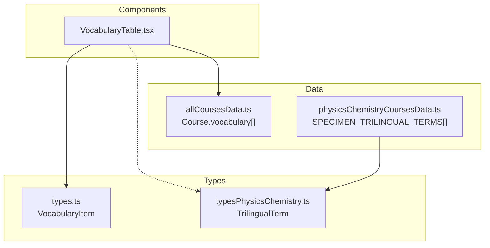
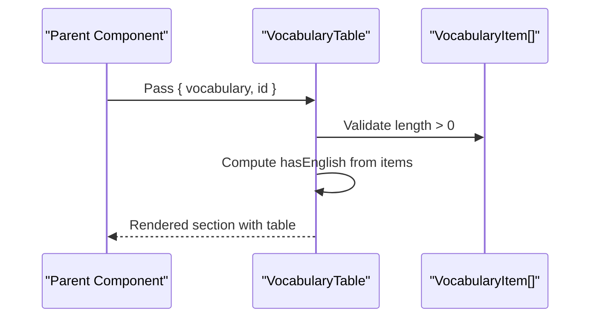
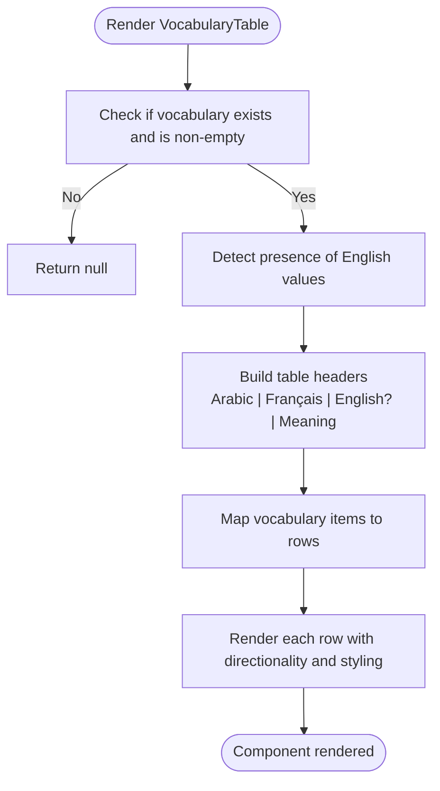
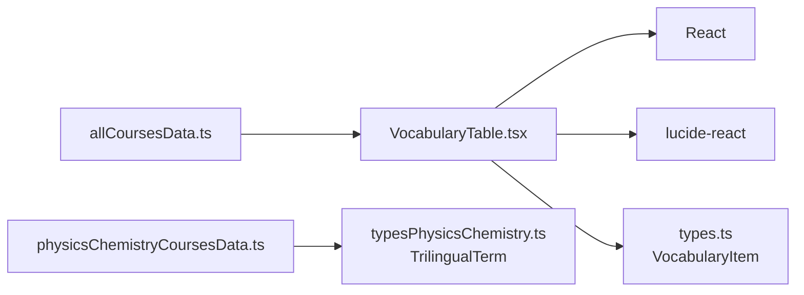

# Vocabulary Table Component

<cite>
**Referenced Files in This Document**
- [VocabularyTable.tsx](file://src/components/VocabularyTable.tsx)
- [types.ts](file://src/types.ts)
- [allCoursesData.ts](file://src/data/allCoursesData.ts)
- [typesPhysicsChemistry.ts](file://src/typesPhysicsChemistry.ts)
- [physicsChemistryCoursesData.ts](file://src/data/physicsChemistryCoursesData.ts)
</cite>

## Table of Contents
1. [Introduction](#introduction)
2. [Project Structure](#project-structure)
3. [Core Components](#core-components)
4. [Architecture Overview](#architecture-overview)
5. [Detailed Component Analysis](#detailed-component-analysis)
6. [Dependency Analysis](#dependency-analysis)
7. [Performance Considerations](#performance-considerations)
8. [Troubleshooting Guide](#troubleshooting-guide)
9. [Conclusion](#conclusion)
10. [Appendices](#appendices)

## Introduction
The VocabularyTable component is a structured, responsive display for educational vocabulary terms with definitions and examples. It presents trilingual content (Arabic, French, and optional English) alongside pedagogical explanations to support precise understanding and cross-language reference. The component renders a clean table with right-to-left Arabic text and left-to-right Latin script columns, adapting its layout for mobile devices.

## Project Structure
This documentation focuses on the VocabularyTable component and its data model:
- Component implementation: src/components/VocabularyTable.tsx
- Data types: src/types.ts
- Sample course datasets: src/data/allCoursesData.ts
- Physics/chemistry domain types and specimen data: src/typesPhysicsChemistry.ts, src/data/physicsChemistryCoursesData.ts

**Diagram sources**
- [VocabularyTable.tsx:1-83](file://src/components/VocabularyTable.tsx#L1-L83)
- [types.ts:28-33](file://src/types.ts#L28-L33)
- [allCoursesData.ts:184-188](file://src/data/allCoursesData.ts#L184-L188)
- [typesPhysicsChemistry.ts:12-18](file://src/typesPhysicsChemistry.ts#L12-L18)
- [physicsChemistryCoursesData.ts:6163-6186](file://src/data/physicsChemistryCoursesData.ts#L6163-L6186)

**Section sources**
- [VocabularyTable.tsx:1-83](file://src/components/VocabularyTable.tsx#L1-L83)
- [types.ts:28-33](file://src/types.ts#L28-L33)
- [allCoursesData.ts:184-188](file://src/data/allCoursesData.ts#L184-L188)
- [typesPhysicsChemistry.ts:12-18](file://src/typesPhysicsChemistry.ts#L12-L18)
- [physicsChemistryCoursesData.ts:6163-6186](file://src/data/physicsChemistryCoursesData.ts#L6163-L6186)

## Core Components
- VocabularyTable: Renders a sectioned vocabulary table with Arabic, French, optional English, and meaning columns. It conditionally shows the English column when any item includes an English value.
- VocabularyItem: The data contract used by the component for each vocabulary entry.

Key responsibilities:
- Render a responsive table with proper directionality for Arabic and Latin scripts.
- Hide the English column if no items provide English translations.
- Provide a safe early return when no vocabulary data is present.

**Section sources**
- [VocabularyTable.tsx:5-16](file://src/components/VocabularyTable.tsx#L5-L16)
- [types.ts:28-33](file://src/types.ts#L28-L33)

## Architecture Overview
The component consumes a typed array of vocabulary items and outputs a semantic HTML table wrapped in a styled container. It does not implement internal state or external API calls; rendering is purely driven by props.

**Diagram sources**
- [VocabularyTable.tsx:10-16](file://src/components/VocabularyTable.tsx#L10-L16)
- [VocabularyTable.tsx:18-80](file://src/components/VocabularyTable.tsx#L18-L80)

## Detailed Component Analysis

### Props and Data Model
- Props
  - vocabulary: Array of VocabularyItem objects.
  - id: Optional DOM id for the root section element.
- Data model
  - VocabularyItem fields: arabic, french, english (optional), meaning.

Rendering behavior:
- If vocabulary is empty or null, the component returns null.
- The English column header is shown only if at least one item has an English value.
- Each row displays:
  - Arabic term (right-aligned).
  - French term (left-aligned, monospace style).
  - English term (left-aligned, monospace style) when available; otherwise a neutral placeholder.
  - Meaning/explanation (right-aligned, readable width).

Accessibility considerations:
- Semantic <section>, <table>, <thead>, <tbody>, <th>, and <td> elements are used.
- Direction attributes ensure correct reading order for Arabic and Latin text.
- No interactive controls are present; screen readers will announce the table structure and cell contents.

Responsive design:
- The table container uses horizontal overflow to enable scrolling on small screens.
- Text sizes scale between xs and sm breakpoints.
- Columns use whitespace control to prevent unwanted wrapping for short terms.

Styling approach:
- Uses utility classes for spacing, borders, colors, and typography.
- Hover states improve row readability.
- Distinct color-coded badges highlight French and English terms.

Customization options:
- Override CSS via Tailwind utilities applied to the component’s wrapper and table elements.
- Adjust column visibility by controlling whether items include English values.
- Change the root section id through the id prop.

Sorting and filtering:
- Not implemented in this component. Sorting/filtering would require additional state and handlers.

Multilingual support:
- Arabic content is displayed with right-to-left alignment.
- French and English columns are explicitly set to left-to-right direction.
- The component supports optional English translations.

Integration patterns:
- Consume a Course object’s vocabulary field and pass it to the component.
- For physics/chemistry domains, map TrilingualTerm arrays to VocabularyItem where needed.

**Diagram sources**
- [VocabularyTable.tsx:14-16](file://src/components/VocabularyTable.tsx#L14-L16)
- [VocabularyTable.tsx:34-77](file://src/components/VocabularyTable.tsx#L34-L77)

**Section sources**
- [VocabularyTable.tsx:5-16](file://src/components/VocabularyTable.tsx#L5-L16)
- [VocabularyTable.tsx:18-80](file://src/components/VocabularyTable.tsx#L18-L80)
- [types.ts:28-33](file://src/types.ts#L28-L33)

### Data Structures and Examples

#### VocabularyItem
- Fields:
  - arabic: string
  - french: string
  - english?: string
  - meaning: string

Example dataset snippet path:
- [allCoursesData.ts:184-188](file://src/data/allCoursesData.ts#L184-L188)

#### TrilingualTerm (domain-specific)
- Fields:
  - arabic: string
  - french: string
  - english?: string
  - explanation?: string
  - symbolOrFormula?: string

Example dataset snippet path:
- [physicsChemistryCoursesData.ts:6163-6186](file://src/data/physicsChemistryCoursesData.ts#L6163-L6186)

Mapping note:
- When integrating physics/chemistry data, map TrilingualTerm to VocabularyItem by aligning fields (e.g., explanation → meaning).

**Section sources**
- [types.ts:28-33](file://src/types.ts#L28-L33)
- [allCoursesData.ts:184-188](file://src/data/allCoursesData.ts#L184-L188)
- [typesPhysicsChemistry.ts:12-18](file://src/typesPhysicsChemistry.ts#L12-L18)
- [physicsChemistryCoursesData.ts:6163-6186](file://src/data/physicsChemistryCoursesData.ts#L6163-L6186)

## Dependency Analysis
- Internal dependencies:
  - React and lucide-react icon library for the language icon.
  - VocabularyItem type from the shared types module.
- External data:
  - Course vocabulary arrays from allCoursesData.ts.
  - Domain-specific specimen terms from physicsChemistryCoursesData.ts.

**Diagram sources**
- [VocabularyTable.tsx:1-3](file://src/components/VocabularyTable.tsx#L1-L3)
- [types.ts:28-33](file://src/types.ts#L28-L33)
- [allCoursesData.ts:184-188](file://src/data/allCoursesData.ts#L184-L188)
- [typesPhysicsChemistry.ts:12-18](file://src/typesPhysicsChemistry.ts#L12-L18)
- [physicsChemistryCoursesData.ts:6163-6186](file://src/data/physicsChemistryCoursesData.ts#L6163-L6186)

**Section sources**
- [VocabularyTable.tsx:1-3](file://src/components/VocabularyTable.tsx#L1-L3)
- [types.ts:28-33](file://src/types.ts#L28-L33)
- [allCoursesData.ts:184-188](file://src/data/allCoursesData.ts#L184-L188)
- [typesPhysicsChemistry.ts:12-18](file://src/typesPhysicsChemistry.ts#L12-L18)
- [physicsChemistryCoursesData.ts:6163-6186](file://src/data/physicsChemistryCoursesData.ts#L6163-L6186)

## Performance Considerations
- Rendering cost is proportional to the number of vocabulary items; mapping rows is O(n).
- Conditional English column detection scans the array once (O(n)) to determine header visibility.
- No heavy computations or side effects; suitable for frequent re-renders within larger course views.
- Styling relies on utility classes; avoid excessive inline styles to keep bundle size minimal.

[No sources needed since this section provides general guidance]

## Troubleshooting Guide
Common issues and resolutions:
- Empty table: Ensure vocabulary is a non-empty array; the component returns null otherwise.
- Missing English column: The English column appears only if at least one item includes an English value. Add english fields to your dataset to show the column.
- Directionality problems: Verify that Arabic content remains right-aligned and Latin content left-aligned; do not override dir attributes unintentionally.
- Long meanings wrapping: Adjust min-width or line-height in custom styles if the meaning column wraps unexpectedly on narrow screens.
- Integration mismatches: When using TrilingualTerm, map explanation to meaning and omit unsupported fields to match VocabularyItem.

**Section sources**
- [VocabularyTable.tsx:14-16](file://src/components/VocabularyTable.tsx#L14-L16)
- [VocabularyTable.tsx:34-77](file://src/components/VocabularyTable.tsx#L34-L77)

## Conclusion
The VocabularyTable component offers a clear, accessible, and responsive way to present trilingual vocabulary with pedagogical explanations. It integrates seamlessly with course datasets, adapts to device widths, and supports Arabic and Latin scripts. While sorting and filtering are not built-in, the component’s simple prop-driven design makes it easy to extend with additional features as needed.

[No sources needed since this section summarizes without analyzing specific files]

## Appendices

### Column Configuration Options
- Arabic column: Always visible, right-aligned.
- French column: Always visible, left-aligned, monospace style.
- English column: Conditionally visible based on dataset.
- Meaning column: Always visible, right-aligned, optimized for readability.

**Section sources**
- [VocabularyTable.tsx:34-77](file://src/components/VocabularyTable.tsx#L34-L77)

### Responsive Design Notes
- Horizontal scroll container ensures usability on small screens.
- Typography scales across breakpoints.
- Row hover improves focusability and scanning.

**Section sources**
- [VocabularyTable.tsx:34-77](file://src/components/VocabularyTable.tsx#L34-L77)

### Accessibility Notes
- Semantic HTML elements enhance screen reader navigation.
- Explicit direction attributes improve reading order for mixed scripts.
- No interactive controls reduce complexity for assistive technologies.

**Section sources**
- [VocabularyTable.tsx:34-77](file://src/components/VocabularyTable.tsx#L34-L77)

### Multilingual Support
- Arabic content aligned right-to-left.
- French and English columns aligned left-to-right.
- Optional English translations supported.

**Section sources**
- [VocabularyTable.tsx:34-77](file://src/components/VocabularyTable.tsx#L34-L77)

### Example Datasets
- Mathematics vocabulary example:
  - [allCoursesData.ts:184-188](file://src/data/allCoursesData.ts#L184-L188)
- Physics/chemistry specimen terms:
  - [physicsChemistryCoursesData.ts:6163-6186](file://src/data/physicsChemistryCoursesData.ts#L6163-L6186)

**Section sources**
- [allCoursesData.ts:184-188](file://src/data/allCoursesData.ts#L184-L188)
- [physicsChemistryCoursesData.ts:6163-6186](file://src/data/physicsChemistryCoursesData.ts#L6163-L6186)

### Customization Guidelines
- Use Tailwind utilities to adjust spacing, colors, and typography.
- Control English column visibility by including english fields in the dataset.
- Set a custom id for the root section to anchor navigation or tests.

**Section sources**
- [VocabularyTable.tsx:18-80](file://src/components/VocabularyTable.tsx#L18-L80)